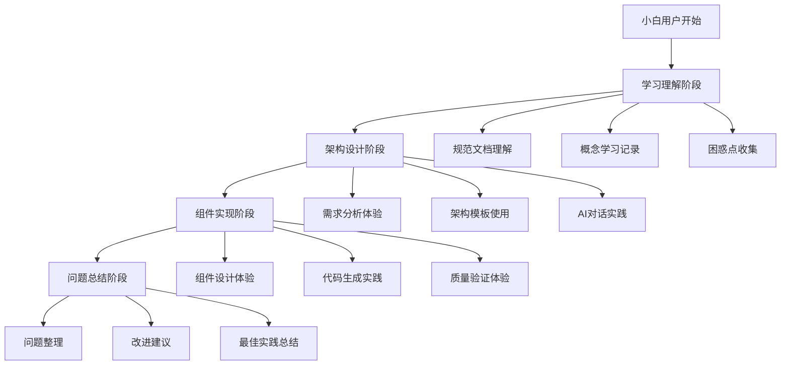

# 设计文档：模拟小白用户使用React组件规范开发SaaS项目体验

## 概述

本设计文档描述了如何模拟一个没有技术基础的小白用户使用现有React组件架构设计规范和组件设计规范开发TaskFlow Mini任务管理SaaS项目的完整技术实现方案。

整个模拟体验将分为四个主要阶段：学习理解、架构设计、组件实现、问题总结。每个阶段都会从小白用户的角度记录遇到的问题、困惑点和解决方案。

## 指导文档对齐

### 技术标准 (现有规范)
设计遵循以下现有技术规范：
- React组件架构设计规范（简化版）- 用于整体架构设计
- React组件设计规范（简化版）- 用于具体组件实现  
- 渐进式采用指南 - 阶段1核心规范，适合小白用户
- AI对话模板 - 提供标准化的AI交互方式

### 项目结构 (基于现有模板)
实现将遵循现有项目组织约定：
- 使用模板1：基础Web应用架构作为目录结构
- 采用页面组件 + 共享组件模式
- 遵循React 18.3.1和Next.js App Router最佳实践

## 代码复用分析

由于这是一个模拟体验项目，我们将最大程度地利用现有规范中的资源：

### 现有组件要利用
- **AI对话模板**: 用于指导小白用户与AI进行有效交互
- **简化版架构模板**: 提供快速架构设计的基础框架
- **组件生成器**: 用于自动生成符合规范的组件代码
- **验证规则工具**: 确保生成的组件质量

### 集成点
- **现有规范文档系统**: 模拟体验将直接使用现有的文档和模板
- **工具链**: 集成现有的代码生成器、验证器等工具
- **示例代码库**: 参考现有的组件示例和最佳实践

## 架构

整个模拟体验系统采用分阶段、渐进式的设计模式，确保小白用户能够逐步理解和应用规范。

### 模块化设计原则
- **单文件职责**: 每个阶段的体验记录独立成文件，便于分析和总结
- **组件隔离**: 将模拟体验分解为独立的小任务，降低复杂度
- **服务层分离**: 分离学习、实践、总结三个层面的活动
- **工具模块化**: 为小白用户提供专门的工具和检查清单



## 组件和接口

### 阶段1：学习理解模块
- **目的**: 模拟小白用户首次接触规范文档的学习过程
- **接口**: 提供文档阅读指导、概念解释、学习路径规划
- **依赖**: 现有的规范文档、简化版指南、AI对话模板
- **复用**: 利用现有的非技术人员指南和AI开发模板

### 阶段2：架构设计模块
- **目的**: 模拟小白用户使用架构设计规范进行项目架构设计
- **接口**: 提供需求分析、架构模板选择、组件识别流程
- **依赖**: React组件架构设计规范、架构生成器工具
- **复用**: 现有的快速架构设计模板和AI对话模板

### 阶段3：组件实现模块  
- **目的**: 模拟小白用户使用组件设计规范实现具体组件
- **接口**: 提供组件生成、代码实现、质量验证流程
- **依赖**: React组件设计规范、组件生成器、验证工具
- **复用**: 现有的组件模板、代码生成器、验证规则

### 阶段4：问题总结模块
- **目的**: 收集整理模拟过程中发现的问题和改进建议
- **接口**: 提供问题分类、影响评估、解决方案设计
- **依赖**: 前三个阶段的体验记录和问题收集
- **复用**: 现有的检查清单和最佳实践文档

## 数据模型

### 体验记录模型
```typescript
interface ExperienceRecord {
  id: string;
  stage: 'learning' | 'architecture' | 'implementation' | 'summary';
  timestamp: Date;
  userAction: string;
  difficulty: 'easy' | 'medium' | 'hard' | 'blocked';
  timeSpent: number; // 分钟
  issuesEncountered: Issue[];
  successfulOutcome: boolean;
  notes: string;
}
```

### 问题记录模型
```typescript
interface Issue {
  id: string;
  type: 'confusion' | 'error' | 'missing_info' | 'process_gap';
  severity: 'low' | 'medium' | 'high' | 'critical';
  description: string;
  context: string;
  suggestedSolution?: string;
  impactOnUser: string;
  category: 'documentation' | 'tooling' | 'process' | 'templates';
}
```

### 改进建议模型
```typescript
interface ImprovementSuggestion {
  id: string;
  targetArea: 'docs' | 'templates' | 'tools' | 'process';
  priority: 'low' | 'medium' | 'high';
  description: string;
  expectedBenefit: string;
  implementationEffort: 'low' | 'medium' | 'high';
  affectedUserTypes: string[];
}
```

## 错误处理

### 错误场景

1. **学习阶段：概念理解困难**
   - **处理**: 记录具体的困惑点，提供更通俗的解释建议
   - **用户影响**: 学习进度缓慢，可能产生挫败感

2. **架构设计阶段：不知道如何开始**  
   - **处理**: 记录决策困难点，评估现有指导的完整性
   - **用户影响**: 可能无法继续进行，需要额外帮助

3. **组件实现阶段：生成的代码不理解**
   - **处理**: 记录代码理解障碍，评估代码注释和文档需求
   - **用户影响**: 无法修改和维护生成的代码

4. **AI交互困难：不知道如何提问**
   - **处理**: 记录AI对话中的沟通障碍，优化对话模板
   - **用户影响**: AI协作效果差，开发效率低

## 测试策略

### 模拟用户体验测试
- 严格按照小白用户的角度进行每个步骤
- 记录每个操作的时间消耗和难度感受
- 收集所有的疑问和卡点

### 文档易用性测试
- 评估现有文档对非技术人员的友好程度
- 测试AI对话模板的实际效果
- 验证示例代码的可理解性

### 工具可用性测试
- 测试组件生成器对小白用户的适用性
- 验证验证规则工具的输出是否易懂
- 评估错误信息的用户友好程度

### 端到端流程测试
- 完整走通从需求到部署的全流程
- 识别流程中的断点和改进机会
- 验证最终产出的质量和可用性

## 成功指标

### 定量指标
- 完成每个阶段的时间消耗
- 遇到阻塞问题的数量和类型
- 需要外部帮助的频次
- 最终代码质量评分

### 定性指标  
- 用户体验的整体满意度
- 规范文档的易理解程度
- AI协作的有效性
- 学习曲线的平缓程度

### 改进效果指标
- 识别的问题数量和严重程度
- 提出的改进建议的可行性
- 对未来小白用户的帮助价值
- 规范优化的方向和重点