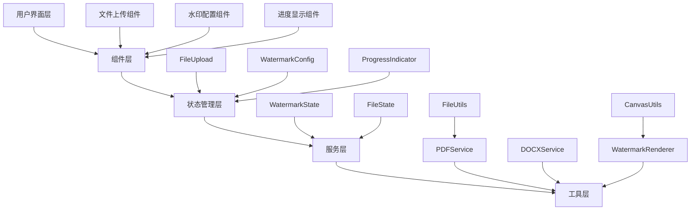

# Design Document

## Overview

本设计文档详细说明如何将现有的水印产品从原生HTML/JavaScript架构迁移到React + Vite的现代前端架构。设计目标是保持所有原有功能的同时，提供更好的代码组织、可维护性和开发体验。

## Steering Document Alignment

### Technical Standards (tech.md)
由于项目没有现有的技术文档，本设计将遵循React和现代前端开发的最佳实践：
- 使用TypeScript提供类型安全
- 采用函数式组件和Hooks
- 使用TailwindCSS进行样式管理
- 实施组件驱动开发

### Project Structure (structure.md)
项目将采用标准的React项目结构，按功能模块组织代码：
- `src/components/` - 可复用的UI组件
- `src/hooks/` - 自定义Hooks
- `src/services/` - 业务逻辑服务
- `src/utils/` - 工具函数
- `src/types/` - TypeScript类型定义

## Code Reuse Analysis

### Existing Components to Leverage
- **原始水印处理逻辑**: 将现有的PDFLib和Mammoth处理逻辑封装为React服务
- **文件上传功能**: 重构为React组件，保持相同的用户体验
- **水印配置UI**: 转换为受控组件，使用React状态管理

### Integration Points
- **PDFLib库**: 封装为PDF处理服务
- **Mammoth库**: 封装为DOCX处理服务
- **Canvas API**: 用于水印渲染和预览

## Architecture

### 整体架构设计



### Modular Design Principles
- **Single File Responsibility**: 每个组件文件负责单一功能
- **Component Isolation**: 创建小型、专注的组件
- **Service Layer Separation**: 分离数据访问、业务逻辑和展示层
- **Utility Modularity**: 将工具函数分解为专注的单一用途模块

## Components and Interfaces

### 组件1: FileUpload
- **Purpose:** 处理文件选择、验证和预览
- **Interfaces:** 
  - `onFileSelect(file: File): void`
  - `reset(): void`
- **Dependencies:** 无
- **Reuses:** 文件类型验证工具函数

### 组件2: WatermarkConfig
- **Purpose:** 水印参数配置界面
- **Interfaces:**
  - `onConfigChange(config: WatermarkConfig): void`
  - `getConfig(): WatermarkConfig`
- **Dependencies:** 状态管理
- **Reuses:** 颜色选择器组件

### 组件3: ProgressIndicator
- **Purpose:** 显示处理进度和状态
- **Interfaces:**
  - `updateProgress(percent: number, status: string): void`
  - `showError(message: string): void`
  - `showSuccess(message: string): void`
- **Dependencies:** 无
- **Reuses:** 动画效果

### 服务1: PDFService
- **Purpose:** PDF文件处理和水印添加
- **Interfaces:**
  - `processPDF(file: File, config: WatermarkConfig): Promise<Blob>`
  - `validatePDF(file: File): boolean`
- **Dependencies:** PDFLib库
- **Reuses:** 文件处理工具

### 服务2: DOCXService
- **Purpose:** DOCX文件处理和转换
- **Interfaces:**
  - `processDOCX(file: File, config: WatermarkConfig): Promise<Blob>`
  - `validateDOCX(file: File): boolean`
- **Dependencies:** Mammoth库、PDFLib库
- **Reuses:** 文件处理工具

## Data Models

### WatermarkConfig
```typescript
interface WatermarkConfig {
  text: string;           // 水印文字
  fontSize: number;       // 字体大小 (24, 36, 48, 60)
  opacity: number;        // 透明度 (0.1-0.9)
  rotation: number;       // 旋转角度 (-45到45)
  color: string;          // 颜色值 (hex)
}
```

### FileState
```typescript
interface FileState {
  selectedFile: File | null;
  fileInfo: {
    name: string;
    size: string;
    type: string;
  } | null;
  isProcessing: boolean;
  progress: number;
  status: string;
  error: string | null;
  success: string | null;
}
```

### ProcessingResult
```typescript
interface ProcessingResult {
  success: boolean;
  processedFile: Blob | null;
  downloadUrl: string | null;
  error: string | null;
  processingTime: number;
}
```

## Error Handling

### Error Scenarios
1. **文件格式不支持**
   - **Handling:** 显示友好的错误消息，提示支持的格式
   - **User Impact:** 用户看到清晰的错误提示，可以重新选择文件

2. **文件处理失败**
   - **Handling:** 捕获异常，显示具体的错误信息
   - **User Impact:** 用户了解失败原因，可以重试或选择其他文件

3. **网络库加载失败**
   - **Handling:** 检查依赖库可用性，提供降级方案
   - **User Impact:** 用户看到系统错误，可能需要刷新页面

4. **内存不足**
   - **Handling:** 实现文件大小限制和分块处理
   - **User Impact:** 大文件处理时得到进度反馈

## Testing Strategy

### 分层测试策略

#### 第一层：单元测试 (无浏览器环境)
**目标**: 测试最小的代码单元，不依赖浏览器  
**工具**: Jest + React Testing Library  
**覆盖范围**:
- 组件逻辑测试
- 工具函数测试  
- 服务类方法测试
- 状态管理测试

**测试示例**:
```typescript
// 工具函数测试
describe('fileUtils', () => {
  test('should validate file type correctly', () => {
    const mockPdfFile = new File(['test'], 'test.pdf', { type: 'application/pdf' });
    expect(validateFileType(mockPdfFile, ['application/pdf'])).toBe(true);
  });
  
  test('should reject invalid file types', () => {
    const mockImageFile = new File(['test'], 'test.jpg', { type: 'image/jpeg' });
    expect(validateFileType(mockImageFile, ['application/pdf'])).toBe(false);
  });
});

// 组件Hook测试
describe('useWatermarkConfig', () => {
  test('should update config correctly', () => {
    const { result } = renderHook(() => useWatermarkConfig());
    
    act(() => {
      result.current.updateConfig({ text: '测试水印' });
    });
    
    expect(result.current.config.text).toBe('测试水印');
  });
});
```

#### 第二层：集成测试 (模拟浏览器环境)
**目标**: 测试组件间的交互和集成  
**工具**: Jest + React Testing Library (jsdom环境)  
**覆盖范围**:
- 组件间数据流
- 用户交互流程
- 状态变更响应
- 错误处理集成

**测试示例**:
```typescript
// 组件集成测试
describe('WatermarkFlow Integration', () => {
  test('should complete file upload to config flow', () => {
    render(<WatermarkTool />);
    
    // 模拟文件上传
    const fileInput = screen.getByLabelText(/选择文件/i);
    const mockFile = new File(['test content'], 'test.pdf', { type: 'application/pdf' });
    fireEvent.change(fileInput, { target: { files: [mockFile] } });
    
    // 验证配置区域显示
    expect(screen.getByLabelText(/水印文字/i)).toBeInTheDocument();
    
    // 模拟配置更改
    const textInput = screen.getByLabelText(/水印文字/i);
    fireEvent.change(textInput, { target: { value: '测试水印' } });
    
    // 验证状态更新
    expect(screen.getByDisplayValue('测试水印')).toBeInTheDocument();
  });
  
  test('should show error for invalid file type', () => {
    render(<WatermarkTool />);
    
    const fileInput = screen.getByLabelText(/选择文件/i);
    const invalidFile = new File(['test'], 'test.jpg', { type: 'image/jpeg' });
    fireEvent.change(fileInput, { target: { files: [invalidFile] } });
    
    expect(screen.getByText(/不支持的文件格式/i)).toBeInTheDocument();
  });
});
```

#### 第三层：E2E测试 (真实浏览器环境)
**目标**: 端到端用户场景测试  
**工具**: Playwright  
**覆盖范围**:
- 完整用户流程
- 跨浏览器兼容性
- 真实文件处理
- 用户体验验证

**测试示例**:
```typescript
// Playwright E2E测试
describe('Watermark Tool E2E', () => {
  test('should complete full watermark workflow', async ({ page }) => {
    await page.goto('/watermark-tool');
    
    // 文件上传
    await page.setInputFiles('input[type="file"]', 'test-files/sample.pdf');
    await expect(page.locator('.file-info')).toBeVisible();
    
    // 配置水印
    await page.fill('#watermarkText', '机密文件');
    await page.selectOption('#fontSize', '36');
    await page.selectOption('#opacity', '0.3');
    
    // 处理文件
    await page.click('#generateBtn');
    await expect(page.locator('.progress-fill')).toBeVisible();
    
    // 等待完成
    await expect(page.locator('.success-message')).toBeVisible({ timeout: 30000 });
    
    // 验证下载
    const downloadPromise = page.waitForEvent('download');
    await page.click('.download-btn');
    const download = await downloadPromise;
    expect(download.suggestedFilename()).toMatch(/watermarked_.*\.pdf/);
  });
  
  test('should handle file validation errors', async ({ page }) => {
    await page.goto('/watermark-tool');
    
    // 上传不支持的文件类型
    await page.setInputFiles('input[type="file"]', 'test-files/invalid.jpg');
    
    // 验证错误消息
    await expect(page.locator('.error-message')).toBeVisible();
    await expect(page.locator('.error-message')).toHaveText(/不支持的文件格式/);
  });
});
```

### 测试执行策略
1. **开发阶段**: 单元测试 (实时运行，快速反馈)
2. **功能完成**: 集成测试 (验证组件协作)  
3. **发布前**: E2E测试 (完整用户场景验证)

### 测试覆盖率目标
- **单元测试**: ≥80% 代码覆盖率
- **集成测试**: ≥60% 关键流程覆盖率
- **E2E测试**: ≥90% 核心用户场景覆盖率

## Build and Deployment Configuration

### Vite Configuration
```typescript
// vite.config.ts
export default defineConfig({
  build: {
    target: 'es2020',
    rollupOptions: {
      output: {
        manualChunks: {
          'watermark-core': ['./src/services/watermarkService'],
          'pdf-processing': ['./src/services/pdfService'],
          'docx-processing': ['./src/services/docxService'],
          'ui-components': ['./src/components']
        }
      }
    }
  }
});
```

### Dependencies Management
```json
{
  "dependencies": {
    "react": "^18.0.0",
    "react-dom": "^18.0.0",
    "pdf-lib": "^1.17.1",
    "mammoth": "^1.7.1",
    "zustand": "^4.4.0"
  },
  "devDependencies": {
    "@types/react": "^18.0.0",
    "@types/react-dom": "^18.0.0",
    "@vitejs/plugin-react": "^4.0.0",
    "typescript": "^5.0.0",
    "tailwindcss": "^3.0.0",
    "vitest": "^0.34.0",
    "@testing-library/react": "^13.0.0",
    "@testing-library/jest-dom": "^5.0.0",
    "@playwright/test": "^1.35.0"
  }
}
```

This design ensures a comprehensive migration strategy that maintains all original functionality while providing a modern, maintainable codebase architecture with thorough testing coverage.