# 组件架构图表文档

> **版本**:[1.0.0]  
> **创建时间**: [2025-08-30]  
> **文档类型**: 组件架构设计  
> **适用范围**: [长截图分割工具前端架构] 

## 📋 文档概览

本文档提供了[长截图分割工具]的详细组件架构图表，包括组件层次结构、数据流向、状态管理架构和交互模式。通过可视化图表帮助开发团队理解系统的组件组织方式和协作模式。

---

## 🏗️ 整体组件架构图

### 应用组件层次结构

参考示例:
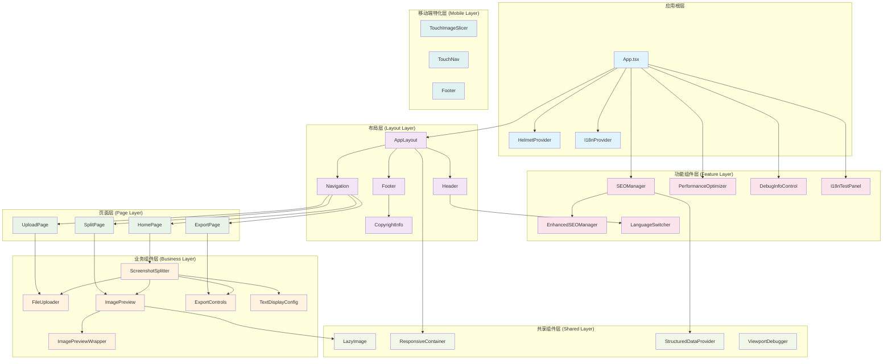

---

## 🔄 数据流架构图

### 状态管理和数据流

参考示例:

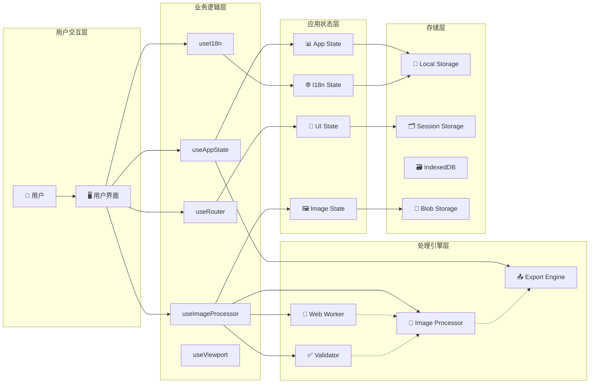

### 组件间通信模式

参考示例:

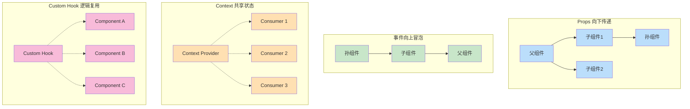

---

## 🧩 核心组件详细架构

### [ScreenshotSplitter] 组件架构

参考示例:
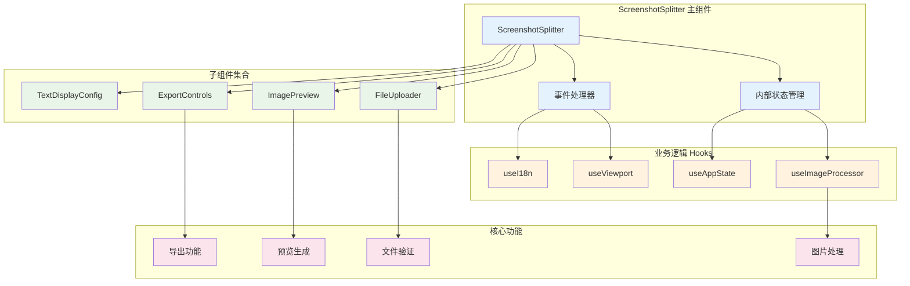

### ImagePreview 组件内部架构

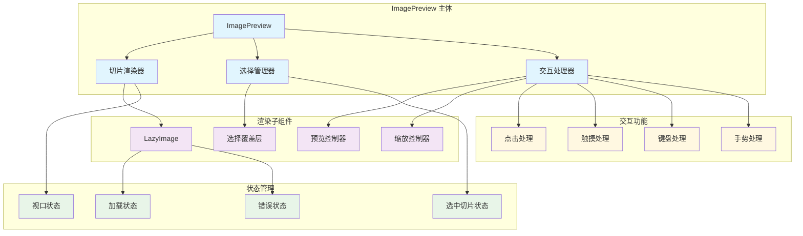

---

## 🎣 Hook 架构设计

### 自定义 Hook 依赖关系

参考示例:

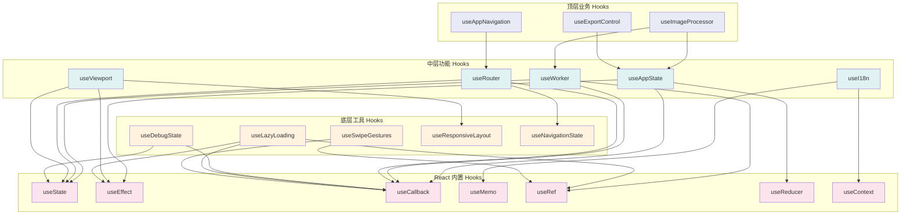

### Hook 数据流架构

参考示例:

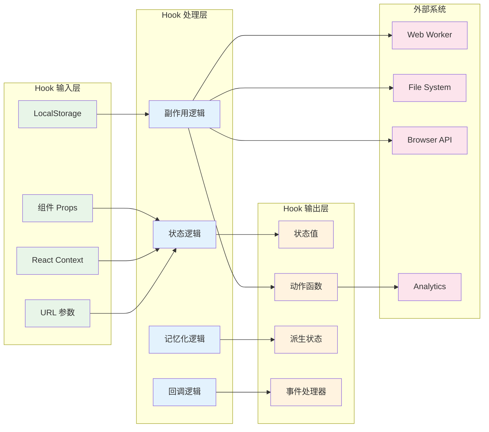

---

## 📱 响应式架构设计

### 响应式组件适配模式

参考示例:

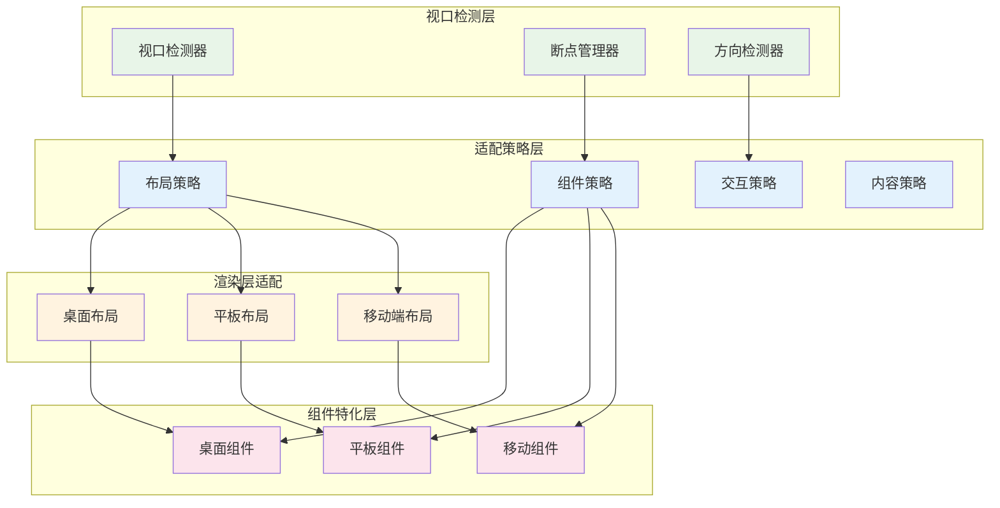

### 移动端特化组件架构

参考示例:

```mermaid
graph TB
    subgraph "移动端容器"
        MobileWrapper[移动端包装器]
        TouchOptimizer[触摸优化器]
        GestureRecognizer[手势识别器]
    end

    subgraph "移动端专用组件"
        TouchImageSlicer2[TouchImageSlicer]
        TouchNav2[TouchNav]
        MobileFooter2[MobileFooter]
        SwipeableCard[可滑动卡片]
    end

    subgraph "触摸交互层"
        TapHandler[点击处理]
        PinchHandler[捏合处理]
        SwipeHandler[滑动处理]
        LongPressHandler[长按处理]
    end

    subgraph "移动端优化"
        LazyRenderer[懒渲染器]
        MemoryOptimizer[内存优化器]
        BatteryOptimizer[电池优化器]
        NetworkOptimizer[网络优化器]
    end

    MobileWrapper --> TouchOptimizer
    MobileWrapper --> GestureRecognizer

    TouchOptimizer --> TouchImageSlicer2
    TouchOptimizer --> TouchNav2
    TouchOptimizer --> MobileFooter2
    GestureRecognizer --> SwipeableCard

    GestureRecognizer --> TapHandler
    GestureRecognizer --> PinchHandler
    GestureRecognizer --> SwipeHandler
    GestureRecognizer --> LongPressHandler

    TouchOptimizer --> LazyRenderer
    TouchOptimizer --> MemoryOptimizer
    TouchOptimizer --> BatteryOptimizer
    TouchOptimizer --> NetworkOptimizer

    classDef containerLayer fill:#e8f5e8
    classDef componentLayer fill:#e3f2fd
    classDef interactionLayer fill:#fff3e0
    classDef optimizationLayer fill:#fce4ec

    class MobileWrapper,TouchOptimizer,GestureRecognizer containerLayer
    class TouchImageSlicer2,TouchNav2,MobileFooter2,SwipeableCard componentLayer
    class TapHandler,PinchHandler,SwipeHandler,LongPressHandler interactionLayer
    class LazyRenderer,MemoryOptimizer,BatteryOptimizer,NetworkOptimizer optimizationLayer
```

---

## 🔧 状态管理架构

### 全局状态架构

参考示例:

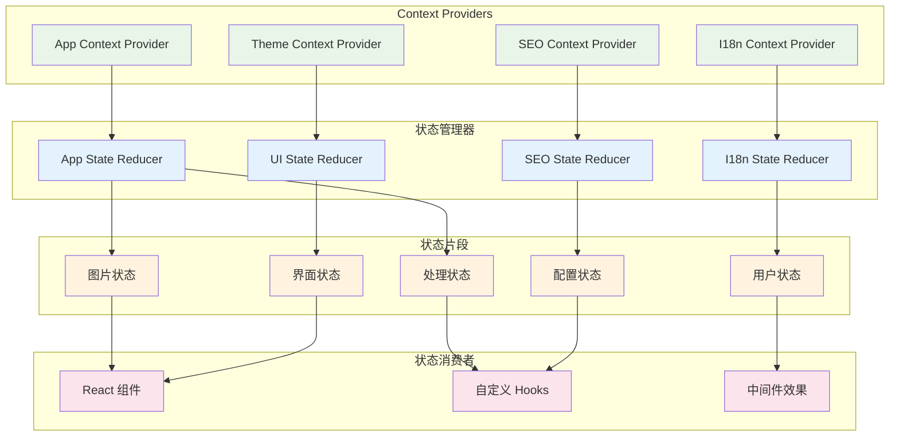

### 状态更新流程

参考示例:

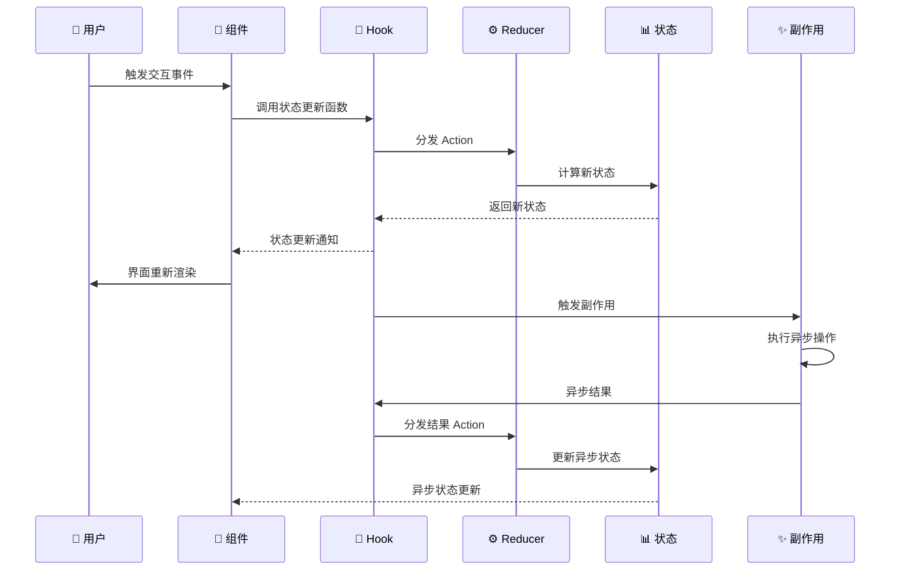

---

## 🚀 性能优化架构

### 组件渲染优化策略

参考示例:

```mermaid
graph TB
    subgraph "渲染优化策略"
        Memoization[记忆化优化]
        Virtualization[虚拟化渲染]
        LazyLoading2[懒加载策略]
        CodeSplitting2[代码分割]
    end

    subgraph "记忆化技术"
        ReactMemo2[React.memo]
        UseMemo2[useMemo]
        UseCallback2[useCallback]
        CustomMemo[自定义记忆化]
    end

    subgraph "虚拟化技术"
        WindowedList[窗口化列表]
        InfiniteScroll[无限滚动]
        ViewportCulling[视口剔除]
    end

    subgraph "加载策略"
        ComponentLazy[组件懒加载]
        ImageLazy[图片懒加载]
        DataLazy[数据懒加载]
        RouteLazy[路由懒加载]
    end

    subgraph "分割策略"
        RouteBasedSplitting[路由分割]
        ComponentBasedSplitting[组件分割]
        FeatureBasedSplitting[功能分割]
        VendorSplitting[第三方库分割]
    end

    Memoization --> ReactMemo2
    Memoization --> UseMemo2
    Memoization --> UseCallback2
    Memoization --> CustomMemo

    Virtualization --> WindowedList
    Virtualization --> InfiniteScroll
    Virtualization --> ViewportCulling

    LazyLoading2 --> ComponentLazy
    LazyLoading2 --> ImageLazy
    LazyLoading2 --> DataLazy
    LazyLoading2 --> RouteLazy

    CodeSplitting2 --> RouteBasedSplitting
    CodeSplitting2 --> ComponentBasedSplitting
    CodeSplitting2 --> FeatureBasedSplitting
    CodeSplitting2 --> VendorSplitting

    classDef strategyLayer fill:#e8f5e8
    classDef memoLayer fill:#e3f2fd
    classDef virtualLayer fill:#fff3e0
    classDef lazyLayer fill:#fce4ec
    classDef splittingLayer fill:#f3e5f5

    class Memoization,Virtualization,LazyLoading2,CodeSplitting2 strategyLayer
    class ReactMemo2,UseMemo2,UseCallback2,CustomMemo memoLayer
    class WindowedList,InfiniteScroll,ViewportCulling virtualLayer
    class ComponentLazy,ImageLazy,DataLazy,RouteLazy lazyLayer
    class RouteBasedSplitting,ComponentBasedSplitting,FeatureBasedSplitting,VendorSplitting splittingLayer
```

### Web Worker 并行处理架构

参考示例:

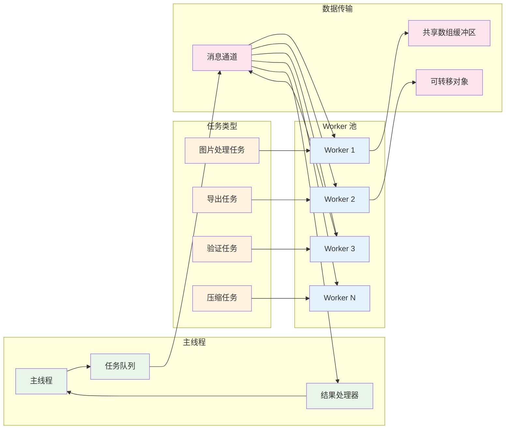

---

## 🔍 错误处理架构

### 错误边界和恢复策略

参考示例:

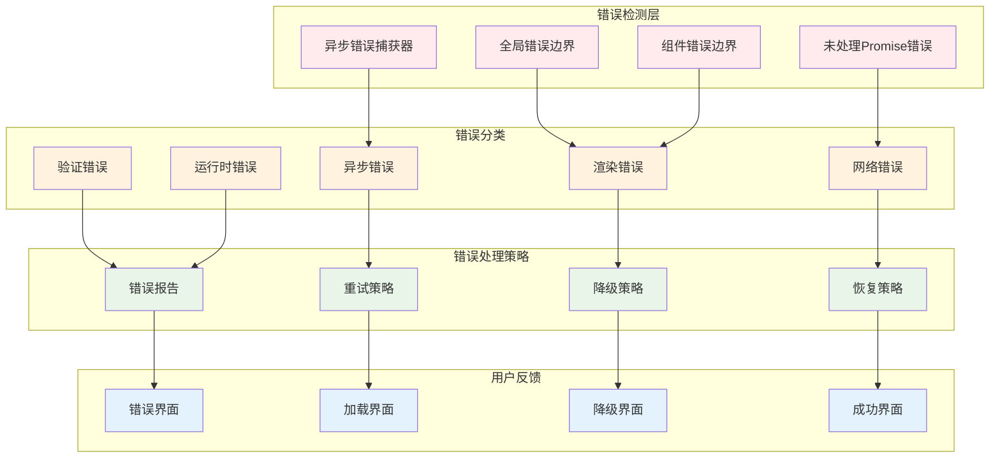


---

## 📋 组件接口规范

### 组件 Props 接口设计

参考示例代码:

```typescript
// 基础组件接口
interface BaseComponentProps {
  className?: string;
  testId?: string;
  ariaLabel?: string;
  children?: React.ReactNode;
}

// 交互组件接口
interface InteractiveComponentProps extends BaseComponentProps {
  disabled?: boolean;
  loading?: boolean;
  onClick?: (event: React.MouseEvent) => void;
  onKeyDown?: (event: React.KeyboardEvent) => void;
}

// 表单组件接口
interface FormComponentProps extends InteractiveComponentProps {
  value?: any;
  defaultValue?: any;
  onChange?: (value: any) => void;
  onBlur?: (event: React.FocusEvent) => void;
  onFocus?: (event: React.FocusEvent) => void;
  error?: string;
  required?: boolean;
  placeholder?: string;
}

// 布局组件接口
interface LayoutComponentProps extends BaseComponentProps {
  direction?: 'row' | 'column';
  justify?: 'start' | 'center' | 'end' | 'space-between' | 'space-around';
  align?: 'start' | 'center' | 'end' | 'stretch';
  gap?: number | string;
  padding?: number | string;
  margin?: number | string;
}

// 业务组件接口示例
interface FileUploaderProps extends InteractiveComponentProps {
  accept?: string[];
  maxSize?: number;
  multiple?: boolean;
  onFileSelect: (files: File[]) => void;
  onError?: (error: Error) => void;
  dragAndDrop?: boolean;
  preview?: boolean;
}

interface ImagePreviewProps extends BaseComponentProps {
  src?: string;
  alt?: string;
  segments?: ImageSegment[];
  selectedSegments?: number[];
  onSegmentSelect?: (indices: number[]) => void;
  zoomable?: boolean;
  downloadable?: boolean;
}

interface ExportControlsProps extends BaseComponentProps {
  segments: ImageSegment[];
  selectedSegments: number[];
  onExport: (format: ExportFormat, options: ExportOptions) => Promise<void>;
  formats?: ExportFormat[];
  disabled?: boolean;
}
```

---

## 🎯 组件开发最佳实践

### 组件设计原则

1. **单一职责原则** - 每个组件只负责一个功能
2. **开放封闭原则** - 对扩展开放，对修改封闭
3. **组合优于继承** - 使用组合模式而非继承
4. **依赖倒置原则** - 依赖抽象而非具体实现
5. **接口隔离原则** - 使用小而专一的接口

### 组件命名规范

参考示例:

```typescript
// 组件命名：PascalCase
const ScreenshotSplitter: React.FC<ScreenshotSplitterProps> = () => {};

// Hook命名：camelCase + use前缀
const useImageProcessor = () => {};

// 事件处理器命名：handle前缀 + 动词
const handleFileSelect = (files: File[]) => {};

// 状态变量命名：is/has/should前缀 + 形容词
const isProcessing = false;
const hasError = false;
const shouldShowPreview = true;

// 常量命名：SCREAMING_SNAKE_CASE
const MAX_FILE_SIZE = 50 * 1024 * 1024;
const SUPPORTED_FORMATS = ['image/png', 'image/jpeg'];
```

### 性能优化清单

- [ ] 使用 React.memo 包装纯组件
- [ ] 使用 useCallback 优化事件处理器
- [ ] 使用 useMemo 优化计算属性
- [ ] 实现组件懒加载
- [ ] 避免在渲染中创建新对象
- [ ] 使用 key 属性优化列表渲染
- [ ] 实现虚拟化长列表
- [ ] 使用 Suspense 处理异步组件

---

## 📚 相关文档链接

- **[系统架构设计文档](./SYSTEM-ARCHITECTURE-DESIGN.md)** - 完整的系统架构设计
- **[技术规范文档](./TECHNICAL-SPECIFICATIONS.md)** - 详细的技术规范说明
- **[部署架构指南](./DEPLOYMENT-ARCHITECTURE.md)** - 部署相关架构设计
- **[API 参考文档](./API-REFERENCE.md)** - 组件和Hook的API文档

---

**文档版本**: [v1.0.0]  
**最后更新**: [2025-08-30]  
**维护团队**: [架构设计团队] 
**审核状态**: 待审核  

[*本文档详细描述了长截图分割工具的组件架构设计，包括组件层次结构、数据流、状态管理、性能优化等核心架构要素。*]