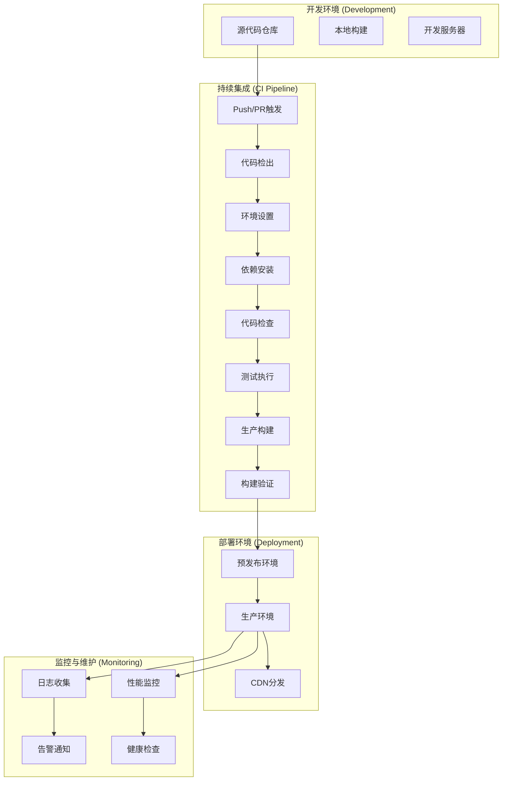
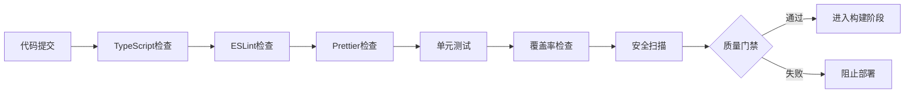
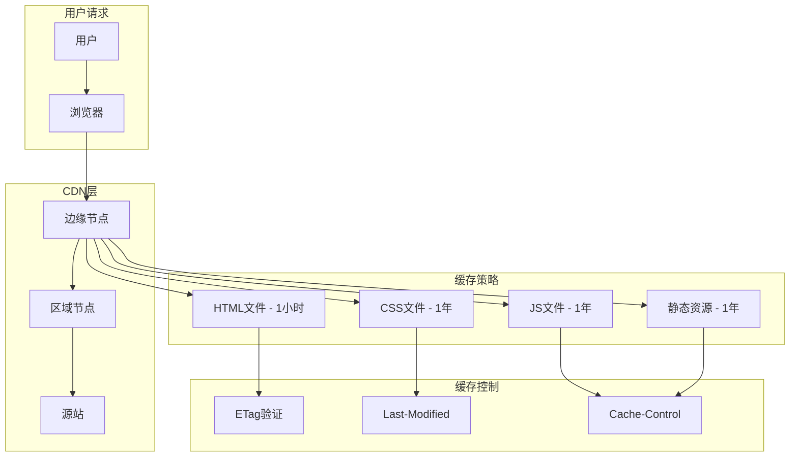

# [长截图分割工具] - 部署架构指南

> **版本**: [1.0.0]  
> **创建时间**: [2025-08-30]  
> **适用范围**: [长截图分割工具]部署和运维  
> **技术栈**: [Vite + GitHub Actions + GitHub Pages]

## 📋 部署概览

本文档详细描述了[长截图分割工具]的部署架构设计，包括构建流程、部署策略、环境配置和运维监控。项目采用现代化的前端部署架构，支持多种部署环境和策略。

---

## 🏗️ 部署架构设计

### 整体部署架构图

参考示例:



### 架构特点

- **🚀 自动化**: 完全自动化的CI/CD流水线
- **📊 多环境**: 开发、测试、生产环境隔离
- **⚡ 高性能**: CDN加速和资源优化
- **🔒 安全性**: 安全的构建和部署流程
- **📈 可观测性**: 完善的监控和日志系统

---

## 🔧 构建系统架构

### [Vite] 构建配置

#### 核心构建配置

参考示例:

```typescript
// vite.config.ts - 生产构建配置
export default defineConfig(({ mode }) => {
  const env = loadEnv(mode, process.cwd(), '')
  const deploy = getDeploymentConfig()

  return {
    // 资源路径配置
    base: mode === 'production' && deploy.useAbsoluteUrls 
      ? deploy.assetsBaseUrl 
      : deploy.basePath,
      
    plugins: [
      react(),
      // 生产环境优化插件
      ...(mode === 'production' ? [
        // 移除console语句
        removeConsolePlugin(),
        // 资源压缩
        compressionPlugin(),
        // PWA支持
        PWAPlugin()
      ] : [])
    ],
    
    build: {
      outDir: 'dist',
      sourcemap: mode !== 'production',
      minify: 'terser',
      
      // Terser配置 - 生产环境优化
      terserOptions: {
        compress: {
          drop_console: true,
          drop_debugger: true,
          pure_funcs: ['console.log', 'console.debug']
        }
      },
      
      // Rollup配置 - 代码分割
      rollupOptions: {
        output: {
          assetFileNames: 'assets/[name]-[hash][extname]',
          chunkFileNames: 'assets/[name]-[hash].js',
          entryFileNames: 'assets/[name]-[hash].js',
          
          // 手动代码分割
          manualChunks: {
            vendor: ['react', 'react-dom'],
            workers: ['./src/workers/split.worker.js'],
            pdf: ['jspdf'],
            zip: ['jszip']
          }
        }
      }
    }
  }
})
```

#### 环境变量管理

参考示例:

```typescript
// config/build/deployment.config.ts - 部署配置
export interface DeploymentConfig {
  basePath: string;                    // 应用基础路径
  assetsBaseUrl: string;              // 静态资源基础URL
  useAbsoluteUrls: boolean;           // 是否使用绝对URL
  
  assetsServer: {
    domain: string;                   // 资源服务器域名
    pathPrefix: string;               // 资源路径前缀
    https: boolean;                   // 是否启用HTTPS
  };
  
  githubPages: {
    repository: string;               // 仓库名称
    enabled: boolean;                 // 是否启用GitHub Pages
    domain: string;                   // GitHub Pages域名
  };
  
  cdn: {
    baseUrl: string;                 // CDN基础URL
    enabled: boolean;                // 是否启用CDN
  };
}

// 环境变量配置
const envConfig = {
  // 核心配置
  VITE_USE_ABSOLUTE_URLS: 'true',              // 使用绝对URL
  VITE_ASSETS_BASE_URL: 'https://cdn.example.com/',  // 资源基础URL
  VITE_DEPLOY_ENV: 'production',               // 部署环境
  VITE_BASE_PATH: '/',                         // 基础路径
  
  // 资源服务器配置
  VITE_ASSETS_DOMAIN: 'assets.example.com',   // 资源域名
  VITE_ASSETS_PATH_PREFIX: '/static',          // 资源路径前缀
  VITE_ASSETS_HTTPS: 'true',                   // 启用HTTPS
  
  // CDN配置
  VITE_CDN_BASE_URL: 'https://cdn.example.com/',  // CDN基础URL
  
  // GitHub Pages配置
  VITE_GITHUB_PAGES: 'true',                   // 启用GitHub Pages
  VITE_GITHUB_REPOSITORY: 'user/repo',         // 仓库地址
  VITE_GITHUB_USER: 'username'                 // GitHub用户名
};
```

### 构建优化策略

#### 资源优化

参考示例:

```typescript
// 资源优化配置
const buildOptimizations = {
  // 代码分割策略
  codeSplitting: {
    vendor: ['react', 'react-dom'],              // 第三方库分离
    workers: ['./src/workers/split.worker.js'],  // Web Workers分离
    features: {
      pdf: ['jspdf'],                            // PDF功能分离
      zip: ['jszip'],                            // ZIP功能分离
      seo: ['react-helmet-async']                // SEO功能分离
    }
  },
  
  // 资源压缩
  compression: {
    gzip: true,                                  // 启用Gzip压缩
    brotli: true,                               // 启用Brotli压缩
    threshold: 1024,                            // 压缩阈值 1KB
    deleteOriginal: false                       // 保留原始文件
  },
  
  // 图片优化
  imageOptimization: {
    formats: ['webp', 'avif'],                  // 现代图片格式
    quality: 80,                                // 图片质量
    progressive: true,                          // 渐进式JPEG
    optimizeForSize: true                       // 优化文件大小
  },
  
  // CSS优化
  cssOptimization: {
    purge: true,                                // 移除未使用的CSS
    minify: true,                               // CSS压缩
    autoprefixer: true,                         // 自动添加浏览器前缀
    criticalCSS: true                           // 关键CSS内联
  }
};
```

#### 性能预算


参考示例:

```typescript
// 性能预算配置
const performanceBudgets = {
  // 文件大小预算
  assets: {
    maxAssetSize: 500 * 1024,                   // 单个资源最大500KB
    maxEntrypointSize: 800 * 1024,              // 入口点最大800KB
    maxChunkSize: 300 * 1024                    // 代码块最大300KB
  },
  
  // 网络预算
  network: {
    maxBundleSize: 2 * 1024 * 1024,            // 总包大小最大2MB
    maxInitialLoad: 1 * 1024 * 1024,           // 初始加载最大1MB
    maxAsyncLoad: 500 * 1024                    // 异步加载最大500KB
  },
  
  // 时间预算
  timing: {
    firstContentfulPaint: 1500,                // FCP < 1.5s
    largestContentfulPaint: 2500,              // LCP < 2.5s
    firstInputDelay: 100,                      // FID < 100ms
    cumulativeLayoutShift: 0.1                 // CLS < 0.1
  }
};
```

---

## 🚀 CI/CD 流水线架构

### [GitHub Actions] 工作流


#### 构建工作流

参考示例:

```yaml
# .github/workflows/deploy.yml - 主要部署工作流
name: 构建和部署到GitHub Pages

on:
  push:
    branches: [ main, master ]
  pull_request:
    branches: [ main, master ]
  workflow_dispatch:

permissions:
  contents: read
  pages: write
  id-token: write

jobs:
  build:
    runs-on: ubuntu-latest
    
    strategy:
      matrix:
        node-version: [18, 20]  # 多Node.js版本测试
    
    steps:
    # 1. 环境准备阶段
    - name: 检出代码
      uses: actions/checkout@v4
      with:
        fetch-depth: 0  # 获取完整历史用于版本分析
        
    - name: 设置Node.js ${{ matrix.node-version }}
      uses: actions/setup-node@v4
      with:
        node-version: ${{ matrix.node-version }}
        cache: 'npm'
        
    # 2. 依赖管理阶段
    - name: 安装依赖
      run: |
        npm ci --legacy-peer-deps
        npm list --depth=0  # 验证依赖安装
        
    # 3. 代码质量检查阶段
    - name: TypeScript类型检查
      run: npm run type-check
      
    - name: ESLint代码检查
      run: npm run lint
      
    - name: Prettier格式检查
      run: npm run format:check
      
    # 4. 测试阶段
    - name: 单元测试
      run: npm run test:run
      
    - name: 测试覆盖率
      run: npm run test:coverage
      
    - name: 上传覆盖率报告
      uses: codecov/codecov-action@v3
      with:
        files: ./test-results/coverage/lcov.info
        
    # 5. 构建阶段
    - name: 生产构建
      run: npm run build
      env:
        NODE_ENV: production
        GITHUB_PAGES: true
        GITHUB_REPOSITORY: ${{ github.repository }}
        VITE_BASE_PATH: ${{ github.event.repository.name }}
        VITE_USE_ABSOLUTE_URLS: true
        VITE_ASSETS_BASE_URL: https://${{ github.repository_owner }}.github.io/${{ github.event.repository.name }}
        VITE_DEPLOY_ENV: production
        
    # 6. 构建验证阶段
    - name: 验证构建产物
      run: |
        echo "📊 构建产物分析："
        du -sh dist/*
        
        echo "📦 资源文件统计："
        find dist -name "*.js" -o -name "*.css" | wc -l
        
        echo "✅ 构建验证完成"
        
    # 7. 安全扫描阶段
    - name: 依赖安全扫描
      run: npm audit --audit-level=high
      
    - name: 构建产物安全扫描
      uses: securecodewarrior/github-action-add-sarif@v1
      with:
        sarif-file: security-scan-results.sarif
        
    # 8. 性能分析阶段
    - name: Bundle分析
      run: |
        npx vite-bundle-analyzer dist
        
    - name: 性能预算检查
      run: |
        npm run analyze:budget
        
    # 9. 部署准备阶段
    - name: 准备部署目录
      run: |
        mkdir -p deploy
        cp -r dist/* deploy/
        
        # 生成部署清单
        echo "部署时间: $(date)" > deploy/DEPLOY_INFO.txt
        echo "提交哈希: ${{ github.sha }}" >> deploy/DEPLOY_INFO.txt
        echo "分支: ${{ github.ref }}" >> deploy/DEPLOY_INFO.txt
        
    - name: 上传构建产物
      uses: actions/upload-pages-artifact@v3
      with:
        path: './deploy'

  # 部署作业
  deploy:
    environment:
      name: github-pages
      url: ${{ steps.deployment.outputs.page_url }}
    runs-on: ubuntu-latest
    needs: build
    if: github.ref == 'refs/heads/main' || github.ref == 'refs/heads/master'
    
    steps:
    - name: 部署到GitHub Pages
      id: deployment
      uses: actions/deploy-pages@v4
      
    - name: 部署后验证
      run: |
        echo "部署URL: ${{ steps.deployment.outputs.page_url }}"
        
        # 健康检查
        curl -f ${{ steps.deployment.outputs.page_url }} || exit 1
        
        echo "✅ 部署验证完成"
```

#### 多环境部署策略

参考示例:

```yaml
# .github/workflows/multi-env-deploy.yml - 多环境部署
name: 多环境部署

on:
  push:
    branches: 
      - develop    # 开发环境
      - staging    # 预发布环境
      - main       # 生产环境

jobs:
  deploy:
    runs-on: ubuntu-latest
    
    strategy:
      matrix:
        include:
          - branch: develop
            environment: development
            base_url: https://dev.example.com
            
          - branch: staging  
            environment: staging
            base_url: https://staging.example.com
            
          - branch: main
            environment: production
            base_url: https://example.com
    
    environment:
      name: ${{ matrix.environment }}
      url: ${{ matrix.base_url }}
    
    steps:
    - name: 检出代码
      uses: actions/checkout@v4
      
    - name: 环境特定构建
      run: npm run build
      env:
        VITE_DEPLOY_ENV: ${{ matrix.environment }}
        VITE_BASE_URL: ${{ matrix.base_url }}
        VITE_API_ENDPOINT: ${{ secrets[format('{0}_API_ENDPOINT', matrix.environment)] }}
        
    - name: 部署到环境
      uses: deployment-action@v1
      with:
        environment: ${{ matrix.environment }}
        artifact: dist/
```

### 部署流程阶段

#### 阶段1: 代码质量门禁



#### 阶段2: 构建和优化


#### 阶段3: 部署和验证


---

## 🌍 多环境部署架构

### 环境配置矩阵

| 环境 | 分支 | 域名 | CDN | 监控 | 备注 |
|------|------|------|-----|------|------|
| **开发环境** | develop | dev.example.com | ❌ | 基础 | 开发测试 |
| **测试环境** | staging | staging.example.com | ✅ | 完整 | 预发布验证 |
| **生产环境** | main | example.com | ✅ | 完整 | 正式发布 |

### 环境特定配置

#### 开发环境配置

参考示例:

```typescript
// config/environments/development.ts
export const developmentConfig = {
  // 构建配置
  build: {
    minify: false,                              // 不压缩代码
    sourcemap: true,                            // 启用源映射
    target: 'esnext',                          // 最新JS特性
    watch: true                                // 监视文件变化
  },
  
  // 开发服务器
  server: {
    host: '0.0.0.0',                          // 允许外部访问
    port: 3000,                               // 开发端口
    hmr: true,                                // 热模块替换
    open: true                                // 自动打开浏览器
  },
  
  // 调试配置
  debug: {
    console: true,                            // 保留console
    debugger: true,                           // 保留debugger
    verbose: true                             // 详细日志
  }
};
```

#### 生产环境配置

参考示例:

```typescript
// config/environments/production.ts
export const productionConfig = {
  // 构建配置
  build: {
    minify: 'terser',                         // Terser压缩
    sourcemap: false,                         // 禁用源映射
    target: 'es2020',                        // 兼容性目标
    reportCompressedSize: true                // 报告压缩大小
  },
  
  // 优化配置
  optimization: {
    splitChunks: true,                        // 代码分割
    treeShaking: true,                        // Tree Shaking
    sideEffects: false,                       // 无副作用优化
    usedExports: true                         // 标记使用的导出
  },
  
  // 安全配置
  security: {
    removeConsole: true,                      // 移除console
    removeDebugger: true,                     // 移除debugger
    obfuscate: false,                         // 不混淆（可选）
    csp: true                                 // 内容安全策略
  }
};
```

### 环境切换机制

参考示例:

```typescript
// config/environment-manager.ts
class EnvironmentManager {
  private currentEnv: string;
  private config: Record<string, any>;
  
  constructor() {
    this.currentEnv = this.detectEnvironment();
    this.config = this.loadEnvironmentConfig();
  }
  
  private detectEnvironment(): string {
    // 1. 环境变量检测
    if (process.env.VITE_DEPLOY_ENV) {
      return process.env.VITE_DEPLOY_ENV;
    }
    
    // 2. Git分支检测
    const branch = process.env.GITHUB_REF?.split('/').pop();
    switch (branch) {
      case 'main': return 'production';
      case 'staging': return 'staging';
      case 'develop': return 'development';
      default: return 'development';
    }
  }
  
  private loadEnvironmentConfig() {
    switch (this.currentEnv) {
      case 'production':
        return require('./environments/production').productionConfig;
      case 'staging':
        return require('./environments/staging').stagingConfig;
      case 'development':
        return require('./environments/development').developmentConfig;
      default:
        return require('./environments/development').developmentConfig;
    }
  }
  
  public getConfig(key?: string) {
    return key ? this.config[key] : this.config;
  }
  
  public isProduction(): boolean {
    return this.currentEnv === 'production';
  }
  
  public isDevelopment(): boolean {
    return this.currentEnv === 'development';
  }
}

export const envManager = new EnvironmentManager();
```

---

## 📈 CDN和缓存架构

参考示例:

### CDN分发策略



#### CDN配置策略

参考示例:

```typescript
// config/cdn.config.ts
export const cdnConfig = {
  // 缓存规则
  cacheRules: {
    html: {
      maxAge: 3600,                           // 1小时
      sMaxAge: 86400,                         // CDN缓存1天
      staleWhileRevalidate: 60,               // 过期后60s内使用缓存
      mustRevalidate: true                    // 必须重新验证
    },
    
    static: {
      maxAge: 31536000,                       // 1年
      sMaxAge: 31536000,                      // CDN缓存1年
      immutable: true,                        // 不可变资源
      public: true                            // 公共缓存
    },
    
    api: {
      maxAge: 300,                            // 5分钟
      sMaxAge: 0,                            // CDN不缓存
      noStore: true,                         // 不存储
      private: true                          // 私有缓存
    }
  },
  
  // 压缩配置
  compression: {
    gzip: {
      enabled: true,
      level: 6,                              // 压缩级别
      types: [
        'text/html',
        'text/css',
        'application/javascript',
        'application/json'
      ]
    },
    
    brotli: {
      enabled: true,
      level: 4,                              // 压缩级别
      types: [
        'text/html',
        'text/css', 
        'application/javascript',
        'application/json'
      ]
    }
  },
  
  // 安全头配置
  securityHeaders: {
    'X-Content-Type-Options': 'nosniff',
    'X-Frame-Options': 'DENY',
    'X-XSS-Protection': '1; mode=block',
    'Referrer-Policy': 'strict-origin-when-cross-origin',
    'Content-Security-Policy': `
      default-src 'self';
      script-src 'self' 'unsafe-inline';
      style-src 'self' 'unsafe-inline';
      img-src 'self' data: blob:;
      worker-src 'self' blob:;
    `.replace(/\s+/g, ' ').trim()
  }
};
```

### 缓存失效策略

```typescript
// utils/cache-busting.ts
export class CacheBustingManager {
  private buildHash: string;
  private assetManifest: Record<string, string>;
  
  constructor() {
    this.buildHash = process.env.VITE_BUILD_HASH || Date.now().toString(36);
    this.assetManifest = this.loadAssetManifest();
  }
  
  // 生成带版本的资源URL
  public getVersionedAssetUrl(assetPath: string): string {
    const manifest = this.assetManifest[assetPath];
    if (manifest) {
      return manifest; // 已包含hash的路径
    }
    
    // 添加查询参数版本控制
    return `${assetPath}?v=${this.buildHash}`;
  }
  
  // 预加载关键资源
  public preloadCriticalAssets(): void {
    const criticalAssets = [
      'main.js',
      'main.css',
      'vendor.js'
    ];
    
    criticalAssets.forEach(asset => {
      const versionedUrl = this.getVersionedAssetUrl(asset);
      this.createPreloadLink(versionedUrl);
    });
  }
  
  private createPreloadLink(url: string): void {
    const link = document.createElement('link');
    link.rel = 'preload';
    link.href = url;
    
    if (url.endsWith('.js')) {
      link.as = 'script';
    } else if (url.endsWith('.css')) {
      link.as = 'style';
    }
    
    document.head.appendChild(link);
  }
  
  private loadAssetManifest(): Record<string, string> {
    try {
      return require('../dist/asset-manifest.json');
    } catch {
      return {};
    }
  }
}
```

---

## 🔧 运维工具和脚本

### 部署脚本集合

#### 构建脚本

参考示例:

```bash
#!/bin/bash
# scripts/build.sh - 生产构建脚本

set -e  # 遇到错误立即退出

echo "🚀 开始生产构建..."

# 1. 环境检查
echo "📋 检查环境..."
node --version
npm --version

# 2. 清理构建目录
echo "🧹 清理构建目录..."
rm -rf dist/
rm -rf .cache/

# 3. 安装依赖
echo "📦 安装依赖..."
npm ci --legacy-peer-deps --silent

# 4. 类型检查
echo "🔍 TypeScript类型检查..."
npm run type-check

# 5. 代码检查
echo "📝 ESLint代码检查..."
npm run lint

# 6. 运行测试
echo "🧪 运行测试..."
npm run test:run --silent

# 7. 生产构建
echo "⚡ 生产构建..."
NODE_ENV=production npm run build

# 8. 构建验证
echo "✅ 构建验证..."
if [ ! -d "dist" ]; then
  echo "❌ 错误: 构建目录不存在"
  exit 1
fi

# 统计构建产物
echo "📊 构建产物统计:"
du -sh dist/*
echo ""
echo "📁 文件数量:"
find dist -type f | wc -l

# 9. 性能分析
echo "📈 性能分析..."
npm run analyze:bundle --silent

echo "✅ 构建完成!"
```

#### 部署脚本

参考示例:

```bash
#!/bin/bash
# scripts/deploy.sh - 部署脚本

set -e

ENVIRONMENT=${1:-production}
BRANCH=${2:-main}

echo "🚀 开始部署到 $ENVIRONMENT 环境..."

# 1. 构建应用
echo "🔨 构建应用..."
bash scripts/build.sh

# 2. 环境特定配置
case $ENVIRONMENT in
  "production")
    DEPLOY_URL="https://example.com"
    HEALTH_CHECK_URL="$DEPLOY_URL/health"
    ;;
  "staging")
    DEPLOY_URL="https://staging.example.com"
    HEALTH_CHECK_URL="$DEPLOY_URL/health"
    ;;
  "development")
    DEPLOY_URL="https://dev.example.com"
    HEALTH_CHECK_URL="$DEPLOY_URL/health"
    ;;
  *)
    echo "❌ 未知环境: $ENVIRONMENT"
    exit 1
    ;;
esac

# 3. 部署前检查
echo "🔍 部署前检查..."
if [ ! -d "dist" ]; then
  echo "❌ 错误: 构建目录不存在"
  exit 1
fi

# 4. 部署到服务器
echo "📤 部署文件..."
# 这里添加具体的部署逻辑，例如:
# rsync -avz dist/ user@server:/var/www/html/
# 或者使用云服务商的CLI工具

# 5. 健康检查
echo "🏥 健康检查..."
sleep 5  # 等待服务启动

for i in {1..5}; do
  if curl -f "$HEALTH_CHECK_URL" > /dev/null 2>&1; then
    echo "✅ 健康检查通过"
    break
  else
    echo "⏳ 健康检查失败，重试 $i/5..."
    sleep 10
    if [ $i -eq 5 ]; then
      echo "❌ 健康检查失败，部署可能有问题"
      exit 1
    fi
  fi
done

# 6. 缓存清理
echo "🧹 清理CDN缓存..."
# 这里添加CDN缓存清理逻辑

echo "🎉 部署成功!"
echo "🔗 访问地址: $DEPLOY_URL"
```

## 📋 部署检查清单

### 部署前检查

- [ ] **代码质量**
  - [ ] TypeScript类型检查通过
  - [ ] ESLint代码检查通过
  - [ ] Prettier格式检查通过
  - [ ] 单元测试覆盖率 > 80%
  - [ ] 集成测试通过

- [ ] **构建优化**
  - [ ] 生产构建成功
  - [ ] Bundle大小检查通过
  - [ ] 代码分割配置正确
  - [ ] 资源压缩启用
  - [ ] Source Map配置正确

- [ ] **安全检查**
  - [ ] 依赖安全扫描通过
  - [ ] 环境变量安全配置
  - [ ] HTTPS配置正确
  - [ ] 安全头配置完整
  - [ ] CSP策略配置

- [ ] **性能优化**
  - [ ] 关键资源预加载
  - [ ] 图片优化和懒加载
  - [ ] 字体优化配置
  - [ ] CDN配置正确
  - [ ] 缓存策略设置

### 部署后验证

- [ ] **功能验证**
  - [ ] 主要功能正常工作
  - [ ] 文件上传功能测试
  - [ ] 图片处理功能测试
  - [ ] 导出功能测试
  - [ ] 多语言切换测试

- [ ] **性能验证**
  - [ ] 首屏加载时间 < 2.5s
  - [ ] Core Web Vitals达标
  - [ ] 资源加载时间合理
  - [ ] 移动端性能测试
  - [ ] 网络条件适应性测试

- [ ] **兼容性验证**
  - [ ] 主流浏览器兼容性
  - [ ] 移动设备适配
  - [ ] 响应式设计测试
  - [ ] 无障碍访问测试
  - [ ] SEO优化验证

- [ ] **监控验证**
  - [ ] 错误监控正常
  - [ ] 性能监控配置
  - [ ] 健康检查可用
  - [ ] 告警机制测试
  - [ ] 日志收集正常

---

## 🔄 回滚和灾难恢复

### 回滚策略

```typescript
// utils/rollback-manager.ts
export class RollbackManager {
  private deploymentHistory: DeploymentRecord[] = [];
  private maxHistorySize: number = 10;
  
  constructor() {
    this.loadDeploymentHistory();
  }
  
  public async rollback(targetVersion?: string): Promise<RollbackResult> {
    const target = targetVersion 
      ? this.findDeployment(targetVersion)
      : this.getPreviousDeployment();
    
    if (!target) {
      throw new Error('No valid rollback target found');
    }
    
    console.log(`🔄 开始回滚到版本: ${target.version}`);
    
    try {
      // 1. 备份当前版本
      await this.backupCurrentVersion();
      
      // 2. 执行回滚
      await this.executeRollback(target);
      
      // 3. 验证回滚
      await this.validateRollback(target);
      
      // 4. 更新部署记录
      this.updateDeploymentHistory(target);
      
      console.log(`✅ 回滚完成: ${target.version}`);
      
      return {
        success: true,
        version: target.version,
        timestamp: Date.now()
      };
      
    } catch (error) {
      console.error(`❌ 回滚失败: ${error.message}`);
      
      // 尝试恢复
      await this.emergencyRecover();
      
      return {
        success: false,
        error: error.message,
        timestamp: Date.now()
      };
    }
  }
  
  private async executeRollback(target: DeploymentRecord): Promise<void> {
    // 实现具体的回滚逻辑
    // 例如：从备份恢复文件、更新配置等
  }
  
  private async validateRollback(target: DeploymentRecord): Promise<void> {
    // 验证回滚后的系统状态
    const healthCheck = await this.runHealthCheck();
    if (!healthCheck.healthy) {
      throw new Error('Rollback validation failed');
    }
  }
}
```

### 灾难恢复计划

```markdown
## 灾难恢复计划

### 1. 服务完全不可用
**检测**: 健康检查连续失败 > 5分钟
**响应时间**: < 2分钟
**恢复步骤**:
1. 立即回滚到上一个稳定版本
2. 检查CDN和DNS配置
3. 启用备用服务器（如有）
4. 通知用户和团队

### 2. 性能严重下降
**检测**: 响应时间 > 5秒，错误率 > 5%
**响应时间**: < 5分钟
**恢复步骤**:
1. 分析性能监控数据
2. 检查资源使用情况
3. 必要时回滚或重启服务
4. 优化CDN缓存配置

### 3. 数据完整性问题
**检测**: 用户报告功能异常
**响应时间**: < 10分钟
**恢复步骤**:
1. 立即停止受影响的功能
2. 从备份恢复数据（如需要）
3. 验证数据完整性
4. 逐步恢复服务

### 4. 安全事件
**检测**: 安全监控告警
**响应时间**: < 1分钟
**恢复步骤**:
1. 立即隔离受影响的系统
2. 分析安全日志
3. 修复安全漏洞
4. 重新部署安全版本
```

---

## 📚 相关文档参考

- **[系统架构设计文档](./SYSTEM-ARCHITECTURE-DESIGN.md)** - 完整的系统架构设计
- **[组件架构图表文档](./COMPONENT-ARCHITECTURE-DIAGRAMS.md)** - 详细的组件架构设计
- **[技术规范文档](./TECHNICAL-SPECIFICATIONS.md)** - 编码规范和最佳实践
- **[API参考文档](./API-REFERENCE.md)** - 接口文档和使用指南

---

## 💡 最佳实践总结

### 部署最佳实践

1. **自动化优先**: 所有部署流程自动化，减少人工错误
2. **渐进式部署**: 使用蓝绿部署或金丝雀发布策略
3. **监控驱动**: 基于监控数据做部署决策
4. **快速回滚**: 保持快速回滚能力，降低故障影响
5. **文档完整**: 维护完整的部署文档和操作手册

### 性能优化最佳实践

1. **度量先行**: 优化前先建立性能基准
2. **关键路径优化**: 优先优化影响用户体验的关键路径
3. **渐进增强**: 从基础功能开始，逐步增加高级特性
4. **缓存策略**: 合理使用多层缓存提升性能
5. **持续监控**: 建立持续的性能监控和告警机制

---

**文档版本**:[v1.0.0]  
**最后更新**: [2025-08-30] 
**维护团队**: [长截图分割工具]部署团队  
**审核状态**: 待审核

[*本部署架构指南提供了长截图分割工具的完整部署方案，包括构建、部署、监控和运维的所有方面。遵循本指南可以确保应用的稳定性、性能和可维护性。*]