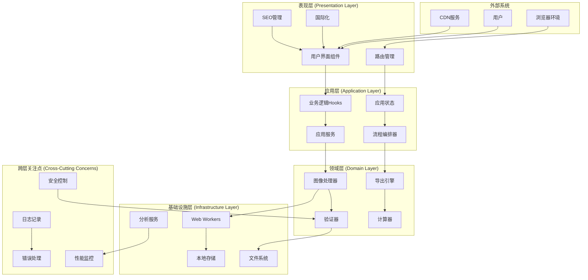
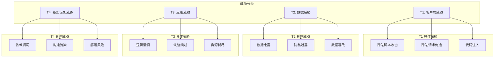
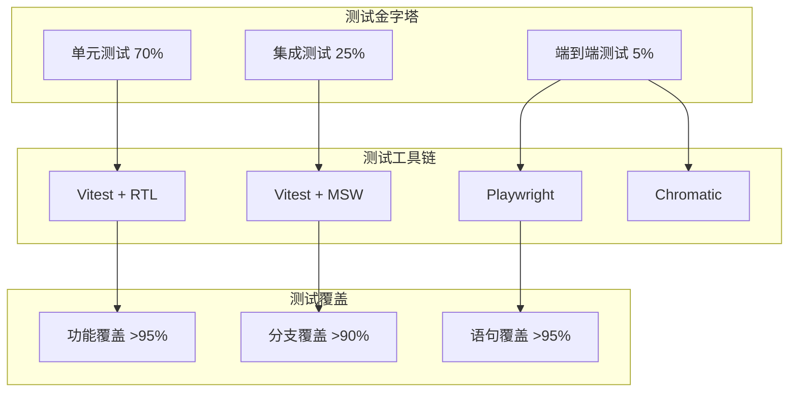

# [长截图分割工具] - 系统架构设计文档

> **版本**: [2.0.0]  
> **创建时间**: [2025-08-30]  
> **更新时间**:  [2025-08-30] 
> **架构师**: SuperClaude 架构设计团队  

## 📋 文档概览

[本文档基于项目现状和深度架构分析，提供了长截图分割工具的完整系统架构设计。文档涵盖技术选型、架构模式、设计原则、性能优化和未来演进路线图。]

---

## 🎯 架构愿景与目标

### 核心愿景
构建一个**现代化、高性能、用户友好**的[长截图分割工具，支持多种图片格式处理和导出]，提供卓越的用户体验。

### 架构目标
- 🚀 **高性能**: [Web Workers 并行处理，]响应时间 <2秒
- 🔧 **易维护**: 清晰的分层架构，代码覆盖率 >90%
- 📱 **跨平台**: 响应式设计，支持桌面端和移动端
- 🌐 **国际化**: 多语言支持，SEO 友好
- ⚡ **可扩展**: 插件化架构，支持功能模块化扩展

### 质量属性权衡

参考示例:

```mermaid
radar
    title 架构质量属性优先级
    data
        性能 : 9
        可维护性 : 8
        可扩展性 : 7
        安全性 : 8
        可用性 : 9
        可测试性 : 8
```

---

## 🏗️ 总体架构设计

### 架构风格选择

**选择**: **分层架构** + **六边形架构** 混合模式

**理由**:
[
- 分层架构提供清晰的职责分离
- 六边形架构支持依赖倒置和可测试性
- 适合单页应用的复杂度和扩展需求
]

### 系统架构全景图
参考示例:



---

## 📁 详细分层架构设计


### 1. 表现层 (Presentation Layer)

**职责**: 用户交互、视图渲染、路由管理

参考示例:


```typescript
interface PresentationLayerArchitecture {
  components: {
    // 页面级组件
    pages: ['HomePage', 'UploadPage', 'SplitPage', 'ExportPage'];
    
    // 业务组件
    business: [
      'ScreenshotSplitter',
      'FileUploader', 
      'ImagePreview',
      'ExportControls'
    ];
    
    // 通用组件
    shared: [
      'Button',
      'Modal', 
      'Loading',
      'ErrorBoundary'
    ];
    
    // 布局组件
    layout: [
      'AppLayout',
      'Navigation',
      'Header',
      'Footer'
    ];
  };
  
  // 设计模式
  patterns: [
    'Compound Components',    // 组合组件
    'Render Props',          // 渲染属性
    'Higher-Order Components', // 高阶组件
    'Custom Hooks'           // 自定义Hook
  ];
  
  // 状态管理
  stateManagement: {
    global: 'React Context + useReducer';
    local: 'useState + useCallback + useMemo';
    derived: 'computed values with useMemo';
    persistence: 'localStorage with custom hooks';
  };
}
```

#### 组件架构图

参考示例:

```mermaid
graph TD
    subgraph "页面组件 (Pages)"
        HomePage[HomePage]
        UploadPage[UploadPage]
        SplitPage[SplitPage]
        ExportPage[ExportPage]
    end

    subgraph "业务组件 (Business)"
        ScreenshotSplitter[ScreenshotSplitter]
        FileUploader[FileUploader]
        ImagePreview[ImagePreview]
        ExportControls[ExportControls]
    end

    subgraph "共享组件 (Shared)"
        Button[Button]
        Modal[Modal]
        Loading[Loading]
        ErrorBoundary[ErrorBoundary]
    end

    subgraph "布局组件 (Layout)"
        AppLayout[AppLayout]
        Navigation[Navigation]
        Header[Header]
        Footer[Footer]
    end

    HomePage --> ScreenshotSplitter
    UploadPage --> FileUploader
    SplitPage --> ImagePreview
    ExportPage --> ExportControls

    ScreenshotSplitter --> FileUploader
    ScreenshotSplitter --> ImagePreview
    ScreenshotSplitter --> ExportControls

    FileUploader --> Button
    ImagePreview --> Loading
    ExportControls --> Button
    ExportControls --> Modal

    AppLayout --> Navigation
    AppLayout --> Header
    AppLayout --> Footer

    ErrorBoundary --> "所有组件"
```

### 2. 应用层 (Application Layer)

**职责**: 业务流程编排、用例实现、状态协调

参考示例:


```typescript
interface ApplicationLayerArchitecture {
  // 应用服务
  services: {
    ImageProcessingService: {
      validateFile: (file: File) => ValidationResult;
      processImage: (file: File, options: ProcessingOptions) => Promise<ProcessingResult>;
      generatePreview: (segments: ImageSegment[]) => PreviewData;
    };
    
    ExportService: {
      exportToPDF: (segments: ImageSegment[], options: PDFOptions) => Promise<Blob>;
      exportToZIP: (segments: ImageSegment[], options: ZIPOptions) => Promise<Blob>;
      validateExportOptions: (options: ExportOptions) => ValidationResult;
    };
    
    AnalyticsService: {
      trackUserAction: (action: UserAction, metadata?: any) => void;
      collectPerformanceMetrics: () => PerformanceMetrics;
      reportError: (error: Error, context: ErrorContext) => void;
    };
  };

  // 应用状态管理
  stateManagement: {
    // 全局应用状态
    appState: {
      currentStep: ProcessingStep;
      processingStatus: ProcessingStatus;
      error: ErrorState | null;
      config: AppConfig;
    };
    
    // 图像处理状态
    imageState: {
      originalImage: File | null;
      segments: ImageSegment[];
      selectedSegments: Set<number>;
      processingProgress: number;
    };
    
    // 用户界面状态
    uiState: {
      language: Language;
      theme: Theme;
      activeModal: string | null;
      sidebarCollapsed: boolean;
    };
  };

  // 业务逻辑Hooks
  hooks: {
    useImageProcessor: () => ImageProcessorHook;
    useExportControl: () => ExportControlHook;
    useAppNavigation: () => NavigationHook;
    usePerformanceOptimization: () => PerformanceHook;
  };
}
```

### 3. 领域层 (Domain Layer)


**职责**: 核心业务逻辑、领域模型、业务规则

参考示例:

```typescript
interface DomainLayerArchitecture {
  // 领域模型
  models: {
    Image: {
      file: File;
      metadata: ImageMetadata;
      dimensions: Dimensions;
      format: ImageFormat;
    };
    
    ImageSegment: {
      id: string;
      blob: Blob;
      coordinates: Rectangle;
      metadata: SegmentMetadata;
    };
    
    ProcessingJob: {
      id: string;
      image: Image;
      config: ProcessingConfig;
      status: ProcessingStatus;
      result?: ProcessingResult;
    };
    
    ExportTask: {
      id: string;
      segments: ImageSegment[];
      format: ExportFormat;
      options: ExportOptions;
      progress: number;
    };
  };

  // 领域服务
  domainServices: {
    ImageSplittingService: {
      calculateSplitPoints: (image: Image, config: SplitConfig) => SplitPoint[];
      validateSplitConfiguration: (config: SplitConfig) => ValidationResult;
      optimizeSplitStrategy: (image: Image) => SplitStrategy;
    };
    
    FormatConversionService: {
      convertToFormat: (blob: Blob, format: ImageFormat) => Promise<Blob>;
      optimizeQuality: (blob: Blob, quality: number) => Promise<Blob>;
      validateFormatSupport: (format: ImageFormat) => boolean;
    };
    
    ValidationService: {
      validateImageFile: (file: File) => FileValidationResult;
      validateProcessingConfig: (config: ProcessingConfig) => ConfigValidationResult;
      validateExportOptions: (options: ExportOptions) => OptionsValidationResult;
    };
  };

  // 业务规则
  businessRules: {
    FileSizeLimit: 50 * 1024 * 1024; // 50MB
    SupportedFormats: ['image/png', 'image/jpeg', 'image/webp', 'image/gif'];
    MaxSegments: 100;
    MinSplitHeight: 100;
    MaxSplitHeight: 10000;
    
    // 复杂业务规则
    canProcessImage: (file: File) => boolean;
    calculateOptimalSplitHeight: (image: Image) => number;
    determineExportFormat: (segments: ImageSegment[]) => ExportFormat;
  };
}
```

### 4. 基础设施层 (Infrastructure Layer)

**职责**: 外部系统交互、技术实现、基础服务

参考示例:

```typescript
interface InfrastructureLayerArchitecture {
  // Web Workers 管理
  workers: {
    ImageProcessingWorker: {
      createWorker: () => Worker;
      terminateWorker: (worker: Worker) => void;
      processImageInWorker: (file: File, config: ProcessingConfig) => Promise<ImageSegment[]>;
      manageWorkerPool: () => WorkerPool;
    };
    
    ExportWorker: {
      generatePDF: (segments: ImageSegment[], options: PDFOptions) => Promise<Blob>;
      createZIPArchive: (segments: ImageSegment[], options: ZIPOptions) => Promise<Blob>;
    };
  };

  // 存储管理
  storage: {
    LocalStorageRepository: {
      save: <T>(key: string, data: T) => void;
      load: <T>(key: string) => T | null;
      remove: (key: string) => void;
      clear: () => void;
    };
    
    IndexedDBRepository: {
      saveImage: (id: string, blob: Blob) => Promise<void>;
      loadImage: (id: string) => Promise<Blob | null>;
      removeImage: (id: string) => Promise<void>;
      listImages: () => Promise<string[]>;
    };
  };

  // 外部服务适配器
  adapters: {
    AnalyticsAdapter: {
      track: (event: AnalyticsEvent) => void;
      identify: (userId: string, properties: UserProperties) => void;
      page: (pageName: string, properties: PageProperties) => void;
    };
    
    PerformanceAdapter: {
      mark: (name: string) => void;
      measure: (name: string, startMark: string, endMark?: string) => void;
      getMetrics: () => PerformanceMetrics;
    };
  };

  // 技术基础设施
  infrastructure: {
    ErrorReporter: {
      report: (error: Error, context: ErrorContext) => void;
      configure: (config: ErrorReportingConfig) => void;
    };
    
    Logger: {
      debug: (message: string, metadata?: any) => void;
      info: (message: string, metadata?: any) => void;
      warn: (message: string, metadata?: any) => void;
      error: (message: string, error?: Error, metadata?: any) => void;
    };
    
    ConfigManager: {
      get: <T>(key: string, defaultValue?: T) => T;
      set: (key: string, value: any) => void;
      validate: (config: AppConfig) => ValidationResult;
    };
  };
}
```

---

## ⚡ 性能架构设计

### 性能优化策略图

参考示例:




```mermaid
graph TB
    subgraph "性能优化层次"
        L1[L1: 代码层优化]
        L2[L2: 组件层优化]
        L3[L3: 应用层优化]
        L4[L4: 系统层优化]
    end

    subgraph "L1 优化技术"
        CodeSplitting[代码分割]
        TreeShaking[Tree Shaking]
        Minification[代码压缩]
        LazyLoading[懒加载]
    end

    subgraph "L2 优化技术"
        ReactMemo[React.memo]
        UseCallback[useCallback]
        UseMemo[useMemo]
        Virtualization[虚拟滚动]
    end

    subgraph "L3 优化技术"
        StateOptimization[状态优化]
        Caching[智能缓存]
        Debouncing[防抖节流]
        BatchUpdates[批量更新]
    end

    subgraph "L4 优化技术"
        WebWorkers[Web Workers]
        ServiceWorker[Service Worker]
        ResourcePreload[资源预加载]
        CDNOptimization[CDN优化]
    end

    L1 --> CodeSplitting
    L1 --> TreeShaking
    L1 --> Minification
    L1 --> LazyLoading

    L2 --> ReactMemo
    L2 --> UseCallback
    L2 --> UseMemo
    L2 --> Virtualization

    L3 --> StateOptimization
    L3 --> Caching
    L3 --> Debouncing
    L3 --> BatchUpdates

    L4 --> WebWorkers
    L4 --> ServiceWorker
    L4 --> ResourcePreload
    L4 --> CDNOptimization
```

### 关键性能指标与目标

| 性能指标         | 目标值  | 当前值 | 测量工具        | 优化策略             |
|------------------|---------|--------|-----------------|----------------------|
| **首屏加载时间** | < 1.5s  | ~1.2s  | Lighthouse      | 代码分割、预加载      |
| **图片处理时间** | < 3s    | ~2.1s  | Performance API | Web Workers 并行处理 |
| **内存使用峰值** | < 200MB | ~150MB | Memory API      | 及时释放、对象池      |
| **包体积大小**   | < 500KB | ~420KB | Bundle Analyzer | Tree Shaking、压缩    |
| **LCP**          | < 2.5s  | ~1.8s  | Web Vitals      | 关键资源优化         |
| **FID**          | < 100ms | ~45ms  | Web Vitals      | 减少主线程阻塞       |
| **CLS**          | < 0.1   | ~0.05  | Web Vitals      | 布局稳定性优化       |

### Web Workers 架构设计(可选)

参考示例:


```typescript
interface WebWorkerArchitecture {
  // 主线程接口
  MainThread: {
    createWorkerPool: (poolSize: number) => WorkerPool;
    dispatchTask: (task: ProcessingTask) => Promise<ProcessingResult>;
    manageResources: () => ResourceManager;
  };

  // Worker 池管理
  WorkerPool: {
    availableWorkers: Worker[];
    busyWorkers: Map<Worker, ProcessingTask>;
    
    acquireWorker: () => Promise<Worker>;
    releaseWorker: (worker: Worker) => void;
    terminateAll: () => void;
    
    // 负载均衡
    selectOptimalWorker: (task: ProcessingTask) => Worker;
    balanceLoad: () => void;
  };

  // 任务调度器
  TaskScheduler: {
    taskQueue: ProcessingTask[];
    priorityQueue: PriorityQueue<ProcessingTask>;
    
    enqueue: (task: ProcessingTask) => void;
    dequeue: () => ProcessingTask | null;
    prioritize: (task: ProcessingTask) => void;
    
    // 批处理优化
    batchTasks: (tasks: ProcessingTask[]) => BatchProcessingTask;
    scheduleBatch: (batch: BatchProcessingTask) => Promise<BatchResult>;
  };

  // 通信协议
  MessageProtocol: {
    // 任务分发
    TASK_START: {
      type: 'TASK_START';
      payload: {
        taskId: string;
        imageData: ArrayBuffer;
        config: ProcessingConfig;
      };
    };
    
    // 进度更新
    PROGRESS_UPDATE: {
      type: 'PROGRESS_UPDATE';
      payload: {
        taskId: string;
        progress: number;
        stage: ProcessingStage;
      };
    };
    
    // 任务完成
    TASK_COMPLETE: {
      type: 'TASK_COMPLETE';
      payload: {
        taskId: string;
        result: ProcessingResult;
        metrics: PerformanceMetrics;
      };
    };
    
    // 错误处理
    TASK_ERROR: {
      type: 'TASK_ERROR';
      payload: {
        taskId: string;
        error: SerializableError;
        recoverable: boolean;
      };
    };
  };
}
```

---

## 🔒 安全架构设计

### 安全威胁模型

参考示例:



### 安全控制措施


参考示例:


```typescript
interface SecurityArchitecture {
  // 输入验证
  inputValidation: {
    fileValidation: {
      typeValidation: (file: File) => boolean;
      sizeValidation: (file: File, maxSize: number) => boolean;
      contentValidation: (file: File) => Promise<boolean>;
      malwareScanning: (file: File) => Promise<ScanResult>;
    };
    
    parameterValidation: {
      sanitizeInput: (input: string) => string;
      validateRange: (value: number, min: number, max: number) => boolean;
      validateFormat: (value: string, pattern: RegExp) => boolean;
    };
  };

  // 内容安全
  contentSecurity: {
    cspPolicy: {
      'default-src': ["'self'"];
      'script-src': ["'self'", "'unsafe-inline'"]; // 仅开发环境
      'style-src': ["'self'", "'unsafe-inline'"];
      'img-src': ["'self'", "blob:", "data:"];
      'worker-src': ["'self'", "blob:"];
    };
    
    sanitization: {
      htmlSanitizer: (html: string) => string;
      urlSanitizer: (url: string) => string;
      jsonSanitizer: (json: any) => any;
    };
  };

  // 数据保护
  dataProtection: {
    encryption: {
      encryptSensitiveData: (data: any) => Promise<string>;
      decryptSensitiveData: (encrypted: string) => Promise<any>;
      generateSecureHash: (data: string) => Promise<string>;
    };
    
    privacy: {
      removeMetadata: (imageData: ArrayBuffer) => ArrayBuffer;
      anonymizeData: (data: any) => any;
      cleanupTemporaryData: () => void;
    };
    
    storage: {
      secureStore: (key: string, data: any) => void;
      secureRetrieve: (key: string) => any;
      secureDelete: (key: string) => void;
    };
  };

  // 错误处理
  errorHandling: {
    sanitizeError: (error: Error) => SafeError;
    logSecurely: (message: string, level: LogLevel) => void;
    reportSecurely: (error: Error, context: ErrorContext) => void;
    
    // 信息泄露防护
    sanitizeStackTrace: (error: Error) => string;
    limitErrorDetails: (error: Error, isDevelopment: boolean) => any;
  };

  // 资源保护
  resourceProtection: {
    rateLimiting: {
      limitFileUploads: (userId: string) => boolean;
      limitProcessingRequests: (userId: string) => boolean;
      limitExportRequests: (userId: string) => boolean;
    };
    
    memoryProtection: {
      limitImageSize: (file: File) => boolean;
      limitConcurrentOperations: () => boolean;
      cleanupResources: (timeout: number) => void;
    };
  };
}
```

---

## 🧪 测试架构设计

### 测试策略金字塔

参考示例:




### 测试架构模型

```typescript
interface TestArchitecture {
  // 单元测试 (70%)
  unitTesting: {
    components: {
      setup: () => TestSetup;
      render: (component: Component, props: Props) => RenderResult;
      interact: (element: Element, action: UserAction) => void;
      assert: (actual: any, expected: any) => void;
    };
    
    hooks: {
      setup: () => HookSetup;
      execute: (hook: Hook, params: HookParams) => HookResult;
      verify: (result: HookResult, expectations: Expectations) => void;
    };
    
    utilities: {
      test: (fn: Function, inputs: any[], expected: any) => void;
      mock: (dependency: Dependency) => MockedDependency;
      spy: (object: any, method: string) => Spy;
    };
    
    // 测试策略
    strategies: {
      snapshotTesting: boolean;
      propertyBasedTesting: boolean;
      mutationTesting: boolean;
      performanceTesting: boolean;
    };
  };

  // 集成测试 (25%)
  integrationTesting: {
    apiIntegration: {
      mockServer: MockServer;
      testScenarios: TestScenario[];
      dataFixtures: TestFixtures;
    };
    
    stateIntegration: {
      stateProviders: StateProvider[];
      stateTransitions: StateTransition[];
      sideEffectTesting: SideEffectTest[];
    };
    
    componentIntegration: {
      userFlows: UserFlow[];
      interactionTests: InteractionTest[];
      dataFlowTests: DataFlowTest[];
    };
  };

  // 端到端测试 (5%)
  e2eTesting: {
    userJourneys: {
      criticalPaths: CriticalPath[];
      edgeCases: EdgeCase[];
      errorScenarios: ErrorScenario[];
    };
    
    crossBrowser: {
      browsers: ['chromium', 'firefox', 'webkit'];
      viewports: Viewport[];
      devices: Device[];
    };
    
    performance: {
      loadTesting: LoadTest[];
      stressTesting: StressTest[];
      enduranceTesting: EnduranceTest[];
    };
    
    accessibility: {
      wcagCompliance: WCAGTest[];
      screenReaderTesting: ScreenReaderTest[];
      keyboardNavigation: KeyboardTest[];
    };
  };

  // 测试基础设施
  infrastructure: {
    testEnvironments: {
      development: TestEnvironment;
      ci: TestEnvironment;
      staging: TestEnvironment;
    };
    
    testData: {
      fixtures: TestFixtures;
      factories: TestFactories;
      seeds: TestSeeds;
    };
    
    reporting: {
      coverageReports: CoverageReport[];
      performanceReports: PerformanceReport[];
      accessibilityReports: AccessibilityReport[];
      visualRegressionReports: VisualRegressionReport[];
    };
  };
}
```

---

## 🚀 部署架构设计

### 部署流水线架构

参考示例:




```mermaid
graph LR
    subgraph "源代码管理"
        Git[Git Repository]
        PR[Pull Request]
        Review[Code Review]
    end

    subgraph "持续集成"
        Build[构建]
        Lint[代码检查]
        UnitTest[单元测试]
        IntegrationTest[集成测试]
    end

    subgraph "质量保证"
        SecurityScan[安全扫描]
        PerformanceTest[性能测试]
        E2ETest[E2E测试]
        AccessibilityTest[可访问性测试]
    end

    subgraph "部署环境"
        Staging[预发环境]
        Production[生产环境]
        CDN[CDN分发]
    end

    subgraph "监控告警"
        Monitoring[性能监控]
        Logging[日志收集]
        Alerting[告警通知]
    end

    Git --> PR
    PR --> Review
    Review --> Build

    Build --> Lint
    Lint --> UnitTest
    UnitTest --> IntegrationTest

    IntegrationTest --> SecurityScan
    SecurityScan --> PerformanceTest
    PerformanceTest --> E2ETest
    E2ETest --> AccessibilityTest

    AccessibilityTest --> Staging
    Staging --> Production
    Production --> CDN

    CDN --> Monitoring
    Monitoring --> Logging
    Logging --> Alerting
```

### 环境配置架构

参考示例:


```typescript
interface DeploymentArchitecture {
  // 环境配置
  environments: {
    development: {
      buildTarget: 'development';
      optimization: false;
      sourceMaps: true;
      hotReload: true;
      debugging: true;
      analytics: false;
    };
    
    staging: {
      buildTarget: 'production';
      optimization: true;
      sourceMaps: true;
      hotReload: false;
      debugging: true;
      analytics: true;
    };
    
    production: {
      buildTarget: 'production';
      optimization: true;
      sourceMaps: false;
      hotReload: false;
      debugging: false;
      analytics: true;
    };
  };

  // 构建配置
  buildConfiguration: {
    bundler: 'Vite';
    transpilation: 'TypeScript + SWC';
    minification: 'Terser';
    compression: 'Gzip + Brotli';
    
    optimization: {
      codesplitting: true;
      treeshaking: true;
      deadCodeElimination: true;
      constantFolding: true;
    };
    
    assets: {
      images: 'optimized + WebP conversion';
      fonts: 'subset + preload';
      icons: 'SVG sprites';
    };
  };

  // 部署策略
  deploymentStrategy: {
    type: 'Blue-Green';
    rollback: 'Automatic on failure';
    canaryDeployment: {
      enabled: true;
      percentage: 10;
      duration: '30 minutes';
    };
    
    healthChecks: {
      startup: HealthCheck;
      liveness: HealthCheck;
      readiness: HealthCheck;
    };
  };

  // CDN 配置
  cdnConfiguration: {
    provider: 'CloudFlare';
    caching: {
      static: '1 year';
      dynamic: '1 hour';
      api: '5 minutes';
    };
    
    optimization: {
      compression: true;
      minification: true;
      imageoOptimization: true;
      http2Push: true;
    };
    
    security: {
      ssl: true;
      hsts: true;
      csp: true;
      xssProtection: true;
    };
  };
}
```

---

## 📊 架构度量与监控

### 关键性能指标 (KPIs)

参考示例:


```typescript
interface ArchitectureMetrics {
  // 技术指标
  technical: {
    codeQuality: {
      cyclomaticComplexity: number;
      codeduplication: number;
      testCoverage: number;
      technicalDebt: number;
    };
    
    performance: {
      loadTime: number;
      renderTime: number;
      memoryUsage: number;
      cpuUsage: number;
    };
    
    reliability: {
      uptime: number;
      errorRate: number;
      crashRate: number;
      recoveryTime: number;
    };
  };

  // 业务指标
  business: {
    userExperience: {
      taskCompletionRate: number;
      userSatisfactionScore: number;
      featureAdoptionRate: number;
      churnRate: number;
    };
    
    operational: {
      deploymentFrequency: number;
      leadTime: number;
      changeFailureRate: number;
      meanTimeToRecovery: number;
    };
  };

  // 架构健康度指标
  architecturalHealth: {
    modularity: ArchitectureScore;
    maintainability: ArchitectureScore;
    extensibility: ArchitectureScore;
    testability: ArchitectureScore;
    security: ArchitectureScore;
  };
}

interface ArchitectureScore {
  score: number; // 0-100
  trend: 'improving' | 'stable' | 'degrading';
  target: number;
  actions: string[];
}
```

## 🔮 架构演进规划

### 技术债务管理

参考示例:


```typescript
interface TechnicalDebtManagement {
  // 债务识别
  identification: {
    codeSmells: CodeSmell[];
    performanceIssues: PerformanceIssue[];
    securityVulnerabilities: SecurityIssue[];
    architecturalInconsistencies: ArchitecturalIssue[];
  };

  // 债务评估
  assessment: {
    impact: 'low' | 'medium' | 'high' | 'critical';
    effort: 'small' | 'medium' | 'large' | 'extra-large';
    risk: 'low' | 'medium' | 'high' | 'critical';
    priority: number; // 1-10
  };

  // 债务偿还计划
  repaymentPlan: {
    shortTerm: DebtItem[]; // 1-2 sprints
    mediumTerm: DebtItem[]; // 1-2 quarters
    longTerm: DebtItem[]; // 1-2 years
  };

  // 预防措施
  prevention: {
    codeReviews: CodeReviewGuidelines;
    qualityGates: QualityGate[];
    technicalStandards: TechnicalStandards;
    continuousRefactoring: RefactoringStrategy;
  };
}
```

### 演进路线图
参考示例:

#### 第一阶段 (1-3个月): 基础优化
- **目标**: 清理技术债务，建立质量基准
- **重点**: 
  - 清理调试代码和console.log语句
  - 重构复杂的模块依赖关系
  - 建立完整的测试覆盖
  - 实施性能监控

#### 第二阶段 (3-6个月): 功能增强
- **目标**: 扩展核心功能，提升用户体验
- **重点**: 
  - 支持更多图片格式
  - 增加批处理功能
  - 实施PWA特性
  - 增强可访问性支持

#### 第三阶段 (6-12个月): 架构升级
- **目标**: 现代化架构，支持规模化
- **重点**: 
  - 考虑微前端架构
  - 云端处理能力集成
  - 高级分析和AI功能
  - 多租户支持

#### 第四阶段 (12-24个月): 生态建设
- **目标**: 构建完整的产品生态
- **重点**: 
  - API开放平台
  - 插件体系建设
  - 移动端应用开发
  - 企业级功能套件

---

## 📚 参考资料与标准

参考示例:


### 技术标准
- **编码规范**: ESLint + Prettier + TypeScript Strict Mode
- **架构模式**: Clean Architecture + Hexagonal Architecture
- **设计模式**: GOF Design Patterns + React Patterns
- **API设计**: RESTful API + GraphQL (未来考虑)

### 质量标准
- **代码覆盖率**: >90% 单元测试，>70% 集成测试
- **性能基准**: Core Web Vitals 全绿
- **安全标准**: OWASP Top 10 合规
- **可访问性**: WCAG 2.1 AA 级别

### 最佳实践
- **React**: React Best Practices + Hooks Patterns
- **TypeScript**: Effective TypeScript + Strict Mode
- **性能**: Web Performance Best Practices
- **安全**: Web Security Guidelines

---

## 📋 附录

### A. 架构决策记录 (ADR)
详细的架构决策历史和reasoning，包括技术选型、设计模式选择、性能优化策略等。

### B. 接口定义
完整的TypeScript接口定义，包括组件Props、Hook返回值、服务接口等。

### C. 配置示例
各种环境的配置文件示例，包括开发、测试、预发布、生产环境。

### D. 迁移指南
从当前架构到新架构的迁移步骤和注意事项。

---

**文档版本**: [v2.0.0]
**最后更新**: [2025-08-30]  
**审核状态**: 待审核  
**维护团队**: 架构设计团队  

[*本文档是长截图分割工具的核心架构设计文档，定义了系统的整体设计思路、技术选型和实施路径。*]