# CLAUDE.md

## 🎯 项目愿景

github-copilot-prompts 是一个专门收集和整理GitHub Copilot提示模板和AI开发模式的文档仓库。该项目旨在为AI驱动的软件开发提供系统化的提示模板库，帮助开发者更好地利用AI工具进行代码生成、测试、审查和文档编写。

## 🏗️ 架构总览

本项目采用模块化的文档组织结构，每个模块专注于特定的AI开发场景和最佳实践。核心架构围绕多代理系统展开，提供从需求分析到代码实现的完整开发流程支持。

### 核心设计理念
- **模块化设计**: 每个功能模块独立且可复用
- **模板化驱动**: 基于预定义模板的代码生成
- **多代理协作**: 不同专业AI代理协同工作
- **最佳实践集成**: 集成软件开发的最佳实践和设计模式

## 📊 模块结构图

```mermaid
graph TD
    A["(根) github-copilot-prompts"] --> B["ai-dev-mvp"];
    A --> C["best-particses"];
    A --> D["代码分析的prompt指令"];
    A --> E["测试任务prompt指令"];
    A --> F["mcp-docs"];
    A --> G["ooda-docs"];
    A --> H["笔记"];
    A --> I["rule收集"];
    
    B --> B1["agents"];
    B --> B2["templates"];
    B --> B3["prompts"];
    B --> B4["principles"];
    
    B1 --> B1a["code_agent.md"];
    B1 --> B1b["test_agent.md"];
    B1 --> B1c["review_agent.md"];
    B1 --> B1d["doc_agent.md"];
    B1 --> B1e["debug_agent.md"];
    
    B2 --> B2a["code_template"];
    B2 --> B2b["tests_template"];
    
    C --> C1["cloudflare-vitest"];
    C --> C2["软件设计原则.md"];
    C --> C3["任务规划.md"];
    
    F --> F1["mcp-protocol-core.md"];
    F --> F2["mcp-quality-guide.md"];
    F --> F3["mcp-implementation-roadmap.md"];
    
    G --> G1["source-code-20250820.md"];

    click B "./ai-dev-mvp/CLAUDE.md" "查看 ai-dev-mvp 模块文档"
    click C "./best-particses/CLAUDE.md" "查看 best-particses 模块文档"
    click D "./代码分析的prompt指令/CLAUDE.md" "查看 代码分析模块文档"
    click E "./测试任务prompt指令/CLAUDE.md" "查看 测试任务模块文档"
    click F "./mcp-docs/CLAUDE.md" "查看 mcp-docs 模块文档"
    click G "./ooda-docs/CLAUDE.md" "查看 ooda-docs 模块文档"
```



## 📋 模块索引

| 模块路径 | 职责描述 | 技术栈 | 状态 | 文档覆盖 |
|---------|---------|--------|------|----------|
| **ai-dev-mvp** | 多代理AI开发系统，包含代码生成、测试、审查、文档和调试代理 | Markdown/模板系统 | ✅ 核心模块 | 📋 入口、接口、依赖 |
| **best-particses** | 软件开发最佳实践、设计原则、任务规划指南 | Markdown文档 | ✅ 完整 | 📋 完整覆盖 |
| **代码分析的prompt指令** | 面向不同角色的代码分析提示模板 | Markdown提示模板 | ✅ 完整 | 📋 完整覆盖 |
| **测试任务prompt指令** | 测试相关的提示模板和指令集 | Markdown提示模板 | ✅ 完整 | 📋 完整覆盖 |
| **mcp-docs** | Model Context Protocol协议文档和实现指南 | Markdown/TypeScript | ✅ 完整 | 📋 协议、质量指南 |
| **ooda-docs** | OODA循环决策框架的Agent实现 | Markdown/YAML | ✅ 完整 | 📋 源码分析 |
| **笔记** | 原始笔记和增强版本的开发思考 | Markdown | ✅ 完整 | 📋 完整覆盖 |
| **rule收集** | 提示规则和样本收集 | Markdown | ✅ 完整 | 📋 完整覆盖 |

## 🚀 运行与开发

### 环境要求
- 无特殊运行环境要求（纯文档项目）
- 建议使用支持Markdown预览的编辑器
- 可选：AI助手工具（如Claude、ChatGPT）用于测试提示模板

### 使用方式
1. **模板参考**: 直接查阅各模块的提示模板
2. **自定义开发**: 基于现有模板进行修改和扩展
3. **多代理系统**: 参考ai-dev-mvp模块构建自己的AI开发流程

## 🧪 测试策略

### 模板验证
- 每个提示模板都包含使用示例和预期输出
- 建议在实际AI工具中测试模板效果
- 收集使用反馈并持续优化模板

### 质量保证
- 模板结构化程度检查
- 输出结果一致性验证
- 用户使用体验收集

## 📝 编码规范

### 文档组织原则
- **模块化**: 每个功能模块独立目录
- **标准化**: 统一的文档结构和命名规范
- **实用性**: 提供实际可用的模板和示例
- **可扩展**: 易于添加新的模板和模块

### 提示模板编写规范
- **清晰的目标**: 每个模板都有明确的使用场景
- **结构化输出**: 定义清晰的输出格式
- **示例驱动**: 提供完整的使用示例
- **最佳实践**: 集成相关的开发最佳实践

## 🤖 AI 使用指引

### 模板使用建议
1. **选择合适的模板**: 根据具体开发场景选择相应模板
2. **定制化调整**: 根据项目需求调整模板参数
3. **迭代优化**: 基于使用反馈持续改进模板
4. **组合使用**: 多个模板可以组合使用完成复杂任务

### AI代理协作流程
```
用户需求 → main.prompt.md → 任务分析 → Agent调度 → 代码生成 → 质量审查 → 测试生成 → 文档编写
```

## 📈 变更记录 (Changelog)

### 2025-08-29
- **feat**: 完成AI上下文初始化扫描和分析
- **feat**: 添加模块结构图和导航面包屑
- **feat**: 生成完整的模块文档和索引
- **feat**: 建立标准化的文档组织结构

### 历史变更
- **feat**: 添加OODA Agent文档
- **feat**: 添加MCP协议文档
- **feat**: 完善多代理系统架构
- **feat**: 添加最佳实践和设计原则

## 🔄 覆盖率统计

### 扫描覆盖情况
- **总文件数**: 52个文件
- **已扫描文件**: 52个文件 (100%)
- **文档生成**: 9个模块文档 (100%)
- **代码模板**: 完整覆盖React组件模板

### 主要缺口
- 无发现的重要缺口
- 所有关键模块均已完整覆盖

### 下一步建议
- [ ] 添加更多语言和框架的代码模板
- [ ] 完善测试用例生成模板
- [ ] 增强代码审查规则库
- [ ] 添加更多最佳实践案例