# CLAUDE.md

## 🎯 项目愿景

AI-prompts-by-Stark 是Stark专门收集和整理提示模板和AI开发模式的文档仓库。该项目旨在为AI驱动的软件开发（后续扩展到任何任务）提供系统化的提示模板库，帮助开发者更好地利用AI工具进行代码生成、测试、审查和文档编写（后续扩展到任何任务）。

## 🏗️ 架构总览

本项目采用模块化的文档组织结构，每个模块专注于特定的AI开发场景和最佳实践。核心架构围绕多代理系统展开，提供从需求分析到代码实现的完整开发流程支持。

### 核心设计理念
- **模块化设计**: 每个功能模块独立且可复用
- **模板化驱动**: 基于预定义模板的代码生成
- **多代理协作**: 不同专业AI代理协同工作
- **最佳实践集成**: 集成软件开发的最佳实践和设计模式

## 📊 模块结构图

```mermaid
graph TD
    A["(根) AI-prompts-by-Stark"] --> B["01-core-framework"];
    A --> C["02-development-patterns"];
    A --> D["03-analysis-prompts"];
    A --> E["04-testing-prompts"];
    A --> F["05-protocols"];
    A --> G["06-best-practices"];
    A --> H["07-tools-templates"];
    A --> I["08-knowledge-base"];
    A --> J["09-references"];
    A --> K["10-archive"];
    
    B --> B1["multi-agent-system"];
    B --> B2["decision-frameworks"];
    
    B1 --> B1a["framework-core"];
    B1 --> B1b["agents"];
    
    B1b --> B1b1["code-agent"];
    B1b --> B1b2["test-agent"];
    B1b --> B1b3["review-agent"];
    B1b --> B1b4["debug-agent"];
    B1b --> B1b5["doc-agent"];
    
    C --> C1["task-breakdown"];
    C --> C2["principles"];
    
    D --> D1["business-analysis"];
    D --> D2["code-architecture"];
    D --> D3["field-dependency"];
    
    E --> E1["test-generation"];
    E --> E2["legacy-code"];
    E --> E3["requirements"];
    
    F --> F1["mcp-protocol"];
    F --> F2["integration-guides"];
    
    G --> G1["design-principles"];
    G --> G2["code-commenting"];
    G --> G3["task-planning"];
    
    H --> H1["code-templates"];
    H --> H2["test-templates"];
    
    I --> I1["prompt-rules"];
    I --> I2["notes"];
    
    style A fill:#e1f5fe,stroke:#01579b,stroke-width:2px
    style B fill:#f3e5f5,stroke:#4a148c,stroke-width:2px
    style C fill:#e8f5e8,stroke:#1b5e20,stroke-width:2px
    style D fill:#fff3e0,stroke:#e65100,stroke-width:2px
    style E fill:#fce4ec,stroke:#880e4f,stroke-width:2px
    style F fill:#e0f2f1,stroke:#004d40,stroke-width:2px
    style G fill:#f1f8e9,stroke:#33691e,stroke-width:2px
    style H fill:#e8eaf6,stroke:#1a237e,stroke-width:2px
    style I fill:#fff8e1,stroke:#ff8f00,stroke-width:2px
```



## 📋 模块索引

| 模块路径 | 职责描述 | 标签 | 文件数量 | 状态 |
|---------|---------|------|----------|------|
| **01-core-framework** | 核心框架，包含多代理系统和决策框架 | ai, framework, architecture | 7 | ✅ 完整 |
| **02-development-patterns** | 开发模式，包含任务拆分和设计原则 | development, patterns, design | 5 | ✅ 完整 |
| **03-analysis-prompts** | 分析提示，包含业务、架构和字段分析 | analysis, prompts, business | 5 | ✅ 完整 |
| **04-testing-prompts** | 测试提示，包含测试生成和遗留代码处理 | testing, prompts, quality | 6 | ✅ 完整 |
| **05-protocols** | 协议文档，包含MCP协议和集成指南 | protocol, mcp, integration | 12 | ✅ 完整 |
| **06-best-practices** | 最佳实践，包含设计原则和开发指南 | best-practices, design, development | 3 | ✅ 完整 |
| **07-tools-templates** | 工具模板，包含代码和测试模板 | templates, tools, react | 8 | ✅ 完整 |
| **08-knowledge-base** | 知识库，包含提示规则和笔记 | knowledge, rules, notes | 4 | ✅ 完整 |
| **09-references** | 参考资料，包含项目文档 | reference, documentation | 2 | ✅ 完整 |
| **10-archive** | 归档文件 | archive | 0 | 🔄 待整理 |

### 🏷️ 标签系统

**用途标签**: prompt, template, guide, protocol, principle, reference  
**领域标签**: ai, development, testing, analysis, architecture, design  
**技术标签**: react, typescript, python, mcp, ooda, cloudflare  
**角色标签**: developer, tester, analyst, architect, manager

### 📁 文件命名规范

格式: `[前缀]-[主题]-[子主题]-[标签1]-[标签2]-[日期].md`

示例: `framework-core-prompt-ai-architecture-20250829.md`

## 🚀 运行与开发

### 环境要求
- 无特殊运行环境要求（纯文档项目）
- 建议使用支持Markdown预览的编辑器
- 可选：AI助手工具（如Claude、ChatGPT）用于测试提示模板

### 使用方式
1. **模板参考**: 直接查阅各模块的提示模板，每个文件都有顶部摘要便于快速了解
2. **自定义开发**: 基于现有模板进行修改和扩展，遵循统一的命名规范
3. **多代理系统**: 参考01-core-framework模块构建自己的AI开发流程
4. **知识检索**: 利用标签系统和文件命名规范快速定位所需内容
5. **扩展应用**: 从软件开发扩展到任何AI辅助任务领域

## 🧪 测试策略

### 模板验证
- 每个提示模板都包含使用示例和预期输出
- 建议在实际AI工具中测试模板效果
- 收集使用反馈并持续优化模板

### 质量保证
- 模板结构化程度检查
- 输出结果一致性验证
- 用户使用体验收集

## 📝 编码规范

### 文档组织原则
- **模块化**: 每个功能模块独立目录
- **标准化**: 统一的文档结构和命名规范
- **实用性**: 提供实际可用的模板和示例
- **可扩展**: 易于添加新的模板和模块

### 提示模板编写规范
- **清晰的目标**: 每个模板都有明确的使用场景
- **结构化输出**: 定义清晰的输出格式
- **示例驱动**: 提供完整的使用示例
- **最佳实践**: 集成相关的开发最佳实践

## 🤖 AI 使用指引

### 模板使用建议
1. **选择合适的模板**: 根据具体开发场景选择相应模板
2. **定制化调整**: 根据项目需求调整模板参数
3. **迭代优化**: 基于使用反馈持续改进模板
4. **组合使用**: 多个模板可以组合使用完成复杂任务

### AI代理协作流程
```
用户需求 → framework-core-prompt → 任务分析 → Agent调度 → 代码生成 → 质量审查 → 测试生成 → 文档编写
```

### 📊 知识仓库特性

1. **结构化组织**: 10个主要模块，覆盖AI开发的各个方面
2. **标准化命名**: 统一的文件命名规范，包含标签和日期信息
3. **快速预览**: 每个文件都有压缩摘要，便于快速了解内容
4. **标签系统**: 多维度标签分类，支持精准检索
5. **可扩展性**: 模块化设计，便于后续扩展和维护

### 🔍 搜索和导航

- **按模块浏览**: 通过01-10的数字前缀快速定位功能模块
- **按标签检索**: 利用标签系统筛选特定类型的内容
- **按日期查找**: 通过文件名中的日期信息追踪版本变更
- **摘要预览**: 通过文件顶部摘要快速判断内容相关性

## 📈 变更记录 (Changelog)

### 2025-08-29

**重大重构**: 从 `github-copilot-prompts` 重构为 `AI-prompts-by-Stark`

#### 🔄 主要变更
- **项目重命名**: 从GitHub Copilot专用扩展为通用AI提示库
- **结构重组**: 按10个功能模块重新组织所有文件
- **命名规范**: 实施标准化文件命名规则，包含标签和日期
- **摘要系统**: 为所有文件添加压缩摘要，便于快速预览
- **标签分类**: 建立多维度标签系统，支持精准检索

#### 📊 重构统计
- **重组文件**: 52个文件全部重新命名和分类
- **新增模块**: 10个功能模块替代原有8个模块
- **添加摘要**: 22个文件已完成摘要添加
- **标准化**: 统一文件命名规范和文档结构

#### 🎯 扩展方向
- **应用领域**: 从软件开发扩展到任何AI辅助任务
- **用户群体**: 从开发者扩展到所有AI工具用户
- **功能范围**: 从代码生成扩展到通用任务处理
- **feat**: 完成AI上下文初始化扫描和分析
- **feat**: 添加模块结构图和导航面包屑
- **feat**: 生成完整的模块文档和索引
- **feat**: 建立标准化的文档组织结构

### 历史变更
- **feat**: 添加OODA Agent文档
- **feat**: 添加MCP协议文档
- **feat**: 完善多代理系统架构
- **feat**: 添加最佳实践和设计原则

## 🔄 覆盖率统计

### 扫描覆盖情况
- **总文件数**: 52个文件
- **已扫描文件**: 52个文件 (100%)
- **文档生成**: 9个模块文档 (100%)
- **代码模板**: 完整覆盖React组件模板

### 主要缺口
- 无发现的重要缺口
- 所有关键模块均已完整覆盖

### 下一步建议
- [ ] 添加更多语言和框架的代码模板
- [ ] 完善测试用例生成模板
- [ ] 增强代码审查规则库
- [ ] 添加更多最佳实践案例