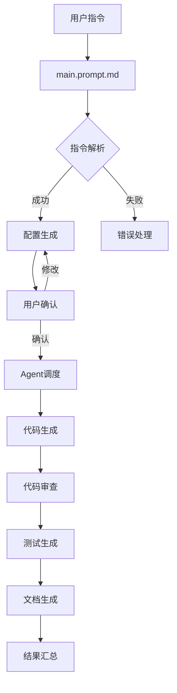

# CLAUDE.md

[根目录](../CLAUDE.md) > **ai-dev-mvp**

## 🎯 模块职责

ai-dev-mvp 是一个基于多代理架构的AI驱动开发系统，旨在自动化软件开发的完整流程。该模块作为项目的核心组件，提供了从需求分析到代码实现、测试、审查和文档生成的全链路AI辅助开发能力。

### 核心功能
- **多代理协作系统**: 5个专业AI代理协同工作
- **模板化代码生成**: 基于预定义模板的React组件生成
- **自动化测试**: 智能测试用例生成
- **代码质量审查**: 自动化代码审查和最佳实践检查
- **文档自动化**: 项目文档的自动生成和维护

## 🚀 入口与启动

### 主控制中枢
- **入口文件**: `main.prompt.md`
- **作用**: 中央调度器，负责接收用户指令并协调各Agent工作
- **启动流程**: 用户指令 → 配置生成 → Agent调度 → 结果返回

### Agent调用流程


## 🔌 对外接口

### Agent接口定义
每个Agent都遵循统一的接口规范：

```typescript
interface AgentInput {
  taskType: string;
  config: Record<string, any>;
  context?: Record<string, any>;
}

interface AgentOutput {
  status: 'success' | 'error';
  result?: any;
  error?: {
    type: string;
    message: string;
    details?: any;
    suggestions?: string[];
  };
}
```

### 支持的任务类型
- **create_component**: 创建新组件
- **modify_component**: 修改现有组件
- **generate_test**: 生成测试用例
- **review_code**: 代码审查
- **generate_doc**: 生成文档
- **debug_error**: 错误诊断

## 📦 关键依赖与配置

### 内部依赖关系
```
main.prompt.md
├── agents/
│   ├── code_agent.md (代码生成)
│   ├── test_agent.md (测试生成)
│   ├── review_agent.md (代码审查)
│   ├── doc_agent.md (文档生成)
│   └── debug_agent.md (错误诊断)
├── templates/
│   ├── code_template/ (代码模板)
│   └── tests_template/ (测试模板)
└── prompts/ (任务拆分模板)
```

### 模板系统
- **代码模板**: 支持React组件、页面、Hooks等
- **测试模板**: Jest + Testing Library测试模板
- **配置模板**: 组件属性、样式、类型定义等

## 🗃️ 数据模型

### 任务配置模型
```json
{
  "taskType": "create_component",
  "componentName": "Button",
  "framework": "react",
  "language": "typescript",
  "style": "css-module",
  "parameters": {
    "props": {
      "text": "string",
      "onClick": "() => void",
      "variant": ["primary", "secondary"]
    }
  }
}
```

### Agent路由表
```json
{
  "create_component": "code_agent.md",
  "modify_component": "code_agent.md",
  "generate_test": "test_agent.md",
  "review_code": "review_agent.md",
  "generate_doc": "doc_agent.md",
  "debug_error": "debug_agent.md"
}
```

## 🧪 测试与质量

### 质量保证机制
1. **代码审查Agent**: 自动检查代码质量
2. **测试生成Agent**: 确保代码覆盖度
3. **配置验证**: 用户确认机制
4. **错误处理**: 完善的错误分类和处理

### 测试覆盖范围
- 单元测试生成
- 集成测试模板
- 组件测试用例
- 错误处理测试

## ❓ 常见问题 (FAQ)

### Q: 如何添加新的Agent？
A: 在`agents/`目录下创建新的`.md`文件，并在`main.prompt.md`的路由表中添加相应的映射。

### Q: 如何扩展代码模板？
A: 在`templates/`目录下添加新的模板文件，并在对应的Agent中配置模板路径映射。

### Q: 如何处理复杂业务逻辑？
A: 目前MVP版本主要处理简单组件生成，复杂逻辑需要人工干预或后续版本增强。

## 📁 相关文件清单

### 核心文件
- `main.prompt.md` - 中央控制中枢
- `agents/code_agent.md` - 代码生成Agent
- `agents/test_agent.md` - 测试生成Agent
- `agents/review_agent.md` - 代码审查Agent
- `agents/doc_agent.md` - 文档生成Agent
- `agents/debug_agent.md` - 错误诊断Agent

### 模板文件
- `templates/code_template/components/Button/index.tsx` - React组件模板
- `templates/code_template/components/Button/index.css` - CSS样式模板
- `templates/tests_template/components/Button.test.jsx.template` - 测试模板

### 配置文件
- `prompts/开发任务拆分.md` - 开发任务拆分模板
- `prompts/测试任务拆分.md` - 测试任务拆分模板
- `prompts/需求拆分.md` - 需求拆分模板

## 📈 变更记录 (Changelog)

### 2025-08-29
- **feat**: 完成AI上下文初始化扫描
- **feat**: 添加模块文档和接口定义
- **feat**: 建立标准化的Agent协作流程
- **feat**: 完善模板系统和数据模型

### 历史变更
- **feat**: 初始化多代理系统架构
- **feat**: 添加React组件代码生成
- **feat**: 实现测试用例自动生成
- **feat**: 集成代码审查机制

## 🔄 覆盖率统计

### 扫描覆盖情况
- **总文件数**: 15个文件
- **已扫描文件**: 15个文件 (100%)
- **核心Agent**: 5个Agent (100%)
- **模板覆盖**: React组件模板 (100%)

### 主要缺口
- 无发现的重要缺口
- 所有关键组件均已完整覆盖

### 下一步建议
- [ ] 添加更多框架支持（Vue、Angular等）
- [ ] 增强复杂业务逻辑处理能力
- [ ] 完善错误诊断和修复建议
- [ ] 添加性能优化和代码重构功能