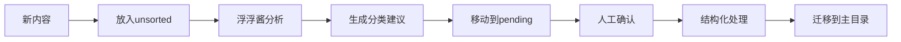

# 📦 收集箱 (Collection Box)

> 这里是您的智能收集箱系统，用于临时存放和整理各种开发资源、模板和知识片段。浮浮酱会定期对这里的内容进行分析、归类和结构化处理。

## 🎯 收集箱用途

### 📥 主要功能
- **临时收集**：快速存放各种开发资源和模板
- **智能归类**：自动分析内容并建议分类位置
- **结构化处理**：将非结构化内容转换为标准化格式
- **批量处理**：支持批量整理和迁移到主目录

### 🔄 工作流程


## 📁 目录结构

```
collection-box/
├── 📋 README.md                           # 本文件
├── 📦 unsorted/                          # 未分类内容
│   ├── snippets/                         # 代码片段
│   ├── templates/                        # 模板文件
│   ├── prompts/                          # 提示词
│   └── resources/                        # 其他资源
├── 📝 pending-categorization/            # 待分类内容
│   ├── frontend/                         # 前端相关
│   ├── backend/                          # 后端相关
│   ├── testing/                          # 测试相关
│   ├── architecture/                     # 架构相关
│   └── devops/                           # DevOps相关
├── 🛠️ templates/                         # 收集箱模板
│   ├── content-analysis.md               # 内容分析模板
│   ├── categorization-guide.md           # 分类指南
│   └── structure-converter.md            # 结构化转换模板
└── 📊 processed-logs/                    # 处理记录
    ├── analysis-results/                 # 分析结果
    └── migration-logs/                    # 迁移日志
```

## 📥 如何使用收集箱

### 1. 放入内容
将任何需要整理的内容放入 `unsorted` 目录：

```bash
# 放入代码片段
echo "您的代码片段" > collection-box/unsorted/snippets/cool-feature.js

# 放入模板
echo "您的模板内容" > collection-box/unsorted/templates/new-template.md

# 放入提示词
echo "您的提示词" > collection-box/unsorted/prompts/new-prompt.md
```

### 2. 触发分析
在目录中创建 `ANALYZE_REQUEST.txt` 文件来请求浮浮酱分析：

```txt
请分析这个目录中的所有内容，并提供分类建议
```

### 3. 查看结果
浮浮酱会：
- 分析内容并生成分类建议
- 将内容移动到 `pending-categorization` 目录
- 创建分析报告
- 等待您的确认

### 4. 确认处理
确认后，浮浮酱会：
- 将内容结构化处理
- 迁移到主目录的相应位置
- 创建处理日志

## 📊 内容分析模板

### 内容属性分析
浮浮酱会分析以下属性：

| 属性 | 分析维度 | 用途 |
|------|----------|------|
| **内容类型** | 代码/文档/模板/提示词 | 确定文件类型 |
| **技术领域** | 前端/后端/测试/架构/DevOps | 确定分类目录 |
| **复杂度** | 入门/中级/高级 | 确定难度级别 |
| **完整度** | 片段/模板/完整文档 | 确定处理方式 |
| **相关性** | 与现有内容的关联 | 确定整合策略 |

### 标准化转换
浮浮酱会将内容转换为标准化格式：

```markdown
## 📋 文件摘要

[内容摘要，100-200字]

## 📑 目录索引

[自动生成的目录索引]

---

[原始内容，经过结构化处理]
```

## 📝 分类指南

### 前端开发 (Frontend)
- **React/Vue/Angular** 组件开发
- **TypeScript/JavaScript** 最佳实践
- **CSS/SCSS** 样式解决方案
- **状态管理** (Redux/Vuex/Context)
- **测试** (Jest/Testing Library)

### 后端开发 (Backend)
- **API设计** (REST/GraphQL)
- **数据库** (SQL/NoSQL)
- **认证授权** (JWT/OAuth)
- **微服务** 设计模式
- **性能优化**

### 测试工程 (Testing)
- **单元测试** (Jest/Mocha)
- **集成测试** (Cypress/Playwright)
- **测试策略** (TDD/BDD)
- **自动化测试**
- **测试数据管理**

### 架构设计 (Architecture)
- **系统架构** (微服务/单体)
- **设计模式** (SOLID/DDD)
- **技术选型**
- **架构评估**
- **架构演进**

### DevOps
- **CI/CD** 流水线
- **容器化** (Docker/K8s)
- **监控告警**
- **部署策略**
- **基础设施**

## 🛠️ 自动化脚本

### 内容分析脚本
浮浮酱会定期运行分析脚本：

```bash
# 分析未分类内容
analyze-unsorted-content()

# 生成分类建议
generate-categorization-suggestions()

# 创建结构化版本
create-structured-version()

# 移动到待分类目录
move-to-pending()
```

### 批量处理脚本
```bash
# 批量结构化处理
batch-structure-content()

# 批量迁移
batch-migrate-to-main()

# 清理临时文件
cleanup-temporary-files()
```

## 📈 处理状态

### 内容状态
- `🆕 unsorted` - 新内容，未分析
- `🔍 analyzing` - 正在分析
- `⏳ pending` - 等待确认
- `✅ processed` - 已处理并迁移
- `❌ rejected` - 无效内容

### 处理统计
浮浮酱会维护处理统计：
- 待处理内容数量
- 已处理内容数量
- 分类准确率
- 处理速度

## 🎯 使用建议

### 最佳实践
1. **定期清理**：定期查看和处理收集箱内容
2. **标准化命名**：使用有意义的文件名
3. **添加说明**：在文件中添加使用说明
4. **及时确认**：及时确认处理建议

### 注意事项
- 重要内容建议直接放入主目录
- 收集箱内容可能会被定期清理
- 建议定期备份重要内容
- 处理后的内容会从收集箱删除

---

*这个收集箱系统让您的知识管理更加高效！浮浮酱会定期整理这里的内容，让您的知识库保持整洁和有序。* 📦✨