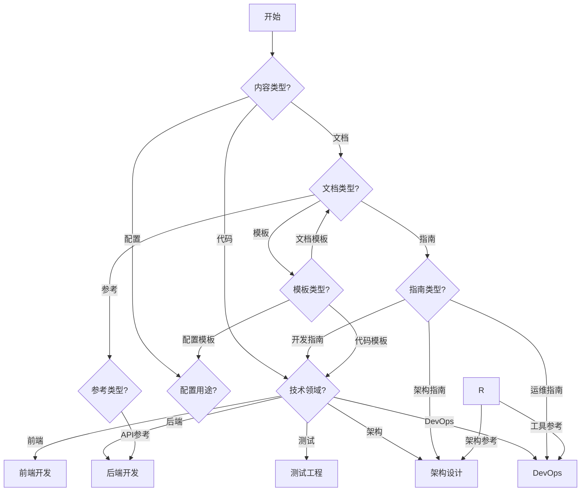

# 🗂️ 分类指南

> 这个指南详细说明了如何将收集箱中的内容准确分类到主目录的相应位置，确保知识库的结构清晰和一致性。

## 🎯 分类原则

### 核心原则
1. **功能导向**：按内容的主要功能分类
2. **专业性**：按技术专业领域细分
3. **实用性**：按实际使用场景组织
4. **一致性**：保持分类标准的一致性

### 分类维度
| 维度 | 说明 | 示例 |
|------|------|------|
| **技术领域** | 内容所属的技术领域 | 前端/后端/测试/架构/DevOps |
| **内容类型** | 内容的形式和用途 | 代码/模板/指南/参考 |
| **复杂度** | 技术难度和学习曲线 | 入门/中级/高级 |
| **项目类型** | 适用的项目类型 | Web应用/移动应用/API/工具库 |

## 📁 分类路径映射

### 前端开发 (Frontend)
```
smart-categories/by-expertise/frontend/
├── 📄 README.md                          # 前端开发总览
├── 🎨 组件开发/
│   ├── React组件/                        # React相关组件
│   ├── Vue组件/                          # Vue相关组件
│   └── 通用组件/                         # 通用UI组件
├── 🎯 状态管理/
│   ├── Redux/                            # Redux状态管理
│   ├── Vuex/                             # Vuex状态管理
│   └── Context API/                      # React Context
├── 💅 样式方案/
│   ├── CSS Modules/                      # CSS模块化
│   ├── Styled Components/                # CSS-in-JS
│   └── Tailwind CSS/                     # 实用优先CSS
└── 🧪 测试策略/
    ├── 单元测试/                         # 组件单元测试
    ├── 集成测试/                         # 组件集成测试
    └── E2E测试/                          # 端到端测试
```

### 后端开发 (Backend)
```
smart-categories/by-expertise/backend/
├── 📄 README.md                          # 后端开发总览
├── 🔌 API设计/
│   ├── RESTful API/                      # REST API设计
│   ├── GraphQL/                          # GraphQL API
│   └── API文档/                          # API文档生成
├── 💾 数据库/
│   ├── SQL数据库/                        # 关系型数据库
│   ├── NoSQL数据库/                      # 非关系型数据库
│   └── 数据库优化/                       # 性能优化
├── 🔐 认证授权/
│   ├── JWT认证/                          # JWT实现
│   ├── OAuth2/                           # OAuth2流程
│   └── 权限控制/                         # RBAC/ABAC
├── 🏗️ 架构模式/
│   ├── 微服务/                           # 微服务架构
│   ├── 单体架构/                         # 单体应用
│   └── 事件驱动/                         # 事件驱动架构
└── ⚡ 性能优化/
    ├── 缓存策略/                         # 缓存实现
    ├── 并发处理/                         # 并发优化
    └── 数据库优化/                       # 查询优化
```

### 测试工程 (Testing)
```
smart-categories/by-expertise/testing/
├── 📄 README.md                          # 测试工程总览
├── 🧪 单元测试/
│   ├── Jest/                             # Jest框架
│   ├── Mocha/                            # Mocha框架
│   └── Vitest/                           # 现代测试框架
├── 🔗 集成测试/
│   ├── Testing Library/                  # 测试库
│   ├── Cypress/                          # E2E测试
│   └── Playwright/                       # 现代E2E测试
├── 📊 测试策略/
│   ├── TDD/                              # 测试驱动开发
│   ├── BDD/                              # 行为驱动开发
│   └── 测试金字塔/                       # 测试策略
├── 🤖 自动化测试/
│   ├── CI/CD集成/                        # 持续集成测试
│   ├── 测试数据管理/                     # 数据工厂
│   └── 测试报告/                         # 报告生成
└── 🎯 质量保证/
    ├── 代码覆盖率/                       # 覆盖率分析
    ├── 性能测试/                         # 性能基准
    └── 安全测试/                         # 安全扫描
```

### 架构设计 (Architecture)
```
smart-categories/by-expertise/architecture/
├── 📄 README.md                          # 架构设计总览
├── 🏗️ 架构模式/
│   ├── 分层架构/                         # 分层架构模式
│   ├── 微服务架构/                       # 微服务设计
│   ├── 事件驱动/                         # 事件驱动架构
│   └── 六边形架构/                       # 端口和适配器
├── 🎨 设计原则/
│   ├── SOLID原则/                        # 面向对象原则
│   ├── DDD/                              # 领域驱动设计
│   └── Clean Architecture/               # 整洁架构
├── 🔧 技术选型/
│   ├── 框架选型/                         # 技术框架对比
│   ├── 数据库选型/                       # 数据库选择
│   └── 云服务选型/                       # 云平台选择
├── 📊 系统设计/
│   ├── 分布式系统/                       # 分布式架构
│   ├── 高可用架构/                       # 高可用设计
│   └── 可扩展架构/                       # 扩展性设计
└── 🔍 架构分析/
    ├── 架构评估/                         # ATAM评估
    ├── 性能分析/                         # 性能建模
    └── 架构演进/                         # 演进策略
```

### DevOps
```
smart-categories/by-expertise/devops/
├── 📄 README.md                          # DevOps总览
├── 🔄 CI/CD/
│   ├── GitHub Actions/                   # GitHub Actions
│   ├── Jenkins/                          # Jenkins流水线
│   └── GitLab CI/                        # GitLab CI
├── 🐳 容器化/
│   ├── Docker/                           # Docker容器
│   ├── Kubernetes/                      # K8s编排
│   └── Docker Compose/                   # 容器编排
├── 📊 监控告警/
│   ├── Prometheus/                       # 指标监控
│   ├── Grafana/                          # 可视化
│   └── ELK Stack/                        # 日志分析
├── ☁️ 云原生/
│   ├── AWS/                              # AWS服务
│   ├── Azure/                            # Azure服务
│   └── GCP/                              # Google Cloud
└── 🔧 基础设施/
    ├── 基础设施即代码/                    # IaC工具
    ├── 配置管理/                         # 配置管理工具
    └── 部署策略/                         # 部署模式
```

## 🎯 分类决策树

### 内容分类流程


### 复杂度评估
```typescript
interface ComplexityAssessment {
  criteria: {
    codeLength: number;        // 代码长度
    dependencies: number;      // 依赖数量
    concepts: number;          // 概念复杂度
    patterns: number;         // 设计模式数量
  };
  level: 'beginner' | 'intermediate' | 'advanced';
  reasoning: string;
}

function assessComplexity(content: string): ComplexityAssessment {
  const lines = content.split('\n').length;
  const imports = (content.match(/import|require/g) || []).length;
  const concepts = countTechnicalConcepts(content);
  const patterns = countDesignPatterns(content);
  
  let level: 'beginner' | 'intermediate' | 'advanced';
  let reasoning: string;
  
  if (lines < 50 && imports < 5 && concepts < 3) {
    level = 'beginner';
    reasoning = '代码简洁，依赖少，概念简单';
  } else if (lines < 200 && imports < 15 && concepts < 8) {
    level = 'intermediate';
    reasoning = '代码适中，依赖合理，概念适中';
  } else {
    level = 'advanced';
    reasoning = '代码复杂，依赖较多，概念复杂';
  }
  
  return {
    criteria: {
      codeLength: lines,
      dependencies: imports,
      concepts,
      patterns
    },
    level,
    reasoning
  };
}
```

## 📝 分类检查清单

### 前端内容检查
- [ ] 是否涉及React/Vue/Angular等前端框架？
- [ ] 是否包含UI组件开发？
- [ ] 是否涉及状态管理？
- [ ] 是否包含CSS/样式相关？
- [ ] 是否包含前端测试？

### 后端内容检查
- [ ] 是否涉及API设计/开发？
- [ ] 是否包含数据库操作？
- [ ] 是否涉及认证授权？
- [ ] 是否包含服务器端逻辑？
- [ ] 是否涉及性能优化？

### 测试内容检查
- [ ] 是否包含测试用例？
- [ ] 是否涉及测试框架？
- [ ] 是否包含测试策略？
- [ ] 是否涉及自动化测试？
- [ ] 是否包含质量保证？

### 架构内容检查
- [ ] 是否涉及系统设计？
- [ ] 是否包含架构模式？
- [ ] 是否涉及技术选型？
- [ ] 是否包含架构决策？
- [ ] 是否涉及架构评估？

### DevOps内容检查
- [ ] 是否涉及CI/CD？
- [ ] 是否包含容器化？
- [ ] 是否涉及监控告警？
- [ ] 是否包含部署策略？
- [ ] 是否涉及基础设施？

## 🔄 分类示例

### 示例1：React组件
```
原始文件：user-profile.jsx
内容类型：代码片段
技术领域：前端
技术栈：React
复杂度：中级
功能：用户资料展示组件

分类路径：smart-categories/by-expertise/frontend/组件开发/React组件/
文件名：user-profile-component-react-typescript-20250829.md
```

### 示例2：API设计
```
原始文件：api-design.txt
内容类型：文档模板
技术领域：后端
技术栈：RESTful API
复杂度：高级
功能：REST API设计指南

分类路径：smart-categories/by-expertise/backend/API设计/RESTful API/
文件名：restful-api-design-guide-backend-20250829.md
```

### 示例3：测试策略
```
原始文件：testing-strategy.md
内容类型：指南
技术领域：测试
技术栈：Jest, Testing Library
复杂度：中级
功能：前端测试策略指南

分类路径：smart-categories/by-expertise/testing/测试策略/
文件名：frontend-testing-strategy-guide-testing-20250829.md
```

## 🛠️ 分类工具

### 自动分类脚本
```bash
#!/bin/bash
# auto-classify.sh

# 分析文件并建议分类路径
suggest_category() {
    local file="$1"
    local content=$(cat "$file")
    
    # 基于内容特征分类
    if echo "$content" | grep -q "import.*react\|React\|JSX"; then
        echo "smart-categories/by-expertise/frontend/"
    elif echo "$content" | grep -q "express\|fastapi\|django\|flask"; then
        echo "smart-categories/by-expertise/backend/"
    elif echo "$content" | grep -q "test\|jest\|cypress\|testing"; then
        echo "smart-categories/by-expertise/testing/"
    elif echo "$content" | grep -q "architecture\|design.*pattern\|microservice"; then
        echo "smart-categories/by-expertise/architecture/"
    elif echo "$content" | grep -q "docker\|kubernetes\|ci/cd\|github.*actions"; then
        echo "smart-categories/by-expertise/devops/"
    else
        echo "需要人工分类"
    fi
}

# 批量分类
for file in collection-box/unsorted/*/*; do
    if [ -f "$file" ]; then
        category=$(suggest_category "$file")
        echo "文件: $file"
        echo "建议分类: $category"
        echo "---"
    fi
done
```

### 分类验证脚本
```bash
#!/bin/bash
# validate-classification.sh

# 验证分类是否正确
validate_classification() {
    local file="$1"
    local category="$2"
    
    # 检查目标目录是否存在
    if [ ! -d "$category" ]; then
        echo "错误：分类目录不存在: $category"
        return 1
    fi
    
    # 检查文件是否符合分类要求
    case "$category" in
        *frontend*)
            if ! grep -q "react\|vue\|angular\|javascript\|typescript" "$file"; then
                echo "警告：文件可能不属于前端分类"
            fi
            ;;
        *backend*)
            if ! grep -q "api\|database\|server\|express\|django" "$file"; then
                echo "警告：文件可能不属于后端分类"
            fi
            ;;
        *testing*)
            if ! grep -q "test\|jest\|cypress\|mock" "$file"; then
                echo "警告：文件可能不属于测试分类"
            fi
            ;;
    esac
}
```

---

*这个分类指南确保收集箱中的内容能够准确、一致地分类到正确的位置，保持知识库的结构清晰和易用性。* 🗂️✨