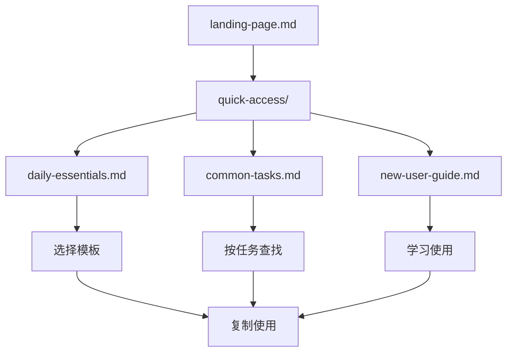
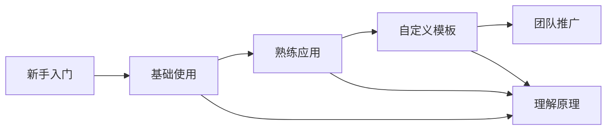

## 📋 文件摘要

本文档为新用户提供AI Prompts by Stark知识库的完整使用指南，包含快速上手、核心概念解释、使用技巧和最佳实践。通过本指南，新用户可以在30分钟内掌握知识库的基本使用方法，开始提升开发效率。

## 📑 目录索引

- [📋 文件摘要](#-文件摘要)
- [🚀 快速开始](#快速开始)
- [🏗️ 理解项目结构](#理解项目结构)
- [🎯 核心概念](#核心概念)
- [📖 使用方法](#使用方法)
- [💡 最佳实践](#最佳实践)
- [🔍 常见问题](#常见问题)
- [📞 进阶学习](#进阶学习)

---

## 🚀 快速开始

### 第一步：了解项目
**AI Prompts by Stark** 是什么？
- 🎯 **目标**：提供高质量的AI提示模板和开发模式
- 💡 **用途**：帮助开发者提升工作效率，解决技术问题
- 📚 **内容**：覆盖开发全生命周期的各类模板和指南

### 第二步：选择入口
根据您的需求选择合适的开始方式：

| 用户类型 | 推荐路径 | 预计时间 |
|----------|----------|----------|
| **完全新手** | [每日必备](daily-essentials.md) → [新手基础](#新手基础) | 30分钟 |
| **有经验开发者** | [常见任务](common-tasks.md) → [实战演练](#实战演练) | 15分钟 |
| **特定需求** | [搜索功能](../search-interface.md) → [问题解决](#问题解决) | 5-10分钟 |

### 第三步：体验核心功能
1. **打开一个模板**：选择[每日必备](daily-essentials.md)中的任意模板
2. **理解结构**：查看模板的摘要、目录索引、详细内容
3. **尝试使用**：复制模板内容，根据您的需求调整参数
4. **查看效果**：在AI工具中使用调整后的提示词

---

## 🏗️ 理解项目结构

### 🌲 整体架构
```
AI-prompts-by-Stark/
├── 🏠 landing-page.md       # 主入口页面
├── 📁 quick-access/         # 快速访问区 ← 新手重点
│   ├── daily-essentials.md  # 每日必备 ← 推荐
│   ├── common-tasks.md      # 常见任务
│   └── new-user-guide.md    # 本文档
├── 📁 smart-categories/     # 智能分类
├── 🔍 search-interface.md   # 搜索功能
├── 📁 01-10模块/           # 原有详细分类
└── 📄 CLAUDE.md            # 项目说明
```

### 🎯 推荐访问路径


---

## 🎯 核心概念

### 📝 提示模板（Prompt Template）
**什么是提示模板？**
- 预先编写好的AI指令框架
- 包含变量占位符，可根据具体需求调整
- 经过验证的高质量指令结构

**示例**：
```
你是一个专业的{角色}，请帮我{任务}。
具体要求：
1. {要求1}
2. {要求2}
3. {要求3}
```

### 🏷️ 标签系统
**文件命名规则**：`[prefix]-[topic]-[subtopic]-[tags]-[date].md`

**标签类型**：
- **技术标签**：react, vue, nodejs, python
- **角色标签**：developer, designer, tester
- **任务标签**：development, testing, debugging
- **级别标签**：beginner, intermediate, advanced

### 📊 质量标准
**优质模板的特征**：
- ✅ **目标明确**：清楚说明要完成的任务
- ✅ **结构完整**：包含背景、要求、输出格式
- ✅ **参数灵活**：可以根据具体情况调整
- ✅ **效果验证**：经过实际使用验证

---

## 📖 使用方法

### 🎯 基础使用流程

#### 1. 查找模板
**方法一：按需求查找**
```markdown
需要生成React组件？
→ 访问 daily-essentials.md
→ 找到"React组件生成"
→ 点击链接查看模板
```

**方法二：按任务查找**
```markdown
需要编写测试？
→ 访问 common-tasks.md
→ 找到"测试验证阶段"
→ 选择具体测试类型
```

#### 2. 理解模板结构
每个模板都包含：
- **📋 文件摘要**：模板用途和内容概述
- **📑 目录索引**：快速导航到特定章节
- **🎯 核心内容**：具体的提示词模板
- **💡 使用建议**：最佳实践和注意事项

#### 3. 自定义调整
**替换变量**：
```markdown
原文：你是一个专业的{前端开发工程师}
修改：你是一个专业的React开发者
```

**添加要求**：
```markdown
原文：生成一个按钮组件
修改：生成一个支持主题切换的按钮组件
```

#### 4. 使用模板
**复制粘贴**：
1. 复制调整后的提示词
2. 粘贴到AI工具（如Claude、ChatGPT）
3. 等待AI生成结果
4. 检查和优化结果

### 🔧 高级使用技巧

#### 组合使用模板
**场景**：开发一个新功能
```markdown
1. 需求分解模板 → 明确功能需求
2. 架构设计模板 → 设计技术方案
3. 代码生成模板 → 生成具体代码
4. 测试生成模板 → 编写测试用例
```

#### 创建自定义模板
**步骤**：
1. 找到类似场景的现有模板
2. 根据项目特点调整内容
3. 测试模板效果
4. 保存为团队专用模板

---

## 💡 最佳实践

### 🎯 效率提升技巧

#### 1. 建立个人收藏
```markdown
浏览器书签夹结构：
📁 AI Prompts by Stark
  ├── 🏆 我的常用
  ├── 🧪 测试相关
  ├── 🏗️ 架构设计
  └── 📝 文档编写
```

#### 2. 团队共享
- **统一标准**：团队使用相同的模板
- **经验分享**：定期分享使用心得
- **持续优化**：根据反馈改进模板

#### 3. 版本管理
- **关注更新**：定期查看模板更新
- **备份自定义**：保存团队定制版本
- **反馈建议**：提出改进建议

### ⚠️ 常见误区

#### 1. 过度依赖
**问题**：完全按照模板，缺乏思考
**解决**：模板是工具，需要结合实际情况调整

#### 2. 参数不当
**问题**：替换参数时不考虑上下文
**解决**：确保参数替换后逻辑一致

#### 3. 缺乏验证
**问题**：直接使用结果不检查
**解决**：始终验证AI输出的质量

---

## 🔍 常见问题

### Q: 如何选择合适的模板？
**A**: 
1. 明确你的任务类型（开发、测试、文档等）
2. 确定技术栈（React、Vue、Node.js等）
3. 考虑难度级别（新手、中级、高级）
4. 在[常见任务](common-tasks.md)中查找对应分类

### Q: 模板效果不理想怎么办？
**A**:
1. 检查参数是否正确替换
2. 调整提示词的详细程度
3. 提供更多上下文信息
4. 尝试类似的替代模板

### Q: 可以为团队定制模板吗？
**A**: 
- **可以**：建议基于现有模板调整
- **步骤**：复制模板 → 团队化调整 → 测试验证 → 团队共享
- **注意**：保持与原模板的一致性

### Q: 如何贡献新的模板？
**A**:
1. 参考现有模板的格式和结构
2. 确保模板经过实际验证
3. 按照命名规范保存
4. 提交到项目仓库

---

## 📞 进阶学习

### 🎯 学习路径


### 📚 推荐资源
1. **官方文档**：[CLAUDE.md](../CLAUDE.md)
2. **最佳实践**：[软件设计原则](../06-best-practices/design-principles/software-design-principles-guide-design-pattern-20250829.md)
3. **高级技巧**：[多代理系统](../01-core-framework/multi-agent-system/framework-core-prompt-ai-architecture-20250829.md)

### 🎯 实战演练
**建议项目**：
1. **个人博客**：使用模板生成前端组件和后端API
2. **TODO应用**：练习全栈开发的各个环节
3. **组件库**：深入理解组件设计和测试

---

## 📈 成长追踪

### 📊 使用统计
- **第一周**：熟悉基本模板，完成1-2个小任务
- **第一个月**：熟练使用常用模板，效率提升30%
- **第三个月**：能够自定义模板，团队内分享经验
- **第六个月**：成为团队模板专家，贡献新的模板

### 🎯 技能提升
- **技术能力**：通过模板学习最佳实践
- **工作效率**：减少重复工作，提升开发速度
- **问题解决**：掌握系统化的问题解决方法
- **团队协作**：统一开发标准，提升协作效率

---

*欢迎来到AI Prompts by Stark的世界！通过这个知识库，您将发现AI辅助开发的无限可能。如有任何问题，随时查阅相关文档或寻求帮助。* 🚀