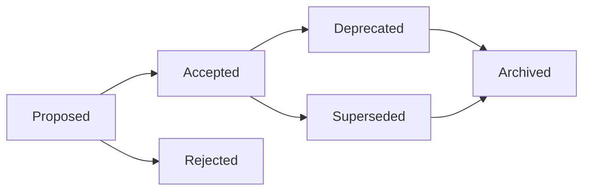

# 📝 架构决策记录 (ADR) 指南

> **记录架构决策的轨迹，为团队提供决策上下文和历史追溯**

## 📋 概述

架构决策记录（Architecture Decision Record, ADR）是记录重要架构决策的轻量级文档。它帮助团队理解为什么做出某些技术选择，避免重复讨论，并为新成员提供历史上下文。

## 🎯 为什么需要ADR

### 核心价值
1. **决策透明化**: 让所有团队成员了解架构决策的原因
2. **知识传承**: 新成员快速理解项目架构演进历史
3. **避免重复**: 防止已经讨论过的问题被反复提出
4. **责任追溯**: 明确决策的制定者和时间
5. **学习改进**: 从过去的决策中学习经验教训

## 📂 ADR文件组织

```
docs/
└── architecture/
    └── decisions/
        ├── 0001-record-architecture-decisions.md
        ├── 0002-use-react-for-frontend.md
        ├── 0003-adopt-typescript.md
        ├── 0004-choose-next-js-framework.md
        ├── 0005-implement-design-system.md
        ├── 0006-api-layer-architecture.md
        ├── 0007-state-management-solution.md
        ├── 0008-testing-strategy.md
        ├── 0009-ci-cd-pipeline.md
        └── 0010-monitoring-and-logging.md
```

## 📝 ADR模板

### 标准ADR模板

```markdown
# ADR-[编号]: [标题]

日期: [YYYY-MM-DD]

## 状态

[Proposed | Accepted | Deprecated | Superseded by ADR-xxx]

## 背景

[描述需要做出决策的背景和上下文。为什么需要这个决策？当前面临什么问题？]

## 决策

[清晰描述做出的决策。使用主动语态，例如"我们将..."，"我们选择..."]

## 选项评估

### 选项1: [选项名称]
**优点:**
- [优点1]
- [优点2]

**缺点:**
- [缺点1]
- [缺点2]

### 选项2: [选项名称]
**优点:**
- [优点1]
- [优点2]

**缺点:**
- [缺点1]
- [缺点2]

### 选项3: [选项名称]
**优点:**
- [优点1]
- [优点2]

**缺点:**
- [缺点1]
- [缺点2]

## 决策理由

[解释为什么选择这个方案而不是其他选项。包括技术、业务、团队等考虑因素]

## 后果

**积极影响:**
- [积极后果1]
- [积极后果2]

**消极影响:**
- [消极后果1]
- [消极后果2]

**风险和缓解措施:**
- 风险: [风险描述]
  缓解: [缓解措施]

## 实施计划

1. [步骤1]
2. [步骤2]
3. [步骤3]

## 参与者

- 提议者: [姓名]
- 决策者: [姓名]
- 参与讨论: [姓名列表]

## 参考资料

- [相关文档链接]
- [技术文章链接]
- [相关ADR链接]
```

## 📚 ADR实例

### 实例1: 选择状态管理方案

```markdown
# ADR-0007: 选择Redux Toolkit作为状态管理方案

日期: 2024-01-15

## 状态

Accepted

## 背景

随着应用复杂度增加，组件间的状态共享变得困难。我们需要一个统一的状态管理方案来：
- 管理全局应用状态
- 处理异步数据获取
- 支持时间旅行调试
- 提供可预测的状态更新

## 决策

我们将采用Redux Toolkit (RTK)作为主要的状态管理解决方案。

## 选项评估

### 选项1: Redux Toolkit
**优点:**
- 官方推荐的Redux使用方式
- 内置了最佳实践
- 简化了Redux的使用
- 优秀的TypeScript支持
- 包含RTK Query用于数据获取

**缺点:**
- 学习曲线相对陡峭
- 对小型应用可能过度设计
- 增加了bundle大小

### 选项2: Zustand
**优点:**
- 极其简单的API
- 小巧轻量(8kb)
- 无需Provider包装
- TypeScript友好

**缺点:**
- 社区和生态系统较小
- 缺少官方的开发工具
- 没有内置的异步处理方案

### 选项3: MobX
**优点:**
- 真正的响应式编程
- 简单直观的API
- 优秀的性能
- 装饰器语法优雅

**缺点:**
- 魔法太多，不够显式
- 调试相对困难
- 与React生态系统集成不够紧密

### 选项4: Context API + useReducer
**优点:**
- React内置，无需额外依赖
- 简单场景下足够使用
- 学习成本低

**缺点:**
- 性能问题（不必要的重渲染）
- 缺少开发工具
- 没有标准的异步处理方案
- 大型应用中会变得复杂

## 决策理由

选择Redux Toolkit的主要原因：

1. **成熟度**: Redux是最成熟的状态管理方案，有大量的最佳实践和解决方案
2. **生态系统**: 丰富的中间件和工具支持
3. **可预测性**: 单向数据流和不可变更新确保状态可预测
4. **开发体验**: Redux DevTools提供优秀的调试体验
5. **团队熟悉度**: 团队成员对Redux较为熟悉
6. **RTK Query**: 内置的数据获取和缓存方案减少了boilerplate

## 后果

**积极影响:**
- 统一的状态管理模式
- 更好的调试和开发体验
- 便于实现复杂的业务逻辑
- 有利于团队协作

**消极影响:**
- 增加了约40KB的bundle大小
- 新成员需要学习Redux概念
- 简单组件可能会有过度设计

**风险和缓解措施:**
- 风险: 过度使用全局状态
  缓解: 制定明确的状态设计规范，优先使用组件本地状态
  
- 风险: 性能问题
  缓解: 使用reselect进行memorization，合理设计state结构

## 实施计划

1. 安装Redux Toolkit和React-Redux
2. 配置store和根Provider
3. 迁移现有的全局状态到Redux
4. 为团队提供Redux Toolkit培训
5. 建立Redux使用规范和最佳实践文档

## 参与者

- 提议者: 张三
- 决策者: 李四（技术负责人）
- 参与讨论: 前端团队全体成员

## 参考资料

- [Redux Toolkit官方文档](https://redux-toolkit.js.org/)
- [Redux最佳实践](https://redux.js.org/style-guide/)
- [状态管理方案对比](https://example.com/state-management-comparison)
```

### 实例2: API层架构决策

```markdown
# ADR-0006: 采用BFF层架构模式

日期: 2024-01-10

## 状态

Accepted

## 背景

当前前端直接调用多个后端微服务API存在以下问题：
- 前端需要处理复杂的数据聚合逻辑
- 多次API调用导致性能问题
- 不同客户端（Web、Mobile）需要不同的数据格式
- 认证和授权逻辑分散

## 决策

我们将实现Backend for Frontend (BFF)层，为每个客户端类型提供定制的API网关。

## 选项评估

### 选项1: BFF (Backend for Frontend)
**优点:**
- 为不同客户端提供定制API
- 减少客户端复杂度
- 优化数据传输
- 集中处理认证授权

**缺点:**
- 增加了架构复杂度
- 需要额外的开发和维护
- 可能成为单点故障

### 选项2: GraphQL
**优点:**
- 客户端按需查询
- 强类型系统
- 减少过度获取和获取不足
- 单一端点

**缺点:**
- 学习曲线陡峭
- 缓存复杂
- 性能调优困难
- N+1查询问题

### 选项3: 直接调用微服务
**优点:**
- 架构简单
- 无额外层级
- 直接通信

**缺点:**
- 前端复杂度高
- 多次网络请求
- 难以优化不同客户端

## 决策理由

1. **性能优化**: BFF可以聚合多个API调用，减少网络往返
2. **客户端简化**: 前端只需要关注UI逻辑
3. **安全性**: 敏感逻辑和密钥可以保存在BFF层
4. **灵活性**: 可以为不同客户端提供不同的API

## 后果

**积极影响:**
- 提升前端性能
- 简化前端代码
- 更好的关注点分离
- 便于API版本管理

**消极影响:**
- 增加了系统复杂度
- 需要额外的服务器资源
- 需要维护BFF层代码

## 实施计划

1. 搭建Node.js BFF服务
2. 实现API聚合层
3. 添加缓存机制
4. 迁移现有API调用
5. 监控和优化

## 参与者

- 提议者: 王五
- 决策者: 赵六（架构师）
- 参与讨论: 前端和后端团队

## 参考资料

- [BFF Pattern](https://samnewman.io/patterns/architectural/bff/)
- [API Gateway vs BFF](https://example.com/comparison)
```

## 🔄 ADR生命周期管理

### 状态流转



### 状态说明

| 状态 | 说明 | 行动 |
|-----|------|-----|
| Proposed | 提议中，等待评审 | 团队讨论和评审 |
| Accepted | 已接受，正在或将要实施 | 按计划实施 |
| Rejected | 已拒绝 | 记录拒绝原因 |
| Deprecated | 已废弃，但未被替代 | 逐步移除 |
| Superseded | 被新ADR替代 | 参考新ADR |
| Archived | 归档，仅作历史参考 | 保留记录 |

## 🛠️ ADR工具和自动化

### 1. ADR CLI工具

```bash
# 安装ADR工具
npm install -g adr-cli

# 初始化ADR目录
adr init docs/architecture/decisions

# 创建新的ADR
adr new "选择测试框架"

# 列出所有ADR
adr list

# 生成目录
adr generate toc

# 创建取代关系
adr supersede 3 by 10
```

### 2. ADR生成脚本

```javascript
// scripts/create-adr.js
const fs = require('fs');
const path = require('path');
const readline = require('readline');

class ADRGenerator {
  constructor() {
    this.adrPath = 'docs/architecture/decisions';
    this.template = this.loadTemplate();
  }

  async create() {
    const rl = readline.createInterface({
      input: process.stdin,
      output: process.stdout
    });

    const title = await this.question(rl, 'ADR标题: ');
    const background = await this.question(rl, '背景描述: ');
    const decision = await this.question(rl, '决策内容: ');
    
    const number = this.getNextNumber();
    const filename = this.formatFilename(number, title);
    const content = this.fillTemplate({
      number,
      title,
      date: new Date().toISOString().split('T')[0],
      background,
      decision
    });

    fs.writeFileSync(
      path.join(this.adrPath, filename),
      content
    );

    console.log(`✅ ADR创建成功: ${filename}`);
    rl.close();
  }

  getNextNumber() {
    const files = fs.readdirSync(this.adrPath);
    const numbers = files
      .map(f => parseInt(f.split('-')[0]))
      .filter(n => !isNaN(n));
    
    return Math.max(0, ...numbers) + 1;
  }

  formatFilename(number, title) {
    const num = String(number).padStart(4, '0');
    const slug = title
      .toLowerCase()
      .replace(/[^a-z0-9]+/g, '-')
      .replace(/^-|-$/g, '');
    
    return `${num}-${slug}.md`;
  }

  fillTemplate(data) {
    let content = this.template;
    
    for (const [key, value] of Object.entries(data)) {
      content = content.replace(new RegExp(`\\[${key}\\]`, 'g'), value);
    }
    
    return content;
  }

  question(rl, prompt) {
    return new Promise(resolve => {
      rl.question(prompt, resolve);
    });
  }

  loadTemplate() {
    return fs.readFileSync(
      path.join(__dirname, 'adr-template.md'),
      'utf-8'
    );
  }
}

// 运行生成器
new ADRGenerator().create();
```

### 3. ADR自动检查

```javascript
// scripts/check-adr.js
class ADRChecker {
  constructor() {
    this.adrPath = 'docs/architecture/decisions';
    this.errors = [];
    this.warnings = [];
  }

  checkAll() {
    const files = fs.readdirSync(this.adrPath);
    
    files.forEach(file => {
      if (file.endsWith('.md')) {
        this.checkFile(path.join(this.adrPath, file));
      }
    });

    this.reportResults();
  }

  checkFile(filepath) {
    const content = fs.readFileSync(filepath, 'utf-8');
    const filename = path.basename(filepath);

    // 检查文件命名
    if (!/^\d{4}-[\w-]+\.md$/.test(filename)) {
      this.errors.push(`${filename}: 文件命名不规范`);
    }

    // 检查必要章节
    const requiredSections = ['状态', '背景', '决策', '后果'];
    requiredSections.forEach(section => {
      if (!content.includes(`## ${section}`)) {
        this.errors.push(`${filename}: 缺少必要章节 "${section}"`);
      }
    });

    // 检查状态值
    const statusMatch = content.match(/## 状态\s+(\w+)/);
    if (statusMatch) {
      const validStatuses = ['Proposed', 'Accepted', 'Rejected', 'Deprecated', 'Superseded'];
      if (!validStatuses.includes(statusMatch[1])) {
        this.errors.push(`${filename}: 无效的状态值 "${statusMatch[1]}"`);
      }
    }

    // 检查日期格式
    const dateMatch = content.match(/日期:\s*(\S+)/);
    if (dateMatch && !/^\d{4}-\d{2}-\d{2}$/.test(dateMatch[1])) {
      this.warnings.push(`${filename}: 日期格式不标准`);
    }

    // 检查引用
    const supersededMatch = content.match(/Superseded by ADR-(\d+)/);
    if (supersededMatch) {
      const refNumber = supersededMatch[1].padStart(4, '0');
      const refExists = fs.existsSync(
        path.join(this.adrPath, `${refNumber}-*.md`)
      );
      if (!refExists) {
        this.errors.push(`${filename}: 引用的ADR-${refNumber}不存在`);
      }
    }
  }

  reportResults() {
    if (this.errors.length > 0) {
      console.error('❌ 错误:');
      this.errors.forEach(err => console.error(`  - ${err}`));
    }

    if (this.warnings.length > 0) {
      console.warn('⚠️ 警告:');
      this.warnings.forEach(warn => console.warn(`  - ${warn}`));
    }

    if (this.errors.length === 0 && this.warnings.length === 0) {
      console.log('✅ 所有ADR检查通过');
    }

    process.exit(this.errors.length > 0 ? 1 : 0);
  }
}

// 运行检查
new ADRChecker().checkAll();
```

## 📊 ADR统计和报告

### 生成ADR报告

```javascript
// scripts/adr-report.js
class ADRReporter {
  generateReport() {
    const stats = this.collectStatistics();
    const report = this.formatReport(stats);
    
    fs.writeFileSync('docs/adr-report.md', report);
    console.log('📊 ADR报告已生成');
  }

  collectStatistics() {
    const files = fs.readdirSync(this.adrPath);
    const adrs = files.map(f => this.parseADR(f));

    return {
      total: adrs.length,
      byStatus: this.groupByStatus(adrs),
      byYear: this.groupByYear(adrs),
      byAuthor: this.groupByAuthor(adrs),
      recentDecisions: this.getRecent(adrs, 5),
      supersededChain: this.findSupersededChains(adrs)
    };
  }

  formatReport(stats) {
    return `# ADR统计报告

生成时间: ${new Date().toISOString()}

## 📈 总体统计

- 总ADR数量: ${stats.total}
- 活跃ADR: ${stats.byStatus.Accepted || 0}
- 废弃ADR: ${stats.byStatus.Deprecated || 0}
- 被替代ADR: ${stats.byStatus.Superseded || 0}

## 📊 按状态分布

${this.formatStatusChart(stats.byStatus)}

## 📅 按年份分布

${this.formatYearChart(stats.byYear)}

## 👥 按作者统计

${this.formatAuthorTable(stats.byAuthor)}

## 🕐 最近决策

${this.formatRecentDecisions(stats.recentDecisions)}

## 🔄 替代关系链

${this.formatSupersededChains(stats.supersededChain)}
`;
  }
}
```

## 🤖 AI辅助ADR生成

### AI生成ADR提示词

```markdown
## 生成ADR提示词

我需要创建一个架构决策记录(ADR)，请帮我生成完整的ADR文档。

**决策主题**: [描述需要决策的问题]

**当前情况**: 
- [现状描述]
- [面临的挑战]

**考虑的选项**:
1. [选项1]
2. [选项2]
3. [选项3]

**约束条件**:
- 技术约束: [技术限制]
- 业务约束: [业务要求]
- 时间约束: [时间限制]
- 资源约束: [资源限制]

**评估维度**:
- 性能
- 可维护性
- 成本
- 学习曲线
- 团队熟悉度

请生成:
1. 完整的ADR文档
2. 每个选项的详细评估
3. 明确的决策建议
4. 实施计划
5. 风险评估
```

## 📝 最佳实践

### ADR编写原则

1. **及时记录**: 在做出决策时立即记录，不要拖延
2. **简洁明了**: 使用清晰、简洁的语言
3. **保持客观**: 公正评估各个选项
4. **包含上下文**: 提供足够的背景信息
5. **记录原因**: 不仅记录"是什么"，更要记录"为什么"

### 常见错误

❌ **避免**:
- 事后补写ADR
- 只记录决策结果，不记录过程
- 使用模糊的语言
- 忽略负面后果
- 不更新状态

✅ **应该**:
- 实时记录决策
- 详细记录评估过程
- 使用明确的表述
- 诚实记录所有后果
- 及时更新ADR状态

## 🔗 ADR集成

### 与开发流程集成

```yaml
# .github/workflows/adr-check.yml
name: ADR Check

on:
  pull_request:
    paths:
      - 'docs/architecture/decisions/**'

jobs:
  check:
    runs-on: ubuntu-latest
    steps:
      - uses: actions/checkout@v3
      
      - name: Check ADR Format
        run: npm run adr:check
      
      - name: Generate ADR Index
        run: npm run adr:index
      
      - name: Commit Index
        uses: EndBug/add-and-commit@v9
        with:
          add: 'docs/architecture/decisions/index.md'
          message: 'Update ADR index'
```

---

**记住：好的架构决策记录是团队智慧的结晶，是项目成功的重要保障！** 📝