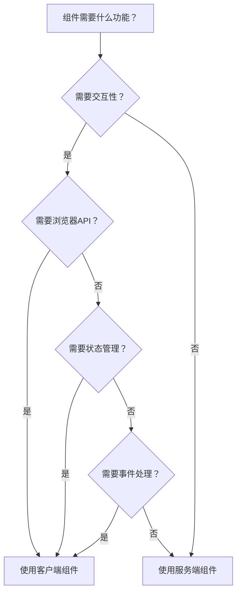

# 组件选择决策指南

> 如何在客户端组件和服务端组件之间做出正确的选择

## 📋 概述

在 Next.js App Router 中，选择使用客户端组件还是服务端组件是一个重要的架构决策。本指南提供了详细的决策框架和最佳实践，帮助开发者做出正确的选择。

## 🎯 决策原则

### 基本决策流程



## 🏗️ 决策矩阵

### 1. 使用服务端组件的情况

#### ✅ 适合服务端组件的场景

| 场景 | 例子 | 原因 |
|------|------|------|
| **静态内容展示** | 页面头部、页脚、导航栏 | 零客户端 JavaScript，更好的 SEO |
| **数据获取** | 用户资料、产品列表、博客文章 | 直接访问数据库，无 CORS 限制 |
| **SEO 重要内容** | 文章详情、产品页面 | 搜索引擎可以直接索引 |
| **布局组件** | 网格布局、容器组件 | 纯展示逻辑，无需交互 |
| **敏感数据处理** | 用户权限、支付信息 | 不会暴露给客户端 |
| **复杂计算** | 数据分析、统计信息 | 服务器端处理，减轻客户端负担 |

#### 📝 服务端组件示例

```tsx
// ✅ 正确：服务端组件示例
import React from 'react';
import { db } from '@/lib/db';

interface BlogPostProps {
  slug: string;
}

export const BlogPost: React.FC<BlogPostProps> = async ({ slug }) => {
  // 直接访问数据库
  const post = await db.post.findUnique({
    where: { slug },
    include: {
      author: true,
      category: true,
    },
  });

  if (!post) {
    return notFound();
  }

  // 服务端计算
  const readTime = Math.ceil(post.content.length / 200);
  const relatedPosts = await getRelatedPosts(post.categoryId, post.id);

  return (
    <article className="blog-post">
      <header>
        <h1>{post.title}</h1>
        <div className="meta">
          <span>By {post.author.name}</span>
          <span>{post.category.name}</span>
          <span>{readTime} min read</span>
        </div>
      </header>
      
      <div 
        className="content"
        dangerouslySetInnerHTML={{ __html: post.content }}
      />
      
      <section className="related-posts">
        <h2>Related Posts</h2>
        <ul>
          {relatedPosts.map(relatedPost => (
            <li key={relatedPost.id}>
              <a href={`/blog/${relatedPost.slug}`}>
                {relatedPost.title}
              </a>
            </li>
          ))}
        </ul>
      </section>
    </article>
  );
};
```

### 2. 使用客户端组件的情况

#### ✅ 适合客户端组件的场景

| 场景 | 例子 | 原因 |
|------|------|------|
| **用户交互** | 按钮、表单、模态框 | 需要事件处理和状态管理 |
| **浏览器 API** | 地图、音频、视频、本地存储 | 需要访问浏览器原生 API |
| **实时更新** | 聊天应用、实时数据 | 需要实时状态更新 |
| **复杂状态管理** | 购物车、用户设置 | 需要复杂的状态逻辑 |
| **动画效果** | 过渡动画、加载动画 | 需要浏览器动画 API |
| **拖拽功能** | 文件上传、排序 | 需要 DOM 操作和事件处理 |

#### 📝 客户端组件示例

```tsx
// ✅ 正确：客户端组件示例
'use client';

import React, { useState, useCallback } from 'react';
import { useDropzone } from 'react-dropzone';

interface FileUploadProps {
  onUpload: (files: File[]) => Promise<void>;
  maxSize?: number;
  acceptedTypes?: string[];
}

export const FileUpload: React.FC<FileUploadProps> = ({
  onUpload,
  maxSize = 10 * 1024 * 1024, // 10MB
  acceptedTypes = ['image/*', 'application/pdf'],
}) => {
  const [uploading, setUploading] = useState(false);
  const [progress, setProgress] = useState(0);
  const [error, setError] = useState<string | null>(null);

  const onDrop = useCallback(async (acceptedFiles: File[]) => {
    try {
      setUploading(true);
      setError(null);
      
      // 模拟上传进度
      const progressInterval = setInterval(() => {
        setProgress(prev => {
          if (prev >= 90) {
            clearInterval(progressInterval);
            return prev;
          }
          return prev + 10;
        });
      }, 100);

      await onUpload(acceptedFiles);
      
      clearInterval(progressInterval);
      setProgress(100);
      
      // 重置状态
      setTimeout(() => {
        setProgress(0);
        setUploading(false);
      }, 1000);
      
    } catch (err) {
      setError(err instanceof Error ? err.message : 'Upload failed');
      setUploading(false);
      setProgress(0);
    }
  }, [onUpload]);

  const { getRootProps, getInputProps, isDragActive } = useDropzone({
    onDrop,
    accept: acceptedTypes.reduce((acc, type) => ({ ...acc, [type]: [] }), {}),
    maxSize,
    disabled: uploading,
  });

  return (
    <div className="file-upload">
      <div
        {...getRootProps()}
        className={`dropzone ${isDragActive ? 'active' : ''} ${uploading ? 'uploading' : ''}`}
      >
        <input {...getInputProps()} />
        
        {uploading ? (
          <div className="upload-progress">
            <div className="progress-bar">
              <div 
                className="progress-fill"
                style={{ width: `${progress}%` }}
              />
            </div>
            <span>Uploading... {progress}%</span>
          </div>
        ) : (
          <div className="upload-prompt">
            <p>
              {isDragActive
                ? 'Drop the files here...'
                : 'Drag & drop files here, or click to select files'
              }
            </p>
            <p className="upload-info">
              Max size: {maxSize / 1024 / 1024}MB<br />
              Accepted types: {acceptedTypes.join(', ')}
            </p>
          </div>
        )}
      </div>
      
      {error && (
        <div className="error-message">
          {error}
        </div>
      )}
    </div>
  );
};
```

## 🔄 混合使用模式

### 1. 服务端组件包装客户端组件

```tsx
// app/products/page.tsx
import React from 'react';
import { db } from '@/lib/db';
import { ProductGrid } from '@/components/ProductGrid';
import { ProductFilters } from '@/components/ProductFilters';

export default async function ProductsPage({
  searchParams,
}: {
  searchParams: {
    category?: string;
    minPrice?: string;
    maxPrice?: string;
  };
}) {
  // 服务端数据获取
  const products = await db.product.findMany({
    where: {
      category: searchParams.category || undefined,
      price: {
        gte: searchParams.minPrice ? parseFloat(searchParams.minPrice) : undefined,
        lte: searchParams.maxPrice ? parseFloat(searchParams.maxPrice) : undefined,
      },
    },
    orderBy: { createdAt: 'desc' },
  });

  const categories = await db.category.findMany();

  return (
    <div className="products-page">
      <h1>Products</h1>
      
      {/* 客户端组件用于交互式过滤 */}
      <ProductFilters 
        initialCategories={categories}
        initialFilters={searchParams}
      />
      
      {/* 服务端组件用于静态展示 */}
      <ProductGrid products={products} />
    </div>
  );
}

// components/ProductGrid.tsx - 服务端组件
import React from 'react';

interface ProductGridProps {
  products: Array<{
    id: string;
    name: string;
    price: number;
    images: string[];
  }>;
}

export const ProductGrid: React.FC<ProductGridProps> = ({ products }) => {
  return (
    <div className="product-grid">
      {products.map(product => (
        <div key={product.id} className="product-card">
          
          <h3>{product.name}</h3>
          <p>${product.price}</p>
          <AddToCartButton productId={product.id} />
        </div>
      ))}
    </div>
  );
};

// components/AddToCartButton.tsx - 客户端组件
'use client';
import React from 'react';
import { useCart } from '@/hooks/useCart';

interface AddToCartButtonProps {
  productId: string;
}

export const AddToCartButton: React.FC<AddToCartButtonProps> = ({ productId }) => {
  const { addToCart, isInCart } = useCart();
  
  return (
    <button 
      onClick={() => addToCart(productId)}
      disabled={isInCart(productId)}
      className={isInCart(productId) ? 'in-cart' : ''}
    >
      {isInCart(productId) ? 'In Cart' : 'Add to Cart'}
    </button>
  );
};
```

### 2. 客户端组件通过 props 接收服务端数据

```tsx
// app/dashboard/page.tsx
import React from 'react';
import { DashboardClient } from '@/components/DashboardClient';
import { getDashboardData } from '@/lib/data';

export default async function DashboardPage() {
  const dashboardData = await getDashboardData();
  
  return (
    <div className="dashboard">
      <DashboardClient initialData={dashboardData} />
    </div>
  );
}

// components/DashboardClient.tsx - 客户端组件
'use client';
import React, { useState, useEffect } from 'react';

interface DashboardData {
  userStats: {
    totalUsers: number;
    activeUsers: number;
    newUsers: number;
  };
  revenue: {
    total: number;
    monthly: number;
    growth: number;
  };
  recentActivity: Array<{
    id: string;
    type: string;
    description: string;
    timestamp: string;
  }>;
}

interface DashboardClientProps {
  initialData: DashboardData;
}

export const DashboardClient: React.FC<DashboardClientProps> = ({ initialData }) => {
  const [data, setData] = useState<DashboardData>(initialData);
  const [loading, setLoading] = useState(false);
  const [realtimeData, setRealtimeData] = useState(false);

  // 实时数据更新
  useEffect(() => {
    if (!realtimeData) return;

    const interval = setInterval(async () => {
      try {
        const response = await fetch('/api/dashboard/realtime');
        const realtimeStats = await response.json();
        setData(prev => ({
          ...prev,
          userStats: realtimeStats.userStats,
        }));
      } catch (error) {
        console.error('Failed to fetch realtime data:', error);
      }
    }, 30000); // 30秒更新一次

    return () => clearInterval(interval);
  }, [realtimeData]);

  const handleRefresh = async () => {
    setLoading(true);
    try {
      const response = await fetch('/api/dashboard');
      const freshData = await response.json();
      setData(freshData);
    } catch (error) {
      console.error('Failed to refresh data:', error);
    } finally {
      setLoading(false);
    }
  };

  return (
    <div className="dashboard-client">
      <div className="dashboard-header">
        <h1>Dashboard</h1>
        <div className="dashboard-controls">
          <button 
            onClick={() => setRealtimeData(!realtimeData)}
            className={realtimeData ? 'active' : ''}
          >
            {realtimeData ? 'Disable Realtime' : 'Enable Realtime'}
          </button>
          <button onClick={handleRefresh} disabled={loading}>
            {loading ? 'Refreshing...' : 'Refresh'}
          </button>
        </div>
      </div>

      <div className="dashboard-grid">
        <StatCard 
          title="Total Users"
          value={data.userStats.totalUsers}
          change={data.userStats.newUsers}
        />
        <StatCard 
          title="Active Users"
          value={data.userStats.activeUsers}
        />
        <StatCard 
          title="Revenue"
          value={`$${data.revenue.total.toLocaleString()}`}
          change={`${data.revenue.growth}%`}
        />
      </div>

      <ActivityFeed activities={data.recentActivity} />
    </div>
  );
};
```

## 🚀 决策检查清单

### 服务端组件检查清单

在决定使用服务端组件时，请确认：

- [ ] 组件是否主要展示静态内容？
- [ ] 是否需要直接访问数据库或 API？
- [ ] 是否对 SEO 有重要影响？
- [ ] 是否包含敏感信息？
- [ ] 是否需要复杂的服务端计算？
- [ ] 是否可以从服务器缓存中受益？
- [ ] 是否需要零客户端 JavaScript？
- [ ] 是否需要更好的初始加载性能？

### 客户端组件检查清单

在决定使用客户端组件时，请确认：

- [ ] 是否需要用户交互？
- [ ] 是否需要访问浏览器 API？
- [ ] 是否需要实时状态更新？
- [ ] 是否需要复杂的状态管理？
- [ ] 是否需要 DOM 操作？
- [ ] 是否需要动画或过渡效果？
- [ ] 是否需要处理文件上传？
- [ ] 是否需要本地存储？

### 性能考虑检查清单

- [ ] 是否考虑了组件的加载性能？
- [ ] 是否最小化了客户端 JavaScript 包大小？
- [ ] 是否合理使用了缓存策略？
- [ ] 是否考虑了网络请求的优化？
- [ ] 是否使用了合适的代码分割策略？
- [ ] 是否考虑了移动端性能？

## 📊 常见反模式

### ❌ 避免的反模式

#### 1. 不必要地使用客户端组件

```tsx
// ❌ 错误：不必要的客户端组件
'use client';

export const StaticHeader = () => {
  return (
    <header className="header">
      <h1>My Website</h1>
      <nav>
        <a href="/">Home</a>
        <a href="/about">About</a>
        <a href="/contact">Contact</a>
      </nav>
    </header>
  );
};

// ✅ 正确：使用服务端组件
export const StaticHeader = () => {
  return (
    <header className="header">
      <h1>My Website</h1>
      <nav>
        <a href="/">Home</a>
        <a href="/about">About</a>
        <a href="/contact">Contact</a>
      </nav>
    </header>
  );
};
```

#### 2. 在服务端组件中使用客户端特性

```tsx
// ❌ 错误：在服务端组件中使用浏览器 API
export const ComponentWithBrowserAPI = () => {
  const [windowSize, setWindowSize] = useState({
    width: 0,
    height: 0,
  });

  useEffect(() => {
    const handleResize = () => {
      setWindowSize({
        width: window.innerWidth,
        height: window.innerHeight,
      });
    };

    window.addEventListener('resize', handleResize);
    handleResize();

    return () => window.removeEventListener('resize', handleResize);
  }, []);

  return (
    <div>
      Window size: {windowSize.width} x {windowSize.height}
    </div>
  );
};

// ✅ 正确：将浏览器 API 相关逻辑移到客户端组件
'use client';

export const WindowSizeTracker = () => {
  const [windowSize, setWindowSize] = useState({
    width: 0,
    height: 0,
  });

  useEffect(() => {
    const handleResize = () => {
      setWindowSize({
        width: window.innerWidth,
        height: window.innerHeight,
      });
    };

    window.addEventListener('resize', handleResize);
    handleResize();

    return () => window.removeEventListener('resize', handleResize);
  }, []);

  return (
    <div>
      Window size: {windowSize.width} x {windowSize.height}
    </div>
  );
};
```

#### 3. 过度嵌套客户端组件

```tsx
// ❌ 错误：过度嵌套客户端组件
export const ParentComponent = () => {
  return (
    <div>
      <ClientComponent1>
        <ClientComponent2>
          <ClientComponent3>
            <div>Content</div>
          </ClientComponent3>
        </ClientComponent2>
      </ClientComponent1>
    </div>
  );
};

// ✅ 正确：最小化客户端组件边界
export const ParentComponent = () => {
  return (
    <div>
      <ServerComponent1>
        <ServerComponent2>
          <ClientComponent3>
            <div>Content</div>
          </ClientComponent3>
        </ServerComponent2>
      </ServerComponent1>
    </div>
  );
};
```

## 🎯 最佳实践总结

### 1. 架构原则
- **默认服务端**：优先使用服务端组件，只在必要时使用客户端组件
- **明确边界**：清晰划分服务端和客户端组件的职责
- **最小化客户端**：最小化客户端 JavaScript 的使用
- **数据位置**：将数据放在最合适的位置处理

### 2. 性能优化
- **减少包大小**：减少客户端 JavaScript 包的大小
- **利用缓存**：利用服务端缓存和浏览器缓存
- **并行加载**：并行加载资源，减少加载时间
- **代码分割**：使用动态导入分割代码

### 3. 用户体验
- **快速响应**：提供快速的用户界面响应
- **渐进增强**：实现渐进增强的用户体验
- **错误处理**：提供优雅的错误处理
- **加载状态**：提供清晰的加载状态

### 4. 开发体验
- **类型安全**：使用 TypeScript 确保类型安全
- **代码复用**：提高代码复用性
- **测试覆盖**：确保充分的测试覆盖
- **文档完整**：提供完整的文档

## 📚 相关资源

- [Next.js App Router 文档](https://nextjs.org/docs/app)
- [React Server Components 文档](https://react.dev/reference/rsc/server-components)
- [Next.js 性能优化指南](https://nextjs.org/docs/app/building-your-application/optimizing)
- [React 最佳实践](https://react.dev/learn)

---

*最后更新：2024年*