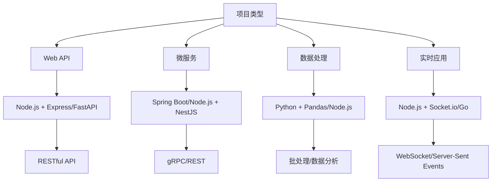

## 📋 文件摘要

本文档是后端开发专业领域的资源中心，包含Node.js、Python、数据库设计、API开发等后端技术的完整开发指南、架构模板和最佳实践。覆盖从API设计到微服务架构，从数据库优化到部署运维的全方位后端开发资源。

## 📑 目录索引

- [📋 文件摘要](#-文件摘要)
- [🎯 后端开发核心领域](#后端开发核心领域)
- [🛠️ 技术栈选择指南](#技术栈选择指南)
- [📡 API设计模式](#api设计模式)
- [💾 数据库设计策略](#数据库设计策略)
- [🏗️ 架构设计模式](#架构设计模式)
- [🔐 安全与认证](#安全与认证)
- [⚡ 性能优化方案](#性能优化方案)
- [🧪 测试策略](#测试策略-1)
- [🚀 部署与运维](#部署与运维)
- [📖 学习路径建议](#学习路径建议-1)

---

## 🎯 后端开发核心领域

### 📊 技术栈覆盖

| 技术类别 | 主要技术 | 资源类型 | 难度级别 |
|----------|----------|----------|----------|
| **运行时** | Node.js, Python, Java, Go | 运行环境配置、性能调优 | 中级 |
| **Web框架** | Express, FastAPI, Spring Boot | 项目模板、最佳实践 | 中级 |
| **数据库** | PostgreSQL, MongoDB, Redis | 数据模型、查询优化 | 高级 |
| **API设计** | RESTful, GraphQL, gRPC | 接口设计、文档生成 | 中级 |
| **认证授权** | JWT, OAuth2, Session | 安全模板、权限控制 | 高级 |
| **消息队列** | RabbitMQ, Kafka, Redis SQS | 消息处理、异步任务 | 高级 |

### 🔥 热门技术专题

#### Node.js 生态系统
- **Express.js**：轻量级Web框架
- **NestJS**：企业级Node.js框架
- **Fastify**：高性能Web框架
- **TypeScript集成**：类型安全的后端开发

#### Python 生态系统
- **FastAPI**：现代、快速的Web框架
- **Django**：全栈Web框架
- **Flask**：轻量级微框架
- **SQLAlchemy**：ORM数据库工具

#### 数据库技术
- **关系型数据库**：PostgreSQL, MySQL
- **NoSQL数据库**：MongoDB, Redis
- **图数据库**：Neo4j
- **时序数据库**：InfluxDB

---

## 🛠️ 技术栈选择指南

### 🎯 技术选型决策树



### 📋 技术栈对比

| 场景 | 推荐技术栈 | 优点 | 缺点 |
|------|------------|------|------|
| **快速原型** | Node.js + Express | 开发快速、生态丰富 | 回调地狱、性能瓶颈 |
| **企业应用** | Java + Spring Boot | 稳定可靠、生态完善 | 学习曲线陡、配置复杂 |
| **数据处理** | Python + FastAPI | 数据处理强、类型安全 | 并发性能一般 |
| **高并发** | Go + Gin | 性能极高、并发优秀 | 生态相对较小 |
| **微服务** | Node.js + NestJS | 模块化、易于测试 | 内存占用较高 |

---

## 📡 API设计模式

### 🎯 API设计原则

#### RESTful API 设计
```typescript
// 用户资源API设计
interface UserAPI {
  // 获取用户列表
  @GET('/users')
  getUsers(@Query() params: UserQuery): Promise<UserListResponse>;
  
  // 创建用户
  @POST('/users')
  createUser(@Body() userData: CreateUserRequest): Promise<UserResponse>;
  
  // 获取单个用户
  @GET('/users/:id')
  getUserById(@Param('id') id: string): Promise<UserResponse>;
  
  // 更新用户
  @PUT('/users/:id')
  updateUser(@Param('id') id: string, @Body() updates: UpdateUserRequest): Promise<UserResponse>;
  
  // 删除用户
  @DELETE('/users/:id')
  deleteUser(@Param('id') id: string): Promise<DeleteResponse>;
}
```

#### GraphQL API 设计
```typescript
// GraphQL Schema 定义
type User {
  id: ID!
  name: String!
  email: String!
  posts: [Post!]!
  createdAt: String!
}

type Query {
  users(limit: Int, offset: Int): [User!]!
  user(id: ID!): User
  searchUsers(query: String!): [User!]!
}

type Mutation {
  createUser(input: CreateUserInput!): User!
  updateUser(id: ID!, input: UpdateUserInput!): User!
  deleteUser(id: ID!): Boolean!
}

input CreateUserInput {
  name: String!
  email: String!
  password: String!
}
```

### 📋 API 实现模板

#### Express.js RESTful API 模板
```typescript
// users.controller.ts
import { Request, Response } from 'express';
import { UserService } from '../services/user.service';
import { CreateUserDTO, UpdateUserDTO } from '../dto/user.dto';

export class UserController {
  private userService: UserService;

  constructor() {
    this.userService = new UserService();
  }

  // 获取用户列表
  getUsers = async (req: Request, res: Response) => {
    try {
      const { page = 1, limit = 10, search } = req.query;
      const users = await this.userService.getUsers({
        page: Number(page),
        limit: Number(limit),
        search: search as string
      });
      
      res.json({
        success: true,
        data: users,
        message: 'Users retrieved successfully'
      });
    } catch (error) {
      res.status(500).json({
        success: false,
        message: 'Internal server error',
        error: error.message
      });
    }
  };

  // 创建用户
  createUser = async (req: Request, res: Response) => {
    try {
      const userData: CreateUserDTO = req.body;
      const user = await this.userService.createUser(userData);
      
      res.status(201).json({
        success: true,
        data: user,
        message: 'User created successfully'
      });
    } catch (error) {
      res.status(400).json({
        success: false,
        message: 'Bad request',
        error: error.message
      });
    }
  };

  // 获取单个用户
  getUserById = async (req: Request, res: Response) => {
    try {
      const { id } = req.params;
      const user = await this.userService.getUserById(id);
      
      if (!user) {
        return res.status(404).json({
          success: false,
          message: 'User not found'
        });
      }
      
      res.json({
        success: true,
        data: user,
        message: 'User retrieved successfully'
      });
    } catch (error) {
      res.status(500).json({
        success: false,
        message: 'Internal server error',
        error: error.message
      });
    }
  };
}

// users.routes.ts
import { Router } from 'express';
import { UserController } from '../controllers/user.controller';
import { validateUser } from '../middleware/validation';
import { authenticate } from '../middleware/auth';

const router = Router();
const userController = new UserController();

router.get('/users', authenticate, userController.getUsers);
router.post('/users', validateUser, userController.createUser);
router.get('/users/:id', authenticate, userController.getUserById);

export default router;
```

#### FastAPI Python API 模板
```python
# main.py
from fastapi import FastAPI, HTTPException, Depends
from fastapi.middleware.cors import CORSMiddleware
from typing import List, Optional
from pydantic import BaseModel
from datetime import datetime

app = FastAPI(title="User Management API", version="1.0.0")

# CORS中间件
app.add_middleware(
    CORSMiddleware,
    allow_origins=["*"],
    allow_credentials=True,
    allow_methods=["*"],
    allow_headers=["*"],
)

# 数据模型
class UserBase(BaseModel):
    name: str
    email: str

class UserCreate(UserBase):
    password: str

class UserUpdate(UserBase):
    pass

class User(UserBase):
    id: int
    created_at: datetime
    
    class Config:
        orm_mode = True

# 数据库模拟
users_db = []
user_id_counter = 1

# API端点
@app.get("/users", response_model=List[User])
async def get_users(skip: int = 0, limit: int = 10, search: Optional[str] = None):
    users = users_db[skip:skip + limit]
    if search:
        users = [user for user in users if search.lower() in user.name.lower()]
    return users

@app.post("/users", response_model=User)
async def create_user(user: UserCreate):
    global user_id_counter
    new_user = User(
        id=user_id_counter,
        name=user.name,
        email=user.email,
        created_at=datetime.now()
    )
    users_db.append(new_user)
    user_id_counter += 1
    return new_user

@app.get("/users/{user_id}", response_model=User)
async def get_user(user_id: int):
    for user in users_db:
        if user.id == user_id:
            return user
    raise HTTPException(status_code=404, detail="User not found")

@app.put("/users/{user_id}", response_model=User)
async def update_user(user_id: int, user_update: UserUpdate):
    for user in users_db:
        if user.id == user_id:
            user.name = user_update.name
            user.email = user_update.email
            return user
    raise HTTPException(status_code=404, detail="User not found")

@app.delete("/users/{user_id}")
async def delete_user(user_id: int):
    global users_db
    users_db = [user for user in users_db if user.id != user_id]
    return {"message": "User deleted successfully"}

if __name__ == "__main__":
    import uvicorn
    uvicorn.run(app, host="0.0.0.0", port=8000)
```

---

## 💾 数据库设计策略

### 🎯 数据库选择指南

| 数据库类型 | 适用场景 | 优点 | 缺点 |
|------------|----------|------|------|
| **PostgreSQL** | 事务性应用、复杂查询 | 功能强大、扩展性好 | 配置复杂、资源占用大 |
| **MySQL** | Web应用、中小型项目 | 简单易用、性能好 | 功能相对较少 |
| **MongoDB** | 非结构化数据、快速迭代 | 灵活性高、扩展性好 | 事务支持弱、查询能力有限 |
| **Redis** | 缓存、会话存储 | 性能极高、数据结构丰富 | 持久化相对复杂 |

### 📋 数据模型设计模板

#### 用户管理系统数据库设计
```sql
-- PostgreSQL 数据库设计

-- 用户表
CREATE TABLE users (
    id SERIAL PRIMARY KEY,
    username VARCHAR(50) UNIQUE NOT NULL,
    email VARCHAR(100) UNIQUE NOT NULL,
    password_hash VARCHAR(255) NOT NULL,
    full_name VARCHAR(100),
    avatar_url VARCHAR(255),
    bio TEXT,
    is_active BOOLEAN DEFAULT true,
    email_verified BOOLEAN DEFAULT false,
    created_at TIMESTAMP WITH TIME ZONE DEFAULT CURRENT_TIMESTAMP,
    updated_at TIMESTAMP WITH TIME ZONE DEFAULT CURRENT_TIMESTAMP
);

-- 角色表
CREATE TABLE roles (
    id SERIAL PRIMARY KEY,
    name VARCHAR(50) UNIQUE NOT NULL,
    description TEXT,
    permissions JSONB,
    created_at TIMESTAMP WITH TIME ZONE DEFAULT CURRENT_TIMESTAMP
);

-- 用户角色关联表
CREATE TABLE user_roles (
    id SERIAL PRIMARY KEY,
    user_id INTEGER REFERENCES users(id) ON DELETE CASCADE,
    role_id INTEGER REFERENCES roles(id) ON DELETE CASCADE,
    assigned_at TIMESTAMP WITH TIME ZONE DEFAULT CURRENT_TIMESTAMP,
    assigned_by INTEGER REFERENCES users(id),
    UNIQUE(user_id, role_id)
);

-- 用户会话表
CREATE TABLE user_sessions (
    id SERIAL PRIMARY KEY,
    user_id INTEGER REFERENCES users(id) ON DELETE CASCADE,
    session_token VARCHAR(255) UNIQUE NOT NULL,
    expires_at TIMESTAMP WITH TIME ZONE NOT NULL,
    created_at TIMESTAMP WITH TIME ZONE DEFAULT CURRENT_TIMESTAMP,
    last_active_at TIMESTAMP WITH TIME ZONE DEFAULT CURRENT_TIMESTAMP
);

-- 用户操作日志表
CREATE TABLE user_logs (
    id SERIAL PRIMARY KEY,
    user_id INTEGER REFERENCES users(id) ON DELETE SET NULL,
    action VARCHAR(50) NOT NULL,
    resource_type VARCHAR(50),
    resource_id INTEGER,
    details JSONB,
    ip_address INET,
    user_agent TEXT,
    created_at TIMESTAMP WITH TIME ZONE DEFAULT CURRENT_TIMESTAMP
);

-- 索引优化
CREATE INDEX idx_users_email ON users(email);
CREATE INDEX idx_users_username ON users(username);
CREATE INDEX idx_user_sessions_token ON user_sessions(session_token);
CREATE INDEX idx_user_sessions_expires ON user_sessions(expires_at);
CREATE INDEX idx_user_logs_user_id ON user_logs(user_id);
CREATE INDEX idx_user_logs_created_at ON user_logs(created_at);

-- 触发器：自动更新updated_at
CREATE OR REPLACE FUNCTION update_updated_at_column()
RETURNS TRIGGER AS $$
BEGIN
    NEW.updated_at = CURRENT_TIMESTAMP;
    RETURN NEW;
END;
$$ language 'plpgsql';

CREATE TRIGGER update_users_updated_at BEFORE UPDATE ON users
    FOR EACH ROW EXECUTE FUNCTION update_updated_at_column();
```

#### MongoDB 数据模型设计
```javascript
// 用户集合设计
{
  _id: ObjectId,
  username: String,
  email: String,
  passwordHash: String,
  profile: {
    fullName: String,
    avatarUrl: String,
    bio: String,
    dateOfBirth: Date,
    location: String,
    website: String
  },
  roles: [String], // ['user', 'admin', 'moderator']
  permissions: [String], // ['read:users', 'write:users', 'delete:users']
  isActive: Boolean,
  emailVerified: Boolean,
  preferences: {
    language: String,
    timezone: String,
    notifications: {
      email: Boolean,
      push: Boolean,
      sms: Boolean
    },
    privacy: {
      profileVisible: Boolean,
      showEmail: Boolean
    }
  },
  security: {
    lastLoginAt: Date,
    lastLoginIp: String,
    failedLoginAttempts: Number,
    accountLockedUntil: Date,
    passwordChangedAt: Date,
    twoFactorEnabled: Boolean,
    twoFactorSecret: String,
    backupCodes: [String]
  },
  sessions: [{
    token: String,
    deviceInfo: {
      type: String,
      name: String,
      os: String,
      browser: String
    },
    ipAddress: String,
    createdAt: Date,
    expiresAt: Date,
    lastActiveAt: Date
  }],
  activityLog: [{
    action: String,
    resource: String,
    resourceId: String,
    details: Object,
    ipAddress: String,
    userAgent: String,
    timestamp: Date
  }],
  createdAt: Date,
  updatedAt: Date
}

// 索引设计
db.users.createIndex({ email: 1 }, { unique: true });
db.users.createIndex({ username: 1 }, { unique: true });
db.users.createIndex({ "sessions.token": 1 });
db.users.createIndex({ "sessions.expiresAt": 1 });
db.users.createIndex({ "activityLog.timestamp": -1 });
db.users.createIndex({ roles: 1 });
db.users.createIndex({ isActive: 1 });
```

---

## 🏗️ 架构设计模式

### 🎯 架构模式选择

| 架构模式 | 适用规模 | 复杂度 | 优点 | 缺点 |
|----------|----------|--------|------|------|
| **单体架构** | 小型项目 | 低 | 开发简单、部署方便 | 扩展性差、技术栈限制 |
| **微服务架构** | 大型项目 | 高 | 技术异构、独立部署 | 复杂度高、运维成本大 |
| **事件驱动架构** | 高并发系统 | 高 | 松耦合、可扩展性好 | 调试困难、数据一致性复杂 |
| **分层架构** | 中型项目 | 中 | 职责清晰、易于维护 | 层间耦合、性能开销 |

### 📋 微服务架构模板

#### 服务拆分策略
```typescript
// 用户服务
interface UserService {
  // 用户管理
  createUser(userData: CreateUserDTO): Promise<User>;
  getUserById(id: string): Promise<User>;
  updateUser(id: string, updates: UpdateUserDTO): Promise<User>;
  deleteUser(id: string): Promise<void>;
  
  // 认证授权
  authenticate(email: string, password: string): Promise<AuthResult>;
  authorize(token: string, resource: string, action: string): Promise<boolean>;
  
  // 用户查询
  searchUsers(query: SearchQuery): Promise<User[]>;
  getUsersByIds(ids: string[]): Promise<User[]>;
}

// 订单服务
interface OrderService {
  createOrder(orderData: CreateOrderDTO): Promise<Order>;
  getOrderById(id: string): Promise<Order>;
  updateOrderStatus(id: string, status: OrderStatus): Promise<Order>;
  getUserOrders(userId: string): Promise<Order[]>;
  
  // 订单处理
  processPayment(orderId: string, paymentData: PaymentDTO): Promise<PaymentResult>;
  shipOrder(orderId: string, shippingData: ShippingDTO): Promise<ShippingResult>;
}

// 通知服务
interface NotificationService {
  sendEmail(to: string, subject: string, content: string): Promise<void>;
  sendSMS(to: string, message: string): Promise<void>;
  sendPushNotification(userId: string, message: string): Promise<void>;
  
  // 模板管理
  createTemplate(template: NotificationTemplate): Promise<NotificationTemplate>;
  getTemplate(id: string): Promise<NotificationTemplate>;
}
```

#### API 网关设计
```typescript
// API Gateway 路由配置
const gatewayRoutes = [
  {
    path: '/api/users',
    service: 'user-service',
    methods: ['GET', 'POST', 'PUT', 'DELETE'],
    rateLimit: {
      windowMs: 15 * 60 * 1000, // 15分钟
      max: 100 // 每个IP最多100次请求
    },
    auth: true
  },
  {
    path: '/api/orders',
    service: 'order-service',
    methods: ['GET', 'POST', 'PUT'],
    rateLimit: {
      windowMs: 15 * 60 * 1000,
      max: 200
    },
    auth: true
  },
  {
    path: '/api/notifications',
    service: 'notification-service',
    methods: ['POST'],
    rateLimit: {
      windowMs: 15 * 60 * 1000,
      max: 50
    },
    auth: true
  },
  {
    path: '/api/auth/login',
    service: 'user-service',
    methods: ['POST'],
    rateLimit: {
      windowMs: 15 * 60 * 1000,
      max: 10
    },
    auth: false
  }
];

// 认证中间件
const authenticate = async (req: Request, res: Response, next: NextFunction) => {
  try {
    const token = req.headers.authorization?.replace('Bearer ', '');
    
    if (!token) {
      return res.status(401).json({ message: 'Access token required' });
    }
    
    const decoded = jwt.verify(token, process.env.JWT_SECRET);
    req.user = decoded;
    
    next();
  } catch (error) {
    return res.status(401).json({ message: 'Invalid token' });
  }
};

// 限流中间件
const rateLimit = (windowMs: number, max: number) => {
  const requests = new Map();
  
  return (req: Request, res: Response, next: NextFunction) => {
    const ip = req.ip;
    const now = Date.now();
    const windowStart = now - windowMs;
    
    // 清理过期记录
    for (const [key, timestamp] of requests.entries()) {
      if (timestamp < windowStart) {
        requests.delete(key);
      }
    }
    
    const requestCount = requests.get(ip) || 0;
    
    if (requestCount >= max) {
      return res.status(429).json({ message: 'Too many requests' });
    }
    
    requests.set(ip, now);
    next();
  };
};
```

---

## 🔐 安全与认证

### 🎯 安全最佳实践

#### JWT 认证实现
```typescript
// JWT 服务
import jwt from 'jsonwebtoken';
import bcrypt from 'bcrypt';

export class AuthService {
  private readonly jwtSecret: string;
  private readonly jwtExpiresIn: string;
  private readonly bcryptRounds: number;

  constructor() {
    this.jwtSecret = process.env.JWT_SECRET || 'your-secret-key';
    this.jwtExpiresIn = process.env.JWT_EXPIRES_IN || '1h';
    this.bcryptRounds = 12;
  }

  // 生成JWT令牌
  generateToken(payload: object): string {
    return jwt.sign(payload, this.jwtSecret, {
      expiresIn: this.jwtExpiresIn
    });
  }

  // 验证JWT令牌
  verifyToken(token: string): any {
    try {
      return jwt.verify(token, this.jwtSecret);
    } catch (error) {
      throw new Error('Invalid token');
    }
  }

  // 哈希密码
  async hashPassword(password: string): Promise<string> {
    return bcrypt.hash(password, this.bcryptRounds);
  }

  // 验证密码
  async verifyPassword(password: string, hash: string): Promise<boolean> {
    return bcrypt.compare(password, hash);
  }

  // 用户登录
  async login(email: string, password: string): Promise<AuthResult> {
    const user = await this.userService.getUserByEmail(email);
    
    if (!user || !await this.verifyPassword(password, user.passwordHash)) {
      throw new Error('Invalid credentials');
    }

    if (!user.isActive) {
      throw new Error('Account is deactivated');
    }

    const token = this.generateToken({
      userId: user.id,
      email: user.email,
      roles: user.roles
    });

    const refreshToken = this.generateToken({
      userId: user.id,
      type: 'refresh'
    });

    return {
      user: {
        id: user.id,
        email: user.email,
        fullName: user.fullName,
        roles: user.roles
      },
      token,
      refreshToken,
      expiresIn: this.jwtExpiresIn
    };
  }
}

// 认证中间件
export const authenticate = async (req: Request, res: Response, next: NextFunction) => {
  try {
    const token = req.headers.authorization?.replace('Bearer ', '');
    
    if (!token) {
      return res.status(401).json({ message: 'Access token required' });
    }

    const decoded = req.authService.verifyToken(token);
    req.user = decoded;
    
    next();
  } catch (error) {
    return res.status(401).json({ message: 'Invalid or expired token' });
  }
};

// 角色授权中间件
export const authorize = (roles: string[]) => {
  return (req: Request, res: Response, next: NextFunction) => {
    if (!req.user) {
      return res.status(401).json({ message: 'Authentication required' });
    }

    const hasRole = roles.some(role => req.user.roles.includes(role));
    
    if (!hasRole) {
      return res.status(403).json({ message: 'Insufficient permissions' });
    }

    next();
  };
};
```

#### OAuth2 集成模板
```typescript
// OAuth2 服务
import { OAuth2Client } from 'google-auth-library';
import axios from 'axios';

export class OAuth2Service {
  private googleClient: OAuth2Client;

  constructor() {
    this.googleClient = new OAuth2Client(
      process.env.GOOGLE_CLIENT_ID,
      process.env.GOOGLE_CLIENT_SECRET,
      process.env.GOOGLE_REDIRECT_URI
    );
  }

  // Google OAuth2 登录
  async googleLogin(code: string): Promise<OAuthResult> {
    try {
      // 获取访问令牌
      const { tokens } = await this.googleClient.getToken(code);
      
      // 获取用户信息
      const ticket = await this.googleClient.verifyIdToken({
        idToken: tokens.id_token!,
        audience: process.env.GOOGLE_CLIENT_ID,
      });

      const payload = ticket.getPayload();
      
      if (!payload || !payload.email) {
        throw new Error('Invalid Google token');
      }

      // 查找或创建用户
      let user = await this.userService.getUserByEmail(payload.email);
      
      if (!user) {
        user = await this.userService.createOAuthUser({
          email: payload.email!,
          fullName: payload.name || '',
          avatarUrl: payload.picture || '',
          provider: 'google',
          providerId: payload.sub
        });
      }

      // 生成JWT令牌
      const authToken = this.authService.generateToken({
        userId: user.id,
        email: user.email,
        roles: user.roles
      });

      return {
        user: {
          id: user.id,
          email: user.email,
          fullName: user.fullName,
          avatarUrl: user.avatarUrl
        },
        token: authToken
      };
    } catch (error) {
      throw new Error('Google authentication failed');
    }
  }

  // GitHub OAuth2 登录
  async githubLogin(code: string): Promise<OAuthResult> {
    try {
      // 获取访问令牌
      const tokenResponse = await axios.post('https://github.com/access_token', {
        client_id: process.env.GITHUB_CLIENT_ID,
        client_secret: process.env.GITHUB_CLIENT_SECRET,
        code,
      }, {
        headers: { Accept: 'application/json' }
      });

      const { access_token } = tokenResponse.data;

      // 获取用户信息
      const userResponse = await axios.get('https://api.github.com/user', {
        headers: { Authorization: `token ${access_token}` }
      });

      const { login, name, avatar_url, email } = userResponse.data;

      // 查找或创建用户
      let user = await this.userService.getUserByEmail(email);
      
      if (!user) {
        user = await this.userService.createOAuthUser({
          email: email || `${login}@github.local`,
          fullName: name || login,
          avatarUrl: avatar_url,
          provider: 'github',
          providerId: login
        });
      }

      // 生成JWT令牌
      const authToken = this.authService.generateToken({
        userId: user.id,
        email: user.email,
        roles: user.roles
      });

      return {
        user: {
          id: user.id,
          email: user.email,
          fullName: user.fullName,
          avatarUrl: user.avatarUrl
        },
        token: authToken
      };
    } catch (error) {
      throw new Error('GitHub authentication failed');
    }
  }
}
```

---

## ⚡ 性能优化方案

### 🎯 性能优化策略

#### 数据库查询优化
```sql
-- 优化前：低效查询
SELECT * FROM users WHERE email = 'user@example.com';

-- 优化后：索引查询
SELECT id, username, email, full_name FROM users WHERE email = 'user@example.com';

-- 复杂查询优化
EXPLAIN ANALYZE
SELECT u.*, r.name as role_name
FROM users u
LEFT JOIN user_roles ur ON u.id = ur.user_id
LEFT JOIN roles r ON ur.role_id = r.id
WHERE u.is_active = true
AND r.name IN ('admin', 'moderator')
ORDER BY u.created_at DESC
LIMIT 20 OFFSET 0;

-- 添加复合索引
CREATE INDEX idx_users_active_created ON users(is_active, created_at DESC);
CREATE INDEX idx_user_roles_role ON user_roles(role_id);
```

#### 缓存策略实现
```typescript
// Redis 缓存服务
import Redis from 'ioredis';

export class CacheService {
  private redis: Redis;

  constructor() {
    this.redis = new Redis({
      host: process.env.REDIS_HOST || 'localhost',
      port: parseInt(process.env.REDIS_PORT || '6379'),
      password: process.env.REDIS_PASSWORD,
      retryDelayOnFailover: 100,
      maxRetriesPerRequest: 3
    });
  }

  // 设置缓存
  async set(key: string, value: any, ttl: number = 3600): Promise<void> {
    await this.redis.setex(key, ttl, JSON.stringify(value));
  }

  // 获取缓存
  async get<T>(key: string): Promise<T | null> {
    const value = await this.redis.get(key);
    return value ? JSON.parse(value) : null;
  }

  // 删除缓存
  async delete(key: string): Promise<void> {
    await this.redis.del(key);
  }

  // 缓存查询结果
  async cacheQuery<T>(
    key: string,
    query: () => Promise<T>,
    ttl: number = 3600
  ): Promise<T> {
    // 尝试从缓存获取
    const cached = await this.get<T>(key);
    if (cached) {
      return cached;
    }

    // 执行查询
    const result = await query();
    
    // 缓存结果
    await this.set(key, result, ttl);
    
    return result;
  }

  // 批量缓存
  async mset(data: Record<string, any>, ttl: number = 3600): Promise<void> {
    const pipeline = this.redis.pipeline();
    
    for (const [key, value] of Object.entries(data)) {
      pipeline.setex(key, ttl, JSON.stringify(value));
    }
    
    await pipeline.exec();
  }
}

// 带缓存的服务层
export class UserService {
  private cacheService: CacheService;

  constructor() {
    this.cacheService = new CacheService();
  }

  async getUserById(id: string): Promise<User | null> {
    const cacheKey = `user:${id}`;
    
    return this.cacheService.cacheQuery(cacheKey, async () => {
      // 实际的数据库查询
      return this.userRepository.findById(id);
    }, 1800); // 30分钟缓存
  }

  async getUserByIds(ids: string[]): Promise<User[]> {
    const cacheKeys = ids.map(id => `user:${id}`);
    
    // 尝试从缓存批量获取
    const cachedUsers = await this.cacheService.mget<User[]>(cacheKeys);
    const cachedIds = new Set(cachedUsers.filter(Boolean).map(u => u.id));
    
    // 找出需要查询的ID
    const missingIds = ids.filter(id => !cachedIds.has(id));
    
    let users = cachedUsers.filter(Boolean);
    
    if (missingIds.length > 0) {
      // 查询缺失的用户
      const freshUsers = await this.userRepository.findByIds(missingIds);
      
      // 缓存新查询的用户
      const cacheData = freshUsers.reduce((acc, user) => {
        acc[`user:${user.id}`] = user;
        return acc;
      }, {});
      
      await this.cacheService.mset(cacheData, 1800);
      
      users = [...users, ...freshUsers];
    }
    
    return users;
  }
}
```

---

## 🧪 测试策略

### 🎯 后端测试模板

#### 单元测试模板
```typescript
// user.service.test.ts
import { UserService } from '../user.service';
import { UserRepository } from '../repositories/user.repository';
import { CacheService } from '../services/cache.service';

// Mock依赖
jest.mock('../repositories/user.repository');
jest.mock('../services/cache.service');

const MockUserRepository = UserRepository as jest.MockedClass<typeof UserRepository>;
const MockCacheService = CacheService as jest.MockedClass<typeof CacheService>;

describe('UserService', () => {
  let userService: UserService;
  let mockUserRepository: jest.Mocked<UserRepository>;
  let mockCacheService: jest.Mocked<CacheService>;

  beforeEach(() => {
    mockUserRepository = new MockUserRepository();
    mockCacheService = new MockCacheService();
    userService = new UserService(mockUserRepository, mockCacheService);
    
    jest.clearAllMocks();
  });

  describe('createUser', () => {
    it('should create a new user successfully', async () => {
      // Arrange
      const userData = {
        email: 'test@example.com',
        password: 'password123',
        fullName: 'Test User'
      };

      const expectedUser = {
        id: '1',
        ...userData,
        passwordHash: 'hashed_password',
        createdAt: new Date(),
        updatedAt: new Date()
      };

      mockUserRepository.create.mockResolvedValue(expectedUser);
      mockCacheService.delete.mockResolvedValue();

      // Act
      const result = await userService.createUser(userData);

      // Assert
      expect(result).toEqual(expectedUser);
      expect(mockUserRepository.create).toHaveBeenCalledWith(
        expect.objectContaining({
          email: userData.email,
          fullName: userData.fullName
        })
      );
      expect(mockCacheService.delete).toHaveBeenCalledWith('users:list');
    });

    it('should throw error if email already exists', async () => {
      // Arrange
      const userData = {
        email: 'existing@example.com',
        password: 'password123',
        fullName: 'Test User'
      };

      mockUserRepository.findByEmail.mockResolvedValue({
        id: '1',
        email: userData.email
      });

      // Act & Assert
      await expect(userService.createUser(userData))
        .rejects.toThrow('Email already exists');
      
      expect(mockUserRepository.create).not.toHaveBeenCalled();
    });
  });

  describe('getUserById', () => {
    it('should return user from cache if available', async () => {
      // Arrange
      const userId = '1';
      const cachedUser = {
        id: userId,
        email: 'test@example.com',
        fullName: 'Test User'
      };

      mockCacheService.get.mockResolvedValue(cachedUser);

      // Act
      const result = await userService.getUserById(userId);

      // Assert
      expect(result).toEqual(cachedUser);
      expect(mockCacheService.get).toHaveBeenCalledWith(`user:${userId}`);
      expect(mockUserRepository.findById).not.toHaveBeenCalled();
    });

    it('should fetch user from database if not in cache', async () => {
      // Arrange
      const userId = '1';
      const dbUser = {
        id: userId,
        email: 'test@example.com',
        fullName: 'Test User'
      };

      mockCacheService.get.mockResolvedValue(null);
      mockUserRepository.findById.mockResolvedValue(dbUser);
      mockCacheService.set.mockResolvedValue();

      // Act
      const result = await userService.getUserById(userId);

      // Assert
      expect(result).toEqual(dbUser);
      expect(mockCacheService.get).toHaveBeenCalledWith(`user:${userId}`);
      expect(mockUserRepository.findById).toHaveBeenCalledWith(userId);
      expect(mockCacheService.set).toHaveBeenCalledWith(
        `user:${userId}`,
        dbUser,
        1800
      );
    });
  });
});
```

#### 集成测试模板
```typescript
// users.integration.test.ts
import request from 'supertest';
import { app } from '../app';
import { DatabaseConnection } from '../config/database';
import { RedisConnection } from '../config/redis';

describe('Users API Integration Tests', () => {
  beforeAll(async () => {
    // 连接数据库和Redis
    await DatabaseConnection.connect();
    await RedisConnection.connect();
  });

  afterAll(async () => {
    // 断开连接
    await DatabaseConnection.disconnect();
    await RedisConnection.disconnect();
  });

  beforeEach(async () => {
    // 清理测试数据
    await DatabaseConnection.clear();
    await RedisConnection.clear();
  });

  describe('POST /api/users', () => {
    it('should create a new user', async () => {
      const userData = {
        email: 'test@example.com',
        password: 'password123',
        fullName: 'Test User'
      };

      const response = await request(app)
        .post('/api/users')
        .send(userData)
        .expect(201);

      expect(response.body.success).toBe(true);
      expect(response.body.data).toMatchObject({
        email: userData.email,
        fullName: userData.fullName
      });
      expect(response.body.data.id).toBeDefined();
      expect(response.body.data.passwordHash).toBeUndefined();
    });

    it('should return validation error for invalid email', async () => {
      const userData = {
        email: 'invalid-email',
        password: 'password123',
        fullName: 'Test User'
      };

      const response = await request(app)
        .post('/api/users')
        .send(userData)
        .expect(400);

      expect(response.body.success).toBe(false);
      expect(response.body.message).toContain('email');
    });

    it('should return error for duplicate email', async () => {
      const userData = {
        email: 'duplicate@example.com',
        password: 'password123',
        fullName: 'Test User'
      };

      // 创建第一个用户
      await request(app)
        .post('/api/users')
        .send(userData)
        .expect(201);

      // 尝试创建重复邮箱的用户
      const response = await request(app)
        .post('/api/users')
        .send(userData)
        .expect(400);

      expect(response.body.success).toBe(false);
      expect(response.body.message).toContain('already exists');
    });
  });

  describe('GET /api/users/:id', () => {
    it('should return user by ID', async () => {
      // 创建用户
      const createResponse = await request(app)
        .post('/api/users')
        .send({
          email: 'test@example.com',
          password: 'password123',
          fullName: 'Test User'
        });

      const userId = createResponse.body.data.id;

      // 获取用户
      const response = await request(app)
        .get(`/api/users/${userId}`)
        .expect(200);

      expect(response.body.success).toBe(true);
      expect(response.body.data.id).toBe(userId);
      expect(response.body.data.email).toBe('test@example.com');
    });

    it('should return 404 for non-existent user', async () => {
      const response = await request(app)
        .get('/api/users/non-existent-id')
        .expect(404);

      expect(response.body.success).toBe(false);
      expect(response.body.message).toBe('User not found');
    });
  });
});
```

---

## 📖 学习路径建议

### 🌱 后端开发入门路径（2-4个月）
1. **编程基础**：JavaScript/Python基础语法
2. **Web框架**：Express.js/FastAPI基础
3. **数据库基础**：SQL基础、CRUD操作
4. **API设计**：RESTful API设计原则
5. **基础项目**：简单的CRUD应用

### 🌿 中级路径（4-8个月）
1. **深入框架**：框架高级特性、中间件
2. **数据库进阶**：查询优化、事务处理
3. **认证授权**：JWT、OAuth2实现
4. **测试策略**：单元测试、集成测试
5. **项目实战**：完整的业务系统

### 🌳 高级路径（8-12个月）
1. **架构设计**：微服务、分布式系统
2. **性能优化**：缓存策略、数据库优化
3. **安全防护**：安全最佳实践、漏洞防护
4. **DevOps**：CI/CD、容器化部署
5. **技术领导**：技术选型、团队管理

---

## 📊 资源统计

- **技术栈指南**：5种主流后端技术栈对比
- **API设计模式**：RESTful、GraphQL、gRPC完整实现
- **数据库设计**：关系型和NoSQL数据库设计模板
- **架构模式**：4种架构模式的详细对比
- **安全实现**：JWT、OAuth2完整认证方案
- **性能优化**：数据库、缓存、代码优化策略
- **测试模板**：单元测试、集成测试完整覆盖
- **实战案例**：1个完整的微服务架构案例

---

*后端开发专区提供了从基础到高级的完整学习路径，每个技术点都有详细的模板和最佳实践。选择适合您的技术水平，开始高效的后端开发之旅！* 🚀