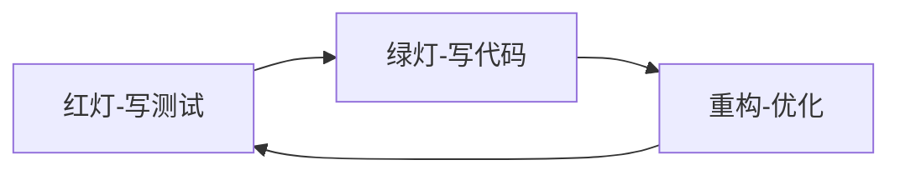

## 📋 文件摘要

本文档是测试工程专业的资源中心，包含单元测试、集成测试、E2E测试、测试驱动开发等完整的质量保证体系。覆盖从基础测试概念到高级测试策略，从手动测试到自动化测试，从测试框架到测试最佳实践的全方位测试工程资源。

## 📑 目录索引

- [📋 文件摘要](#-文件摘要)
- [🎯 测试工程核心领域](#测试工程核心领域)
- [🧪 测试类型详解](#测试类型详解)
- [🔧 测试框架与工具](#测试框架与工具)
- [📊 测试策略与方法论](#测试策略与方法论)
- [🚀 测试自动化实践](#测试自动化实践)
- [🔍 测试质量与度量](#测试质量与度量)
- [📈 测试工程最佳实践](#测试工程最佳实践)
- [🎯 学习路径建议](#学习路径建议)

---

## 🎯 测试工程核心领域

### 📊 测试技术栈覆盖

| 技术类别 | 主要技术 | 资源类型 | 难度级别 |
|----------|----------|----------|----------|
| **单元测试** | Jest, Mocha, Vitest | 测试模板、最佳实践 | 中级 |
| **集成测试** | Testing Library, Cypress | 集成测试指南 | 高级 |
| **E2E测试** | Cypress, Playwright | 端到端测试方案 | 高级 |
| **TDD/BDD** | Jest, Cucumber | 开发方法论指南 | 高级 |
| **性能测试** | Lighthouse, WebPageTest | 性能测试策略 | 高级 |
| **测试报告** | Allure, Mochawesome | 报告模板 | 中级 |

### 🔥 热门测试专题

#### 前端测试
- **React Testing Library**：组件测试最佳实践
- **Jest配置与优化**：测试框架深度配置
- **Cypress实战**：E2E测试自动化
- **Vue Test Utils**：Vue组件测试指南

#### 后端测试
- **API测试**：RESTful API测试策略
- **数据库测试**：数据层测试方法
- **集成测试**：服务间通信测试
- **性能测试**：负载和压力测试

#### 测试自动化
- **CI/CD集成**：自动化测试流程
- **测试数据管理**：测试数据生成策略
- **测试环境管理**：环境配置最佳实践
- **测试报告分析**：测试结果可视化

---

## 🧪 测试类型详解

### 🎯 测试金字塔

#### 1. 单元测试（Unit Testing）
**特点**：
- 测试最小可测试单元
- 执行速度快，隔离性好
- 成本低，频率高

**最佳实践**：
```typescript
// 用户服务单元测试
describe('UserService', () => {
  let userService: UserService;
  let mockUserRepository: MockProxy<UserRepository>;

  beforeEach(() => {
    mockUserRepository = mock<UserRepository>();
    userService = new UserService(mockUserRepository);
  });

  describe('createUser', () => {
    it('应该成功创建用户', async () => {
      // Arrange
      const userData = { name: 'John', email: 'john@example.com' };
      mockUserRepository.create.mockResolvedValue({
        id: '1',
        ...userData,
        createdAt: new Date()
      });

      // Act
      const result = await userService.createUser(userData);

      // Assert
      expect(result).toEqual({
        id: '1',
        name: 'John',
        email: 'john@example.com',
        createdAt: expect.any(Date)
      });
      expect(mockUserRepository.create).toHaveBeenCalledWith(userData);
    });

    it('邮箱重复时应该抛出错误', async () => {
      // Arrange
      const userData = { name: 'John', email: 'existing@example.com' };
      mockUserRepository.findByEmail.mockResolvedValue({
        id: '1',
        ...userData
      });

      // Act & Assert
      await expect(userService.createUser(userData))
        .rejects.toThrow('Email already exists');
    });
  });
});
```

#### 2. 集成测试（Integration Testing）
**特点**：
- 测试多个组件的交互
- 验证组件间的接口
- 中等执行速度

**React组件集成测试**：
```typescript
// UserManagement集成测试
import { render, screen, fireEvent, waitFor } from '@testing-library/react';
import { UserManagement } from './UserManagement';
import { useUserStore } from '../store/userStore';

// Mock store
jest.mock('../store/userStore');

const mockUseUserStore = useUserStore as jest.MockedFunction<typeof useUserStore>;

describe('UserManagement Integration', () => {
  const mockUsers = [
    { id: '1', name: 'John Doe', email: 'john@example.com' },
    { id: '2', name: 'Jane Smith', email: 'jane@example.com' }
  ];

  beforeEach(() => {
    mockUseUserStore.mockReturnValue({
      users: mockUsers,
      loading: false,
      error: null,
      fetchUsers: jest.fn(),
      addUser: jest.fn(),
      updateUser: jest.fn(),
      deleteUser: jest.fn()
    });
  });

  it('应该正确渲染用户列表', () => {
    render(<UserManagement />);
    
    expect(screen.getByText('John Doe')).toBeInTheDocument();
    expect(screen.getByText('Jane Smith')).toBeInTheDocument();
  });

  it('应该能够添加新用户', async () => {
    const mockAddUser = jest.fn();
    mockUseUserStore.mockReturnValue({
      users: mockUsers,
      loading: false,
      error: null,
      fetchUsers: jest.fn(),
      addUser: mockAddUser,
      updateUser: jest.fn(),
      deleteUser: jest.fn()
    });

    render(<UserManagement />);
    
    // 点击添加按钮
    fireEvent.click(screen.getByText('添加用户'));
    
    // 填写表单
    fireEvent.change(screen.getByLabelText('姓名'), {
      target: { value: 'New User' }
    });
    fireEvent.change(screen.getByLabelText('邮箱'), {
      target: { value: 'new@example.com' }
    });
    
    // 提交表单
    fireEvent.click(screen.getByText('保存'));
    
    await waitFor(() => {
      expect(mockAddUser).toHaveBeenCalledWith({
        name: 'New User',
        email: 'new@example.com'
      });
    });
  });
});
```

#### 3. E2E测试（End-to-End Testing）
**特点**：
- 完整的用户流程测试
- 真实浏览器环境
- 执行速度慢，成本高

**Cypress E2E测试**：
```typescript
// 用户管理E2E测试
describe('User Management E2E', () => {
  beforeEach(() => {
    cy.visit('/users');
    cy.intercept('GET', '/api/users', { fixture: 'users.json' }).as('getUsers');
  });

  it('应该能够查看用户列表', () => {
    cy.wait('@getUsers');
    cy.contains('John Doe').should('be.visible');
    cy.contains('Jane Smith').should('be.visible');
  });

  it('应该能够创建新用户', () => {
    cy.intercept('POST', '/api/users', {
      statusCode: 201,
      body: { id: '3', name: 'New User', email: 'new@example.com' }
    }).as('createUser');

    cy.contains('添加用户').click();
    
    cy.get('input[name="name"]').type('New User');
    cy.get('input[name="email"]').type('new@example.com');
    
    cy.contains('保存').click();
    
    cy.wait('@createUser');
    cy.contains('New User').should('be.visible');
    cy.contains('用户创建成功').should('be.visible');
  });

  it('应该能够编辑用户', () => {
    cy.intercept('PUT', '/api/users/1', {
      statusCode: 200,
      body: { id: '1', name: 'John Updated', email: 'john@example.com' }
    }).as('updateUser');

    cy.contains('编辑').first().click();
    
    cy.get('input[name="name"]').clear().type('John Updated');
    
    cy.contains('保存').click();
    
    cy.wait('@updateUser');
    cy.contains('John Updated').should('be.visible');
  });
});
```

---

## 🔧 测试框架与工具

### 🛠️ 主流测试框架对比

| 框架 | 优点 | 缺点 | 适用场景 |
|------|------|------|----------|
| **Jest** | 零配置、快照测试、覆盖率报告 | 内存占用较大 | React项目、通用测试 |
| **Mocha** | 灵活、插件丰富 | 需要额外配置 | Node.js项目、定制化需求 |
| **Vitest** | 快速、兼容Jest API | 生态系统较新 | Vite项目、现代前端 |
| **Cypress** | 开发者友好、调试方便 | 执行速度较慢 | E2E测试、集成测试 |
| **Playwright** | 多浏览器支持、速度快 | 学习曲线较陡 | 跨浏览器测试、现代Web应用 |

### 📋 Jest配置模板

**基础配置**：
```javascript
// jest.config.js
module.exports = {
  testEnvironment: 'jsdom',
  setupFilesAfterEnv: ['<rootDir>/jest.setup.js'],
  moduleNameMapping: {
    '^@/(.*)$': '<rootDir>/src/$1',
    '\\.(css|less|scss|sass)$': 'identity-obj-proxy'
  },
  collectCoverageFrom: [
    'src/**/*.{js,jsx,ts,tsx}',
    '!src/**/*.d.ts',
    '!src/index.ts',
    '!src/test-utils.tsx'
  ],
  coverageReporters: ['text', 'lcov', 'html'],
  testMatch: [
    '<rootDir>/src/**/__tests__/**/*.{js,jsx,ts,tsx}',
    '<rootDir>/src/**/*.{test,spec}.{js,jsx,ts,tsx}'
  ]
};
```

**测试设置文件**：
```javascript
// jest.setup.js
import '@testing-library/jest-dom';

// Mock global fetch
global.fetch = jest.fn();

// Mock localStorage
const localStorageMock = {
  getItem: jest.fn(),
  setItem: jest.fn(),
  removeItem: jest.fn(),
  clear: jest.fn()
};
global.localStorage = localStorageMock;

// Mock IntersectionObserver
global.IntersectionObserver = class IntersectionObserver {
  constructor() {}
  disconnect() {}
  observe() {}
  unobserve() {}
};

// 清理每个测试后的状态
afterEach(() => {
  jest.clearAllMocks();
  localStorageMock.clear();
});
```

### 🧪 Cypress配置模板

**配置文件**：
```javascript
// cypress.config.js
const { defineConfig } = require('cypress');

module.exports = defineConfig({
  e2e: {
    baseUrl: 'http://localhost:3000',
    viewportWidth: 1280,
    viewportHeight: 720,
    video: false,
    screenshot: false,
    setupNodeEvents(on, config) {
      // 自定义任务
      on('task', {
        // 数据库连接任务
        async connectDb(query) {
          const result = await database.query(query);
          return result;
        }
      });
    },
  },
  component: {
    devServer: {
      framework: 'react',
      bundler: 'webpack',
    },
  },
});
```

**自定义命令**：
```javascript
// cypress/support/commands.js
// 登录命令
Cypress.Commands.add('login', (email, password) => {
  cy.session([email, password], () => {
    cy.visit('/login');
    cy.get('input[name="email"]').type(email);
    cy.get('input[name="password"]').type(password);
    cy.get('button[type="submit"]').click();
    cy.url().should('include', '/dashboard');
  });
});

// API请求命令
Cypress.Commands.add('apiRequest', (method, url, body = null) => {
  return cy.request({
    method,
    url: `http://localhost:3000/api${url}`,
    body,
    headers: {
      'Content-Type': 'application/json',
    },
  });
});

// 数据库清理命令
Cypress.Commands.add('clearDatabase', () => {
  cy.task('connectDb', 'TRUNCATE TABLE users CASCADE');
});
```

---

## 📊 测试策略与方法论

### 🎯 测试驱动开发（TDD）

#### TDD循环


#### TDD实践示例
```typescript
// 1. 先写测试（红灯）
describe('StringCalculator', () => {
  let calculator: StringCalculator;

  beforeEach(() => {
    calculator = new StringCalculator();
  });

  it('应该返回空字符串的和为0', () => {
    expect(calculator.add('')).toBe(0);
  });

  it('应该返回单个数字的和', () => {
    expect(calculator.add('1')).toBe(1);
  });

  it('应该返回两个数字的和', () => {
    expect(calculator.add('1,2')).toBe(3);
  });

  it('应该处理多个数字', () => {
    expect(calculator.add('1,2,3,4')).toBe(10);
  });

  it('应该处理换行符分隔符', () => {
    expect(calculator.add('1\n2,3')).toBe(6);
  });
});

// 2. 实现代码（绿灯）
class StringCalculator {
  add(numbers: string): number {
    if (!numbers) return 0;
    
    const delimiter = /[\n,]/;
    const numberArray = numbers.split(delimiter);
    
    return numberArray
      .map(num => parseInt(num, 10))
      .reduce((sum, num) => sum + num, 0);
  }
}

// 3. 重构优化
class StringCalculator {
  add(numbers: string): number {
    if (!numbers) return 0;
    
    const delimiter = this.detectDelimiter(numbers);
    const cleanNumbers = this.cleanInput(numbers, delimiter);
    
    return this.parseAndSum(cleanNumbers);
  }

  private detectDelimiter(input: string): RegExp {
    return /[\n,]/;
  }

  private cleanInput(input: string, delimiter: RegExp): string {
    return input.replace(/\n/g, ',');
  }

  private parseAndSum(numbers: string): number {
    return numbers
      .split(',')
      .map(num => parseInt(num, 10))
      .filter(num => !isNaN(num))
      .reduce((sum, num) => sum + num, 0);
  }
}
```

### 🎯 行为驱动开发（BDD）

#### Gherkin语法示例
```gherkin
# 用户管理功能
Feature: User Management
  As a system administrator
  I want to manage users
  So that I can control access to the system

  Scenario: Create new user
    Given I am on the user management page
    When I click the "Add User" button
    And I fill in the user details
    And I click "Save"
    Then I should see the new user in the list
    And the user should receive a welcome email

  Scenario: Edit existing user
    Given I am on the user management page
    And there is a user "John Doe" in the list
    When I click the "Edit" button next to "John Doe"
    And I update the user's email
    And I click "Save"
    Then I should see the updated email in the list
```

#### Cucumber.js实现
```javascript
// features/support/steps.js
const { Given, When, Then } = require('@cucumber/cucumber');
const { expect } = require('@playwright/test');

Given('I am on the user management page', async function () {
  await this.page.goto('/users');
});

When('I click the {string} button', async function (buttonText) {
  await this.page.click(`text=${buttonText}`);
});

When('I fill in the user details', async function () {
  await this.page.fill('input[name="name"]', 'Test User');
  await this.page.fill('input[name="email"]', 'test@example.com');
});

Then('I should see the new user in the list', async function () {
  await expect(this.page.locator('text=Test User')).toBeVisible();
});
```

---

## 🚀 测试自动化实践

### 🔄 CI/CD集成

#### GitHub Actions工作流
```yaml
# .github/workflows/test.yml
name: Test Suite

on:
  push:
    branches: [ main, develop ]
  pull_request:
    branches: [ main ]

jobs:
  test:
    runs-on: ubuntu-latest
    
    strategy:
      matrix:
        node-version: [16.x, 18.x]
        
    steps:
    - uses: actions/checkout@v3
    
    - name: Setup Node.js ${{ matrix.node-version }}
      uses: actions/setup-node@v3
      with:
        node-version: ${{ matrix.node-version }}
        cache: 'npm'
        
    - name: Install dependencies
      run: npm ci
      
    - name: Run linting
      run: npm run lint
      
    - name: Run unit tests
      run: npm run test:unit
      env:
        CI: true
        
    - name: Run integration tests
      run: npm run test:integration
      
    - name: Upload coverage to Codecov
      uses: codecov/codecov-action@v3
      with:
        file: ./coverage/lcov.info
        flags: unittests
        name: codecov-umbrella
        
    - name: Build application
      run: npm run build
      
    - name: Run E2E tests
      run: npm run test:e2e
      if: github.event_name == 'push'

  security:
    runs-on: ubuntu-latest
    steps:
    - uses: actions/checkout@v3
    - name: Run security audit
      run: npm audit --audit-level moderate
```

### 📊 测试数据管理

#### 测试数据工厂
```typescript
// factories/UserFactory.ts
import { Factory } from 'fishery';
import { faker } from '@faker-js/faker';

export interface User {
  id: string;
  name: string;
  email: string;
  role: 'user' | 'admin';
  createdAt: Date;
  updatedAt: Date;
}

export const UserFactory = Factory.define<User>(() => ({
  id: faker.string.uuid(),
  name: faker.person.fullName(),
  email: faker.internet.email(),
  role: 'user',
  createdAt: faker.date.past(),
  updatedAt: faker.date.recent(),
}));

// 使用示例
const user = UserFactory.build();
const adminUser = UserFactory.build({ role: 'admin' });
const users = UserFactory.buildList(5);
```

#### 测试数据清理
```typescript
// test-utils/database.ts
export class TestDatabase {
  async cleanup() {
    await this.truncate('users');
    await this.truncate('posts');
    await this.truncate('comments');
  }

  async truncate(table: string) {
    await database.query(`TRUNCATE TABLE ${table} CASCADE`);
  }

  async seed() {
    const users = UserFactory.buildList(10);
    await this.insertUsers(users);
  }

  private async insertUsers(users: User[]) {
    for (const user of users) {
      await database.query(
        'INSERT INTO users (id, name, email, role, created_at, updated_at) VALUES ($1, $2, $3, $4, $5, $6)',
        [user.id, user.name, user.email, user.role, user.createdAt, user.updatedAt]
      );
    }
  }
}
```

---

## 🔍 测试质量与度量

### 📈 测试覆盖率

#### 覆盖率配置
```javascript
// jest.config.js
module.exports = {
  collectCoverage: true,
  coverageDirectory: 'coverage',
  coverageReporters: [
    'text',
    'lcov',
    'html'
  ],
  coverageThreshold: {
    global: {
      branches: 80,
      functions: 80,
      lines: 80,
      statements: 80
    },
    // 针对特定文件的覆盖率要求
    './src/components/': {
      branches: 90,
      functions: 90,
      lines: 90,
      statements: 90
    }
  }
};
```

#### 覆盖率报告分析
```bash
# 生成覆盖率报告
npm run test:coverage

# 查看覆盖率报告
open coverage/lcov-report/index.html

# 检查覆盖率是否达标
npm run test:coverage -- --coverageThreshold
```

### 🎯 测试质量指标

#### 测试质量检查清单
- ✅ 测试用例命名规范
- ✅ 测试覆盖率达标
- ✅ 测试执行速度合理
- ✅ 测试数据独立
- ✅ 测试环境隔离
- ✅ 错误处理完善
- ✅ 边界条件测试
- ✅ 集成测试覆盖
- ✅ E2E测试覆盖关键流程

#### 测试健康度监控
```typescript
// test-health-monitor.ts
export class TestHealthMonitor {
  static async checkHealth() {
    const metrics = await this.collectMetrics();
    const health = this.calculateHealth(metrics);
    
    if (health.score < 80) {
      console.warn('Test health score is low:', health.score);
      console.warn('Issues:', health.issues);
    }
    
    return health;
  }

  private static async collectMetrics() {
    return {
      coverage: await this.getCoverage(),
      executionTime: await this.getExecutionTime(),
      flakyTests: await this.getFlakyTests(),
      failedTests: await this.getFailedTests()
    };
  }

  private static calculateHealth(metrics: any) {
    let score = 100;
    const issues = [];

    if (metrics.coverage < 80) {
      score -= 20;
      issues.push('Low test coverage');
    }

    if (metrics.executionTime > 30000) {
      score -= 10;
      issues.push('Slow test execution');
    }

    if (metrics.flakyTests > 0) {
      score -= 15;
      issues.push('Flaky tests detected');
    }

    return { score, issues };
  }
}
```

---

## 📈 测试工程最佳实践

### 🎯 测试命名规范

#### 测试文件命名
```
✅ 好的命名：
- User.test.ts
- UserService.spec.ts
- Button.component.test.tsx
- auth.integration.test.ts

❌ 避免的命名：
- test.js
- user_tests.js
- temp_test.js
```

#### 测试用例命名
```typescript
✅ 好的命名：
describe('UserService', () => {
  describe('createUser', () => {
    it('should create user with valid data', () => {
      // 测试代码
    });

    it('should throw error when email already exists', () => {
      // 测试代码
    });
  });
});

❌ 避免的命名：
describe('test', () => {
  it('works', () => {
    // 测试代码
  });

  it('test user', () => {
    // 测试代码
  });
});
```

### 🎯 测试组织结构

```
src/
├── components/
│   ├── Button/
│   │   ├── Button.tsx
│   │   ├── Button.test.tsx
│   │   └── Button.stories.tsx
│   └── UserManagement/
│       ├── UserManagement.tsx
│       ├── UserManagement.test.tsx
│       └── UserManagement.integration.test.tsx
├── services/
│   ├── UserService.ts
│   └── UserService.test.ts
├── hooks/
│   ├── useAuth.ts
│   └── useAuth.test.ts
└── test-utils/
    ├── render.tsx
    ├── factories.ts
    └── mockData.ts
```

### 🎯 测试性能优化

#### 测试并行化
```javascript
// jest.config.js
module.exports = {
  maxWorkers: '50%',
  testTimeout: 10000,
  verbose: true,
  cache: true,
  cacheDirectory: '<rootDir>/.jest-cache'
};
```

#### 测试分割
```javascript
// 分割测试套件
const commonConfig = {
  testEnvironment: 'jsdom',
  setupFilesAfterEnv: ['<rootDir>/jest.setup.js']
};

module.exports = {
  ...commonConfig,
  testMatch: ['<rootDir>/src/**/*.{test,spec}.{js,jsx,ts,tsx}'],
  coveragePathIgnorePatterns: [
    '<rootDir>/src/test-utils/',
    '<rootDir>/src/**/*.stories.{js,jsx,ts,tsx}'
  ]
};
```

---

## 🎯 学习路径建议

### 🌱 入门路径（1-2个月）
1. **测试基础**：单元测试概念、断言库使用
2. **Jest入门**：Jest基本用法、测试编写
3. **React测试**：React Testing Library基础
4. **简单项目**：TODO应用测试

### 🌿 中级路径（2-4个月）
1. **测试策略**：TDD/BDD方法论
2. **集成测试**：组件集成、API测试
3. **测试工具**：Cypress基础、测试数据管理
4. **项目实战**：电商网站测试套件

### 🌳 高级路径（4-6个月）
1. **测试架构**：测试框架设计、测试策略制定
2. **性能测试**：性能优化、负载测试
3. **自动化**：CI/CD集成、测试自动化
4. **团队领导**：测试流程优化、团队指导

---

## 📊 资源统计

- **测试框架对比**：5个主流框架详细对比
- **测试类型详解**：单元/集成/E2E测试完整指南
- **配置模板**：Jest、Cypress完整配置
- **实践示例**：TDD/BDD实际应用案例
- **自动化方案**：CI/CD集成、测试数据管理
- **最佳实践**：测试命名、组织、性能优化

---

*测试工程专区提供了从入门到精通的完整测试学习路径，每个技术点都有详细的模板和最佳实践。选择适合您的技术水平，开始构建高质量的应用程序！* 🧪