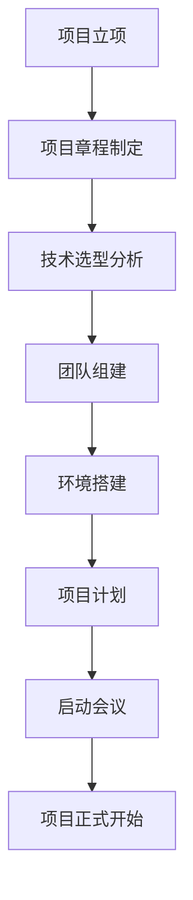

## 📋 文件摘要

本文档是项目启动阶段的资源中心，包含项目可行性分析、技术选型决策、开发环境搭建、团队组建等项目初始化的关键活动。提供完整的项目启动模板、检查清单和最佳实践，确保项目从一开始就建立在坚实的基础之上。

## 📑 目录索引

- [📋 文件摘要](#-文件摘要)
- [🎯 项目启动核心任务](#项目启动核心任务)
- [📊 项目可行性分析](#项目可行性分析)
- [🔧 技术选型决策](#技术选型决策)
- [🏗️ 开发环境搭建](#开发环境搭建)
- [👥 团队组建与分工](#团队组建与分工)
- [📋 项目计划制定](#项目计划制定)
- [📝 启动阶段检查清单](#启动阶段检查清单)
- [🎯 最佳实践建议](#最佳实践建议)

---

## 🎯 项目启动核心任务

### 📋 核心任务清单

| 任务 | 优先级 | 预计时间 | 产出物 | 负责人 |
|------|--------|----------|--------|--------|
| **项目章程制定** | 高 | 1-2天 | 项目章程文档 | 项目经理 |
| **技术选型决策** | 高 | 2-3天 | 技术栈文档 | 技术负责人 |
| **开发环境搭建** | 中 | 1-2天 | 环境配置文档 | 开发工程师 |
| **团队组建** | 高 | 3-5天 | 团队组织架构 | HR/项目经理 |
| **项目计划制定** | 高 | 2-3天 | 项目计划文档 | 项目经理 |
| **工具链配置** | 中 | 1-2天 | 工具配置文档 | DevOps工程师 |

### 🔄 项目启动流程



---

## 📊 项目可行性分析

### 🎯 可行性分析框架

#### 1. 技术可行性
```markdown
## 技术可行性分析

### 技术栈评估
- **前端技术**：React/Vue/Angular的成熟度和团队熟悉度
- **后端技术**：Node.js/Python/Java的适用性和性能
- **数据库**：SQL/NoSQL的选择和数据一致性要求
- **部署方案**：云服务/本地部署的可行性

### 技术风险评估
| 风险项 | 风险等级 | 缓解措施 | 负责人 |
|--------|----------|----------|--------|
| 新技术学习曲线 | 中 | 培训计划、技术预研 | 技术负责人 |
| 第三方依赖稳定性 | 中 | 备选方案、监控机制 | 开发团队 |
| 性能要求挑战 | 高 | 性能测试、优化方案 | 架构师 |

### 技术资源评估
- **开发人员技能匹配度**：80%
- **技术文档完整性**：良好
- **社区支持度**：活跃
- **长期维护成本**：可接受
```

#### 2. 业务可行性
```markdown
## 业务可行性分析

### 市场需求分析
- **目标用户群体**：明确用户画像和使用场景
- **市场规模**：潜在用户数量和增长趋势
- **竞争优势**：与现有解决方案的差异化
- **商业模式**：盈利模式和价值主张

### 业务风险评估
| 风险项 | 风险等级 | 缓解措施 | 负责人 |
|--------|----------|----------|--------|
| 需求变更频繁 | 高 | 敏捷开发、迭代规划 | 产品经理 |
| 用户接受度 | 中 | 用户调研、原型验证 | 产品团队 |
| 竞争对手反应 | 中 | 持续创新、用户体验优化 | 产品团队 |

### 业务价值评估
- **预期收益**：具体的业务指标提升
- **成本效益比**：投入产出比分析
- **战略价值**：对公司长期发展的贡献
- **用户价值**：为用户解决的实际问题
```

### 📋 可行性分析模板

```markdown
# 项目可行性分析报告

## 项目概述
- **项目名称**：[项目名称]
- **项目负责人**：[负责人姓名]
- **分析日期**：[分析日期]

## 技术可行性
### 技术栈选择
- [ ] 前端技术：React/Vue/Angular
- [ ] 后端技术：Node.js/Python/Java
- [ ] 数据库：PostgreSQL/MySQL/MongoDB
- [ ] 部署方案：Docker/Kubernetes/云服务

### 技术风险评估
| 风险项 | 等级 | 描述 | 缓解措施 |
|--------|------|------|----------|
| | | | |

## 业务可行性
### 市场分析
- **目标用户**：
- **市场规模**：
- **竞争分析**：

### 业务价值
- **预期收益**：
- **成本估算**：
- **ROI分析**：

## 财务可行性
### 成本估算
- **开发成本**：
- **运维成本**：
- **人力成本**：

### 收益预测
- **直接收益**：
- **间接收益**：

## 结论与建议
### 决策建议
- [ ] 推荐实施
- [ ] 有条件实施
- [ ] 不推荐实施

### 后续步骤
1. 
2. 
3. 
```

---

## 🔧 技术选型决策

### 🎯 技术选型框架

#### 评估维度
```typescript
interface TechEvaluation {
  technology: string;
  criteria: {
    maturity: number;        // 成熟度 (1-5)
    community: number;       // 社区活跃度 (1-5)
    learning: number;        // 学习曲线 (1-5, 越低越好)
    performance: number;     // 性能表现 (1-5)
    scalability: number;     // 可扩展性 (1-5)
    cost: number;           // 成本 (1-5, 越低越好)
    ecosystem: number;       // 生态系统 (1-5)
  };
  totalScore: number;
  recommendation: 'adopt' | 'trial' | 'assess' | 'hold';
}

class TechnologyEvaluator {
  evaluate(tech: TechEvaluation): TechEvaluation {
    const weights = {
      maturity: 0.15,
      community: 0.15,
      learning: 0.10,
      performance: 0.20,
      scalability: 0.20,
      cost: 0.10,
      ecosystem: 0.10
    };

    const normalizedScore = this.calculateNormalizedScore(tech.criteria, weights);
    tech.totalScore = normalizedScore;
    tech.recommendation = this.getRecommendation(normalizedScore);

    return tech;
  }

  private calculateNormalizedScore(criteria: any, weights: any): number {
    return (
      criteria.maturity * weights.maturity +
      criteria.community * weights.community +
      (6 - criteria.learning) * weights.learning +
      criteria.performance * weights.performance +
      criteria.scalability * weights.scalability +
      (6 - criteria.cost) * weights.cost +
      criteria.ecosystem * weights.ecosystem
    );
  }

  private getRecommendation(score: number): 'adopt' | 'trial' | 'assess' | 'hold' {
    if (score >= 4.0) return 'adopt';
    if (score >= 3.0) return 'trial';
    if (score >= 2.0) return 'assess';
    return 'hold';
  }
}
```

#### 前端技术选型示例
```typescript
// React评估
const reactEval: TechEvaluation = {
  technology: 'React',
  criteria: {
    maturity: 5,        // 非常成熟
    community: 5,       // 社区活跃
    learning: 3,        // 学习曲线中等
    performance: 4,     // 性能良好
    scalability: 4,     // 可扩展性好
    cost: 5,           // 开源免费
    ecosystem: 5        // 生态系统完善
  },
  totalScore: 0,
  recommendation: 'hold'
};

// Vue评估
const vueEval: TechEvaluation = {
  technology: 'Vue',
  criteria: {
    maturity: 4,        // 成熟
    community: 4,       // 社区活跃
    learning: 2,        // 学习曲线较平缓
    performance: 4,     // 性能良好
    scalability: 4,     // 可扩展性好
    cost: 5,           // 开源免费
    ecosystem: 4        // 生态系统良好
  },
  totalScore: 0,
  recommendation: 'hold'
};

const evaluator = new TechnologyEvaluator();
console.log('React:', evaluator.evaluate(reactEval));
console.log('Vue:', evaluator.evaluate(vueEval));
```

### 📋 技术选型决策模板

```markdown
# 技术选型决策文档

## 项目背景
- **项目名称**：[项目名称]
- **项目类型**：Web应用/移动应用/API服务
- **项目规模**：小型/中型/大型
- **团队规模**：[人数]人

## 技术需求
### 功能需求
- [ ] 用户认证和授权
- [ ] 数据持久化
- [ ] 实时通信
- [ ] 文件上传/下载
- [ ] 第三方集成

### 非功能需求
- [ ] 高性能要求
- [ ] 高可用性
- [ ] 可扩展性
- [ ] 安全性
- [ ] 可维护性

## 候选技术评估

### 前端技术
| 技术 | 成熟度 | 学习曲线 | 性能 | 生态 | 总分 | 推荐 |
|------|--------|----------|------|------|------|------|
| React | 5 | 3 | 4 | 5 | 4.2 | ✅ |
| Vue | 4 | 2 | 4 | 4 | 4.0 | ✅ |
| Angular | 5 | 4 | 4 | 4 | 3.8 | ⚠️ |

### 后端技术
| 技术 | 成熟度 | 学习曲线 | 性能 | 生态 | 总分 | 推荐 |
|------|--------|----------|------|------|------|------|
| Node.js | 4 | 2 | 4 | 5 | 4.1 | ✅ |
| Python | 5 | 2 | 3 | 5 | 4.2 | ✅ |
| Java | 5 | 4 | 5 | 5 | 4.3 | ✅ |

### 数据库技术
| 技术 | 成熟度 | 学习曲线 | 性能 | 生态 | 总分 | 推荐 |
|------|--------|----------|------|------|------|------|
| PostgreSQL | 5 | 3 | 5 | 5 | 4.5 | ✅ |
| MySQL | 5 | 2 | 4 | 5 | 4.3 | ✅ |
| MongoDB | 4 | 2 | 3 | 4 | 3.8 | ⚠️ |

## 决策结果

### 最终技术栈
- **前端框架**：React 18 + TypeScript
- **后端框架**：Node.js + Express
- **数据库**：PostgreSQL 15
- **缓存**：Redis 7
- **消息队列**：RabbitMQ
- **部署方案**：Docker + Kubernetes

### 决策理由
1. **React**：生态系统完善，团队熟悉度高
2. **Node.js**：JavaScript全栈，开发效率高
3. **PostgreSQL**：功能强大，数据一致性保证
4. **Docker + K8s**：容器化部署，便于扩展

### 风险评估
| 风险 | 等级 | 缓解措施 |
|------|------|----------|
| React学习曲线 | 中 | 提供培训，使用成熟组件库 |
| Node.js性能 | 中 | 性能优化，使用集群 |
| K8s复杂度 | 高 | 使用托管服务，简化运维 |

## 后续计划
1. **技术预研**：[时间]完成关键技术验证
2. **环境搭建**：[时间]完成开发环境配置
3. **团队培训**：[时间]完成技术培训
4. **原型开发**：[时间]完成技术原型
```

---

## 🏗️ 开发环境搭建

### 🎯 环境配置清单

#### 基础开发环境
```bash
#!/bin/bash
# setup-dev-env.sh

echo "🚀 开始搭建开发环境..."

# 检查系统要求
check_requirements() {
    echo "📋 检查系统要求..."
    
    # 检查操作系统
    if [[ "$OSTYPE" == "linux-gnu"* ]]; then
        OS="linux"
    elif [[ "$OSTYPE" == "darwin"* ]]; then
        OS="macos"
    elif [[ "$OSTYPE" == "msys" ]]; then
        OS="windows"
    fi
    
    echo "操作系统: $OS"
    
    # 检查必需工具
    command -v git >/dev/null 2>&1 || { echo "❌ 需要安装 git"; exit 1; }
    command -v node >/dev/null 2>&1 || { echo "❌ 需要安装 node"; exit 1; }
    command -v npm >/dev/null 2>&1 || { echo "❌ 需要安装 npm"; exit 1; }
    
    echo "✅ 基础工具检查通过"
}

# 安装Node.js
install_nodejs() {
    echo "📦 安装Node.js..."
    
    if command -v nvm >/dev/null 2>&1; then
        echo "使用nvm安装Node.js..."
        nvm install 18
        nvm use 18
    else
        echo "请手动安装Node.js 18+"
        exit 1
    fi
    
    echo "✅ Node.js安装完成: $(node --version)"
}

# 安装全局工具
install_global_tools() {
    echo "🛠️ 安装全局开发工具..."
    
    # 包管理器
    npm install -g pnpm@8
    npm install -g yarn@1.22
    
    # 代码质量工具
    npm install -g typescript@5
    npm install -g eslint@8
    npm install -g prettier@3
    
    # 测试工具
    npm install -g jest@29
    npm install -g @nestjs/cli@10
    
    # 部署工具
    npm install -g vercel@32
    npm install -g @aws-amplify/cli@12
    
    echo "✅ 全局工具安装完成"
}

# 配置Git
setup_git() {
    echo "⚙️ 配置Git..."
    
    git config --global user.name "Your Name"
    git config --global user.email "your.email@example.com"
    
    # 配置Git别名
    git config --global alias.st status
    git config --global alias.co checkout
    git config --global alias.br branch
    git config --global alias.ci commit
    
    echo "✅ Git配置完成"
}

# 创建项目结构
create_project_structure() {
    echo "📁 创建项目结构..."
    
    mkdir -p my-project
    cd my-project
    
    # 创建标准目录结构
    mkdir -p src/{components,pages,services,utils,types,hooks}
    mkdir -p tests/{unit,integration,e2e}
    mkdir -p docs/{api,architecture,deployment}
    mkdir -p scripts/{build,deploy}
    mkdir -p config
    
    echo "✅ 项目结构创建完成"
}

# 初始化项目
initialize_project() {
    echo "🚀 初始化项目..."
    
    # 初始化npm项目
    npm init -y
    
    # 安装核心依赖
    npm install react@18 react-dom@18
    npm install typescript @types/node @types/react @types/react-dom
    npm install vite @vitejs/plugin-react
    
    # 安装开发依赖
    npm install -D eslint eslint-config-react-app @typescript-eslint/eslint-plugin
    npm install -D prettier eslint-config-prettier
    npm install -D @testing-library/react @testing-library/jest-dom
    npm install -D jest @types/jest ts-jest
    
    echo "✅ 项目初始化完成"
}

# 配置开发工具
configure_dev_tools() {
    echo "⚙️ 配置开发工具..."
    
    # 创建TypeScript配置
    cat > tsconfig.json << 'EOF'
{
  "compilerOptions": {
    "target": "ES2020",
    "useDefineForClassFields": true,
    "lib": ["ES2020", "DOM", "DOM.Iterable"],
    "module": "ESNext",
    "skipLibCheck": true,
    "moduleResolution": "bundler",
    "allowImportingTsExtensions": true,
    "resolveJsonModule": true,
    "isolatedModules": true,
    "noEmit": true,
    "jsx": "react-jsx",
    "strict": true,
    "noUnusedLocals": true,
    "noUnusedParameters": true,
    "noFallthroughCasesInSwitch": true
  },
  "include": ["src"],
  "references": [{ "path": "./tsconfig.node.json" }]
}
EOF

    # 创建Vite配置
    cat > vite.config.ts << 'EOF'
import { defineConfig } from 'vite'
import react from '@vitejs/plugin-react'

export default defineConfig({
  plugins: [react()],
  server: {
    port: 3000,
    host: true
  },
  build: {
    outDir: 'dist',
    sourcemap: true
  }
})
EOF

    # 创建ESLint配置
    cat > .eslintrc.json << 'EOF'
{
  "extends": [
    "react-app",
    "react-app/jest",
    "prettier"
  ],
  "plugins": ["prettier"],
  "rules": {
    "prettier/prettier": "error"
  }
}
EOF

    # 创建Prettier配置
    cat > .prettierrc << 'EOF'
{
  "semi": true,
  "trailingComma": "es5",
  "singleQuote": true,
  "printWidth": 100,
  "tabWidth": 2
}
EOF

    echo "✅ 开发工具配置完成"
}

# 创建开发脚本
create_dev_scripts() {
    echo "📜 创建开发脚本..."
    
    # 创建package.json脚本
    npm pkg set scripts.dev="vite"
    npm pkg set scripts.build="tsc && vite build"
    npm pkg set scripts.preview="vite preview"
    npm pkg set scripts.test="jest"
    npm pkg set scripts.lint="eslint src --ext .ts,.tsx"
    npm pkg set scripts.format="prettier --write src/**/*.{ts,tsx}"
    
    # 创建环境变量文件
    cat > .env.example << 'EOF'
VITE_API_URL=http://localhost:8080
VITE_APP_TITLE=My App
VITE_VERSION=1.0.0
EOF
    
    # 创建.gitignore
    cat > .gitignore << 'EOF'
node_modules/
dist/
.env
.env.local
.env.development.local
.env.test.local
.env.production.local
.DS_Store
*.log
coverage/
.vscode/
.idea/
EOF

    echo "✅ 开发脚本创建完成"
}

# 主执行函数
main() {
    check_requirements
    install_nodejs
    install_global_tools
    setup_git
    create_project_structure
    initialize_project
    configure_dev_tools
    create_dev_scripts
    
    echo "🎉 开发环境搭建完成！"
    echo "📋 下一步："
    echo "   1. cd my-project"
    echo "   2. cp .env.example .env"
    echo "   3. npm run dev"
}

main "$@"
```

#### 开发环境验证脚本
```bash
#!/bin/bash
# verify-dev-env.sh

echo "🔍 验证开发环境..."

# 验证Node.js
verify_nodejs() {
    echo "📦 验证Node.js..."
    
    if command -v node >/dev/null 2>&1; then
        NODE_VERSION=$(node --version)
        echo "✅ Node.js: $NODE_VERSION"
        
        # 检查版本
        if [[ "$(node --version)" == "v18"* ]]; then
            echo "✅ Node.js版本符合要求"
        else
            echo "⚠️ 建议使用Node.js 18+"
        fi
    else
        echo "❌ Node.js未安装"
        return 1
    fi
}

# 验证npm
verify_npm() {
    echo "📦 验证npm..."
    
    if command -v npm >/dev/null 2>&1; then
        NPM_VERSION=$(npm --version)
        echo "✅ npm: $NPM_VERSION"
    else
        echo "❌ npm未安装"
        return 1
    fi
}

# 验证Git
verify_git() {
    echo "🔀 验证Git..."
    
    if command -v git >/dev/null 2>&1; then
        GIT_VERSION=$(git --version)
        echo "✅ Git: $GIT_VERSION"
        
        # 检查Git配置
        GIT_USER=$(git config --global user.name)
        GIT_EMAIL=$(git config --global user.email)
        
        if [[ -n "$GIT_USER" && -n "$GIT_EMAIL" ]]; then
            echo "✅ Git配置正确"
        else
            echo "⚠️ Git配置不完整"
        fi
    else
        echo "❌ Git未安装"
        return 1
    fi
}

# 验证项目依赖
verify_dependencies() {
    echo "📦 验证项目依赖..."
    
    if [[ -f "package.json" ]]; then
        echo "✅ 发现package.json"
        
        # 检查node_modules
        if [[ -d "node_modules" ]]; then
            echo "✅ node_modules存在"
        else
            echo "⚠️ 需要运行 npm install"
        fi
        
        # 检查关键依赖
        if npm list react >/dev/null 2>&1; then
            echo "✅ React已安装"
        else
            echo "❌ React未安装"
        fi
    else
        echo "❌ 未发现package.json"
        return 1
    fi
}

# 验证配置文件
verify_config_files() {
    echo "⚙️ 验证配置文件..."
    
    local files=("tsconfig.json" "vite.config.ts" ".eslintrc.json" ".prettierrc")
    
    for file in "${files[@]}"; do
        if [[ -f "$file" ]]; then
            echo "✅ $file存在"
        else
            echo "❌ $file不存在"
        fi
    done
}

# 验证开发服务器
verify_dev_server() {
    echo "🚀 验证开发服务器..."
    
    if [[ -f "package.json" ]]; then
        # 检查dev脚本
        if npm run --silent dev >/dev/null 2>&1; then
            echo "✅ 开发服务器配置正确"
        else
            echo "❌ 开发服务器配置有问题"
        fi
    fi
}

# 生成验证报告
generate_report() {
    echo "📊 生成验证报告..."
    
    local report="dev-env-report.txt"
    
    echo "开发环境验证报告" > "$report"
    echo "生成时间: $(date)" >> "$report"
    echo "" >> "$report"
    
    echo "## 系统信息" >> "$report"
    echo "操作系统: $OSTYPE" >> "$report"
    echo "Node.js: $(node --version)" >> "$report"
    echo "npm: $(npm --version)" >> "$report"
    echo "Git: $(git --version)" >> "$report"
    echo "" >> "$report"
    
    echo "## 项目状态" >> "$report"
    if [[ -f "package.json" ]]; then
        echo "✅ 项目已初始化" >> "$report"
        echo "项目名称: $(npm pkg get name)" >> "$report"
        echo "项目版本: $(npm pkg get version)" >> "$report"
    else
        echo "❌ 项目未初始化" >> "$report"
    fi
    
    echo "" >> "$report"
    echo "## 建议操作" >> "$report"
    
    if [[ ! -d "node_modules" ]]; then
        echo "- 运行 npm install 安装依赖" >> "$report"
    fi
    
    if [[ ! -f ".env" ]]; then
        echo "- 创建 .env 文件" >> "$report"
    fi
    
    echo "" >> "$report"
    echo "## 下一步" >> "$report"
    echo "1. 运行 npm run dev 启动开发服务器" >> "$report"
    echo "2. 访问 http://localhost:3000 查看应用" >> "$report"
    echo "3. 开始开发功能" >> "$report"
    
    echo "✅ 验证报告已生成: $report"
}

# 主执行函数
main() {
    verify_nodejs
    verify_npm
    verify_git
    verify_dependencies
    verify_config_files
    verify_dev_server
    generate_report
    
    echo "🎉 开发环境验证完成！"
}

main "$@"
```

---

## 👥 团队组建与分工

### 🎯 团队角色定义

#### 标准团队结构
```markdown
## 团队角色与职责

### 核心角色
| 角色 | 职责 | 技能要求 | 人数 |
|------|------|----------|------|
| **项目经理** | 项目规划、进度管理、风险控制 | 项目管理、沟通协调、风险管理 | 1 |
| **技术负责人** | 技术选型、架构设计、技术决策 | 系统架构、技术广度、团队管理 | 1 |
| **产品经理** | 需求分析、产品设计、用户体验 | 产品思维、用户研究、沟通能力 | 1 |
| **前端开发** | UI开发、用户交互、前端架构 | React/Vue、TypeScript、CSS | 2-3 |
| **后端开发** | API开发、业务逻辑、数据库 | Node.js/Python、数据库、API设计 | 2-3 |
| **测试工程师** | 测试策略、测试用例、质量保证 | 测试方法论、自动化测试、缺陷管理 | 1-2 |
| **UI/UX设计师** | 界面设计、用户体验、交互设计 | 设计工具、用户体验、前端基础 | 1 |
| **DevOps工程师** | 部署运维、CI/CD、监控告警 | Docker/K8s、云服务、自动化部署 | 1 |

### 扩展角色（根据项目规模）
| 角色 | 职责 | 适用场景 |
|------|------|----------|
| **架构师** | 系统架构设计、技术难点攻关 | 大型项目、复杂系统 |
| **安全工程师** | 安全架构、漏洞扫描、合规检查 | 金融、医疗等安全敏感项目 |
| **数据工程师** | 数据架构、数据分析、数据可视化 | 数据密集型项目 |
| **运维工程师** | 系统运维、性能优化、故障处理 | 7x24运行的项目 |
```

#### 团队协作模式
```typescript
// 团队协作配置
interface TeamCollaboration {
  communication: {
    tools: string[];
    frequency: string;
    guidelines: string[];
  };
  development: {
    workflow: 'agile' | 'waterfall' | 'hybrid';
    methodology: 'scrum' | 'kanban' | 'custom';
    ceremonies: string[];
  };
  quality: {
    codeReview: {
      required: boolean;
      reviewers: number;
      guidelines: string[];
    };
    testing: {
      coverage: number;
      types: string[];
    };
  };
}

const teamConfig: TeamCollaboration = {
  communication: {
    tools: ['Slack', 'Jira', 'Confluence', 'GitHub'],
    frequency: 'Daily stand-ups, Weekly planning, Bi-weekly retrospectives',
    guidelines: [
      '及时响应沟通',
      '清晰表达需求',
      '文档化重要决策',
      '保持透明度'
    ]
  },
  development: {
    workflow: 'agile',
    methodology: 'scrum',
    ceremonies: [
      'Sprint Planning',
      'Daily Stand-up',
      'Sprint Review',
      'Sprint Retrospective',
      'Backlog Refinement'
    ]
  },
  quality: {
    codeReview: {
      required: true,
      reviewers: 2,
      guidelines: [
        '所有代码必须经过审查',
        '审查重点包括代码质量、安全性、性能',
        '审查应在24小时内完成',
        '使用Pull Request进行代码审查'
      ]
    },
    testing: {
      coverage: 80,
      types: ['unit', 'integration', 'e2e']
    }
  }
};
```

### 📋 团队组建检查清单

```markdown
# 团队组建检查清单

## 人员配置
- [ ] 项目经理已确定
- [ ] 技术负责人已确定
- [ ] 产品经理已确定
- [ ] 前端开发人员已确定
- [ ] 后端开发人员已确定
- [ ] 测试工程师已确定
- [ ] UI/UX设计师已确定
- [ ] DevOps工程师已确定

## 技能评估
### 前端团队
- [ ] React/Vue/Angular技能评估
- [ ] TypeScript/JavaScript技能评估
- [ ] CSS/SCSS技能评估
- [ ] 状态管理经验评估
- [ ] 测试经验评估

### 后端团队
- [ ] 编程语言技能评估
- [ ] 框架使用经验评估
- [ ] 数据库设计能力评估
- [ ] API设计能力评估
- [ ] 系统设计能力评估

### 测试团队
- [ ] 自动化测试经验评估
- [ ] 测试框架使用评估
- [ ] 性能测试经验评估
- [ ] 安全测试经验评估

## 工具配置
- [ ] 沟通工具配置（Slack/Teams）
- [ ] 项目管理工具配置（Jira/Trello）
- [ ] 代码仓库配置（GitHub/GitLab）
- [ ] 文档工具配置（Confluence/Notion）
- [ ] CI/CD工具配置

## 协作规范
- [ ] 开发流程规范制定
- [ ] 代码审查流程制定
- [ ] 分支策略制定
- [ ] 发布流程制定
- [ ] 沟通规范制定

## 培训计划
- [ ] 技术栈培训计划
- [ ] 工具使用培训计划
- [ ] 流程规范培训计划
- [ ] 团队协作培训计划
```

---

## 📋 项目计划制定

### 🎯 项目计划模板

```markdown
# 项目计划文档

## 项目概述
- **项目名称**：[项目名称]
- **项目经理**：[负责人]
- **开始日期**：[开始日期]
- **预计完成日期**：[完成日期]
- **项目预算**：[预算金额]

## 项目目标
### 业务目标
- [ ] 提升用户活跃度20%
- [ ] 减少用户流失率15%
- [ ] 增加收入10%

### 技术目标
- [ ] 系统性能提升50%
- [ ] 代码覆盖率80%+
- [ ] 零重大安全事故

### 质量目标
- [ ] 用户满意度90%+
- [ ] 系统可用性99.9%+
- [ ] 缺陷密度<1个/KLOC

## 项目范围
### 包含功能
- [ ] 用户认证系统
- [ ] 数据管理系统
- [ ] 报表生成系统
- [ ] 通知系统

### 排除功能
- [ ] 高级数据分析
- [ ] 移动端应用
- [ ] 第三方系统集成

## 项目里程碑
| 里程碑 | 完成日期 | 交付物 | 负责人 |
|--------|----------|--------|--------|
| 需求确认 | [日期] | 需求文档 | 产品经理 |
| 架构设计完成 | [日期] | 架构文档 | 技术负责人 |
| 开发完成 | [日期] | 功能代码 | 开发团队 |
| 测试完成 | [日期] | 测试报告 | 测试团队 |
| 正式上线 | [日期] | 生产环境 | DevOps团队 |

## 资源计划
### 人力资源
| 角色 | 人数 | 投入时间 | 成本 |
|------|------|----------|------|
| 项目经理 | 1 | 100% | [金额] |
| 前端开发 | 3 | 100% | [金额] |
| 后端开发 | 3 | 100% | [金额] |
| 测试工程师 | 2 | 100% | [金额] |

### 技术资源
- [ ] 开发环境：云服务器
- [ ] 数据库：PostgreSQL
- [ ] 缓存：Redis
- [ ] 消息队列：RabbitMQ

## 风险管理
### 风险识别
| 风险 | 概率 | 影响 | 缓解措施 | 负责人 |
|------|------|------|----------|--------|
| 需求变更 | 高 | 高 | 敏捷开发，变更管理 | 产品经理 |
| 技术难点 | 中 | 高 | 技术预研，专家咨询 | 技术负责人 |
| 人员流失 | 低 | 中 | 知识共享，备份计划 | 项目经理 |

## 质量保证
### 代码质量
- [ ] 代码审查覆盖率100%
- [ ] 静态代码分析
- [ ] 单元测试覆盖率80%+

### 测试策略
- [ ] 单元测试
- [ ] 集成测试
- [ ] 系统测试
- [ ] 用户验收测试

## 沟通计划
### 会议安排
- **每日站会**：15分钟，全体成员
- **周会**：1小时，全体成员
- **Sprint计划会**：2小时，全体成员
- **Sprint回顾会**：1小时，全体成员

### 报告机制
- **周报**：每周一发送
- **月报**：每月初发送
- **里程碑报告**：每个里程碑完成后发送

## 监控与控制
### 进度监控
- [ ] 每日进度跟踪
- [ ] 每周进度报告
- [ ] 里程碑评估

### 质量监控
- [ ] 缺陷密度统计
- [ ] 测试覆盖率统计
- [ ] 用户反馈收集

### 成本监控
- [ ] 每周成本报告
- [ ] 预算执行情况
- [ ] 成本偏差分析

## 验收标准
### 功能验收
- [ ] 所有需求功能实现
- [ ] 功能测试通过
- [ ] 用户验收通过

### 性能验收
- [ ] 响应时间<2秒
- [ ] 并发用户>1000
- [ ] 系统可用性>99.9%

### 安全验收
- [ ] 安全测试通过
- [ ] 漏洞扫描通过
- [ ] 数据加密验证

## 项目交付
### 交付物清单
- [ ] 源代码
- [ ] 技术文档
- [ ] 用户手册
- [ ] 部署脚本
- [ ] 测试报告

### 交付流程
1. 代码审查完成
2. 测试验证通过
3. 用户验收通过
4. 部署到生产环境
5. 运维交接完成

## 后续计划
### 维护计划
- [ ] 3个月免费维护期
- [ ] Bug修复优先响应
- [ ] 性能监控持续

### 优化计划
- [ ] 性能优化计划
- [ ] 功能迭代计划
- [ ] 技术升级计划
```

---

## 📝 启动阶段检查清单

### 🎯 完整检查清单

```markdown
# 项目启动阶段检查清单

## ✅ 项目可行性分析
- [ ] 技术可行性评估完成
- [ ] 业务可行性评估完成
- [ ] 财务可行性评估完成
- [ ] 风险评估完成
- [ ] 可行性报告已审核

## ✅ 技术选型决策
- [ ] 技术需求分析完成
- [ ] 候选技术评估完成
- [ ] 技术选型决策文档完成
- [ ] 技术栈确认完成
- [ ] 技术风险评估完成

## ✅ 开发环境搭建
- [ ] 基础开发环境搭建完成
- [ ] 项目结构创建完成
- [ ] 开发工具配置完成
- [ ] 版本控制配置完成
- [ ] 开发环境验证通过

## ✅ 团队组建与分工
- [ ] 团队角色定义完成
- [ ] 团队成员确定完成
- [ ] 技能评估完成
- [ ] 协作规范制定完成
- [ ] 培训计划制定完成

## ✅ 项目计划制定
- [ ] 项目目标明确
- [ ] 项目范围确定
- [ ] 里程碑计划制定
- [ ] 资源计划制定
- [ ] 风险管理计划制定

## ✅ 工具与基础设施
- [ ] 沟通工具配置完成
- [ ] 项目管理工具配置完成
- [ ] 代码仓库配置完成
- [ ] CI/CD工具配置完成
- [ ] 监控工具配置完成

## ✅ 文档与规范
- [ ] 项目章程文档完成
- [ ] 技术选型文档完成
- [ ] 开发规范文档完成
- [ ] 协作流程文档完成
- [ ] 质量标准文档完成

## ✅ 启动会议准备
- [ ] 启动会议议程准备
- [ ] 演示材料准备
- [ ] 参会人员确认
- [ ] 会议目标明确
- [ ] 后续计划清晰

## ✅ 项目启动完成标准
- [ ] 项目章程获得批准
- [ ] 技术选型获得确认
- [ ] 团队组建完成
- [ ] 开发环境就绪
- [ ] 项目计划获得批准
- [ ] 启动会议成功召开
- [ ] 项目正式开始执行
```

---

## 🎯 最佳实践建议

### 🚀 启动阶段最佳实践

#### 1. 充分的前期调研
- **市场调研**：了解市场需求和竞争状况
- **技术调研**：评估技术可行性和风险
- **用户调研**：了解用户需求和痛点
- **竞品分析**：分析竞争对手的优缺点

#### 2. 明确的项目目标
- **SMART原则**：具体的、可测量的、可实现的、相关的、有时限的
- **业务目标**：与公司战略目标对齐
- **技术目标**：技术架构和质量标准
- **用户目标**：用户体验和价值

#### 3. 合理的技术选型
- **技术匹配度**：与项目需求匹配
- **团队能力**：考虑团队技能水平
- **长期维护**：考虑长期维护成本
- **社区支持**：选择有良好社区支持的技术

#### 4. 完善的团队建设
- **技能互补**：团队成员技能互补
- **经验平衡**：平衡经验和创新
- **文化契合**：团队文化和价值观契合
- **持续学习**：鼓励持续学习和成长

#### 5. 规范的开发流程
- **标准化**：建立标准化开发流程
- **自动化**：尽可能自动化重复工作
- **可追溯**：所有决策和变更可追溯
- **持续改进**：定期回顾和改进流程

### 📊 常见问题与解决方案

#### 问题1：需求不明确
**症状**：项目启动时需求模糊，经常变更
**解决方案**：
- 花更多时间进行需求调研
- 建立需求变更管理流程
- 采用敏捷开发方法
- 加强与业务方沟通

#### 问题2：技术选型困难
**症状**：技术选型犹豫不决，影响项目进度
**解决方案**：
- 建立技术选型评估框架
- 进行技术原型验证
- 咨询技术专家
- 考虑长期发展

#### 问题3：团队协作不畅
**症状**：团队成员沟通不畅，协作效率低
**解决方案**：
- 建立清晰的沟通机制
- 定期团队建设活动
- 明确角色和职责
- 使用协作工具

#### 问题4：进度控制困难
**症状**：项目进度经常延期
**解决方案**：
- 建立详细的进度计划
- 定期进度跟踪和报告
- 建立预警机制
- 灵活调整计划

---

*项目启动阶段是项目成功的基础，充分的准备和规划能够为后续开发奠定坚实的基础。确保每个环节都经过仔细的考虑和验证，让项目从一开始就走在正确的轨道上。* 🚀✨