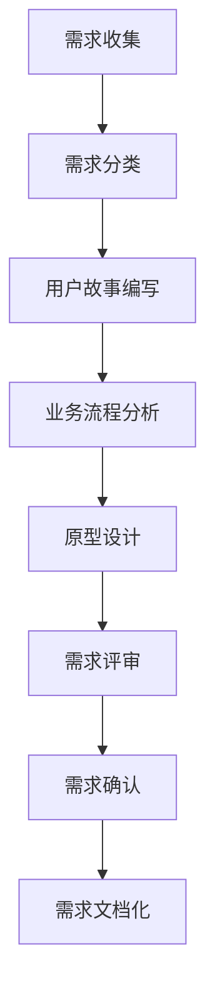
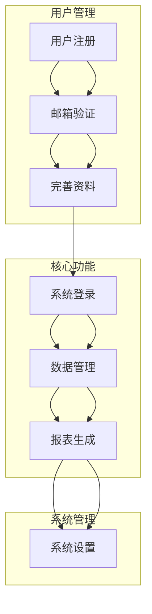

## 📋 文件摘要

本文档是需求分析阶段的资源中心，包含需求收集、用户故事编写、业务流程分析、原型设计等需求工程的核心活动。提供完整的需求分析模板、业务分析方法论和用户研究工具，帮助团队深入理解业务需求，明确功能范围。

## 📑 目录索引

- [📋 文件摘要](#-文件摘要)
- [🎯 需求分析核心任务](#需求分析核心任务)
- [📝 需求收集与整理](#需求收集与整理)
- [👤 用户故事编写](#用户故事编写)
- [🔄 业务流程分析](#业务流程分析)
- [🎨 原型设计](#原型设计)
- [📋 需求评审与确认](#需求评审与确认)
- [📊 需求文档管理](#需求文档管理)
- [🎯 最佳实践建议](#最佳实践建议)

---

## 🎯 需求分析核心任务

### 📋 核心任务清单

| 任务 | 优先级 | 预计时间 | 产出物 | 负责人 |
|------|--------|----------|--------|--------|
| **需求收集** | 高 | 1-2周 | 需求池、用户反馈 | 产品经理 |
| **用户故事编写** | 高 | 1周 | 用户故事列表、验收标准 | 产品经理 |
| **业务流程分析** | 高 | 1-2周 | 业务流程图、用例图 | 业务分析师 |
| **原型设计** | 中 | 1-2周 | 原型图、交互说明 | UI/UX设计师 |
| **需求评审** | 高 | 2-3天 | 评审报告、确认文档 | 项目团队 |
| **需求文档** | 高 | 1周 | 需求规格说明书 | 产品经理 |

### 🔄 需求分析流程



---

## 📝 需求收集与整理

### 🎯 需求收集方法

#### 1. 用户访谈
```markdown
## 用户访谈指南

### 访谈准备
- **访谈对象**：目标用户群体代表
- **访谈时长**：30-60分钟
- **访谈环境**：安静、无干扰
- **记录方式**：录音+笔记

### 访谈问题设计
#### 开放性问题
- "您在日常工作中遇到的最大挑战是什么？"
- "您希望系统能为您解决什么问题？"
- "您目前是如何处理相关任务的？"

#### 具体问题
- "您每天需要处理多少个类似的任务？"
- "您希望系统具备哪些具体功能？"
- "您对界面的使用习惯是什么？"

### 访谈技巧
1. **积极倾听**：认真听取用户意见
2. **追问细节**：深入了解用户需求
3. **避免引导**：不引导用户回答
4. **记录关键点**：记录重要信息
5. **总结确认**：总结并确认理解
```

#### 2. 问卷调查
```markdown
## 问卷调查设计

### 问卷结构
1. **基本信息**：用户背景、使用经验
2. **现状调查**：当前工作方式、痛点
3. **需求调查**：功能需求、优先级
4. **期望调查**：使用期望、改进建议

### 问题类型
- **选择题**：便于统计分析
- **评分题**：了解重要程度
- **排序题**：了解优先级
- **开放题**：收集详细意见

### 调查对象
- **现有用户**：了解使用体验
- **潜在用户**：了解需求期望
- **流失用户**：了解流失原因
```

### 📋 需求分类框架

```typescript
// 需求分类模型
interface Requirement {
  id: string;
  title: string;
  description: string;
  type: RequirementType;
  priority: Priority;
  category: Category;
  source: Source;
  status: Status;
  acceptanceCriteria: string[];
  dependencies: string[];
  estimatedEffort: number;
}

type RequirementType = 
  | 'functional'
  | 'non-functional'
  | 'business'
  | 'technical';

type Priority = 
  | 'critical'
  | 'high'
  | 'medium'
  | 'low';

type Category = 
  | 'user-management'
  | 'data-management'
  | 'reporting'
  | 'integration'
  | 'security'
  | 'performance';

type Source = 
  | 'user-interview'
  | 'survey'
  | 'stakeholder'
  | 'market-research'
  | 'regulatory';

type Status = 
  | 'proposed'
  | 'analyzed'
  | 'approved'
  | 'implemented'
  | 'tested';

// 需求管理工具
class RequirementManager {
  private requirements: Map<string, Requirement> = new Map();
  
  addRequirement(requirement: Requirement): void {
    this.requirements.set(requirement.id, requirement);
  }
  
  getRequirementsByType(type: RequirementType): Requirement[] {
    return Array.from(this.requirements.values())
      .filter(req => req.type === type);
  }
  
  getRequirementsByPriority(priority: Priority): Requirement[] {
    return Array.from(this.requirements.values())
      .filter(req => req.priority === priority);
  }
  
  prioritizeRequirements(): Requirement[] {
    return Array.from(this.requirements.values())
      .sort((a, b) => {
        const priorityOrder = {
          'critical': 4,
          'high': 3,
          'medium': 2,
          'low': 1
        };
        return priorityOrder[b.priority] - priorityOrder[a.priority];
      });
  }
}
```

---

## 👤 用户故事编写

### 🎯 用户故事模板

#### 标准用户故事格式
```markdown
## 用户故事标准格式

### 基本格式
**作为** [用户角色]
**我希望** [功能需求]
**以便** [业务价值]

### 完整用户故事示例
**作为** 系统管理员
**我希望** 能够批量导入用户数据
**以便** 提高用户创建效率，减少手动操作错误

### 验收标准
- [ ] 支持CSV文件导入
- [ ] 支持Excel文件导入
- [ ] 能够预览导入数据
- [ ] 能够处理导入错误
- [ ] 提供导入结果报告
- [ ] 导入过程有进度提示

### 技术说明
- 文件大小限制：10MB
- 支持的字段：用户名、邮箱、部门、角色
- 错误处理：重复邮箱、格式错误、必填字段缺失
```

#### 用户故事INVEST原则
```markdown
## INVEST原则

### Independent (独立)
- 用户故事之间相互独立
- 可以单独开发和测试
- 减少依赖关系

### Negotiable (可协商)
- 需求细节可以协商
- 不是固定不变的合同
- 允许灵活实现

### Valuable (有价值)
- 对用户或业务有价值
- 解决实际问题
- 明确的价值主张

### Estimable (可估算)
- 能够估算工作量
- 规模适中
- 足够详细

### Small (小型)
- 规模小，易于实现
- 通常在一个Sprint内完成
- 避免过于复杂

### Testable (可测试)
- 有明确的验收标准
- 可以验证是否完成
- 测试条件明确
```

### 📋 用户故事管理

#### 用户故事地图
```markdown
## 用户故事地图

### 用户旅程
1. **用户注册**
   - 注册账号
   - 邮箱验证
   - 完善资料

2. **系统登录**
   - 账号密码登录
   - 第三方登录
   - 找回密码

3. **功能使用**
   - 数据管理
   - 报表生成
   - 系统设置

### 故事优先级
| 用户故事 | 优先级 | 故事点 | Sprint |
|----------|--------|--------|--------|
| 用户注册 | High | 5 | Sprint 1 |
| 系统登录 | High | 3 | Sprint 1 |
| 数据管理 | Medium | 8 | Sprint 2 |
| 报表生成 | Medium | 13 | Sprint 3 |
```

---

## 🔄 业务流程分析

### 🎯 业务流程建模

#### 业务流程图


#### 用例分析
```markdown
## 用例分析

### 参与者
- **系统用户**：使用系统的主要用户
- **系统管理员**：管理系统配置
- **数据分析师**：分析系统数据

### 主要用例
#### 用户注册用例
**目标**：新用户注册系统账号
**前置条件**：用户未注册
**后置条件**：用户账号创建成功

**基本流程**：
1. 用户访问注册页面
2. 填写注册信息
3. 系统验证信息格式
4. 发送验证邮件
5. 用户验证邮箱
6. 账号激活成功

**扩展流程**：
- 3a 邮箱已存在：提示用户邮箱已注册
- 4a 邮件发送失败：提示用户重新发送
- 5a 验证链接过期：提示用户重新获取验证邮件
```

---

## 📊 需求文档管理

### 🎯 需求规格说明书模板

```markdown
# 需求规格说明书

## 1. 引言
### 1.1 目的
本文档描述了系统的功能需求和非功能需求，为开发和测试提供依据。

### 1.2 范围
#### 包含功能
- 用户管理
- 数据管理
- 报表生成
- 系统设置

#### 排除功能
- 高级数据分析
- 移动端应用
- 第三方集成

### 1.3 定义、首字母缩写和缩略语
- **UI**：用户界面
- **API**：应用程序接口
- **SRS**：软件需求规格说明书

## 2. 总体描述
### 2.1 产品前景
本系统旨在提供高效的数据管理和报表生成功能。

### 2.2 产品功能
主要功能包括用户管理、数据管理、报表生成等。

### 2.3 用户特征
- **普通用户**：使用基本功能
- **管理员**：管理系统配置
- **数据分析师**：分析数据报表

### 2.4 约束
- 技术约束：使用React + Node.js
- 时间约束：6个月内完成
- 预算约束：控制在预算范围内

## 3. 功能需求
### 3.1 用户管理
#### 3.1.1 用户注册
**描述**：新用户注册系统账号
**输入**：用户名、邮箱、密码
**处理**：验证信息、创建账号、发送验证邮件
**输出**：注册结果

**验收标准**：
- 支持用户名、邮箱、密码注册
- 验证邮箱格式有效性
- 检查用户名唯一性
- 发送验证邮件
- 处理注册异常情况

### 3.2 数据管理
#### 3.2.1 数据录入
**描述**：用户录入业务数据
**输入**：各种业务数据
**处理**：数据验证、存储
**输出**：录入结果

## 4. 非功能需求
### 4.1 性能需求
- 响应时间：页面加载<2秒
- 并发用户：支持1000+并发
- 数据处理：支持10万+数据量

### 4.2 安全需求
- 用户认证：支持多种认证方式
- 数据加密：敏感数据加密存储
- 访问控制：基于角色的权限控制

### 4.3 可用性需求
- 系统可用性：99.9%+
- 界面友好：符合用户体验标准
- 帮助文档：提供完整的帮助文档

## 5. 接口需求
### 5.1 用户界面
- 采用响应式设计
- 支持多浏览器
- 符合无障碍标准

### 5.2 软件接口
- RESTful API接口
- 支持JSON格式
- 标准HTTP状态码

## 6. 其他需求
### 6.1 数据库
- 使用PostgreSQL
- 支持数据备份
- 支持数据恢复

### 6.2 操作系统
- 支持Windows、Linux、macOS
- 支主流浏览器
```

---

## 🎯 最佳实践建议

### 🚀 需求分析最佳实践

#### 1. 深入理解业务
- **业务领域知识**：了解行业背景和业务流程
- **用户需求挖掘**：深入挖掘用户真实需求
- **业务价值分析**：分析需求对业务的价值

#### 2. 有效沟通协作
- **跨部门协作**：与业务、技术、设计团队协作
- **持续沟通**：保持与利益相关者的沟通
- **需求澄清**：及时澄清模糊不清的需求

#### 3. 需求管理
- **需求优先级**：合理设置需求优先级
- **需求变更**：建立需求变更管理流程
- **需求追踪**：建立需求到实现的可追溯性

#### 4. 文档质量
- **清晰明确**：需求描述清晰明确
- **可测试性**：需求具备可测试性
- **完整性**：覆盖所有功能和非功能需求

### 📊 常见问题与解决方案

#### 问题1：需求不明确
**解决方案**：
- 进行深入的用户调研
- 使用原型和示例澄清需求
- 建立需求澄清机制

#### 问题2：需求变更频繁
**解决方案**：
- 建立需求变更管理流程
- 评估变更影响
- 合理安排变更优先级

#### 问题3：需求冲突
**解决方案**：
- 识别利益相关者的不同需求
- 寻找平衡点
- 通过协商解决冲突

---

*需求分析阶段是项目成功的关键，深入理解业务需求，准确把握用户期望，为后续开发和测试奠定坚实的基础。确保需求分析的全面性和准确性，避免后期需求变更带来的风险。* 📝✨