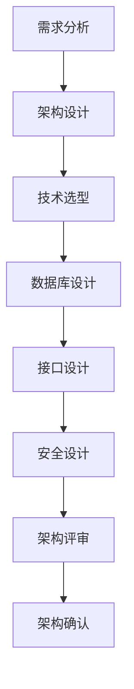
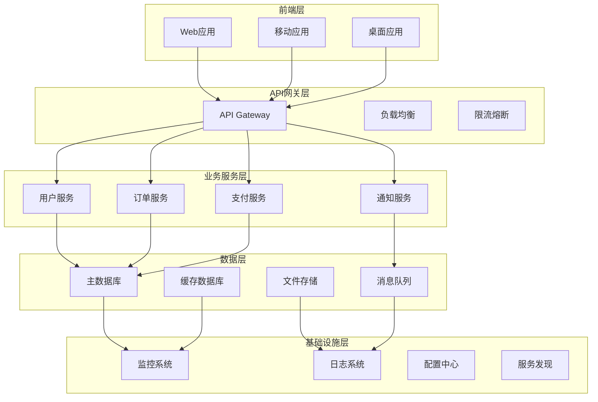
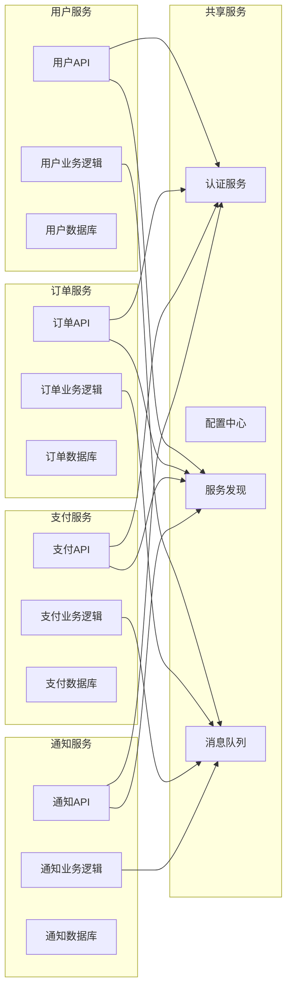

## 📋 文件摘要

本文档是架构设计阶段的综合资源中心，包含系统架构设计、技术选型决策、数据库设计、接口设计、安全架构设计等核心架构活动。提供完整的架构设计方法论、设计模式指南、技术评估框架和架构评审流程，帮助团队设计出可扩展、可维护、高性能的系统架构。

## 📑 目录索引

- [📋 文件摘要](#-文件摘要)
- [🎯 架构设计核心任务](#架构设计核心任务)
- [🏗️ 系统架构设计](#系统架构设计)
- [🔧 技术选型决策](#技术选型决策)
- [💾 数据库设计](#数据库设计)
- [🔌 接口设计](#接口设计)
- [🔒 安全架构设计](#安全架构设计)
- [📋 架构评审与确认](#架构评审与确认)
- [🎯 最佳实践建议](#最佳实践建议)

---

## 🎯 架构设计核心任务

### 📋 核心任务清单

| 任务 | 优先级 | 预计时间 | 产出物 | 负责人 |
|------|--------|----------|--------|--------|
| **系统架构设计** | 高 | 2-3周 | 架构图、技术方案 | 架构师 |
| **技术选型决策** | 高 | 1-2周 | 技术栈清单、评估报告 | 架构师 |
| **数据库设计** | 高 | 1-2周 | 数据库模型、设计文档 | 数据库架构师 |
| **接口设计** | 高 | 1周 | API文档、接口规范 | 后端架构师 |
| **安全架构设计** | 高 | 1周 | 安全方案、防护策略 | 安全架构师 |
| **架构评审** | 高 | 2-3天 | 评审报告、改进建议 | 项目团队 |

### 🔄 架构设计流程



---

## 🏗️ 系统架构设计

### 🎯 架构设计方法论

#### 架构设计原则
```markdown
## 架构设计基本原则

### 1. 分层架构 (Layered Architecture)
**目的**：实现关注点分离，提高系统可维护性

**层次结构**：
- **表现层**：用户界面和交互逻辑
- **业务层**：核心业务逻辑和规则
- **数据访问层**：数据持久化和操作
- **基础设施层**：通用服务和工具

**优点**：
- 层间解耦，易于维护
- 便于团队分工协作
- 支持技术栈独立演进

### 2. 微服务架构 (Microservices)
**目的**：实现服务解耦，提高系统弹性和可扩展性

**核心特征**：
- **服务独立**：每个服务独立部署和扩展
- **数据隔离**：服务间数据独立管理
- **接口标准化**：通过API进行服务间通信
- **自动化运维**：支持CI/CD和监控

**适用场景**：
- 业务复杂度高，需要快速迭代
- 团队规模大，需要并行开发
- 系统负载不均，需要弹性扩展

### 3. 事件驱动架构 (Event-Driven)
**目的**：实现异步处理，提高系统响应性

**核心组件**：
- **事件发布者**：产生事件的服务
- **事件订阅者**：处理事件的服务
- **事件总线**：事件传输和路由
- **事件存储**：事件持久化和重放

**优势**：
- 服务间松耦合
- 支持异步处理
- 便于系统扩展和集成
```

#### 架构模式选择
```typescript
// 架构模式决策框架
interface ArchitecturePattern {
  name: string;
  description: string;
  advantages: string[];
  disadvantages: string[];
  useCases: string[];
  complexity: 'low' | 'medium' | 'high';
  scalability: 'low' | 'medium' | 'high';
}

const architecturePatterns: ArchitecturePattern[] = [
  {
    name: '分层架构',
    description: '按功能层次划分系统的架构模式',
    advantages: ['结构清晰', '易于维护', '团队协作友好'],
    disadvantages: ['可能过度设计', '性能开销', '扩展性受限'],
    useCases: ['传统企业应用', '中小型项目', '团队开发'],
    complexity: 'low',
    scalability: 'medium'
  },
  {
    name: '微服务架构',
    description: '将系统拆分为多个独立服务的架构模式',
    advantages: ['服务解耦', '独立部署', '技术异构性', '弹性扩展'],
    disadvantages: ['分布式复杂性', '运维成本高', '服务间通信开销'],
    useCases: ['大型系统', '云原生应用', '快速迭代项目'],
    complexity: 'high',
    scalability: 'high'
  },
  {
    name: '事件驱动架构',
    description: '基于事件传递的异步架构模式',
    advantages: ['松耦合', '高响应性', '可扩展性', '容错性'],
    disadvantages: ['调试复杂', '数据一致性挑战', '事件设计复杂'],
    useCases: ['实时系统', 'IoT应用', '高并发场景'],
    complexity: 'medium',
    scalability: 'high'
  }
];

// 架构模式选择器
class ArchitecturePatternSelector {
  selectPattern(requirements: SystemRequirements): ArchitecturePattern {
    const { teamSize, complexity, scalability, timeToMarket } = requirements;
    
    if (teamSize <= 5 && complexity === 'low') {
      return architecturePatterns[0]; // 分层架构
    }
    
    if (scalability === 'high' && teamSize > 10) {
      return architecturePatterns[1]; // 微服务架构
    }
    
    if (timeToMarket === 'critical' && complexity === 'medium') {
      return architecturePatterns[2]; // 事件驱动架构
    }
    
    return architecturePatterns[0]; // 默认分层架构
  }
}
```

### 📊 架构图设计

#### 系统架构图


#### 微服务架构图


---

## 🔧 技术选型决策

### 🎯 技术选型框架

#### 技术评估模型
```typescript
// 技术评估框架
interface TechnologyEvaluation {
  technology: string;
  category: 'frontend' | 'backend' | 'database' | 'infrastructure';
  criteria: EvaluationCriteria;
  score: number;
  recommendation: 'adopt' | 'trial' | 'assess' | 'hold';
}

interface EvaluationCriteria {
  maturity: number;           // 成熟度 (1-10)
  community: number;           // 社区支持 (1-10)
  performance: number;         // 性能表现 (1-10)
  scalability: number;         // 可扩展性 (1-10)
  security: number;            // 安全性 (1-10)
  learningCurve: number;       // 学习曲线 (1-10, 越低越好)
  cost: number;                // 成本 (1-10, 越低越好)
  integration: number;         // 集成难度 (1-10, 越低越好)
}

// 技术评估器
class TechnologyEvaluator {
  evaluate(tech: TechnologyEvaluation): number {
    const weights = {
      maturity: 0.15,
      community: 0.15,
      performance: 0.20,
      scalability: 0.15,
      security: 0.15,
      learningCurve: 0.10,
      cost: 0.05,
      integration: 0.05
    };
    
    const weightedScore = 
      tech.criteria.maturity * weights.maturity +
      tech.criteria.community * weights.community +
      tech.criteria.performance * weights.performance +
      tech.criteria.scalability * weights.scalability +
      tech.criteria.security * weights.security +
      (11 - tech.criteria.learningCurve) * weights.learningCurve +
      (11 - tech.criteria.cost) * weights.cost +
      (11 - tech.criteria.integration) * weights.integration;
    
    return Math.round(weightedScore * 10) / 10;
  }
  
  getRecommendation(score: number): string {
    if (score >= 8.0) return 'adopt';
    if (score >= 6.0) return 'trial';
    if (score >= 4.0) return 'assess';
    return 'hold';
  }
}
```

#### 技术栈组合推荐
```markdown
## 推荐技术栈组合

### 1. 全栈JavaScript技术栈
**适用场景**：快速原型开发、中小型项目、全JavaScript团队

**前端技术**：
- **框架**：React 18 + TypeScript
- **状态管理**：Redux Toolkit + React Query
- **UI组件**：Material-UI / Ant Design
- **构建工具**：Vite + ESLint + Prettier

**后端技术**：
- **运行时**：Node.js 18+
- **框架**：Express.js / NestJS
- **数据库**：PostgreSQL + Redis
- **ORM**：Prisma / TypeORM

**部署方案**：
- **容器化**：Docker + Docker Compose
- **云服务**：Vercel (前端) + Railway (后端)
- **监控**：Sentry + Logflare

### 2. Java企业级技术栈
**适用场景**：大型企业应用、高并发系统、金融领域

**后端技术**：
- **框架**：Spring Boot 3.x
- **安全**：Spring Security + JWT
- **数据库**：PostgreSQL + MongoDB
- **缓存**：Redis + Caffeine
- **消息队列**：RabbitMQ / Apache Kafka

**前端技术**：
- **框架**：Vue 3 + TypeScript
- **构建**：Webpack 5
- **UI库**：Element Plus
- **状态管理**：Pinia

**部署方案**：
- **容器化**：Docker + Kubernetes
- **云服务**：AWS / Azure
- **监控**：Prometheus + Grafana

### 3. 现代化云原生技术栈
**适用场景**：云原生应用、微服务架构、容器化部署

**后端技术**：
- **框架**：Go (Gin) / Python (FastAPI)
- **数据库**：PostgreSQL + TimescaleDB
- **缓存**：Redis + Cluster
- **消息队列**：Apache Kafka + NATS
- **服务网格**：Istio + Envoy

**前端技术**：
- **框架**：Next.js 14 + TypeScript
- **状态管理**：Zustand + SWR
- **样式**：Tailwind CSS + Headless UI
- **部署**：Vercel Edge Functions

**基础设施**：
- **容器**：Kubernetes + Helm
- **CI/CD**：GitHub Actions + ArgoCD
- **监控**：OpenTelemetry + Grafana
- **日志**：Loki + Promtail
```

---

## 💾 数据库设计

### 🎯 数据库架构设计

#### 数据库选型策略
```typescript
// 数据库选型决策框架
interface DatabaseSelection {
  workload: 'OLTP' | 'OLAP' | 'Mixed';
  dataVolume: 'small' | 'medium' | 'large' | 'huge';
  concurrency: 'low' | 'medium' | 'high' | 'very-high';
  consistency: 'strong' | 'eventual';
  availability: number; // 99.9, 99.99, etc.
  budget: 'low' | 'medium' | 'high';
}

// 数据库推荐系统
class DatabaseRecommender {
  recommend(requirements: DatabaseSelection): string[] {
    const { workload, dataVolume, concurrency, consistency, availability, budget } = requirements;
    
    if (workload === 'OLTP' && consistency === 'strong') {
      if (dataVolume === 'small' && budget === 'low') {
        return ['SQLite', 'PostgreSQL'];
      }
      if (dataVolume === 'medium' && concurrency === 'high') {
        return ['PostgreSQL', 'MySQL'];
      }
      if (dataVolume === 'large' && concurrency === 'very-high') {
        return ['PostgreSQL', 'Oracle'];
      }
    }
    
    if (workload === 'OLAP' && dataVolume === 'huge') {
      return ['ClickHouse', 'BigQuery', 'Redshift'];
    }
    
    if (consistency === 'eventual' && concurrency === 'high') {
      return ['MongoDB', 'Cassandra', 'DynamoDB'];
    }
    
    return ['PostgreSQL']; // 默认推荐
  }
}
```

#### 数据库设计模式
```markdown
## 数据库设计最佳实践

### 1. 范式化设计
**第一范式 (1NF)**：
- 确保每个字段都是原子的
- 消除重复字段
- 建立主键

**第二范式 (2NF)**：
- 满足1NF
- 消除部分依赖
- 所有非主键字段完全依赖于主键

**第三范式 (3NF)**：
- 满足2NF
- 消除传递依赖
- 非主键字段不依赖于其他非主键字段

### 2. 反范式化策略
**适用场景**：
- 查询性能要求高
- 数据更新频率低
- 读操作远多于写操作

**常用技术**：
- **冗余字段**：在表中存储计算结果
- **预计算**：提前计算聚合数据
- **缓存表**：创建专门的缓存表
- **分区表**：按时间或范围分区

### 3. 分库分表策略
**水平分表**：
- 按ID范围分表
- 按哈希值分表
- 按时间分表

**垂直分库**：
- 按业务模块分库
- 按读写频率分库
- 按数据量分库
```

#### 数据库性能优化
```sql
-- 索引优化示例
-- 创建复合索引
CREATE INDEX idx_user_email_status ON users(email, status);

-- 创建部分索引
CREATE INDEX idx_active_users ON users(id) WHERE status = 'active';

-- 创建哈希索引
CREATE INDEX idx_user_email_hash ON users USING HASH(email);

-- 查询优化示例
-- 使用EXPLAIN分析查询计划
EXPLAIN ANALYZE SELECT * FROM orders 
WHERE user_id = 123 AND created_at >= '2024-01-01';

-- 使用CTE优化复杂查询
WITH active_users AS (
  SELECT id, email FROM users WHERE status = 'active'
),
recent_orders AS (
  SELECT user_id, COUNT(*) as order_count 
  FROM orders 
  WHERE created_at >= '2024-01-01'
  GROUP BY user_id
)
SELECT u.email, o.order_count
FROM active_users u
LEFT JOIN recent_orders o ON u.id = o.user_id;

-- 使用窗口函数优化聚合查询
SELECT 
  user_id,
  order_count,
  RANK() OVER (ORDER BY order_count DESC) as rank
FROM (
  SELECT user_id, COUNT(*) as order_count
  FROM orders
  GROUP BY user_id
) user_stats;
```

---

## 🔌 接口设计

### 🎯 API设计规范

#### RESTful API设计
```typescript
// RESTful API设计规范
interface ApiDesign {
  version: string;
  baseUrl: string;
  resources: ApiResource[];
  standards: ApiStandards;
}

interface ApiResource {
  name: string;
  path: string;
  methods: HttpMethod[];
  authentication: boolean;
  rateLimit: number;
  validation: ValidationRule[];
}

interface ApiStandards {
  naming: NamingConvention;
  statusCodes: StatusCodeMapping;
  errorHandling: ErrorHandlingStrategy;
  documentation: DocumentationStandard;
}

// API设计器
class ApiDesigner {
  designResource(resource: Partial<ApiResource>): ApiResource {
    return {
      name: resource.name || '',
      path: this.generatePath(resource.name),
      methods: resource.methods || ['GET'],
      authentication: resource.authentication || false,
      rateLimit: resource.rateLimit || 100,
      validation: resource.validation || []
    };
  }
  
  private generatePath(name: string): string {
    return `/${name.toLowerCase().replace(/ /g, '-')}`;
  }
}

// API路由示例
const apiRoutes = {
  users: {
    list: { method: 'GET', path: '/users', auth: true },
    create: { method: 'POST', path: '/users', auth: true },
    get: { method: 'GET', path: '/users/:id', auth: true },
    update: { method: 'PUT', path: '/users/:id', auth: true },
    delete: { method: 'DELETE', path: '/users/:id', auth: true }
  },
  orders: {
    list: { method: 'GET', path: '/orders', auth: true },
    create: { method: 'POST', path: '/orders', auth: true },
    get: { method: 'GET', path: '/orders/:id', auth: true },
    update: { method: 'PUT', path: '/orders/:id', auth: true }
  }
};
```

#### GraphQL API设计
```typescript
// GraphQL Schema设计
type User {
  id: ID!
  email: String!
  name: String!
  status: UserStatus!
  createdAt: DateTime!
  updatedAt: DateTime!
  orders: [Order!]!
  profile: Profile
}

type Order {
  id: ID!
  userId: ID!
  amount: Float!
  status: OrderStatus!
  createdAt: DateTime!
  items: [OrderItem!]!
  user: User!
}

type OrderItem {
  id: ID!
  orderId: ID!
  productId: ID!
  quantity: Int!
  price: Float!
  product: Product!
}

type Query {
  users(filter: UserFilter, pagination: Pagination): UserConnection!
  user(id: ID!): User
  orders(filter: OrderFilter, pagination: Pagination): OrderConnection!
  order(id: ID!): Order
}

type Mutation {
  createUser(input: CreateUserInput!): User!
  updateUser(id: ID!, input: UpdateUserInput!): User!
  deleteUser(id: ID!): Boolean!
  createOrder(input: CreateOrderInput!): Order!
  updateOrder(id: ID!, input: UpdateOrderInput!): Order!
}

input UserFilter {
  status: UserStatus
  email: StringFilter
  name: StringFilter
  createdAt: DateFilter
}

input Pagination {
  first: Int
  after: String
  last: Int
  before: String
}

type UserConnection {
  edges: [UserEdge!]!
  pageInfo: PageInfo!
  totalCount: Int!
}

type UserEdge {
  node: User!
  cursor: String!
}
```

#### API文档规范
```markdown
## API文档标准

### 1. OpenAPI 3.0规范
```yaml
openapi: 3.0.0
info:
  title: User Management API
  version: 1.0.0
  description: 用户管理系统的RESTful API

servers:
  - url: https://api.example.com/v1
    description: Production server
  - url: https://staging-api.example.com/v1
    description: Staging server

paths:
  /users:
    get:
      summary: 获取用户列表
      tags:
        - Users
      parameters:
        - name: page
          in: query
          schema:
            type: integer
            minimum: 1
            default: 1
        - name: limit
          in: query
          schema:
            type: integer
            minimum: 1
            maximum: 100
            default: 20
      responses:
        '200':
          description: 用户列表
          content:
            application/json:
              schema:
                type: object
                properties:
                  data:
                    type: array
                    items:
                      $ref: '#/components/schemas/User'
                  pagination:
                    $ref: '#/components/schemas/Pagination'

components:
  schemas:
    User:
      type: object
      properties:
        id:
          type: string
          format: uuid
        email:
          type: string
          format: email
        name:
          type: string
        status:
          type: string
          enum: [active, inactive, suspended]
        createdAt:
          type: string
          format: date-time
        updatedAt:
          type: string
          format: date-time
```

### 2. API文档结构
- **概述**：API的基本信息和使用说明
- **认证**：认证方式和授权流程
- **基础信息**：基础URL、版本、协议
- **资源**：所有API资源的详细说明
- **数据模型**：所有数据结构的定义
- **错误处理**：错误码和错误信息
- **示例**：请求和响应示例
- **SDK**：各种语言的SDK使用说明
```

---

## 🔒 安全架构设计

### 🎯 安全架构策略

#### 安全设计原则
```typescript
// 安全架构设计框架
interface SecurityArchitecture {
  authentication: AuthStrategy;
  authorization: AuthzStrategy;
  encryption: EncryptionStrategy;
  networkSecurity: NetworkSecurity;
  dataProtection: DataProtection;
  monitoring: SecurityMonitoring;
}

// 认证策略
interface AuthStrategy {
  methods: AuthMethod[];
  mfa: MultiFactorAuth;
  session: SessionManagement;
  rateLimit: RateLimiting;
}

// 授权策略
interface AuthzStrategy {
  model: 'RBAC' | 'ABAC' | 'RBAC+ABAC';
  permissions: Permission[];
  roles: Role[];
  policies: Policy[];
}

// 安全架构设计器
class SecurityArchitect {
  designSecurity(requirements: SecurityRequirements): SecurityArchitecture {
    return {
      authentication: this.designAuth(requirements),
      authorization: this.designAuthz(requirements),
      encryption: this.designEncryption(requirements),
      networkSecurity: this.designNetworkSecurity(requirements),
      dataProtection: this.designDataProtection(requirements),
      monitoring: this.designMonitoring(requirements)
    };
  }
  
  private designAuth(requirements: SecurityRequirements): AuthStrategy {
    return {
      methods: ['JWT', 'OAuth2', 'API Key'],
      mfa: {
        enabled: requirements.sensitivity === 'high',
        methods: ['TOTP', 'SMS', 'Email']
      },
      session: {
        timeout: 3600,
        renewal: true,
        concurrent: false
      },
      rateLimit: {
        requests: 100,
        window: 3600,
        burst: 10
      }
    };
  }
}
```

#### 安全实施最佳实践
```markdown
## 安全实施最佳实践

### 1. 身份认证安全
- **强密码策略**：最少8位，包含大小写字母、数字、特殊字符
- **多因素认证**：支持TOTP、短信、邮箱验证
- **JWT安全**：使用强密钥，设置合理的过期时间
- **会话管理**：安全的会话标识，定期更新会话密钥

### 2. 数据加密
- **传输加密**：TLS 1.3，禁用弱加密算法
- **存储加密**：敏感数据加密存储，使用强加密算法
- **密钥管理**：使用密钥管理服务，定期轮换密钥
- **证书管理**：使用权威CA签发的证书，定期更新

### 3. 网络安全
- **防火墙配置**：最小权限原则，只开放必要端口
- **DDoS防护**：使用云服务商的DDoS防护服务
- **WAF配置**：Web应用防火墙，防止常见Web攻击
- **VPN访问**：管理后台通过VPN访问

### 4. 应用安全
- **输入验证**：所有用户输入进行严格验证
- **输出编码**：防止XSS攻击，对输出进行编码
- **SQL注入防护**：使用参数化查询，避免拼接SQL
- **CSRF防护**：使用CSRF令牌，验证请求来源

### 5. 监控和审计
- **安全监控**：实时监控安全事件和异常行为
- **日志审计**：记录所有关键操作的审计日志
- **入侵检测**：部署入侵检测系统
- **安全扫描**：定期进行安全漏洞扫描
```

---

## 📋 架构评审与确认

### 🎯 架构评审流程

#### 评审检查清单
```markdown
## 架构评审检查清单

### 1. 功能性评审
- [ ] 架构是否满足所有功能需求
- [ ] 系统边界是否清晰定义
- [ ] 组件职责是否明确
- [ ] 接口设计是否合理
- [ ] 数据流是否正确

### 2. 非功能性评审
- [ ] 性能目标是否可达成
- [ ] 可扩展性是否满足要求
- [ ] 可用性目标是否合理
- [ ] 安全性是否充分
- [ ] 可维护性是否良好

### 3. 技术评审
- [ ] 技术选型是否合理
- [ ] 技术风险是否可控
- [ ] 技术债务是否可接受
- [ ] 技术栈是否成熟
- [ ] 团队能力是否匹配

### 4. 运维评审
- [ ] 部署方案是否可行
- [ ] 监控方案是否完善
- [ ] 故障处理是否充分
- [ ] 备份恢复是否可靠
- [ ] 成本控制是否合理

### 5. 合规评审
- [ ] 是否符合行业规范
- [ ] 是否满足法律法规
- [ ] 数据保护是否到位
- [ ] 隐私保护是否充分
- [ ] 审计要求是否满足
```

#### 架构决策记录
```typescript
// 架构决策记录模板
interface ArchitectureDecisionRecord {
  id: string;
  title: string;
  status: 'proposed' | 'accepted' | 'rejected' | 'deprecated';
  date: Date;
  author: string;
  stakeholders: string[];
  
  context: {
    problem: string;
    constraints: string[];
    assumptions: string[];
  };
  
  options: {
    description: string;
    pros: string[];
    cons: string[];
    consequences: string[];
  }[];
  
  decision: {
    chosen: string;
    rationale: string;
    implications: string[];
  };
  
  review: {
    reviewer: string;
    date: Date;
    comments: string;
    approval: boolean;
  };
}

// ADR管理器
class ADRManager {
  private adrs: Map<string, ArchitectureDecisionRecord> = new Map();
  
  createADR(adr: Omit<ArchitectureDecisionRecord, 'id' | 'date'>): string {
    const id = this.generateId();
    const fullADR: ArchitectureDecisionRecord = {
      ...adr,
      id,
      date: new Date()
    };
    
    this.adrs.set(id, fullADR);
    return id;
  }
  
  getADR(id: string): ArchitectureDecisionRecord | undefined {
    return this.adrs.get(id);
  }
  
  listADRs(): ArchitectureDecisionRecord[] {
    return Array.from(this.adrs.values());
  }
  
  private generateId(): string {
    const count = this.adrs.size + 1;
    return `ADR-${count.toString().padStart(3, '0')}`;
  }
}
```

---

## 🎯 最佳实践建议

### 🚀 架构设计最佳实践

#### 1. 设计原则
- **KISS原则**：保持简单，避免过度设计
- **DRY原则**：避免重复代码，提高复用性
- **YAGNI原则**：不要实现不需要的功能
- **SOLID原则**：面向对象设计的基本原则

#### 2. 架构模式
- **分层架构**：清晰的层次结构，便于维护
- **微服务架构**：服务解耦，独立部署
- **事件驱动架构**：异步处理，提高响应性
- **CQRS架构**：读写分离，优化性能

#### 3. 性能优化
- **缓存策略**：合理使用缓存，提高访问速度
- **数据库优化**：索引优化，查询优化
- **并发处理**：异步处理，提高吞吐量
- **资源管理**：合理使用系统资源

#### 4. 安全设计
- **安全优先**：在架构设计阶段考虑安全
- **最小权限**：按最小权限原则设计
- **纵深防御**：多层次安全防护
- **持续监控**：实时监控安全事件

### 📊 常见问题与解决方案

#### 问题1：架构过度设计
**解决方案**：
- 从简单架构开始，逐步演进
- 根据实际需求调整架构复杂度
- 避免过早优化和过度抽象

#### 问题2：技术选型不当
**解决方案**：
- 建立技术评估框架
- 考虑团队能力和学习成本
- 进行概念验证和技术试验

#### 问题3：性能瓶颈
**解决方案**：
- 进行性能测试和压力测试
- 识别性能瓶颈并优化
- 考虑水平扩展和垂直扩展

---

*架构设计阶段是项目成功的关键，合理的架构设计能够为系统的可扩展性、可维护性和性能奠定坚实的基础。确保架构设计的全面性和前瞻性，避免后期重构带来的风险。* 🏗️✨