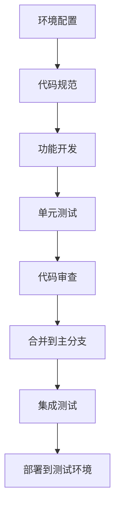

## 📋 文件摘要

本文档是开发实现阶段的综合资源中心，包含开发环境配置、代码规范制定、功能模块开发、代码审查流程、版本控制管理等核心开发活动。提供完整的开发实践指南、代码质量保证体系、团队协作流程和开发效率提升工具，帮助团队高质量、高效率地完成功能开发。

## 📑 目录索引

- [📋 文件摘要](#-文件摘要)
- [🎯 开发实现核心任务](#开发实现核心任务)
- [🛠️ 开发环境配置](#开发环境配置)
- [📝 代码规范制定](#代码规范制定)
- [💻 功能模块开发](#功能模块开发)
- [🔍 代码审查流程](#代码审查流程)
- [📊 版本控制管理](#版本控制管理)
- [🧪 单元测试开发](#单元测试开发)
- [🎯 最佳实践建议](#最佳实践建议)

---

## 🎯 开发实现核心任务

### 📋 核心任务清单

| 任务 | 优先级 | 预计时间 | 产出物 | 负责人 |
|------|--------|----------|--------|--------|
| **开发环境配置** | 高 | 2-3天 | 环境配置文档、开发指南 | 技术负责人 |
| **代码规范制定** | 高 | 1-2天 | 代码规范文档、配置文件 | 技术负责人 |
| **功能模块开发** | 高 | 2-8周 | 功能代码、单元测试 | 开发人员 |
| **代码审查流程** | 高 | 持续进行 | 审查记录、改进建议 | 团队全体 |
| **版本控制管理** | 高 | 持续进行 | 版本历史、分支管理 | 团队全体 |
| **单元测试开发** | 高 | 持续进行 | 测试代码、测试报告 | 开发人员 |

### 🔄 开发实现流程



---

## 🛠️ 开发环境配置

### 🎯 开发环境标准化

#### 开发环境配置清单
```markdown
## 开发环境配置清单

### 1. 基础环境
- **操作系统**：Ubuntu 20.04+ / macOS 12+ / Windows 10+
- **Node.js**：18.x LTS 版本
- **Python**：3.9+ (如需要)
- **Java**：17+ (如需要)
- **Go**：1.19+ (如需要)

### 2. 开发工具
- **IDE/编辑器**：
  - VS Code (推荐)
  - IntelliJ IDEA (Java开发)
  - WebStorm (前端开发)
- **版本控制**：Git 2.35+
- **包管理器**：
  - npm/yarn/pnpm (Node.js)
  - Maven/Gradle (Java)
  - pip (Python)

### 3. 数据库工具
- **数据库客户端**：
  - DBeaver (通用数据库工具)
  - pgAdmin (PostgreSQL)
  - MongoDB Compass (MongoDB)
- **Redis客户端**：RedisInsight
- **消息队列工具**：RabbitMQ Management UI

### 4. 容器化工具
- **Docker**：20.10+
- **Docker Compose**：2.0+
- **Kubernetes**：minikube/kind (本地开发)

### 5. API工具
- **API测试**：Postman / Insomnia
- **API文档**：Swagger UI / Redoc
- **API监控**：Apigee / Kong
```

#### 开发环境自动化配置
```bash
#!/bin/bash
# setup-dev-env.sh
echo "🚀 开始配置开发环境..."

# 检查系统信息
echo "📋 系统信息检查..."
uname -a
node --version
npm --version
git --version
docker --version

# 安装项目依赖
echo "📦 安装项目依赖..."
npm install
npm install --save-dev husky lint-staged prettier

# 配置Git钩子
echo "🪝 配置Git钩子..."
npx husky install
npx husky add .husky/pre-commit "npx lint-staged"
npx husky add .husky/commit-msg "npx commitlint --edit $1"

# 创建环境配置文件
echo "⚙️ 创建环境配置文件..."
cp .env.example .env.local
cp .env.example .env.development

# 设置数据库连接
echo "🗄️ 配置数据库..."
docker-compose up -d postgres redis
sleep 10

# 运行数据库迁移
echo "🔄 运行数据库迁移..."
npm run db:migrate

# 安装开发工具
echo "🛠️ 安装开发工具..."
npm install --save-dev @types/node @types/jest typescript ts-node

# 验证配置
echo "✅ 验证配置..."
npm run test:unit
npm run build

echo "🎉 开发环境配置完成！"
echo "📖 请阅读 DEVELOPMENT.md 了解开发流程"
```

#### VS Code工作区配置
```json
// .vscode/settings.json
{
  "editor.formatOnSave": true,
  "editor.codeActionsOnSave": {
    "source.fixAll.eslint": true,
    "source.organizeImports": true
  },
  "editor.defaultFormatter": "esbenp.prettier-vscode",
  "eslint.validate": [
    "javascript",
    "typescript",
    "vue",
    "json",
    "markdown"
  ],
  "typescript.preferences.importModuleSpecifier": "relative",
  "files.associations": {
    "*.env": "ini",
    "*.env.*": "ini"
  },
  "search.exclude": {
    "**/node_modules": true,
    "**/dist": true,
    "**/build": true,
    "**/.git": true,
    "**/.next": true
  },
  "files.watcherExclude": {
    "**/node_modules/**": true,
    "**/dist/**": true,
    "**/build/**": true
  }
}
```

```json
// .vscode/extensions.json
{
  "recommendations": [
    "dbaeumer.vscode-eslint",
    "esbenp.prettier-vscode",
    "ms-vscode.vscode-typescript-next",
    "bradlc.vscode-tailwindcss",
    "ms-vscode.vscode-json",
    "ms-vscode.vscode-markdown",
    "formulahendry.auto-rename-tag",
    "christian-kohler.path-intellisense",
    "streetsidesoftware.code-spell-checker",
    "eamodio.gitlens",
    "ms-vscode-remote.remote-containers"
  ]
}
```

```json
// .vscode/launch.json
{
  "version": "0.2.0",
  "configurations": [
    {
      "name": "Debug Server",
      "type": "node",
      "request": "launch",
      "program": "${workspaceFolder}/src/server.ts",
      "preLaunchTask": "tsc: build - tsconfig.json",
      "outFiles": ["${workspaceFolder}/dist/**/*.js"],
      "env": {
        "NODE_ENV": "development"
      }
    },
    {
      "name": "Debug Tests",
      "type": "node",
      "request": "launch",
      "program": "${workspaceFolder}/node_modules/jest/bin/jest.js",
      "args": ["--runInBand", "--watchAll=false"],
      "console": "integratedTerminal",
      "internalConsoleOptions": "neverOpen"
    }
  ]
}
```

---

## 📝 代码规范制定

### 🎯 代码质量标准

#### JavaScript/TypeScript代码规范
```typescript
// .eslintrc.js
module.exports = {
  env: {
    browser: true,
    es2021: true,
    node: true,
    jest: true
  },
  extends: [
    'eslint:recommended',
    '@typescript-eslint/recommended',
    'plugin:react/recommended',
    'plugin:prettier/recommended'
  ],
  parser: '@typescript-eslint/parser',
  parserOptions: {
    ecmaVersion: 'latest',
    sourceType: 'module',
    ecmaFeatures: {
      jsx: true
    }
  },
  plugins: ['react', '@typescript-eslint', 'import'],
  rules: {
    // 代码风格
    'indent': ['error', 2],
    'linebreak-style': ['error', 'unix'],
    'quotes': ['error', 'single'],
    'semi': ['error', 'always'],
    
    // 最佳实践
    'no-console': 'warn',
    'no-debugger': 'error',
    'no-unused-vars': 'off',
    '@typescript-eslint/no-unused-vars': ['error', { argsIgnorePattern: '^_' }],
    
    // TypeScript特定规则
    '@typescript-eslint/explicit-function-return-type': 'off',
    '@typescript-eslint/explicit-module-boundary-types': 'off',
    '@typescript-eslint/no-explicit-any': 'warn',
    
    // React特定规则
    'react/prop-types': 'off',
    'react/react-in-jsx-scope': 'off',
    
    // 导入规则
    'import/order': ['error', {
      'groups': [
        'builtin',
        'external',
        'internal',
        'parent',
        'sibling',
        'index'
      ],
      'newlines-between': 'always'
    }]
  },
  settings: {
    react: {
      version: 'detect'
    }
  }
};
```

#### Prettier格式化配置
```json
// .prettierrc
{
  "semi": true,
  "trailingComma": "es5",
  "singleQuote": true,
  "printWidth": 100,
  "tabWidth": 2,
  "useTabs": false,
  "bracketSpacing": true,
  "arrowParens": "avoid",
  "endOfLine": "lf",
  "jsxSingleQuote": false,
  "bracketSameLine": false,
  "quoteProps": "as-needed"
}
```

#### 代码提交规范
```javascript
// commitlint.config.js
module.exports = {
  extends: ['@commitlint/config-conventional'],
  rules: {
    'type-enum': [
      2,
      'always',
      [
        'feat',     // 新功能
        'fix',      // 修复bug
        'docs',     // 文档更新
        'style',    // 代码格式修改
        'refactor', // 重构
        'test',     // 测试相关
        'chore',    // 构建工具或依赖管理
        'perf',     // 性能优化
        'ci',       // CI配置
        'build',    // 构建相关
        'revert',   // 回滚
        'wip'       // 进行中的工作
      ]
    ],
    'type-case': [2, 'always', 'lower-case'],
    'type-empty': [2, 'never'],
    'scope-case': [2, 'always', 'lower-case'],
    'subject-case': [2, 'never', ['sentence-case', 'start-case', 'pascal-case', 'upper-case']],
    'subject-empty': [2, 'never'],
    'subject-full-stop': [2, 'never', '.'],
    'header-max-length': [2, 'always', 72],
    'body-leading-blank': [1, 'always'],
    'body-max-line-length': [2, 'always', 100],
    'footer-leading-blank': [1, 'always'],
    'footer-max-line-length': [2, 'always', 100]
  }
};
```

#### Git钩子配置
```json
// package.json
{
  "lint-staged": {
    "*.{js,jsx,ts,tsx}": [
      "eslint --fix",
      "prettier --write"
    ],
    "*.{json,md,yml,yaml}": [
      "prettier --write"
    ],
    "*.{css,scss,sass,less}": [
      "prettier --write"
    ]
  },
  "husky": {
    "hooks": {
      "pre-commit": "lint-staged",
      "commit-msg": "commitlint -E HUSKY_GIT_PARAMS"
    }
  }
}
```

---

## 💻 功能模块开发

### 🎯 模块化开发实践

#### 组件开发模式
```typescript
// React组件开发模板
import React, { FC, ReactNode } from 'react';
import styles from './ComponentName.module.css';

interface ComponentNameProps {
  /**
   * 组件的主要显示内容
   */
  children: ReactNode;
  /**
   * 组件的变体类型
   */
  variant?: 'primary' | 'secondary' | 'outline';
  /**
   * 组件的大小
   */
  size?: 'small' | 'medium' | 'large';
  /**
   * 是否禁用组件
   */
  disabled?: boolean;
  /**
   * 点击事件处理函数
   */
  onClick?: () => void;
  /**
   * 自定义样式类名
   */
  className?: string;
}

/**
 * 组件名称和描述
 * 
 * 这是一个高质量的React组件示例，展示了：
 * - TypeScript类型定义
 * - 属性验证和默认值
 * - 样式处理
 * - 可访问性支持
 * - 性能优化
 */
export const ComponentName: FC<ComponentNameProps> = ({
  children,
  variant = 'primary',
  size = 'medium',
  disabled = false,
  onClick,
  className = ''
}) => {
  const handleClick = () => {
    if (!disabled && onClick) {
      onClick();
    }
  };

  const componentClasses = [
    styles.component,
    styles[variant],
    styles[size],
    disabled ? styles.disabled : '',
    className
  ].filter(Boolean).join(' ');

  return (
    <div
      className={componentClasses}
      onClick={handleClick}
      role="button"
      tabIndex={disabled ? -1 : 0}
      aria-disabled={disabled}
      onKeyDown={(e) => {
        if (e.key === 'Enter' || e.key === ' ') {
          e.preventDefault();
          handleClick();
        }
      }}
    >
      {children}
    </div>
  );
};

// 默认导出
export default ComponentName;
```

#### 服务层开发模式
```typescript
// 服务层开发模板
import { injectable, inject } from 'inversify';
import { ILogger } from '../interfaces/ILogger';
import { IUserRepository } from '../interfaces/IUserRepository';
import { IUser } from '../models/User';
import { UserCreateDTO, UserUpdateDTO } from '../dtos/UserDTO';
import { ValidationError, NotFoundError } from '../errors/AppError';

@injectable()
export class UserService {
  constructor(
    @inject('ILogger') private logger: ILogger,
    @inject('IUserRepository') private userRepository: IUserRepository
  ) {}

  /**
   * 创建新用户
   * @param userData 用户数据
   * @returns 创建的用户信息
   */
  async createUser(userData: UserCreateDTO): Promise<IUser> {
    try {
      // 验证输入数据
      this.validateUserData(userData);

      // 检查用户是否已存在
      const existingUser = await this.userRepository.findByEmail(userData.email);
      if (existingUser) {
        throw new ValidationError('用户邮箱已存在');
      }

      // 创建用户
      const user = await this.userRepository.create(userData);
      
      this.logger.info(`用户创建成功: ${user.id}`);
      return user;
    } catch (error) {
      this.logger.error('用户创建失败', error);
      throw error;
    }
  }

  /**
   * 获取用户信息
   * @param userId 用户ID
   * @returns 用户信息
   */
  async getUserById(userId: string): Promise<IUser> {
    try {
      const user = await this.userRepository.findById(userId);
      if (!user) {
        throw new NotFoundError('用户不存在');
      }
      return user;
    } catch (error) {
      this.logger.error(`获取用户信息失败: ${userId}`, error);
      throw error;
    }
  }

  /**
   * 更新用户信息
   * @param userId 用户ID
   * @param updateData 更新数据
   * @returns 更新后的用户信息
   */
  async updateUser(userId: string, updateData: UserUpdateDTO): Promise<IUser> {
    try {
      // 检查用户是否存在
      const existingUser = await this.userRepository.findById(userId);
      if (!existingUser) {
        throw new NotFoundError('用户不存在');
      }

      // 验证更新数据
      this.validateUpdateData(updateData);

      // 更新用户
      const updatedUser = await this.userRepository.update(userId, updateData);
      
      this.logger.info(`用户信息更新成功: ${userId}`);
      return updatedUser;
    } catch (error) {
      this.logger.error(`用户信息更新失败: ${userId}`, error);
      throw error;
    }
  }

  /**
   * 删除用户
   * @param userId 用户ID
   */
  async deleteUser(userId: string): Promise<void> {
    try {
      // 检查用户是否存在
      const user = await this.userRepository.findById(userId);
      if (!user) {
        throw new NotFoundError('用户不存在');
      }

      // 删除用户
      await this.userRepository.delete(userId);
      
      this.logger.info(`用户删除成功: ${userId}`);
    } catch (error) {
      this.logger.error(`用户删除失败: ${userId}`, error);
      throw error;
    }
  }

  /**
   * 获取用户列表
   * @param page 页码
   * @param limit 每页数量
   * @returns 用户列表和分页信息
   */
  async getUserList(page: number = 1, limit: number = 10): Promise<{
    users: IUser[];
    total: number;
    page: number;
    limit: number;
  }> {
    try {
      const skip = (page - 1) * limit;
      const [users, total] = await Promise.all([
        this.userRepository.findMany({ skip, limit }),
        this.userRepository.count()
      ]);

      return {
        users,
        total,
        page,
        limit
      };
    } catch (error) {
      this.logger.error('获取用户列表失败', error);
      throw error;
    }
  }

  private validateUserData(userData: UserCreateDTO): void {
    if (!userData.email || !userData.email.includes('@')) {
      throw new ValidationError('邮箱格式不正确');
    }
    if (!userData.name || userData.name.length < 2) {
      throw new ValidationError('用户名长度不能少于2个字符');
    }
    if (!userData.password || userData.password.length < 6) {
      throw new ValidationError('密码长度不能少于6个字符');
    }
  }

  private validateUpdateData(updateData: UserUpdateDTO): void {
    if (updateData.email && !updateData.email.includes('@')) {
      throw new ValidationError('邮箱格式不正确');
    }
    if (updateData.name && updateData.name.length < 2) {
      throw new ValidationError('用户名长度不能少于2个字符');
    }
  }
}
```

#### 数据库操作层模式
```typescript
// 数据库操作层模板
import { injectable } from 'inversify';
import { prisma } from '../config/database';
import { IUserRepository } from '../interfaces/IUserRepository';
import { IUser, UserCreateInput, UserUpdateInput } from '../models/User';

@injectable()
export class UserRepository implements IUserRepository {
  /**
   * 创建用户
   * @param userData 用户数据
   * @returns 创建的用户
   */
  async create(userData: UserCreateInput): Promise<IUser> {
    const user = await prisma.user.create({
      data: {
        ...userData,
        createdAt: new Date(),
        updatedAt: new Date()
      }
    });
    return user;
  }

  /**
   * 根据ID查找用户
   * @param id 用户ID
   * @returns 用户信息或null
   */
  async findById(id: string): Promise<IUser | null> {
    return await prisma.user.findUnique({
      where: { id },
      include: {
        profile: true,
        orders: {
          orderBy: { createdAt: 'desc' },
          take: 10
        }
      }
    });
  }

  /**
   * 根据邮箱查找用户
   * @param email 用户邮箱
   * @returns 用户信息或null
   */
  async findByEmail(email: string): Promise<IUser | null> {
    return await prisma.user.findUnique({
      where: { email }
    });
  }

  /**
   * 更新用户信息
   * @param id 用户ID
   * @param updateData 更新数据
   * @returns 更新后的用户信息
   */
  async update(id: string, updateData: UserUpdateInput): Promise<IUser> {
    return await prisma.user.update({
      where: { id },
      data: {
        ...updateData,
        updatedAt: new Date()
      },
      include: {
        profile: true
      }
    });
  }

  /**
   * 删除用户
   * @param id 用户ID
   */
  async delete(id: string): Promise<void> {
    await prisma.user.delete({
      where: { id }
    });
  }

  /**
   * 查找多个用户
   * @param options 查询选项
   * @returns 用户列表
   */
  async findMany(options: {
    skip?: number;
    limit?: number;
    where?: any;
    orderBy?: any;
  }): Promise<IUser[]> {
    const { skip = 0, limit = 10, where = {}, orderBy = { createdAt: 'desc' } } = options;
    
    return await prisma.user.findMany({
      skip,
      take: limit,
      where,
      orderBy,
      include: {
        profile: true
      }
    });
  }

  /**
   * 统计用户数量
   * @param where 查询条件
   * @returns 用户数量
   */
  async count(where: any = {}): Promise<number> {
    return await prisma.user.count({ where });
  }

  /**
   * 批量更新用户
   * @param ids 用户ID列表
   * @param updateData 更新数据
   * @returns 更新结果
   */
  async updateMany(ids: string[], updateData: UserUpdateInput): Promise<{ count: number }> {
    return await prisma.user.updateMany({
      where: { id: { in: ids } },
      data: {
        ...updateData,
        updatedAt: new Date()
      }
    });
  }

  /**
   * 批量删除用户
   * @param ids 用户ID列表
   * @returns 删除结果
   */
  async deleteMany(ids: string[]): Promise<{ count: number }> {
    return await prisma.user.deleteMany({
      where: { id: { in: ids } }
    });
  }
}
```

---

## 🔍 代码审查流程

### 🎯 代码质量控制

#### 代码审查清单
```markdown
## 代码审查清单

### 1. 代码质量
- [ ] 代码是否遵循项目编码规范
- [ ] 变量和函数命名是否清晰易懂
- [ ] 代码逻辑是否清晰，易于理解
- [ ] 是否存在重复代码
- [ ] 代码复杂度是否合理

### 2. 功能实现
- [ ] 是否完整实现了需求功能
- [ ] 边界条件是否处理完善
- [ ] 错误处理是否充分
- [ ] 数据验证是否完整
- [ ] 业务逻辑是否正确

### 3. 性能考虑
- [ ] 是否存在性能瓶颈
- [ ] 数据库查询是否优化
- [ ] 循环和递归是否合理
- [ ] 内存使用是否高效
- [ ] 缓存策略是否合理

### 4. 安全性
- [ ] 输入验证是否充分
- [ ] SQL注入防护是否到位
- [ ] XSS防护是否完善
- [ ] 敏感信息是否暴露
- [ ] 权限控制是否正确

### 5. 测试覆盖
- [ ] 单元测试是否完整
- [ ] 测试用例是否覆盖边界情况
- [ ] 集成测试是否充分
- [ ] 测试代码质量是否良好
- [ ] 测试覆盖率是否达标

### 6. 文档和注释
- [ ] 关键函数是否有注释
- [ ] 复杂逻辑是否有说明
- [ ] API文档是否完整
- [ ] 配置说明是否清晰
- [ ] 使用示例是否提供
```

#### Pull Request模板
```markdown
## PR描述模板

### 变更类型
- [ ] Bug修复
- [ ] 新功能
- [ ] 文档更新
- [ ] 重构
- [ ] 性能优化
- [ ] 测试相关
- [ ] CI/CD相关

### 变更描述
简要描述这个PR的主要内容和目的。

### 相关Issue
Closes #123
Fixes #456

### 变更详情
#### 新增功能
- 功能1：具体描述
- 功能2：具体描述

#### 修改内容
- 修改1：具体描述
- 修改2：具体描述

#### 删除内容
- 删除1：具体描述
- 删除2：具体描述

### 测试情况
#### 单元测试
- [ ] 新增测试用例
- [ ] 修改现有测试
- [ ] 测试覆盖率：XX%

#### 集成测试
- [ ] API测试通过
- [ ] 数据库操作正常
- [ ] 第三方服务集成正常

#### 手动测试
- [ ] 功能测试通过
- [ ] 边界情况测试通过
- [ ] 性能测试通过

### 审核清单
#### 代码质量
- [ ] 代码符合项目规范
- [ ] 无明显的代码异味
- [ ] 适当的错误处理
- [ ] 合理的日志记录

#### 安全性
- [ ] 输入验证完善
- [ ] 无SQL注入风险
- [ ] 无XSS漏洞
- [ ] 权限控制正确

#### 性能
- [ ] 无性能瓶颈
- [ ] 数据库查询优化
- [ ] 内存使用合理
- [ ] 响应时间可接受

### 部署影响
#### 数据库变更
- [ ] 无数据库变更
- [ ] 需要数据库迁移
- [ ] 数据结构变更

#### 配置变更
- [ ] 无配置变更
- [ ] 环境变量变更
- [ ] 系统配置变更

#### 依赖变更
- [ ] 无依赖变更
- [ ] 新增依赖包
- [ ] 依赖包升级

### 截图（如适用）
<!-- 添加相关截图 -->


### 其他说明
其他需要说明的事项。
```

#### 自动化检查配置
```yaml
# .github/workflows/code-review.yml
name: Code Review Automation

on:
  pull_request:
    types: [opened, synchronize, reopened]

jobs:
  code-quality:
    runs-on: ubuntu-latest
    
    steps:
    - name: Checkout code
      uses: actions/checkout@v3
      
    - name: Setup Node.js
      uses: actions/setup-node@v3
      with:
        node-version: '18'
        cache: 'npm'
        
    - name: Install dependencies
      run: npm ci
      
    - name: Run ESLint
      run: npm run lint
      
    - name: Run TypeScript check
      run: npm run type-check
      
    - name: Run unit tests
      run: npm run test:unit
      
    - name: Generate test coverage
      run: npm run test:coverage
      
    - name: Upload coverage reports
      uses: codecov/codecov-action@v3
      
  security-scan:
    runs-on: ubuntu-latest
    steps:
    - name: Checkout code
      uses: actions/checkout@v3
      
    - name: Run security audit
      run: npm audit --audit-level moderate
      
    - name: Run Snyk security scan
      uses: snyk/actions/node@master
      env:
        SNYK_TOKEN: ${{ secrets.SNYK_TOKEN }}
```

---

## 📊 版本控制管理

### 🎯 Git工作流程

#### Git分支策略
```markdown
## Git分支策略

### 1. 主分支
- **main/master**：生产环境分支，始终保持可部署状态
- **develop**：开发分支，集成了所有开发功能

### 2. 功能分支
- **feature/**：新功能开发分支
- **hotfix/**：紧急修复分支
- **release/**：发布准备分支
- **bugfix/**：常规bug修复分支

### 3. 分支命名规范
```
feature/功能名称/开发者姓名
hotfix/问题描述/开发者姓名
release/版本号
bugfix/问题描述/开发者姓名
```

### 4. 分支生命周期
```
feature分支 → develop分支 → release分支 → main分支
hotfix分支 → main分支 + develop分支
```
```

#### Git提交规范
```bash
#!/bin/bash
# git-commit-template.sh

echo "📝 Git提交信息模板"
echo "===================="
echo "1. feat: 新功能"
echo "2. fix: 修复bug"
echo "3. docs: 文档更新"
echo "4. style: 代码格式修改"
echo "5. refactor: 重构"
echo "6. test: 测试相关"
echo "7. chore: 构建工具或依赖管理"
echo "8. perf: 性能优化"
echo "9. ci: CI配置"
echo "10. build: 构建相关"
echo "11. revert: 回滚"
echo "12. wip: 进行中的工作"
echo ""

read -p "请选择提交类型 (1-12): " type_choice

case $type_choice in
  1) type_prefix="feat";;
  2) type_prefix="fix";;
  3) type_prefix="docs";;
  4) type_prefix="style";;
  5) type_prefix="refactor";;
  6) type_prefix="test";;
  7) type_prefix="chore";;
  8) type_prefix="perf";;
  9) type_prefix="ci";;
  10) type_prefix="build";;
  11) type_prefix="revert";;
  12) type_prefix="wip";;
  *) echo "无效选择"; exit 1;;
esac

read -p "请输入提交描述: " description

if [[ -n "$description" ]]; then
  commit_message="$type_prefix: $description"
  echo "提交信息: $commit_message"
  git commit -m "$commit_message"
else
  echo "提交描述不能为空"
  exit 1
fi
```

#### 版本号管理
```json
{
  "name": "project-name",
  "version": "1.0.0",
  "scripts": {
    "release:major": "npm version major && git push --follow-tags",
    "release:minor": "npm version minor && git push --follow-tags",
    "release:patch": "npm version patch && git push --follow-tags",
    "release:pre": "npm version prerelease --preid beta && git push --follow-tags"
  },
  "release": {
    "branches": ["main", "develop"],
    "plugins": [
      "@semantic-release/commit-analyzer",
      "@semantic-release/release-notes-generator",
      "@semantic-release/changelog",
      "@semantic-release/npm",
      "@semantic-release/github",
      "@semantic-release/git"
    ]
  }
}
```

---

## 🧪 单元测试开发

### 🎯 测试驱动开发

#### 测试框架配置
```typescript
// jest.config.ts
import type { Config } from 'jest';
import { pathsToModuleNameMapper } from 'ts-jest';
import { compilerOptions } from './tsconfig.json';

const config: Config = {
  preset: 'ts-jest',
  testEnvironment: 'node',
  roots: ['<rootDir>/src', '<rootDir>/tests'],
  testMatch: [
    '**/__tests__/**/*.ts',
    '**/?(*.)+(spec|test).ts'
  ],
  transform: {
    '^.+\\.ts$': 'ts-jest'
  },
  moduleNameMapper: pathsToModuleNameMapper(compilerOptions.paths, {
    prefix: '<rootDir>/'
  }),
  collectCoverageFrom: [
    'src/**/*.ts',
    '!src/**/*.d.ts',
    '!src/**/index.ts',
    '!src/**/*.mock.ts',
    '!src/**/*.test.ts'
  ],
  coverageDirectory: 'coverage',
  coverageReporters: [
    'text',
    'lcov',
    'clover',
    'html'
  ],
  coverageThreshold: {
    global: {
      branches: 80,
      functions: 80,
      lines: 80,
      statements: 80
    }
  },
  setupFilesAfterEnv: ['<rootDir>/tests/setup.ts'],
  testTimeout: 10000,
  verbose: true,
  forceExit: true,
  clearMocks: true,
  resetMocks: true,
  restoreMocks: true
};

export default config;
```

#### 单元测试模板
```typescript
// 用户服务测试模板
import { UserService } from '@/services/UserService';
import { IUserRepository } from '@/interfaces/IUserRepository';
import { ILogger } from '@/interfaces/ILogger';
import { UserCreateDTO, UserUpdateDTO } from '@/dtos/UserDTO';
import { ValidationError, NotFoundError } from '@/errors/AppError';
import { mockUser, mockUserRepository, mockLogger } from '../__mocks__/userMocks';

describe('UserService', () => {
  let userService: UserService;
  let userRepository: jest.Mocked<IUserRepository>;
  let logger: jest.Mocked<ILogger>;

  beforeEach(() => {
    // 重置所有mock
    jest.clearAllMocks();
    
    // 创建mock实例
    userRepository = mockUserRepository();
    logger = mockLogger();
    
    // 创建服务实例
    userService = new UserService(logger, userRepository);
  });

  describe('createUser', () => {
    it('应该成功创建用户', async () => {
      // Arrange
      const userData: UserCreateDTO = {
        email: 'test@example.com',
        name: 'Test User',
        password: 'password123'
      };
      
      userRepository.findByEmail.mockResolvedValue(null);
      userRepository.create.mockResolvedValue(mockUser);

      // Act
      const result = await userService.createUser(userData);

      // Assert
      expect(result).toEqual(mockUser);
      expect(userRepository.findByEmail).toHaveBeenCalledWith(userData.email);
      expect(userRepository.create).toHaveBeenCalledWith(userData);
      expect(logger.info).toHaveBeenCalledWith(`用户创建成功: ${mockUser.id}`);
    });

    it('当邮箱已存在时应该抛出错误', async () => {
      // Arrange
      const userData: UserCreateDTO = {
        email: 'existing@example.com',
        name: 'Test User',
        password: 'password123'
      };
      
      userRepository.findByEmail.mockResolvedValue(mockUser);

      // Act & Assert
      await expect(userService.createUser(userData)).rejects.toThrow(ValidationError);
      expect(userRepository.findByEmail).toHaveBeenCalledWith(userData.email);
      expect(userRepository.create).not.toHaveBeenCalled();
    });

    it('当邮箱格式不正确时应该抛出错误', async () => {
      // Arrange
      const userData: UserCreateDTO = {
        email: 'invalid-email',
        name: 'Test User',
        password: 'password123'
      };

      // Act & Assert
      await expect(userService.createUser(userData)).rejects.toThrow(ValidationError);
      expect(userRepository.findByEmail).not.toHaveBeenCalled();
      expect(userRepository.create).not.toHaveBeenCalled();
    });

    it('当用户名太短时应该抛出错误', async () => {
      // Arrange
      const userData: UserCreateDTO = {
        email: 'test@example.com',
        name: 'A',
        password: 'password123'
      };

      // Act & Assert
      await expect(userService.createUser(userData)).rejects.toThrow(ValidationError);
      expect(userRepository.findByEmail).not.toHaveBeenCalled();
      expect(userRepository.create).not.toHaveBeenCalled();
    });

    it('当密码太短时应该抛出错误', async () => {
      // Arrange
      const userData: UserCreateDTO = {
        email: 'test@example.com',
        name: 'Test User',
        password: '123'
      };

      // Act & Assert
      await expect(userService.createUser(userData)).rejects.toThrow(ValidationError);
      expect(userRepository.findByEmail).not.toHaveBeenCalled();
      expect(userRepository.create).not.toHaveBeenCalled();
    });
  });

  describe('getUserById', () => {
    it('应该成功获取用户信息', async () => {
      // Arrange
      const userId = 'user-id';
      userRepository.findById.mockResolvedValue(mockUser);

      // Act
      const result = await userService.getUserById(userId);

      // Assert
      expect(result).toEqual(mockUser);
      expect(userRepository.findById).toHaveBeenCalledWith(userId);
    });

    it('当用户不存在时应该抛出错误', async () => {
      // Arrange
      const userId = 'non-existent-id';
      userRepository.findById.mockResolvedValue(null);

      // Act & Assert
      await expect(userService.getUserById(userId)).rejects.toThrow(NotFoundError);
      expect(userRepository.findById).toHaveBeenCalledWith(userId);
    });
  });

  describe('updateUser', () => {
    it('应该成功更新用户信息', async () => {
      // Arrange
      const userId = 'user-id';
      const updateData: UserUpdateDTO = {
        name: 'Updated Name'
      };
      
      const updatedUser = { ...mockUser, ...updateData };
      userRepository.findById.mockResolvedValue(mockUser);
      userRepository.update.mockResolvedValue(updatedUser);

      // Act
      const result = await userService.updateUser(userId, updateData);

      // Assert
      expect(result).toEqual(updatedUser);
      expect(userRepository.findById).toHaveBeenCalledWith(userId);
      expect(userRepository.update).toHaveBeenCalledWith(userId, updateData);
    });

    it('当用户不存在时应该抛出错误', async () => {
      // Arrange
      const userId = 'non-existent-id';
      const updateData: UserUpdateDTO = {
        name: 'Updated Name'
      };
      
      userRepository.findById.mockResolvedValue(null);

      // Act & Assert
      await expect(userService.updateUser(userId, updateData)).rejects.toThrow(NotFoundError);
      expect(userRepository.findById).toHaveBeenCalledWith(userId);
      expect(userRepository.update).not.toHaveBeenCalled();
    });
  });

  describe('deleteUser', () => {
    it('应该成功删除用户', async () => {
      // Arrange
      const userId = 'user-id';
      userRepository.findById.mockResolvedValue(mockUser);
      userRepository.delete.mockResolvedValue(undefined);

      // Act
      await userService.deleteUser(userId);

      // Assert
      expect(userRepository.findById).toHaveBeenCalledWith(userId);
      expect(userRepository.delete).toHaveBeenCalledWith(userId);
      expect(logger.info).toHaveBeenCalledWith(`用户删除成功: ${userId}`);
    });

    it('当用户不存在时应该抛出错误', async () => {
      // Arrange
      const userId = 'non-existent-id';
      userRepository.findById.mockResolvedValue(null);

      // Act & Assert
      await expect(userService.deleteUser(userId)).rejects.toThrow(NotFoundError);
      expect(userRepository.findById).toHaveBeenCalledWith(userId);
      expect(userRepository.delete).not.toHaveBeenCalled();
    });
  });

  describe('getUserList', () => {
    it('应该成功获取用户列表', async () => {
      // Arrange
      const page = 1;
      const limit = 10;
      const users = [mockUser];
      const total = 1;
      
      userRepository.findMany.mockResolvedValue(users);
      userRepository.count.mockResolvedValue(total);

      // Act
      const result = await userService.getUserList(page, limit);

      // Assert
      expect(result).toEqual({
        users,
        total,
        page,
        limit
      });
      expect(userRepository.findMany).toHaveBeenCalledWith({
        skip: 0,
        limit: 10,
        where: {},
        orderBy: { createdAt: 'desc' }
      });
      expect(userRepository.count).toHaveBeenCalledWith({});
    });
  });
});
```

#### 集成测试模板
```typescript
// API集成测试模板
import request from 'supertest';
import { app } from '@/app';
import { prisma } from '@/config/database';
import { UserFactory } from '../__factories__/UserFactory';

describe('User API Integration Tests', () => {
  let userFactory: UserFactory;

  beforeAll(async () => {
    userFactory = new UserFactory();
  });

  beforeEach(async () => {
    // 清理数据库
    await prisma.user.deleteMany();
  });

  afterAll(async () => {
    await prisma.$disconnect();
  });

  describe('POST /api/users', () => {
    it('应该成功创建用户', async () => {
      // Arrange
      const userData = {
        email: 'test@example.com',
        name: 'Test User',
        password: 'password123'
      };

      // Act
      const response = await request(app)
        .post('/api/users')
        .send(userData)
        .expect(201);

      // Assert
      expect(response.body).toMatchObject({
        email: userData.email,
        name: userData.name
      });
      expect(response.body).toHaveProperty('id');
      expect(response.body).toHaveProperty('createdAt');
    });

    it('当邮箱已存在时应该返回400错误', async () => {
      // Arrange
      const existingUser = await userFactory.create();
      const userData = {
        email: existingUser.email,
        name: 'Another User',
        password: 'password123'
      };

      // Act
      const response = await request(app)
        .post('/api/users')
        .send(userData)
        .expect(400);

      // Assert
      expect(response.body).toHaveProperty('message', '用户邮箱已存在');
    });

    it('当输入数据不完整时应该返回400错误', async () => {
      // Arrange
      const incompleteData = {
        email: 'test@example.com',
        name: 'Test User'
        // 缺少password
      };

      // Act
      const response = await request(app)
        .post('/api/users')
        .send(incompleteData)
        .expect(400);

      // Assert
      expect(response.body).toHaveProperty('message');
    });
  });

  describe('GET /api/users/:id', () => {
    it('应该成功获取用户信息', async () => {
      // Arrange
      const user = await userFactory.create();

      // Act
      const response = await request(app)
        .get(`/api/users/${user.id}`)
        .expect(200);

      // Assert
      expect(response.body).toMatchObject({
        id: user.id,
        email: user.email,
        name: user.name
      });
    });

    it('当用户不存在时应该返回404错误', async () => {
      // Act
      const response = await request(app)
        .get('/api/users/non-existent-id')
        .expect(404);

      // Assert
      expect(response.body).toHaveProperty('message', '用户不存在');
    });
  });

  describe('PUT /api/users/:id', () => {
    it('应该成功更新用户信息', async () => {
      // Arrange
      const user = await userFactory.create();
      const updateData = {
        name: 'Updated Name'
      };

      // Act
      const response = await request(app)
        .put(`/api/users/${user.id}`)
        .send(updateData)
        .expect(200);

      // Assert
      expect(response.body).toMatchObject({
        id: user.id,
        name: updateData.name
      });
    });
  });

  describe('GET /api/users', () => {
    it('应该成功获取用户列表', async () => {
      // Arrange
      await userFactory.createMany(5);

      // Act
      const response = await request(app)
        .get('/api/users')
        .expect(200);

      // Assert
      expect(response.body).toHaveProperty('users');
      expect(response.body).toHaveProperty('total');
      expect(response.body).toHaveProperty('page', 1);
      expect(response.body).toHaveProperty('limit', 10);
      expect(Array.isArray(response.body.users)).toBe(true);
    });
  });
});
```

---

## 🎯 最佳实践建议

### 🚀 开发实现最佳实践

#### 1. 代码质量
- **代码规范**：严格遵守团队代码规范
- **代码审查**：所有代码必须经过审查
- **单元测试**：保持高测试覆盖率
- **持续集成**：自动化测试和部署

#### 2. 开发效率
- **开发工具**：使用高效的开发工具
- **代码复用**：避免重复代码，提高复用性
- **模块化设计**：保持代码模块化和解耦
- **自动化**：自动化重复性工作

#### 3. 团队协作
- **代码审查**：建立有效的代码审查流程
- **知识分享**：定期进行技术分享
- **文档维护**：保持文档的及时更新
- **沟通协作**：保持良好的团队沟通

#### 4. 性能优化
- **性能测试**：定期进行性能测试
- **代码优化**：持续优化代码性能
- **资源管理**：合理使用系统资源
- **缓存策略**：合理使用缓存机制

### 📊 常见问题与解决方案

#### 问题1：代码质量不一致
**解决方案**：
- 建立统一的代码规范
- 使用自动化工具检查代码质量
- 加强代码审查流程
- 定期进行代码重构

#### 问题2：开发效率低下
**解决方案**：
- 优化开发环境配置
- 使用高效的开发工具
- 建立代码模板库
- 自动化重复性工作

#### 问题3：测试覆盖率不足
**解决方案**：
- 建立测试驱动开发流程
- 设置测试覆盖率目标
- 使用自动化测试工具
- 定期进行测试审查

---

*开发实现阶段是项目成功的关键，高质量的代码实现能够为系统的稳定性和可维护性奠定坚实的基础。确保开发过程的规范性和效率，避免技术债务的积累。* 💻✨