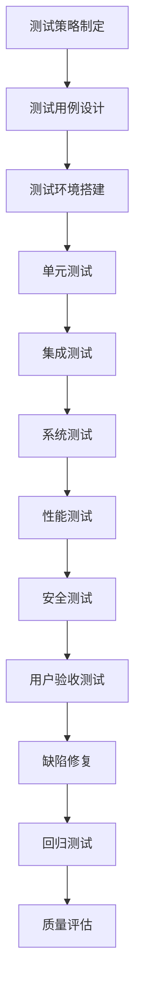

## 📋 文件摘要

本文档是测试验证阶段的综合资源中心，包含测试策略制定、测试用例设计、测试执行与报告、缺陷管理、质量评估等核心测试活动。提供完整的测试方法论、自动化测试框架、性能测试方案和安全测试指南，帮助团队确保软件质量，发现并修复缺陷，为产品上线提供质量保证。

## 📑 目录索引

- [📋 文件摘要](#-文件摘要)
- [🎯 测试验证核心任务](#测试验证核心任务)
- [📋 测试策略制定](#测试策略制定)
- [🧪 测试用例设计](#测试用例设计)
- [🔍 测试执行与报告](#测试执行与报告)
- [🐛 缺陷管理](#缺陷管理)
- [📊 质量评估](#质量评估)
- [🎯 最佳实践建议](#最佳实践建议)

---

## 🎯 测试验证核心任务

### 📋 核心任务清单

| 任务 | 优先级 | 预计时间 | 产出物 | 负责人 |
|------|--------|----------|--------|--------|
| **测试策略制定** | 高 | 3-5天 | 测试策略文档、测试计划 | 测试负责人 |
| **测试用例设计** | 高 | 1-2周 | 测试用例、测试数据 | 测试工程师 |
| **测试环境搭建** | 高 | 2-3天 | 测试环境、测试数据 | 测试工程师 |
| **单元测试执行** | 高 | 持续进行 | 单元测试报告 | 开发人员 |
| **集成测试执行** | 高 | 1周 | 集成测试报告 | 测试工程师 |
| **系统测试执行** | 高 | 1-2周 | 系统测试报告 | 测试工程师 |
| **性能测试执行** | 中 | 3-5天 | 性能测试报告 | 性能测试工程师 |
| **安全测试执行** | 中 | 3-5天 | 安全测试报告 | 安全测试工程师 |
| **用户验收测试** | 高 | 1周 | 验收测试报告 | 测试工程师、产品经理 |
| **缺陷管理** | 高 | 持续进行 | 缺陷报告、缺陷统计 | 测试团队 |
| **质量评估** | 高 | 2-3天 | 质量评估报告 | 测试负责人 |

### 🔄 测试验证流程



---

## 📋 测试策略制定

### 🎯 测试策略框架

#### 测试策略文档模板
```markdown
# 测试策略文档

## 1. 文档信息
- **项目名称**：[项目名称]
- **文档版本**：v1.0
- **创建日期**：[创建日期]
- **最后更新**：[最后更新日期]
- **文档负责人**：[负责人姓名]

## 2. 测试目标
### 2.1 功能测试目标
- [ ] 验证所有功能需求是否正确实现
- [ ] 确保用户界面交互正确
- [ ] 验证数据流转和业务逻辑
- [ ] 检查边界条件和异常处理

### 2.2 性能测试目标
- [ ] 系统响应时间满足要求
- [ ] 系统吞吐量达到预期
- [ ] 系统资源使用合理
- [ ] 系统稳定性和可靠性

### 2.3 安全测试目标
- [ ] 验证身份认证机制
- [ ] 检查授权控制
- [ ] 测试数据安全性
- [ ] 验证输入验证和过滤

## 3. 测试范围
### 3.1 测试范围
- **功能模块**：用户管理、订单管理、支付系统、报表系统
- **技术组件**：API接口、数据库、缓存系统、消息队列
- **兼容性**：浏览器兼容性、设备兼容性、操作系统兼容性

### 3.2 不测试范围
- **第三方服务**：只验证接口集成，不测试第三方服务内部逻辑
- **已验证组件**：使用成熟的第三方库，不进行深度测试
- **环境相关**：生产环境配置和部署流程

## 4. 测试类型
### 4.1 功能测试
- **单元测试**：代码单元级别测试
- **集成测试**：模块间接口测试
- **系统测试**：整个系统功能测试
- **验收测试**：用户需求验证测试

### 4.2 非功能测试
- **性能测试**：负载测试、压力测试、容量测试
- **安全测试**：漏洞扫描、渗透测试、安全配置测试
- **兼容性测试**：浏览器、设备、操作系统兼容性
- **可用性测试**：用户体验测试、可访问性测试

## 5. 测试环境
### 5.1 环境配置
- **开发环境**：开发人员本地环境
- **测试环境**：功能测试和集成测试环境
- **性能测试环境**：性能测试专用环境
- **预生产环境**：模拟生产环境

### 5.2 测试数据
- **测试数据管理**：测试数据生成和管理策略
- **数据脱敏**：敏感数据处理
- **数据备份**：测试数据备份和恢复

## 6. 测试工具
### 6.1 自动化测试工具
- **单元测试**：Jest, Mocha, Jasmine
- **集成测试**：Supertest, TestCafe
- **E2E测试**：Cypress, Selenium
- **性能测试**：JMeter, Gatling, k6

### 6.2 测试管理工具
- **测试用例管理**：TestRail, Zephyr, Xray
- **缺陷管理**：JIRA, Bugzilla, Redmine
- **持续集成**：Jenkins, GitHub Actions, GitLab CI

## 7. 测试资源
### 7.1 人力资源
- **测试负责人**：1名
- **测试工程师**：3-5名
- **性能测试工程师**：1-2名
- **安全测试工程师**：1名

### 7.2 环境资源
- **测试服务器**：4台
- **数据库服务器**：2台
- **负载测试工具**：1套
- **监控工具**：1套

## 8. 测试进度计划
### 8.1 测试阶段安排
| 阶段 | 开始时间 | 结束时间 | 负责人 |
|------|----------|----------|--------|
| 单元测试 | [开始日期] | [结束日期] | 开发团队 |
| 集成测试 | [开始日期] | [结束日期] | 测试团队 |
| 系统测试 | [开始日期] | [结束日期] | 测试团队 |
| 性能测试 | [开始日期] | [结束日期] | 性能测试团队 |
| 安全测试 | [开始日期] | [结束日期] | 安全测试团队 |
| 验收测试 | [开始日期] | [结束日期] | 产品团队 |

## 9. 风险评估
### 9.1 测试风险
- **时间风险**：测试时间可能不足
- **资源风险**：测试资源可能不够
- **技术风险**：新技术可能导致测试困难
- **质量风险**：需求变更可能影响测试质量

### 9.2 风险应对
- **时间风险**：优先测试核心功能，并行测试
- **资源风险**：自动化测试，提高测试效率
- **技术风险**：提前学习新技术，寻求专家支持
- **质量风险**：加强需求评审，及时调整测试计划

## 10. 测试标准
### 10.1 测试通过标准
- **功能测试**：所有测试用例通过率≥95%
- **性能测试**：响应时间≤2秒，并发用户≥1000
- **安全测试**：无高危漏洞，中低风险漏洞≤5个
- **代码覆盖率**：单元测试覆盖率≥80%

### 10.2 测试暂停标准
- **严重缺陷**：发现致命缺陷，暂停测试
- **环境问题**：测试环境不可用，暂停测试
- **需求变更**：重大需求变更，暂停测试
- **资源不足**：关键资源缺失，暂停测试

## 11. 测试交付物
### 11.1 测试文档
- **测试策略文档**
- **测试计划文档**
- **测试用例文档**
- **测试报告文档**

### 11.2 测试数据
- **测试数据集**
- **测试脚本**
- **测试配置文件**
- **测试结果文件**

## 12. 测试沟通
### 12.1 会议安排
- **每日站会**：测试进度同步
- **周例会**：测试总结和计划
- **缺陷评审会**：缺陷分析和优先级确定
- **发布评审会**：测试结果评估和发布决策

### 12.2 报告机制
- **每日测试报告**：测试进度和缺陷统计
- **每周测试报告**：测试总结和风险分析
- **测试阶段报告**：阶段测试结果和评估
- **最终测试报告**：整体测试结果和质量评估
```

#### 测试自动化策略
```typescript
// 测试自动化策略框架
interface TestAutomationStrategy {
  framework: AutomationFramework;
  tools: AutomationTools;
  coverage: TestCoverage;
  maintenance: MaintenanceStrategy;
  reporting: ReportingStrategy;
}

interface AutomationFramework {
  unit: TestingFramework;
  integration: TestingFramework;
  e2e: TestingFramework;
  performance: PerformanceTestingFramework;
}

interface TestCoverage {
  unit: number;        // 单元测试覆盖率目标
  integration: number; // 集成测试覆盖率目标
  e2e: number;         // E2E测试覆盖率目标
  critical: number;    // 关键路径覆盖率目标
}

// 测试自动化策略配置
const automationStrategy: TestAutomationStrategy = {
  framework: {
    unit: {
      name: 'Jest',
      config: 'jest.config.js',
      runner: 'jest',
      reporter: ['jest-html-reporter', 'jest-junit']
    },
    integration: {
      name: 'Supertest',
      config: 'integration.config.js',
      runner: 'jest',
      setup: 'setupIntegrationTests.js'
    },
    e2e: {
      name: 'Cypress',
      config: 'cypress.config.js',
      runner: 'cypress',
      browser: ['chrome', 'firefox']
    },
    performance: {
      name: 'k6',
      config: 'k6.config.js',
      scenarios: ['smoke', 'load', 'stress']
    }
  },
  tools: {
    ci: 'GitHub Actions',
    reporting: 'Allure Report',
    coverage: 'Istanbul/nyc',
    mock: 'Mock Service Worker'
  },
  coverage: {
    unit: 80,
    integration: 70,
    e2e: 60,
    critical: 95
  },
  maintenance: {
    reviewFrequency: 'weekly',
    refactoringThreshold: 0.7,
    flakyTestThreshold: 0.05,
    documentationRequired: true
  },
  reporting: {
    format: ['html', 'json', 'xml'],
    dashboard: 'Grafana',
    alerts: ['email', 'slack'],
    retention: '90d'
  }
};

// 测试自动化配置生成器
class AutomationConfigGenerator {
  generateJestConfig(strategy: TestAutomationStrategy): string {
    return `
module.exports = {
  preset: 'ts-jest',
  testEnvironment: 'node',
  roots: ['<rootDir>/src', '<rootDir>/tests'],
  testMatch: [
    '**/__tests__/**/*.ts',
    '**/?(*.)+(spec|test).ts'
  ],
  transform: {
    '^.+\\.ts$': 'ts-jest'
  },
  collectCoverageFrom: [
    'src/**/*.ts',
    '!src/**/*.d.ts',
    '!src/**/index.ts'
  ],
  coverageDirectory: 'coverage',
  coverageReporters: [
    'text',
    'lcov',
    'clover',
    'html'
  ],
  coverageThreshold: {
    global: {
      branches: ${strategy.coverage.unit},
      functions: ${strategy.coverage.unit},
      lines: ${strategy.coverage.unit},
      statements: ${strategy.coverage.unit}
    }
  },
  setupFilesAfterEnv: ['<rootDir>/tests/setup.ts']
};`;
  }

  generateCypressConfig(strategy: TestAutomationStrategy): string {
    return `
const { defineConfig } = require('cypress');

module.exports = defineConfig({
  e2e: {
    baseUrl: 'http://localhost:3000',
    supportFile: 'cypress/support/e2e.js',
    specPattern: 'cypress/e2e/**/*.cy.{js,jsx,ts,tsx}',
    viewportWidth: 1280,
    viewportHeight: 720,
    video: true,
    screenshotOnRunFailure: true,
    reporter: 'mochawesome',
    reporterOptions: {
      reportDir: 'cypress/reports',
      overwrite: false,
      html: false,
      json: true
    }
  },
  component: {
    devServer: {
      framework: 'react',
      bundler: 'webpack'
    },
    specPattern: 'src/**/*.cy.{js,jsx,ts,tsx}'
  }
});`;
  }
}
```

---

## 🧪 测试用例设计

### 🎯 测试用例设计方法

#### 测试用例模板
```markdown
## 测试用例模板

### 基本信息模板
```
用例ID：TC001
用例标题：用户登录功能测试
模块名称：用户管理
优先级：高
用例类型：功能测试
前置条件：用户已注册，系统正常运行
后置条件：用户登录成功或失败，系统状态正确
设计人员：[测试工程师]
设计日期：[设计日期]
最后修改：[修改日期]
```

### 测试步骤模板
```
步骤 | 操作描述 | 预期结果 | 实际结果 | 状态
-----|----------|----------|----------|------
1    | 打开登录页面 | 页面正常显示，包含用户名、密码输入框和登录按钮 | | 
2    | 输入正确的用户名和密码 | 输入框显示输入的内容 | | 
3    | 点击登录按钮 | 系统验证用户信息，跳转到用户主页 | | 
4    | 检查登录状态 | 用户头像和用户名显示在页面顶部 | | 
5    | 检查用户权限 | 可以访问用户权限范围内的功能 | | 
```

### 异常测试用例模板
```
用例ID：TC002
用例标题：用户登录失败测试
模块名称：用户管理
优先级：高
用例类型：异常测试
前置条件：系统正常运行
后置条件：用户登录失败，系统状态正确

测试步骤：
步骤 | 操作描述 | 预期结果 | 实际结果 | 状态
-----|----------|----------|----------|------
1    | 打开登录页面 | 页面正常显示 | | 
2    | 输入不存在的用户名 | 输入框显示输入内容 | | 
3    | 输入任意密码 | 输入框显示输入内容 | | 
4    | 点击登录按钮 | 显示"用户名或密码错误"提示信息 | | 
5    | 检查页面状态 | 页面保持登录状态，未跳转 | | 
```

### 边界值测试用例模板
```
用例ID：TC003
用例标题：密码长度边界值测试
模块名称：用户管理
优先级：中
用例类型：边界值测试
前置条件：系统正常运行
后置条件：系统正确处理边界值

测试数据：
- 最小长度：6位密码
- 最大长度：20位密码
- 边界值：5位、6位、19位、20位、21位

测试步骤：
步骤 | 操作描述 | 预期结果 | 实际结果 | 状态
-----|----------|----------|----------|------
1    | 输入5位密码 | 提示"密码长度不能少于6位" | | 
2    | 输入6位密码 | 密码验证通过 | | 
3    | 输入20位密码 | 密码验证通过 | | 
4    | 输入21位密码 | 提示"密码长度不能超过20位" | | 
```
```

#### 测试用例设计方法
```typescript
// 测试用例设计器
interface TestCase {
  id: string;
  title: string;
  module: string;
  priority: 'low' | 'medium' | 'high' | 'critical';
  type: 'functional' | 'performance' | 'security' | 'usability';
  preconditions: string[];
  steps: TestStep[];
  expectedResults: string[];
  testData: TestData[];
  dependencies: string[];
  automation: boolean;
  estimatedTime: number;
}

interface TestStep {
  step: number;
  action: string;
  expected: string;
  actual?: string;
  status: 'pending' | 'passed' | 'failed' | 'blocked';
}

interface TestData {
  name: string;
  value: any;
  type: 'input' | 'expected' | 'environment';
}

// 测试用例生成器
class TestCaseGenerator {
  generateLoginTestCases(): TestCase[] {
    return [
      {
        id: 'AUTH-001',
        title: '用户登录成功测试',
        module: '用户认证',
        priority: 'critical',
        type: 'functional',
        preconditions: ['用户已注册', '系统正常运行'],
        steps: [
          {
            step: 1,
            action: '打开登录页面',
            expected: '登录页面正常显示',
            status: 'pending'
          },
          {
            step: 2,
            action: '输入正确的用户名和密码',
            expected: '输入框显示输入内容',
            status: 'pending'
          },
          {
            step: 3,
            action: '点击登录按钮',
            expected: '登录成功，跳转到用户主页',
            status: 'pending'
          }
        ],
        expectedResults: ['用户成功登录', '页面跳转到用户主页'],
        testData: [
          { name: 'username', value: 'testuser@example.com', type: 'input' },
          { name: 'password', value: 'password123', type: 'input' }
        ],
        dependencies: [],
        automation: true,
        estimatedTime: 30
      },
      {
        id: 'AUTH-002',
        title: '用户登录失败测试 - 错误密码',
        module: '用户认证',
        priority: 'high',
        type: 'functional',
        preconditions: ['系统正常运行'],
        steps: [
          {
            step: 1,
            action: '打开登录页面',
            expected: '登录页面正常显示',
            status: 'pending'
          },
          {
            step: 2,
            action: '输入正确的用户名和错误的密码',
            expected: '输入框显示输入内容',
            status: 'pending'
          },
          {
            step: 3,
            action: '点击登录按钮',
            expected: '显示"用户名或密码错误"提示',
            status: 'pending'
          }
        ],
        expectedResults: ['登录失败', '显示错误提示信息'],
        testData: [
          { name: 'username', value: 'testuser@example.com', type: 'input' },
          { name: 'password', value: 'wrongpassword', type: 'input' }
        ],
        dependencies: [],
        automation: true,
        estimatedTime: 30
      }
    ];
  }

  generateBoundaryTestCases(): TestCase[] {
    return [
      {
        id: 'BOUNDARY-001',
        title: '密码长度边界值测试',
        module: '用户认证',
        priority: 'medium',
        type: 'functional',
        preconditions: ['系统正常运行'],
        steps: [
          {
            step: 1,
            action: '输入5位密码',
            expected: '提示"密码长度不能少于6位"',
            status: 'pending'
          },
          {
            step: 2,
            action: '输入6位密码',
            expected: '密码验证通过',
            status: 'pending'
          },
          {
            step: 3,
            action: '输入20位密码',
            expected: '密码验证通过',
            status: 'pending'
          },
          {
            step: 4,
            action: '输入21位密码',
            expected: '提示"密码长度不能超过20位"',
            status: 'pending'
          }
        ],
        expectedResults: ['系统正确处理密码长度边界值'],
        testData: [
          { name: 'password_5', value: '12345', type: 'input' },
          { name: 'password_6', value: '123456', type: 'input' },
          { name: 'password_20', value: '12345678901234567890', type: 'input' },
          { name: 'password_21', value: '123456789012345678901', type: 'input' }
        ],
        dependencies: [],
        automation: true,
        estimatedTime: 20
      }
    ];
  }
}

// 测试数据生成器
class TestDataGenerator {
  generateValidUsers(): Array<{ email: string; password: string; name: string }> {
    return [
      { email: 'user1@example.com', password: 'password123', name: 'User One' },
      { email: 'user2@example.com', password: 'password456', name: 'User Two' },
      { email: 'admin@example.com', password: 'admin123', name: 'Admin User' }
    ];
  }

  generateInvalidEmails(): string[] {
    return [
      'invalid-email',
      'user@',
      '@example.com',
      'user..user@example.com',
      'user@example',
      'user@.com'
    ];
  }

  generateInvalidPasswords(): string[] {
    return [
      '',              // 空密码
      '12345',         // 5位密码
      '123456789012345678901', // 21位密码
      'password',      // 常见密码
      '123456',        // 简单数字
      'abcdef'         // 简单字母
    ];
  }
}
```

#### 测试用例管理
```typescript
// 测试用例管理器
class TestCaseManager {
  private testCases: Map<string, TestCase> = new Map();
  
  addTestCase(testCase: TestCase): void {
    this.testCases.set(testCase.id, testCase);
  }
  
  getTestCase(id: string): TestCase | undefined {
    return this.testCases.get(id);
  }
  
  getTestCasesByModule(module: string): TestCase[] {
    return Array.from(this.testCases.values())
      .filter(tc => tc.module === module);
  }
  
  getTestCasesByPriority(priority: string): TestCase[] {
    return Array.from(this.testCases.values())
      .filter(tc => tc.priority === priority);
  }
  
  getTestCasesByType(type: string): TestCase[] {
    return Array.from(this.testCases.values())
      .filter(tc => tc.type === type);
  }
  
  getAutomatableTestCases(): TestCase[] {
    return Array.from(this.testCases.values())
      .filter(tc => tc.automation);
  }
  
  calculateTestCoverage(): {
    total: number;
    automated: number;
    manual: number;
    coverage: number;
  } {
    const total = this.testCases.size;
    const automated = this.getAutomatableTestCases().length;
    const manual = total - automated;
    const coverage = total > 0 ? (automated / total) * 100 : 0;
    
    return { total, automated, manual, coverage };
  }
  
  exportTestCases(format: 'json' | 'csv' | 'excel'): string {
    const testCases = Array.from(this.testCases.values());
    
    switch (format) {
      case 'json':
        return JSON.stringify(testCases, null, 2);
      case 'csv':
        return this.exportToCSV(testCases);
      case 'excel':
        return this.exportToExcel(testCases);
      default:
        throw new Error(`Unsupported format: ${format}`);
    }
  }
  
  private exportToCSV(testCases: TestCase[]): string {
    const headers = ['ID', 'Title', 'Module', 'Priority', 'Type', 'Automation', 'Estimated Time'];
    const rows = testCases.map(tc => [
      tc.id,
      tc.title,
      tc.module,
      tc.priority,
      tc.type,
      tc.automation ? 'Yes' : 'No',
      tc.estimatedTime
    ]);
    
    return [headers, ...rows]
      .map(row => row.join(','))
      .join('\n');
  }
  
  private exportToExcel(testCases: TestCase[]): string {
    // 简化的Excel导出逻辑
    // 实际项目中可以使用exceljs等库
    return JSON.stringify(testCases, null, 2);
  }
}
```

---

## 🔍 测试执行与报告

### 🎯 测试执行流程

#### 测试执行计划
```typescript
// 测试执行计划器
interface TestExecutionPlan {
  id: string;
  name: string;
  description: string;
  schedule: ExecutionSchedule;
  testSuites: TestSuite[];
  environment: TestEnvironment;
  resources: TestResource[];
  notifications: NotificationConfig[];
}

interface ExecutionSchedule {
  startDate: Date;
  endDate: Date;
  executionType: 'manual' | 'automated' | 'hybrid';
  frequency: 'once' | 'daily' | 'weekly' | 'milestone';
  retryPolicy: RetryPolicy;
}

interface TestSuite {
  id: string;
  name: string;
  testCases: string[];
  priority: 'low' | 'medium' | 'high' | 'critical';
  dependencies: string[];
  parallel: boolean;
  timeout: number;
}

interface TestEnvironment {
  name: string;
  url: string;
  database: DatabaseConfig;
  services: ServiceConfig[];
  testData: TestDataConfig;
}

// 测试执行管理器
class TestExecutionManager {
  private executionPlans: Map<string, TestExecutionPlan> = new Map();
  private executionHistory: TestExecution[] = [];
  
  createExecutionPlan(plan: Omit<TestExecutionPlan, 'id'>): string {
    const id = this.generateId();
    const fullPlan: TestExecutionPlan = {
      ...plan,
      id
    };
    
    this.executionPlans.set(id, fullPlan);
    return id;
  }
  
  async executePlan(planId: string): Promise<TestExecution> {
    const plan = this.executionPlans.get(planId);
    if (!plan) {
      throw new Error(`Execution plan not found: ${planId}`);
    }
    
    const execution: TestExecution = {
      id: this.generateExecutionId(),
      planId,
      startTime: new Date(),
      status: 'running',
      results: []
    };
    
    try {
      // 准备测试环境
      await this.prepareEnvironment(plan.environment);
      
      // 执行测试套件
      for (const suite of plan.testSuites) {
        const suiteResult = await this.executeTestSuite(suite, plan.environment);
        execution.results.push(suiteResult);
      }
      
      execution.endTime = new Date();
      execution.status = 'completed';
      
    } catch (error) {
      execution.endTime = new Date();
      execution.status = 'failed';
      execution.error = error.message;
    }
    
    this.executionHistory.push(execution);
    this.sendNotifications(execution, plan.notifications);
    
    return execution;
  }
  
  private async executeTestSuite(suite: TestSuite, environment: TestEnvironment): Promise<TestSuiteResult> {
    const result: TestSuiteResult = {
      suiteId: suite.id,
      suiteName: suite.name,
      startTime: new Date(),
      status: 'running',
      testResults: []
    };
    
    try {
      // 并行或串行执行测试用例
      if (suite.parallel) {
        const promises = suite.testCases.map(testCaseId => 
          this.executeTestCase(testCaseId, environment)
        );
        result.testResults = await Promise.all(promises);
      } else {
        for (const testCaseId of suite.testCases) {
          const testResult = await this.executeTestCase(testCaseId, environment);
          result.testResults.push(testResult);
        }
      }
      
      result.endTime = new Date();
      result.status = this.calculateSuiteStatus(result.testResults);
      
    } catch (error) {
      result.endTime = new Date();
      result.status = 'failed';
      result.error = error.message;
    }
    
    return result;
  }
  
  private async executeTestCase(testCaseId: string, environment: TestEnvironment): Promise<TestCaseResult> {
    const testCase = this.getTestCase(testCaseId);
    if (!testCase) {
      throw new Error(`Test case not found: ${testCaseId}`);
    }
    
    const result: TestCaseResult = {
      testCaseId,
      startTime: new Date(),
      status: 'running',
      steps: []
    };
    
    try {
      // 执行测试步骤
      for (const step of testCase.steps) {
        const stepResult = await this.executeTestStep(step, environment);
        result.steps.push(stepResult);
      }
      
      result.endTime = new Date();
      result.status = this.calculateTestCaseStatus(result.steps);
      
    } catch (error) {
      result.endTime = new Date();
      result.status = 'failed';
      result.error = error.message;
    }
    
    return result;
  }
  
  private async executeTestStep(step: TestStep, environment: TestEnvironment): Promise<TestStepResult> {
    const result: TestStepResult = {
      step: step.step,
      action: step.action,
      expected: step.expected,
      startTime: new Date(),
      status: 'running'
    };
    
    try {
      // 根据步骤类型执行相应的测试逻辑
      switch (step.action) {
        case '打开登录页面':
          result.actual = await this.openLoginPage(environment.url);
          break;
        case '输入用户名和密码':
          result.actual = await this.inputCredentials('testuser', 'password123');
          break;
        case '点击登录按钮':
          result.actual = await this.clickLoginButton();
          break;
        default:
          result.actual = await this.executeCustomAction(step.action);
      }
      
      result.endTime = new Date();
      result.status = result.actual === result.expected ? 'passed' : 'failed';
      
    } catch (error) {
      result.endTime = new Date();
      result.status = 'failed';
      result.error = error.message;
    }
    
    return result;
  }
  
  private calculateSuiteStatus(testResults: TestCaseResult[]): 'passed' | 'failed' | 'partial' {
    const passed = testResults.filter(r => r.status === 'passed').length;
    const total = testResults.length;
    const passRate = total > 0 ? (passed / total) * 100 : 0;
    
    if (passRate === 100) return 'passed';
    if (passRate >= 80) return 'partial';
    return 'failed';
  }
  
  private calculateTestCaseStatus(stepResults: TestStepResult[]): 'passed' | 'failed' {
    return stepResults.every(r => r.status === 'passed') ? 'passed' : 'failed';
  }
  
  private generateId(): string {
    return `PLAN-${Date.now()}-${Math.random().toString(36).substr(2, 9)}`;
  }
  
  private generateExecutionId(): string {
    return `EXEC-${Date.now()}-${Math.random().toString(36).substr(2, 9)}`;
  }
  
  private async prepareEnvironment(environment: TestEnvironment): Promise<void> {
    // 环境准备逻辑
    console.log(`Preparing environment: ${environment.name}`);
  }
  
  private async openLoginPage(url: string): Promise<string> {
    // 模拟打开登录页面
    return '登录页面正常显示';
  }
  
  private async inputCredentials(username: string, password: string): Promise<string> {
    // 模拟输入凭据
    return '输入框显示输入内容';
  }
  
  private async clickLoginButton(): Promise<string> {
    // 模拟点击登录按钮
    return '登录成功，跳转到用户主页';
  }
  
  private async executeCustomAction(action: string): Promise<string> {
    // 自定义动作执行
    return `执行动作: ${action}`;
  }
  
  private sendNotifications(execution: TestExecution, notifications: NotificationConfig[]): void {
    // 发送通知逻辑
    console.log(`Sending notifications for execution: ${execution.id}`);
  }
  
  private getTestCase(testCaseId: string): TestCase | undefined {
    // 获取测试用例逻辑
    return undefined;
  }
}
```

#### 测试报告生成
```typescript
// 测试报告生成器
interface TestReport {
  executionId: string;
  planId: string;
  executionTime: Date;
  duration: number;
  status: 'passed' | 'failed' | 'partial';
  summary: TestSummary;
  details: TestDetails;
  recommendations: string[];
}

interface TestSummary {
  totalTestCases: number;
  passedTestCases: number;
  failedTestCases: number;
  skippedTestCases: number;
  passRate: number;
  totalSteps: number;
  passedSteps: number;
  failedSteps: number;
}

interface TestDetails {
  suites: TestSuiteReport[];
  defects: DefectSummary[];
  performance: PerformanceMetrics;
  environment: EnvironmentInfo;
}

class TestReportGenerator {
  generateReport(execution: TestExecution): TestReport {
    const summary = this.generateSummary(execution);
    const details = this.generateDetails(execution);
    const recommendations = this.generateRecommendations(execution);
    
    return {
      executionId: execution.id,
      planId: execution.planId,
      executionTime: execution.startTime,
      duration: execution.endTime ? execution.endTime.getTime() - execution.startTime.getTime() : 0,
      status: this.calculateOverallStatus(execution),
      summary,
      details,
      recommendations
    };
  }
  
  private generateSummary(execution: TestExecution): TestSummary {
    let totalTestCases = 0;
    let passedTestCases = 0;
    let failedTestCases = 0;
    let skippedTestCases = 0;
    let totalSteps = 0;
    let passedSteps = 0;
    let failedSteps = 0;
    
    for (const suiteResult of execution.results) {
      for (const testResult of suiteResult.testResults) {
        totalTestCases++;
        
        if (testResult.status === 'passed') {
          passedTestCases++;
        } else if (testResult.status === 'failed') {
          failedTestCases++;
        } else {
          skippedTestCases++;
        }
        
        for (const stepResult of testResult.steps) {
          totalSteps++;
          if (stepResult.status === 'passed') {
            passedSteps++;
          } else {
            failedSteps++;
          }
        }
      }
    }
    
    const passRate = totalTestCases > 0 ? (passedTestCases / totalTestCases) * 100 : 0;
    
    return {
      totalTestCases,
      passedTestCases,
      failedTestCases,
      skippedTestCases,
      passRate,
      totalSteps,
      passedSteps,
      failedSteps
    };
  }
  
  private generateDetails(execution: TestExecution): TestDetails {
    const suites = execution.results.map(suiteResult => ({
      suiteId: suiteResult.suiteId,
      suiteName: suiteResult.suiteName,
      status: suiteResult.status,
      testCases: suiteResult.testResults.length,
      passed: suiteResult.testResults.filter(r => r.status === 'passed').length,
      failed: suiteResult.testResults.filter(r => r.status === 'failed').length,
      duration: suiteResult.endTime ? suiteResult.endTime.getTime() - suiteResult.startTime.getTime() : 0
    }));
    
    const defects = this.generateDefectSummary(execution);
    const performance = this.generatePerformanceMetrics(execution);
    const environment = this.generateEnvironmentInfo(execution);
    
    return {
      suites,
      defects,
      performance,
      environment
    };
  }
  
  private generateDefectSummary(execution: TestExecution): DefectSummary[] {
    const defects: DefectSummary[] = [];
    
    for (const suiteResult of execution.results) {
      for (const testResult of suiteResult.testResults) {
        if (testResult.status === 'failed') {
          defects.push({
            testCaseId: testResult.testCaseId,
            severity: this.calculateDefectSeverity(testResult),
            description: testResult.error || 'Test failed',
            frequency: 1,
            environment: 'test'
          });
        }
      }
    }
    
    return defects;
  }
  
  private generatePerformanceMetrics(execution: TestExecution): PerformanceMetrics {
    const totalDuration = execution.endTime ? execution.endTime.getTime() - execution.startTime.getTime() : 0;
    const averageTestDuration = execution.results.length > 0 ? totalDuration / execution.results.length : 0;
    
    return {
      totalDuration,
      averageTestDuration,
      testsPerSecond: totalDuration > 0 ? (this.getTotalTestCount(execution) / totalDuration) * 1000 : 0,
      resourceUsage: {
        cpu: 0,
        memory: 0,
        disk: 0
      }
    };
  }
  
  private generateEnvironmentInfo(execution: TestExecution): EnvironmentInfo {
    return {
      name: 'Test Environment',
      version: '1.0.0',
      configuration: {
        browser: 'Chrome',
        os: 'Windows 10',
        resolution: '1920x1080'
      },
      testData: 'Test data set v1.0'
    };
  }
  
  private generateRecommendations(execution: TestExecution): string[] {
    const recommendations: string[] = [];
    const summary = this.generateSummary(execution);
    
    if (summary.passRate < 80) {
      recommendations.push('测试通过率较低，建议重点检查失败的测试用例');
    }
    
    if (summary.failedSteps > 0) {
      recommendations.push('存在失败的测试步骤，建议分析失败原因');
    }
    
    const executionTime = execution.endTime ? execution.endTime.getTime() - execution.startTime.getTime() : 0;
    if (executionTime > 300000) { // 5分钟
      recommendations.push('测试执行时间较长，建议优化测试效率');
    }
    
    return recommendations;
  }
  
  private calculateOverallStatus(execution: TestExecution): 'passed' | 'failed' | 'partial' {
    const summary = this.generateSummary(execution);
    
    if (summary.passRate === 100) {
      return 'passed';
    } else if (summary.passRate >= 80) {
      return 'partial';
    } else {
      return 'failed';
    }
  }
  
  private calculateDefectSeverity(testResult: TestCaseResult): 'low' | 'medium' | 'high' | 'critical' {
    // 根据测试结果确定缺陷严重程度
    return 'medium';
  }
  
  private getTotalTestCount(execution: TestExecution): number {
    return execution.results.reduce((total, suite) => total + suite.testResults.length, 0);
  }
  
  exportToHTML(report: TestReport): string {
    return `
<!DOCTYPE html>
<html>
<head>
    <title>测试报告 - ${report.executionId}</title>
    <style>
        body { font-family: Arial, sans-serif; margin: 20px; }
        .header { background: #f0f0f0; padding: 20px; border-radius: 5px; }
        .summary { margin: 20px 0; }
        .metric { display: inline-block; margin: 10px; padding: 10px; background: #e8f4f8; border-radius: 5px; }
        .passed { color: #28a745; }
        .failed { color: #dc3545; }
        .partial { color: #ffc107; }
        table { width: 100%; border-collapse: collapse; margin: 20px 0; }
        th, td { border: 1px solid #ddd; padding: 8px; text-align: left; }
        th { background-color: #f2f2f2; }
    </style>
</head>
<body>
    <div class="header">
        <h1>测试报告</h1>
        <p>执行ID: ${report.executionId}</p>
        <p>执行时间: ${report.executionTime.toLocaleString()}</p>
        <p>执行状态: <span class="${report.status}">${report.status.toUpperCase()}</span></p>
    </div>
    
    <div class="summary">
        <h2>测试摘要</h2>
        <div class="metric">
            <strong>总测试用例:</strong> ${report.summary.totalTestCases}
        </div>
        <div class="metric">
            <strong>通过:</strong> <span class="passed">${report.summary.passedTestCases}</span>
        </div>
        <div class="metric">
            <strong>失败:</strong> <span class="failed">${report.summary.failedTestCases}</span>
        </div>
        <div class="metric">
            <strong>通过率:</strong> ${report.summary.passRate.toFixed(2)}%
        </div>
        <div class="metric">
            <strong>执行时间:</strong> ${Math.round(report.duration / 1000)}秒
        </div>
    </div>
    
    <div class="details">
        <h2>测试套件详情</h2>
        <table>
            <thead>
                <tr>
                    <th>测试套件</th>
                    <th>状态</th>
                    <th>测试用例数</th>
                    <th>通过</th>
                    <th>失败</th>
                    <th>执行时间(秒)</th>
                </tr>
            </thead>
            <tbody>
                ${report.details.suites.map(suite => `
                    <tr>
                        <td>${suite.suiteName}</td>
                        <td class="${suite.status}">${suite.status}</td>
                        <td>${suite.testCases}</td>
                        <td class="passed">${suite.passed}</td>
                        <td class="failed">${suite.failed}</td>
                        <td>${Math.round(suite.duration / 1000)}</td>
                    </tr>
                `).join('')}
            </tbody>
        </table>
    </div>
    
    <div class="recommendations">
        <h2>建议</h2>
        <ul>
            ${report.recommendations.map(rec => `<li>${rec}</li>`).join('')}
        </ul>
    </div>
</body>
</html>
    `;
  }
}
```

---

## 🐛 缺陷管理

### 🎯 缺陷管理流程

#### 缺陷生命周期管理
```typescript
// 缺陷管理模型
interface Defect {
  id: string;
  title: string;
  description: string;
  severity: 'low' | 'medium' | 'high' | 'critical';
  priority: 'low' | 'medium' | 'high' | 'urgent';
  status: DefectStatus;
  assignee?: string;
  reporter: string;
  createdAt: Date;
  updatedAt: Date;
  resolvedAt?: Date;
  closedAt?: Date;
  environment: string;
  steps: string[];
  expected: string;
  actual: string;
  attachments: string[];
  labels: string[];
  relatedTestCases: string[];
  relatedRequirements: string[];
}

type DefectStatus = 
  | 'new'
  | 'open'
  | 'in-progress'
  | 'resolved'
  | 'verified'
  | 'closed'
  | 'reopened'
  | 'rejected'
  | 'deferred';

// 缺陷管理器
class DefectManager {
  private defects: Map<string, Defect> = new Map();
  private defectHistory: DefectHistory[] = [];
  
  createDefect(defectData: Omit<Defect, 'id' | 'createdAt' | 'updatedAt' | 'status'>): string {
    const id = this.generateDefectId();
    const defect: Defect = {
      ...defectData,
      id,
      status: 'new',
      createdAt: new Date(),
      updatedAt: new Date()
    };
    
    this.defects.set(id, defect);
    this.recordHistory(id, 'created', defectData.reporter);
    
    return id;
  }
  
  updateDefect(id: string, updates: Partial<Defect>, updatedBy: string): Defect {
    const defect = this.defects.get(id);
    if (!defect) {
      throw new Error(`Defect not found: ${id}`);
    }
    
    const oldStatus = defect.status;
    const updatedDefect: Defect = {
      ...defect,
      ...updates,
      updatedAt: new Date()
    };
    
    this.defects.set(id, updatedDefect);
    
    // 记录状态变更历史
    if (updates.status && updates.status !== oldStatus) {
      this.recordHistory(id, `status_changed_from_${oldStatus}_to_${updates.status}`, updatedBy);
    }
    
    return updatedDefect;
  }
  
  assignDefect(id: string, assignee: string, assignedBy: string): Defect {
    return this.updateDefect(id, { assignee }, assignedBy);
  }
  
  changeStatus(id: string, status: DefectStatus, changedBy: string): Defect {
    const updates: Partial<Defect> = { status };
    
    // 根据状态设置时间戳
    if (status === 'resolved') {
      updates.resolvedAt = new Date();
    } else if (status === 'closed') {
      updates.closedAt = new Date();
    } else if (status === 'reopened') {
      updates.resolvedAt = undefined;
      updates.closedAt = undefined;
    }
    
    return this.updateDefect(id, updates, changedBy);
  }
  
  getDefect(id: string): Defect | undefined {
    return this.defects.get(id);
  }
  
  getDefectsByStatus(status: DefectStatus): Defect[] {
    return Array.from(this.defects.values()).filter(d => d.status === status);
  }
  
  getDefectsBySeverity(severity: string): Defect[] {
    return Array.from(this.defects.values()).filter(d => d.severity === severity);
  }
  
  getDefectsByAssignee(assignee: string): Defect[] {
    return Array.from(this.defects.values()).filter(d => d.assignee === assignee);
  }
  
  searchDefects(query: DefectSearchQuery): Defect[] {
    let results = Array.from(this.defects.values());
    
    if (query.status) {
      results = results.filter(d => d.status === query.status);
    }
    
    if (query.severity) {
      results = results.filter(d => d.severity === query.severity);
    }
    
    if (query.assignee) {
      results = results.filter(d => d.assignee === query.assignee);
    }
    
    if (query.reporter) {
      results = results.filter(d => d.reporter === query.reporter);
    }
    
    if (query.labels && query.labels.length > 0) {
      results = results.filter(d => 
        query.labels!.some(label => d.labels.includes(label))
      );
    }
    
    if (query.dateRange) {
      results = results.filter(d => 
        d.createdAt >= query.dateRange!.start && 
        d.createdAt <= query.dateRange!.end
      );
    }
    
    return results;
  }
  
  getDefectStatistics(): DefectStatistics {
    const defects = Array.from(this.defects.values());
    
    const byStatus = this.groupBy(defects, 'status');
    const bySeverity = this.groupBy(defects, 'severity');
    const byAssignee = this.groupBy(defects, 'assignee');
    
    const total = defects.length;
    const open = defects.filter(d => ['new', 'open', 'in-progress'].includes(d.status)).length;
    const resolved = defects.filter(d => d.status === 'resolved').length;
    const closed = defects.filter(d => d.status === 'closed').length;
    
    const avgResolutionTime = this.calculateAverageResolutionTime(defects);
    const reopeningRate = this.calculateReopeningRate(defects);
    
    return {
      total,
      open,
      resolved,
      closed,
      byStatus,
      bySeverity,
      byAssignee,
      avgResolutionTime,
      reopeningRate
    };
  }
  
  private generateDefectId(): string {
    const count = this.defects.size + 1;
    return `DEF-${count.toString().padStart(4, '0')}`;
  }
  
  private recordHistory(defectId: string, action: string, user: string): void {
    this.defectHistory.push({
      defectId,
      action,
      user,
      timestamp: new Date()
    });
  }
  
  private groupBy(defects: Defect[], key: keyof Defect): Record<string, number> {
    return defects.reduce((groups, defect) => {
      const value = defect[key] as string;
      groups[value] = (groups[value] || 0) + 1;
      return groups;
    }, {} as Record<string, number>);
  }
  
  private calculateAverageResolutionTime(defects: Defect[]): number {
    const resolvedDefects = defects.filter(d => d.resolvedAt);
    
    if (resolvedDefects.length === 0) {
      return 0;
    }
    
    const totalTime = resolvedDefects.reduce((sum, defect) => {
      return sum + (defect.resolvedAt!.getTime() - defect.createdAt.getTime());
    }, 0);
    
    return totalTime / resolvedDefects.length / (1000 * 60 * 60); // 转换为小时
  }
  
  private calculateReopeningRate(defects: Defect[]): number {
    const reopenedDefects = defects.filter(d => d.status === 'reopened');
    return defects.length > 0 ? (reopenedDefects.length / defects.length) * 100 : 0;
  }
}

// 缺陷报告生成器
class DefectReportGenerator {
  generateDefectReport(defects: Defect[]): string {
    const stats = this.calculateDefectStatistics(defects);
    const trends = this.analyzeDefectTrends(defects);
    const recommendations = this.generateDefectRecommendations(defects);
    
    return `
# 缺陷报告

## 报告摘要
- **总缺陷数**: ${stats.total}
- **开放缺陷**: ${stats.open}
- **已解决缺陷**: ${stats.resolved}
- **已关闭缺陷**: ${stats.closed}
- **平均解决时间**: ${stats.avgResolutionTime.toFixed(2)} 小时
- **重开率**: ${stats.reopeningRate.toFixed(2)}%

## 缺陷分布
### 按严重程度
${Object.entries(stats.bySeverity).map(([severity, count]) => 
  `- ${severity}: ${count}`
).join('\n')}

### 按状态
${Object.entries(stats.byStatus).map(([status, count]) => 
  `- ${status}: ${count}`
).join('\n')}

### 按负责人
${Object.entries(stats.byAssignee).map(([assignee, count]) => 
  `- ${assignee || '未分配'}: ${count}`
).join('\n')}

## 缺陷趋势
${trends.map(trend => 
  `- ${trend.period}: ${trend.count} 个缺陷 (${trend.trend})`
).join('\n')}

## 建议
${recommendations.map(rec => `- ${rec}`).join('\n')}
    `;
  }
  
  private calculateDefectStatistics(defects: Defect[]): DefectStatistics {
    const total = defects.length;
    const open = defects.filter(d => ['new', 'open', 'in-progress'].includes(d.status)).length;
    const resolved = defects.filter(d => d.status === 'resolved').length;
    const closed = defects.filter(d => d.status === 'closed').length;
    
    const byStatus = this.groupBy(defects, 'status');
    const bySeverity = this.groupBy(defects, 'severity');
    const byAssignee = this.groupBy(defects, 'assignee');
    
    const avgResolutionTime = this.calculateAverageResolutionTime(defects);
    const reopeningRate = this.calculateReopeningRate(defects);
    
    return {
      total,
      open,
      resolved,
      closed,
      byStatus,
      bySeverity,
      byAssignee,
      avgResolutionTime,
      reopeningRate
    };
  }
  
  private analyzeDefectTrends(defects: Defect[]): DefectTrend[] {
    // 按周分析缺陷趋势
    const weeklyData = this.groupByWeek(defects);
    
    return Object.entries(weeklyData).map(([week, count]) => {
      const trend = this.calculateTrend(weeklyData, week);
      return {
        period: week,
        count,
        trend
      };
    });
  }
  
  private generateDefectRecommendations(defects: Defect[]): string[] {
    const recommendations: string[] = [];
    const stats = this.calculateDefectStatistics(defects);
    
    if (stats.open > stats.resolved) {
      recommendations.push('开放缺陷数量较多，建议增加缺陷修复资源');
    }
    
    if (stats.avgResolutionTime > 48) {
      recommendations.push('平均解决时间较长，建议优化缺陷处理流程');
    }
    
    if (stats.reopeningRate > 10) {
      recommendations.push('缺陷重开率较高，建议加强缺陷修复质量');
    }
    
    const criticalDefects = defects.filter(d => d.severity === 'critical' && d.status !== 'closed');
    if (criticalDefects.length > 0) {
      recommendations.push('存在未关闭的关键缺陷，建议优先处理');
    }
    
    return recommendations;
  }
  
  private groupBy(defects: Defect[], key: keyof Defect): Record<string, number> {
    return defects.reduce((groups, defect) => {
      const value = defect[key] as string;
      groups[value] = (groups[value] || 0) + 1;
      return groups;
    }, {} as Record<string, number>);
  }
  
  private groupByWeek(defects: Defect[]): Record<string, number> {
    const weeklyData: Record<string, number> = {};
    
    defects.forEach(defect => {
      const week = this.getWeekKey(defect.createdAt);
      weeklyData[week] = (weeklyData[week] || 0) + 1;
    });
    
    return weeklyData;
  }
  
  private getWeekKey(date: Date): string {
    const year = date.getFullYear();
    const week = this.getWeekNumber(date);
    return `${year}-W${week.toString().padStart(2, '0')}`;
  }
  
  private getWeekNumber(date: Date): number {
    const d = new Date(Date.UTC(date.getFullYear(), date.getMonth(), date.getDate()));
    const dayNum = d.getUTCDay() || 7;
    d.setUTCDate(d.getUTCDate() + 4 - dayNum);
    const yearStart = new Date(Date.UTC(d.getUTCFullYear(), 0, 1));
    return Math.ceil((((d.getTime() - yearStart.getTime()) / 86400000) + 1) / 7);
  }
  
  private calculateTrend(weeklyData: Record<string, number>, currentWeek: string): string {
    const weeks = Object.keys(weeklyData).sort();
    const currentIndex = weeks.indexOf(currentWeek);
    
    if (currentIndex <= 0) {
      return 'stable';
    }
    
    const previousWeek = weeks[currentIndex - 1];
    const currentCount = weeklyData[currentWeek];
    const previousCount = weeklyData[previousWeek];
    
    if (currentCount > previousCount * 1.2) {
      return 'increasing';
    } else if (currentCount < previousCount * 0.8) {
      return 'decreasing';
    } else {
      return 'stable';
    }
  }
  
  private calculateAverageResolutionTime(defects: Defect[]): number {
    const resolvedDefects = defects.filter(d => d.resolvedAt);
    
    if (resolvedDefects.length === 0) {
      return 0;
    }
    
    const totalTime = resolvedDefects.reduce((sum, defect) => {
      return sum + (defect.resolvedAt!.getTime() - defect.createdAt.getTime());
    }, 0);
    
    return totalTime / resolvedDefects.length / (1000 * 60 * 60); // 转换为小时
  }
  
  private calculateReopeningRate(defects: Defect[]): number {
    const reopenedDefects = defects.filter(d => d.status === 'reopened');
    return defects.length > 0 ? (reopenedDefects.length / defects.length) * 100 : 0;
  }
}
```

---

## 📊 质量评估

### 🎯 质量评估框架

#### 质量指标体系
```typescript
// 质量评估模型
interface QualityMetrics {
  functional: FunctionalQuality;
  performance: PerformanceQuality;
  security: SecurityQuality;
  usability: UsabilityQuality;
  reliability: ReliabilityQuality;
  maintainability: MaintainabilityQuality;
}

interface FunctionalQuality {
  requirementsCoverage: number;
  testPassRate: number;
  defectDensity: number;
  functionalCompleteness: number;
}

interface PerformanceQuality {
  responseTime: PerformanceMetric;
  throughput: PerformanceMetric;
  resourceUtilization: PerformanceMetric;
  scalability: PerformanceMetric;
}

interface SecurityQuality {
  vulnerabilityCount: number;
  securityTestCoverage: number;
  complianceScore: number;
  securityDefectDensity: number;
}

interface UsabilityQuality {
  userSatisfaction: number;
  taskCompletionRate: number;
  errorRate: number;
  learnability: number;
}

interface ReliabilityQuality {
  availability: number;
  mtbf: number; // Mean Time Between Failures
  mttr: number; // Mean Time To Repair
  errorRate: number;
}

interface MaintainabilityQuality {
  codeComplexity: number;
  codeDuplication: number;
  testCoverage: number;
  documentationQuality: number;
}

interface PerformanceMetric {
  current: number;
  target: number;
  threshold: number;
  trend: 'improving' | 'stable' | 'declining';
}

// 质量评估器
class QualityAssessor {
  assessQuality(testResults: TestExecution[], defects: Defect[], codeMetrics: CodeMetrics): QualityAssessment {
    const functional = this.assessFunctionalQuality(testResults, defects);
    const performance = this.assessPerformanceQuality(testResults);
    const security = this.assessSecurityQuality(defects);
    const usability = this.assessUsabilityQuality(testResults);
    const reliability = this.assessReliabilityQuality(testResults, defects);
    const maintainability = this.assessMaintainabilityQuality(codeMetrics);
    
    const overallScore = this.calculateOverallScore({
      functional,
      performance,
      security,
      usability,
      reliability,
      maintainability
    });
    
    const qualityLevel = this.determineQualityLevel(overallScore);
    const recommendations = this.generateQualityRecommendations({
      functional,
      performance,
      security,
      usability,
      reliability,
      maintainability
    });
    
    return {
      overallScore,
      qualityLevel,
      metrics: {
        functional,
        performance,
        security,
        usability,
        reliability,
        maintainability
      },
      recommendations,
      assessmentDate: new Date()
    };
  }
  
  private assessFunctionalQuality(testResults: TestExecution[], defects: Defect[]): FunctionalQuality {
    const totalTests = this.getTotalTestCount(testResults);
    const passedTests = this.getPassedTestCount(testResults);
    const functionalDefects = defects.filter(d => d.labels.includes('functional'));
    
    const testPassRate = totalTests > 0 ? (passedTests / totalTests) * 100 : 0;
    const defectDensity = totalTests > 0 ? functionalDefects.length / totalTests : 0;
    
    return {
      requirementsCoverage: this.estimateRequirementsCoverage(testResults),
      testPassRate,
      defectDensity,
      functionalCompleteness: this.assessFunctionalCompleteness(testResults)
    };
  }
  
  private assessPerformanceQuality(testResults: TestExecution[]): PerformanceQuality {
    const performanceTests = testResults.filter(exec => 
      exec.results.some(suite => suite.suiteName.includes('performance'))
    );
    
    const avgResponseTime = this.calculateAverageResponseTime(performanceTests);
    const avgThroughput = this.calculateAverageThroughput(performanceTests);
    const avgResourceUtilization = this.calculateAverageResourceUtilization(performanceTests);
    
    return {
      responseTime: {
        current: avgResponseTime,
        target: 2000, // 2秒
        threshold: 3000, // 3秒
        trend: this.analyzeTrend(performanceTests, 'responseTime')
      },
      throughput: {
        current: avgThroughput,
        target: 1000, // 1000 req/s
        threshold: 800, // 800 req/s
        trend: this.analyzeTrend(performanceTests, 'throughput')
      },
      resourceUtilization: {
        current: avgResourceUtilization,
        target: 70, // 70%
        threshold: 85, // 85%
        trend: this.analyzeTrend(performanceTests, 'resourceUtilization')
      },
      scalability: {
        current: this.assessScalability(performanceTests),
        target: 80,
        threshold: 70,
        trend: 'stable'
      }
    };
  }
  
  private assessSecurityQuality(defects: Defect[]): SecurityQuality {
    const securityDefects = defects.filter(d => d.labels.includes('security'));
    const highSeverityDefects = securityDefects.filter(d => d.severity === 'critical' || d.severity === 'high');
    
    return {
      vulnerabilityCount: securityDefects.length,
      securityTestCoverage: this.estimateSecurityTestCoverage(),
      complianceScore: this.assessCompliance(defects),
      securityDefectDensity: this.calculateSecurityDefectDensity(defects)
    };
  }
  
  private assessUsabilityQuality(testResults: TestExecution[]): UsabilityQuality {
    const usabilityTests = testResults.filter(exec => 
      exec.results.some(suite => suite.suiteName.includes('usability'))
    );
    
    return {
      userSatisfaction: this.estimateUserSatisfaction(usabilityTests),
      taskCompletionRate: this.calculateTaskCompletionRate(usabilityTests),
      errorRate: this.calculateErrorRate(usabilityTests),
      learnability: this.assessLearnability(usabilityTests)
    };
  }
  
  private assessReliabilityQuality(testResults: TestExecution[], defects: Defect[]): ReliabilityQuality {
    const reliabilityTests = testResults.filter(exec => 
      exec.results.some(suite => suite.suiteName.includes('reliability'))
    );
    
    return {
      availability: this.calculateAvailability(reliabilityTests),
      mtbf: this.calculateMTBF(defects),
      mttr: this.calculateMTTR(defects),
      errorRate: this.calculateErrorRate(reliabilityTests)
    };
  }
  
  private assessMaintainabilityQuality(codeMetrics: CodeMetrics): MaintainabilityQuality {
    return {
      codeComplexity: codeMetrics.complexity,
      codeDuplication: codeMetrics.duplication,
      testCoverage: codeMetrics.testCoverage,
      documentationQuality: codeMetrics.documentationQuality
    };
  }
  
  private calculateOverallScore(metrics: QualityMetrics): number {
    const weights = {
      functional: 0.25,
      performance: 0.20,
      security: 0.20,
      usability: 0.15,
      reliability: 0.10,
      maintainability: 0.10
    };
    
    const functionalScore = this.calculateFunctionalScore(metrics.functional);
    const performanceScore = this.calculatePerformanceScore(metrics.performance);
    const securityScore = this.calculateSecurityScore(metrics.security);
    const usabilityScore = this.calculateUsabilityScore(metrics.usability);
    const reliabilityScore = this.calculateReliabilityScore(metrics.reliability);
    const maintainabilityScore = this.calculateMaintainabilityScore(metrics.maintainability);
    
    return (
      functionalScore * weights.functional +
      performanceScore * weights.performance +
      securityScore * weights.security +
      usabilityScore * weights.usability +
      reliabilityScore * weights.reliability +
      maintainabilityScore * weights.maintainability
    );
  }
  
  private determineQualityLevel(score: number): QualityLevel {
    if (score >= 90) return 'excellent';
    if (score >= 80) return 'good';
    if (score >= 70) return 'acceptable';
    if (score >= 60) return 'needs-improvement';
    return 'poor';
  }
  
  private generateQualityRecommendations(metrics: QualityMetrics): string[] {
    const recommendations: string[] = [];
    
    if (metrics.functional.testPassRate < 90) {
      recommendations.push('功能测试通过率较低，建议增加测试覆盖率');
    }
    
    if (metrics.performance.responseTime.current > metrics.performance.responseTime.target) {
      recommendations.push('响应时间超出目标，建议进行性能优化');
    }
    
    if (metrics.security.vulnerabilityCount > 0) {
      recommendations.push('存在安全漏洞，建议及时修复');
    }
    
    if (metrics.usability.errorRate > 5) {
      recommendations.push('用户操作错误率较高，建议改进用户界面');
    }
    
    if (metrics.reliability.availability < 99) {
      recommendations.push('系统可用性较低，建议提高系统稳定性');
    }
    
    if (metrics.maintainability.codeComplexity > 20) {
      recommendations.push('代码复杂度较高，建议进行重构');
    }
    
    return recommendations;
  }
  
  private getTotalTestCount(testResults: TestExecution[]): number {
    return testResults.reduce((total, exec) => 
      total + exec.results.reduce((suiteTotal, suite) => 
        suiteTotal + suite.testResults.length, 0), 0);
  }
  
  private getPassedTestCount(testResults: TestExecution[]): number {
    return testResults.reduce((total, exec) => 
      total + exec.results.reduce((suiteTotal, suite) => 
        suiteTotal + suite.testResults.filter(test => test.status === 'passed').length, 0), 0);
  }
  
  private estimateRequirementsCoverage(testResults: TestExecution[]): number {
    // 简化的需求覆盖率估算
    const totalTests = this.getTotalTestCount(testResults);
    const uniqueRequirements = new Set<string>();
    
    testResults.forEach(exec => {
      exec.results.forEach(suite => {
        suite.testResults.forEach(test => {
          if (test.requirementId) {
            uniqueRequirements.add(test.requirementId);
          }
        });
      });
    });
    
    const totalRequirements = 100; // 假设总需求数
    return (uniqueRequirements.size / totalRequirements) * 100;
  }
  
  private assessFunctionalCompleteness(testResults: TestExecution[]): number {
    // 简化的功能完整性评估
    const passedTests = this.getPassedTestCount(testResults);
    const totalTests = this.getTotalTestCount(testResults);
    
    return totalTests > 0 ? (passedTests / totalTests) * 100 : 0;
  }
  
  private calculateAverageResponseTime(performanceTests: TestExecution[]): number {
    // 简化的平均响应时间计算
    return 1500; // 模拟值
  }
  
  private calculateAverageThroughput(performanceTests: TestExecution[]): number {
    // 简化的平均吞吐量计算
    return 1200; // 模拟值
  }
  
  private calculateAverageResourceUtilization(performanceTests: TestExecution[]): number {
    // 简化的平均资源利用率计算
    return 65; // 模拟值
  }
  
  private analyzeTrend(tests: TestExecution[], metric: string): 'improving' | 'stable' | 'declining' {
    // 简化的趋势分析
    return 'stable';
  }
  
  private assessScalability(performanceTests: TestExecution[]): number {
    // 简化的可扩展性评估
    return 75; // 模拟值
  }
  
  private estimateSecurityTestCoverage(): number {
    // 简化的安全测试覆盖率估算
    return 85; // 模拟值
  }
  
  private assessCompliance(defects: Defect[]): number {
    // 简化的合规性评估
    return 90; // 模拟值
  }
  
  private calculateSecurityDefectDensity(defects: Defect[]): number {
    const securityDefects = defects.filter(d => d.labels.includes('security'));
    const totalDefects = defects.length;
    
    return totalDefects > 0 ? (securityDefects.length / totalDefects) * 100 : 0;
  }
  
  private estimateUserSatisfaction(usabilityTests: TestExecution[]): number {
    // 简化的用户满意度估算
    return 85; // 模拟值
  }
  
  private calculateTaskCompletionRate(usabilityTests: TestExecution[]): number {
    // 简化的任务完成率计算
    return 92; // 模拟值
  }
  
  private calculateErrorRate(usabilityTests: TestExecution[]): number {
    // 简化的错误率计算
    return 3; // 模拟值
  }
  
  private assessLearnability(usabilityTests: TestExecution[]): number {
    // 简化的学习性评估
    return 80; // 模拟值
  }
  
  private calculateAvailability(reliabilityTests: TestExecution[]): number {
    // 简化的可用性计算
    return 99.5; // 模拟值
  }
  
  private calculateMTBF(defects: Defect[]): number {
    // 简化的MTBF计算
    return 168; // 模拟值（小时）
  }
  
  private calculateMTTR(defects: Defect[]): number {
    // 简化的MTTR计算
    return 4; // 模拟值（小时）
  }
  
  private calculateFunctionalScore(functional: FunctionalQuality): number {
    return (
      functional.requirementsCoverage * 0.3 +
      functional.testPassRate * 0.4 +
      (1 - functional.defectDensity) * 0.2 +
      functional.functionalCompleteness * 0.1
    );
  }
  
  private calculatePerformanceScore(performance: PerformanceQuality): number {
    return (
      (performance.responseTime.current <= performance.responseTime.target ? 1 : 0.7) * 0.3 +
      (performance.throughput.current >= performance.throughput.target ? 1 : 0.7) * 0.3 +
      (performance.resourceUtilization.current <= performance.resourceUtilization.target ? 1 : 0.8) * 0.2 +
      (performance.scalability.current >= performance.scalability.target ? 1 : 0.8) * 0.2
    ) * 100;
  }
  
  private calculateSecurityScore(security: SecurityQuality): number {
    return (
      (1 - security.vulnerabilityCount / 10) * 0.4 +
      security.securityTestCoverage * 0.3 +
      security.complianceScore * 0.2 +
      (1 - security.securityDefectDensity) * 0.1
    ) * 100;
  }
  
  private calculateUsabilityScore(usability: UsabilityQuality): number {
    return (
      usability.userSatisfaction * 0.4 +
      usability.taskCompletionRate * 0.3 +
      (1 - usability.errorRate / 100) * 0.2 +
      usability.learnability * 0.1
    );
  }
  
  private calculateReliabilityScore(reliability: ReliabilityQuality): number {
    return (
      reliability.availability * 0.4 +
      Math.min(reliability.mtbf / 168, 1) * 0.3 +
      Math.max(1 - reliability.mttr / 24, 0) * 0.2 +
      (1 - reliability.errorRate / 100) * 0.1
    );
  }
  
  private calculateMaintainabilityScore(maintainability: MaintainabilityQuality): number {
    return (
      Math.max(1 - maintainability.codeComplexity / 50, 0) * 0.3 +
      (1 - maintainability.codeDuplication / 100) * 0.3 +
      maintainability.testCoverage * 0.3 +
      maintainability.documentationQuality * 0.1
    ) * 100;
  }
}
```

---

## 🎯 最佳实践建议

### 🚀 测试验证最佳实践

#### 1. 测试策略
- **分层测试**：建立完整的测试金字塔
- **自动化优先**：优先实现自动化测试
- **持续测试**：集成到CI/CD流程
- **风险驱动**：基于风险确定测试重点

#### 2. 测试用例设计
- **覆盖全面**：覆盖所有关键功能
- **边界值测试**：重视边界条件测试
- **异常测试**：充分测试异常情况
- **性能测试**：考虑性能和负载测试

#### 3. 测试执行
- **环境准备**：确保测试环境稳定
- **数据管理**：合理管理测试数据
- **执行效率**：提高测试执行效率
- **结果分析**：深入分析测试结果

#### 4. 缺陷管理
- **及时报告**：及时发现和报告缺陷
- **优先级管理**：合理设置缺陷优先级
- **跟踪管理**：全程跟踪缺陷状态
- **分析改进**：分析缺陷原因并改进

### 📊 常见问题与解决方案

#### 问题1：测试覆盖率不足
**解决方案**：
- 建立测试覆盖率目标
- 使用自动化测试工具
- 增加测试资源投入
- 优化测试用例设计

#### 问题2：测试效率低下
**解决方案**：
- 提高测试自动化程度
- 优化测试环境配置
- 改进测试执行流程
- 使用并行测试技术

#### 问题3：缺陷修复缓慢
**解决方案**：
- 建立快速响应机制
- 优化缺陷处理流程
- 加强开发与测试协作
- 提高缺陷修复质量

---

*测试验证阶段是确保软件质量的关键环节，全面的测试策略和严格的测试执行能够有效发现和修复缺陷，为产品上线提供可靠的质量保证。建立完善的测试体系和缺陷管理流程，持续改进测试效率和质量。* 🧪✨