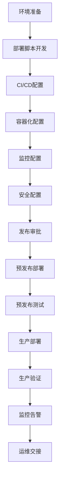

## 📋 文件摘要

本文档是部署上线阶段的综合资源中心，包含部署环境配置、部署脚本编写、发布流程管理、监控告警配置、运维文档编写等核心部署活动。提供完整的部署策略、自动化部署方案、容器化部署指南、监控配置模板和故障处理流程，帮助团队实现高效、稳定的系统部署和运维管理。

## 📑 目录索引

- [📋 文件摘要](#-文件摘要)
- [🎯 部署上线核心任务](#部署上线核心任务)
- [🔧 部署环境配置](#部署环境配置)
- [📜 部署脚本编写](#部署脚本编写)
- [🚀 发布流程管理](#发布流程管理)
- [📊 监控告警配置](#监控告警配置)
- [📚 运维文档编写](#运维文档编写)
- [🎯 最佳实践建议](#最佳实践建议)

---

## 🎯 部署上线核心任务

### 📋 核心任务清单

| 任务 | 优先级 | 预计时间 | 产出物 | 负责人 |
|------|--------|----------|--------|--------|
| **部署环境配置** | 高 | 2-3天 | 环境配置文档、环境清单 | 运维工程师 |
| **部署脚本编写** | 高 | 3-5天 | 部署脚本、配置文件 | 运维工程师 |
| **CI/CD流水线** | 高 | 3-5天 | CI/CD配置、自动化流程 | DevOps工程师 |
| **容器化部署** | 中 | 2-3天 | Docker镜像、K8s配置 | DevOps工程师 |
| **监控配置** | 高 | 2-3天 | 监控配置、告警规则 | 运维工程师 |
| **发布流程** | 高 | 1-2天 | 发布流程文档、审批流程 | 项目经理 |
| **灾备方案** | 中 | 2-3天 | 灾备文档、恢复方案 | 运维工程师 |
| **性能调优** | 中 | 3-5天 | 性能优化报告、配置调优 | 性能工程师 |
| **安全加固** | 高 | 2-3天 | 安全配置、加固方案 | 安全工程师 |
| **运维文档** | 高 | 2-3天 | 运维手册、故障处理 | 运维工程师 |

### 🔄 部署上线流程



---

## 🔧 部署环境配置

### 🎯 环境标准化

#### 环境配置清单
```markdown
## 环境配置清单

### 1. 开发环境 (Development)
**用途**：开发人员日常开发和调试
**配置要求**：
- **服务器**：2核4G虚拟机
- **操作系统**：Ubuntu 20.04 LTS
- **数据库**：PostgreSQL 13 + Redis 6
- **应用服务器**：Node.js 18 + Nginx
- **域名**：dev.example.com
- **访问方式**：VPN访问
- **备份策略**：每日备份，保留7天

### 2. 测试环境 (Testing)
**用途**：功能测试、集成测试、性能测试
**配置要求**：
- **服务器**：4核8G虚拟机
- **操作系统**：Ubuntu 20.04 LTS
- **数据库**：PostgreSQL 13 + Redis 6 + MongoDB 4.4
- **应用服务器**：Node.js 18 + Nginx + PM2
- **域名**：test.example.com
- **访问方式**：内网访问
- **备份策略**：每日备份，保留14天

### 3. 预发布环境 (Staging)
**用途**：生产环境镜像、最终验收测试
**配置要求**：
- **服务器**：8核16G虚拟机
- **操作系统**：Ubuntu 20.04 LTS
- **数据库**：PostgreSQL 13 + Redis 6 + MongoDB 4.4
- **应用服务器**：Node.js 18 + Nginx + PM2
- **域名**：staging.example.com
- **访问方式**：域名访问，基础认证
- **备份策略**：每日备份，保留30天

### 4. 生产环境 (Production)
**用途**：正式运行环境
**配置要求**：
- **服务器**：16核32G云服务器 × 2台
- **操作系统**：Ubuntu 20.04 LTS
- **数据库**：PostgreSQL 13集群 + Redis 6集群 + MongoDB 4.4集群
- **应用服务器**：Node.js 18 + Nginx + PM2
- **负载均衡**：Nginx + Keepalived
- **域名**：www.example.com
- **访问方式**：HTTPS访问，CDN加速
- **备份策略**：实时备份，保留90天

### 5. 灾备环境 (Disaster Recovery)
**用途**：灾难恢复和备份
**配置要求**：
- **服务器**：8核16G云服务器
- **操作系统**：Ubuntu 20.04 LTS
- **数据库**：PostgreSQL 13 + Redis 6
- **应用服务器**：Node.js 18 + Nginx
- **域名**：dr.example.com
- **访问方式**：仅限应急访问
- **备份策略**：实时同步，保留180天
```

#### 服务器初始化脚本
```bash
#!/bin/bash
# server-init.sh
echo "🚀 开始服务器初始化..."

# 检查是否为root用户
if [[ $EUID -ne 0 ]]; then
   echo "❌ 请使用root用户运行此脚本"
   exit 1
fi

# 设置时区
echo "⏰ 设置时区..."
timedatectl set-timezone Asia/Shanghai

# 更新系统
echo "🔄 更新系统..."
apt-get update && apt-get upgrade -y

# 安装基础工具
echo "🛠️ 安装基础工具..."
apt-get install -y \
    curl \
    wget \
    git \
    htop \
    vim \
    tree \
    ncdu \
    iotop \
    net-tools \
    unzip \
    zip \
    software-properties-common

# 创建应用用户
echo "👤 创建应用用户..."
useradd -m -s /bin/bash appuser
usermod -aG sudo appuser

# 配置SSH
echo "🔐 配置SSH..."
cp /etc/ssh/sshd_config /etc/ssh/sshd_config.bak
cat > /etc/ssh/sshd_config << EOF
Port 22
PermitRootLogin no
PasswordAuthentication no
PubkeyAuthentication yes
AuthorizedKeysFile .ssh/authorized_keys
ChallengeResponseAuthentication no
UsePAM yes
X11Forwarding yes
PrintMotd no
AcceptEnv LANG LC_*
Subsystem sftp /usr/lib/openssh/sftp-server
EOF

systemctl restart sshd

# 配置防火墙
echo "🛡️ 配置防火墙..."
apt-get install -y ufw
ufw default deny incoming
ufw default allow outgoing
ufw allow ssh
ufw allow 80/tcp
ufw allow 443/tcp
ufw allow 3000/tcp  # 应用端口
ufw --force enable

# 安装Docker
echo "🐳 安装Docker..."
curl -fsSL https://get.docker.com -o get-docker.sh
sh get-docker.sh
usermod -aG docker appuser

# 安装Docker Compose
echo "📦 安装Docker Compose..."
curl -L "https://github.com/docker/compose/releases/download/1.29.2/docker-compose-$(uname -s)-$(uname -m)" -o /usr/local/bin/docker-compose
chmod +x /usr/local/bin/docker-compose

# 安装Node.js
echo "📦 安装Node.js..."
curl -fsSL https://deb.nodesource.com/setup_18.x | sudo -E bash -
apt-get install -y nodejs

# 安装PM2
echo "🔄 安装PM2..."
npm install -g pm2

# 配置Nginx
echo "🌐 配置Nginx..."
apt-get install -y nginx
systemctl enable nginx
systemctl start nginx

# 创建应用目录
echo "📁 创建应用目录..."
mkdir -p /app/{logs,uploads,backups,config}
chown -R appuser:appuser /app

# 配置日志轮转
echo "📊 配置日志轮转..."
cat > /etc/logrotate.d/app << EOF
/app/logs/*.log {
    daily
    missingok
    rotate 30
    compress
    delaycompress
    notifempty
    create 0644 appuser appuser
    postrotate
        pm2 reload all
    endscript
}
EOF

# 配置系统监控
echo "📈 配置系统监控..."
apt-get install -y sysstat
systemctl enable sysstat
systemctl start sysstat

# 优化系统参数
echo "⚙️ 优化系统参数..."
cat >> /etc/sysctl.conf << EOF

# 网络优化
net.core.rmem_max = 16777216
net.core.wmem_max = 16777216
net.ipv4.tcp_rmem = 4096 87380 16777216
net.ipv4.tcp_wmem = 4096 65536 16777216
net.ipv4.tcp_fin_timeout = 30
net.ipv4.tcp_keepalive_time = 120
net.ipv4.tcp_max_syn_backlog = 65536
net.core.netdev_max_backlog = 65536
net.ipv4.tcp_max_tw_buckets = 8000
net.ipv4.tcp_tw_reuse = 1
net.ipv4.tcp_tw_recycle = 1
net.ipv4.tcp_syncookies = 1
net.ipv4.tcp_synack_retries = 2
net.ipv4.tcp_syn_retries = 2
net.ipv4.tcp_local_port_range = 1024 65000

# 文件系统优化
fs.file-max = 65536
vm.swappiness = 10
vm.dirty_ratio = 60
vm.dirty_background_ratio = 2
EOF

sysctl -p

# 设置文件描述符限制
echo "📄 设置文件描述符限制..."
cat >> /etc/security/limits.conf << EOF
appuser soft nofile 65536
appuser hard nofile 65536
appuser soft nproc 32768
appuser hard nproc 32768
EOF

# 清理系统
echo "🧹 清理系统..."
apt-get autoremove -y
apt-get autoclean
rm -rf /tmp/*
rm -rf /var/tmp/*

echo "✅ 服务器初始化完成！"
echo "📋 请完成以下手动配置："
echo "1. 上传SSH公钥到 /home/appuser/.ssh/authorized_keys"
echo "2. 配置域名解析"
echo "3. 上传SSL证书"
echo "4. 配置数据库连接"
echo "5. 配置应用环境变量"
```

#### 环境变量配置模板
```bash
#!/bin/bash
# .env.example
echo "📝 生成环境变量配置模板..."

cat > /app/config/.env.example << EOF
# 应用配置
NODE_ENV=development
APP_NAME=my-app
APP_VERSION=1.0.0
APP_PORT=3000
APP_HOST=0.0.0.0

# 数据库配置
DB_HOST=localhost
DB_PORT=5432
DB_NAME=myapp
DB_USER=myapp
DB_PASSWORD=your_password_here
DB_POOL_SIZE=10
DB_CONNECTION_TIMEOUT=30000

# Redis配置
REDIS_HOST=localhost
REDIS_PORT=6379
REDIS_PASSWORD=your_redis_password
REDIS_DB=0

# JWT配置
JWT_SECRET=your_jwt_secret_here
JWT_EXPIRES_IN=7d
JWT_REFRESH_EXPIRES_IN=30d

# 邮件配置
SMTP_HOST=smtp.gmail.com
SMTP_PORT=587
SMTP_USER=your_email@gmail.com
SMTP_PASS=your_email_password

# 文件上传配置
UPLOAD_MAX_SIZE=10MB
UPLOAD_ALLOWED_TYPES=jpg,jpeg,png,gif,pdf,doc,docx
UPLOAD_PATH=/app/uploads

# 日志配置
LOG_LEVEL=info
LOG_FILE=/app/logs/app.log
LOG_MAX_SIZE=10MB
LOG_MAX_FILES=5

# 监控配置
MONITORING_ENABLED=true
MONITORING_PORT=9090
MONITORING_PATH=/metrics

# 缓存配置
CACHE_ENABLED=true
CACHE_TTL=3600
CACHE_PREFIX=myapp

# 限流配置
RATE_LIMIT_ENABLED=true
RATE_LIMIT_WINDOW=15
RATE_LIMIT_MAX=100

# 安全配置
CORS_ENABLED=true
CORS_ORIGIN=http://localhost:3000
HELMET_ENABLED=true
CSRF_ENABLED=true

# 第三方服务配置
STRIPE_SECRET_KEY=your_stripe_secret_key
STRIPE_WEBHOOK_SECRET=your_webhook_secret
GOOGLE_CLIENT_ID=your_google_client_id
GOOGLE_CLIENT_SECRET=your_google_client_secret

# 监控和告警
SENTRY_DSN=your_sentry_dsn
LOGZIO_TOKEN=your_logzio_token
DATADOG_API_KEY=your_datadog_api_key

# 备份配置
BACKUP_ENABLED=true
BACKUP_SCHEDULE=0 2 * * *
BACKUP_RETENTION_DAYS=30
BACKUP_ENCRYPTION_KEY=your_backup_key

# 功能开关
FEATURE_NEW_UI=false
FEATURE_BETA_PROGRAM=true
FEATURE_MAINTENANCE_MODE=false
EOF

echo "✅ 环境变量配置模板已生成：/app/config/.env.example"
```

---

## 📜 部署脚本编写

### 🎯 自动化部署脚本

#### 主部署脚本
```bash
#!/bin/bash
# deploy.sh
echo "🚀 开始部署应用..."

# 加载配置
source /app/config/.env

# 设置变量
APP_NAME="$APP_NAME"
APP_VERSION="$APP_VERSION"
DEPLOY_USER="appuser"
DEPLOY_PATH="/app"
BACKUP_PATH="/app/backups"
LOG_FILE="/app/logs/deploy.log"

# 日志函数
log() {
    echo "[$(date '+%Y-%m-%d %H:%M:%S')] $1" | tee -a "$LOG_FILE"
}

# 错误处理
error_exit() {
    log "❌ 部署失败: $1"
    exit 1
}

# 检查前置条件
check_prerequisites() {
    log "🔍 检查前置条件..."
    
    # 检查用户权限
    if [[ $EUID -ne 0 ]]; then
        error_exit "请使用root用户运行此脚本"
    fi
    
    # 检查必要目录
    [[ -d "$DEPLOY_PATH" ]] || error_exit "部署目录不存在: $DEPLOY_PATH"
    [[ -d "$BACKUP_PATH" ]] || error_exit "备份目录不存在: $BACKUP_PATH"
    
    # 检查必要服务
    systemctl is-active --quiet nginx || error_exit "Nginx服务未运行"
    systemctl is-active --quiet docker || error_exit "Docker服务未运行"
    
    # 检查端口占用
    if netstat -tlnp | grep -q ":$APP_PORT"; then
        log "⚠️ 端口 $APP_PORT 已被占用"
    fi
    
    log "✅ 前置条件检查完成"
}

# 备份当前版本
backup_current_version() {
    log "💾 备份当前版本..."
    
    local backup_dir="$BACKUP_PATH/backup-$(date +%Y%m%d-%H%M%S)"
    mkdir -p "$backup_dir"
    
    # 备份应用文件
    if [[ -d "$DEPLOY_PATH/current" ]]; then
        cp -r "$DEPLOY_PATH/current" "$backup_dir/"
        log "✅ 应用文件备份完成"
    fi
    
    # 备份数据库
    if [[ "$DB_HOST" != "" ]]; then
        pg_dump -h "$DB_HOST" -U "$DB_USER" "$DB_NAME" > "$backup_dir/database.sql"
        log "✅ 数据库备份完成"
    fi
    
    # 备份配置文件
    if [[ -f "$DEPLOY_PATH/config/.env" ]]; then
        cp "$DEPLOY_PATH/config/.env" "$backup_dir/"
        log "✅ 配置文件备份完成"
    fi
    
    # 清理旧备份
    find "$BACKUP_PATH" -name "backup-*" -type d -mtime +7 -exec rm -rf {} \;
    
    log "✅ 备份完成: $backup_dir"
}

# 拉取最新代码
pull_latest_code() {
    log "📥 拉取最新代码..."
    
    cd "$DEPLOY_PATH"
    
    # 检查是否为Git仓库
    if [[ ! -d ".git" ]]; then
        error_exit "当前目录不是Git仓库"
    fi
    
    # 获取当前分支
    current_branch=$(git branch --show-current)
    log "当前分支: $current_branch"
    
    # 拉取最新代码
    git pull origin "$current_branch" || error_exit "拉取代码失败"
    
    # 获取最新commit
    latest_commit=$(git rev-parse HEAD)
    log "最新commit: $latest_commit"
    
    log "✅ 代码拉取完成"
}

# 安装依赖
install_dependencies() {
    log "📦 安装依赖..."
    
    cd "$DEPLOY_PATH"
    
    # 安装Node.js依赖
    if [[ -f "package.json" ]]; then
        log "安装Node.js依赖..."
        npm ci --production || error_exit "安装Node.js依赖失败"
        log "✅ Node.js依赖安装完成"
    fi
    
    # 构建应用
    if [[ -f "package.json" ]] && npm run build >/dev/null 2>&1; then
        log "🔨 构建应用..."
        npm run build || error_exit "构建应用失败"
        log "✅ 应用构建完成"
    fi
    
    log "✅ 依赖安装完成"
}

# 运行数据库迁移
run_database_migrations() {
    log "🔄 运行数据库迁移..."
    
    cd "$DEPLOY_PATH"
    
    # 检查是否有迁移脚本
    if [[ -f "package.json" ]] && npm run db:migrate >/dev/null 2>&1; then
        npm run db:migrate || error_exit "数据库迁移失败"
        log "✅ 数据库迁移完成"
    else
        log "ℹ️ 未找到数据库迁移脚本"
    fi
}

# 更新静态文件
update_static_files() {
    log "📄 更新静态文件..."
    
    cd "$DEPLOY_PATH"
    
    # 构建Docker镜像（如果使用Docker）
    if [[ -f "Dockerfile" ]]; then
        log "🐳 构建Docker镜像..."
        docker build -t "$APP_NAME:$APP_VERSION" . || error_exit "构建Docker镜像失败"
        log "✅ Docker镜像构建完成"
    fi
    
    # 复制静态文件到nginx目录
    if [[ -d "dist" ]]; then
        cp -r dist/* /var/www/html/ || error_exit "复制静态文件失败"
        log "✅ 静态文件更新完成"
    fi
}

# 更新应用配置
update_application_config() {
    log "⚙️ 更新应用配置..."
    
    # 更新Nginx配置
    if [[ -f "nginx.conf" ]]; then
        cp nginx.conf /etc/nginx/sites-available/"$APP_NAME" || error_exit "更新Nginx配置失败"
        ln -sf /etc/nginx/sites-available/"$APP_NAME" /etc/nginx/sites-enabled/
        nginx -t || error_exit "Nginx配置测试失败"
        systemctl reload nginx
        log "✅ Nginx配置更新完成"
    fi
    
    # 更新systemd服务
    if [[ -f "$APP_NAME.service" ]]; then
        cp "$APP_NAME.service" /etc/systemd/system/ || error_exit "更新systemd服务失败"
        systemctl daemon-reload
        systemctl enable "$APP_NAME"
        log "✅ systemd服务更新完成"
    fi
    
    log "✅ 应用配置更新完成"
}

# 重启应用服务
restart_application() {
    log "🔄 重启应用服务..."
    
    # 停止旧版本（如果使用PM2）
    if command -v pm2 &> /dev/null; then
        pm2 stop "$APP_NAME" || true
        pm2 delete "$APP_NAME" || true
        pm2 start ecosystem.config.js --env production || error_exit "PM2启动失败"
        pm2 save
        log "✅ PM2服务重启完成"
    fi
    
    # 重启systemd服务
    if systemctl is-active --quiet "$APP_NAME"; then
        systemctl restart "$APP_NAME" || error_exit "systemd服务重启失败"
        log "✅ systemd服务重启完成"
    fi
    
    # 重启Docker容器（如果使用Docker）
    if docker ps -a --format "table {{.Names}}" | grep -q "$APP_NAME"; then
        docker stop "$APP_NAME" || true
        docker rm "$APP_NAME" || true
        docker run -d \
            --name "$APP_NAME" \
            -p "$APP_PORT:3000" \
            --env-file /app/config/.env \
            "$APP_NAME:$APP_VERSION" || error_exit "Docker容器启动失败"
        log "✅ Docker容器重启完成"
    fi
    
    log "✅ 应用服务重启完成"
}

# 健康检查
health_check() {
    log "🔍 执行健康检查..."
    
    local max_attempts=30
    local attempt=1
    
    while [[ $attempt -le $max_attempts ]]; do
        if curl -f "http://localhost:$APP_PORT/health" >/dev/null 2>&1; then
            log "✅ 健康检查通过"
            return 0
        fi
        
        log "⏳ 等待应用启动... ($attempt/$max_attempts)"
        sleep 2
        ((attempt++))
    done
    
    error_exit "健康检查失败"
}

# 清理资源
cleanup_resources() {
    log "🧹 清理资源..."
    
    # 清理Docker镜像
    if command -v docker &> /dev/null; then
        docker image prune -f
        log "✅ Docker镜像清理完成"
    fi
    
    # 清理npm缓存
    if command -v npm &> /dev/null; then
        npm cache clean --force
        log "✅ npm缓存清理完成"
    fi
    
    # 清理日志文件
    find /app/logs -name "*.log" -size +100M -exec truncate -s 0 {} \;
    log "✅ 日志文件清理完成"
    
    log "✅ 资源清理完成"
}

# 发送通知
send_notification() {
    log "📧 发送部署通知..."
    
    local status=$1
    local message="应用 $APP_NAME 部署$status - 版本: $APP_VERSION"
    
    # 发送邮件通知
    if [[ "$SMTP_HOST" != "" ]]; then
        echo "$message" | mail -s "部署通知" "$DEPLOY_NOTIFICATION_EMAIL"
        log "✅ 邮件通知发送完成"
    fi
    
    # 发送Slack通知
    if [[ "$SLACK_WEBHOOK" != "" ]]; then
        curl -X POST -H 'Content-type: application/json' \
            --data "{\"text\":\"$message\"}" \
            "$SLACK_WEBHOOK"
        log "✅ Slack通知发送完成"
    fi
    
    log "✅ 通知发送完成"
}

# 主函数
main() {
    log "🚀 开始部署流程..."
    
    # 执行部署步骤
    check_prerequisites
    backup_current_version
    pull_latest_code
    install_dependencies
    run_database_migrations
    update_static_files
    update_application_config
    restart_application
    health_check
    cleanup_resources
    
    log "🎉 部署完成！"
    send_notification "成功"
}

# 脚本入口点
if [[ "${BASH_SOURCE[0]}" == "${0}" ]]; then
    main "$@"
fi
```

#### 回滚脚本
```bash
#!/bin/bash
# rollback.sh
echo "🔄 开始回滚应用..."

# 设置变量
APP_NAME="$APP_NAME"
BACKUP_PATH="/app/backups"
DEPLOY_PATH="/app"
LOG_FILE="/app/logs/rollback.log"

# 日志函数
log() {
    echo "[$(date '+%Y-%m-%d %H:%M:%S')] $1" | tee -a "$LOG_FILE"
}

# 错误处理
error_exit() {
    log "❌ 回滚失败: $1"
    exit 1
}

# 获取备份列表
get_backup_list() {
    log "📋 获取备份列表..."
    
    local backups=()
    for backup_dir in "$BACKUP_PATH"/backup-*; do
        if [[ -d "$backup_dir" ]]; then
            backups+=("$(basename "$backup_dir")")
        fi
    done
    
    # 按时间排序
    IFS=$'\n' sorted_backups=($(sort -r <<<"${backups[*]}"))
    unset IFS
    
    log "可用备份:"
    for i in "${!sorted_backups[@]}"; do
        log "$((i+1)). ${sorted_backups[i]}"
    done
    
    echo "${sorted_backups[@]}"
}

# 选择备份版本
select_backup() {
    local backups=("$@")
    
    if [[ ${#backups[@]} -eq 0 ]]; then
        error_exit "没有可用的备份"
    fi
    
    # 如果只有一个备份，直接使用
    if [[ ${#backups[@]} -eq 1 ]]; then
        echo "${backups[0]}"
        return
    fi
    
    # 交互式选择
    echo "请选择要回滚的备份版本:"
    for i in "${!backups[@]}"; do
        echo "$((i+1)). ${backups[i]}"
    done
    
    read -p "请输入选项 (1-${#backups[@]}): " choice
    
    if [[ $choice -ge 1 && $choice -le ${#backups[@]} ]]; then
        echo "${backups[$((choice-1))]}"
    else
        error_exit "无效选择"
    fi
}

# 执行回滚
perform_rollback() {
    local backup_name="$1"
    local backup_path="$BACKUP_PATH/$backup_name"
    
    log "🔄 执行回滚到: $backup_name"
    
    # 停止当前应用
    log "🛑 停止当前应用..."
    if command -v pm2 &> /dev/null; then
        pm2 stop "$APP_NAME" || true
        pm2 delete "$APP_NAME" || true
    fi
    
    if systemctl is-active --quiet "$APP_NAME"; then
        systemctl stop "$APP_NAME" || true
    fi
    
    if docker ps -a --format "table {{.Names}}" | grep -q "$APP_NAME"; then
        docker stop "$APP_NAME" || true
        docker rm "$APP_NAME" || true
    fi
    
    # 恢复应用文件
    if [[ -d "$backup_path/current" ]]; then
        log "📁 恢复应用文件..."
        rm -rf "$DEPLOY_PATH/current"
        cp -r "$backup_path/current" "$DEPLOY_PATH/"
        log "✅ 应用文件恢复完成"
    fi
    
    # 恢复数据库
    if [[ -f "$backup_path/database.sql" ]]; then
        log "🗄️ 恢复数据库..."
        source /app/config/.env
        pg_restore -h "$DB_HOST" -U "$DB_USER" -d "$DB_NAME" "$backup_path/database.sql" || error_exit "数据库恢复失败"
        log "✅ 数据库恢复完成"
    fi
    
    # 恢复配置文件
    if [[ -f "$backup_path/.env" ]]; then
        log "⚙️ 恢复配置文件..."
        cp "$backup_path/.env" "$DEPLOY_PATH/config/.env"
        log "✅ 配置文件恢复完成"
    fi
    
    # 重启应用
    log "🚀 重启应用..."
    cd "$DEPLOY_PATH/current"
    
    if command -v pm2 &> /dev/null; then
        pm2 start ecosystem.config.js --env production || error_exit "PM2启动失败"
    fi
    
    if [[ -f "$APP_NAME.service" ]]; then
        systemctl start "$APP_NAME" || error_exit "systemd服务启动失败"
    fi
    
    if [[ -f "Dockerfile" ]]; then
        docker run -d \
            --name "$APP_NAME" \
            -p "$APP_PORT:3000" \
            --env-file /app/config/.env \
            "$APP_NAME:$(cat package.json | grep version | head -1 | awk -F: '{ print $2 }' | sed 's/[", ]//g')" || error_exit "Docker容器启动失败"
    fi
    
    log "✅ 应用重启完成"
}

# 健康检查
health_check() {
    log "🔍 执行健康检查..."
    
    local max_attempts=30
    local attempt=1
    
    while [[ $attempt -le $max_attempts ]]; do
        if curl -f "http://localhost:$APP_PORT/health" >/dev/null 2>&1; then
            log "✅ 健康检查通过"
            return 0
        fi
        
        log "⏳ 等待应用启动... ($attempt/$max_attempts)"
        sleep 2
        ((attempt++))
    done
    
    error_exit "健康检查失败"
}

# 主函数
main() {
    log "🔄 开始回滚流程..."
    
    # 获取备份列表
    local backup_list=($(get_backup_list))
    
    # 选择备份版本
    local selected_backup=$(select_backup "${backup_list[@]}")
    
    # 执行回滚
    perform_rollback "$selected_backup"
    
    # 健康检查
    health_check
    
    log "🎉 回滚完成！"
}

# 脚本入口点
if [[ "${BASH_SOURCE[0]}" == "${0}" ]]; then
    main "$@"
fi
```

---

## 🚀 发布流程管理

### 🎯 发布流程标准化

#### 发布检查清单
```markdown
## 发布检查清单

### 1. 代码检查
- [ ] 代码审查通过
- [ ] 单元测试覆盖率≥80%
- [ ] 集成测试通过
- [ ] 静态代码分析通过
- [ ] 安全扫描通过
- [ ] 性能测试通过
- [ ] 代码合并到主分支

### 2. 环境检查
- [ ] 生产环境配置正确
- [ ] 数据库连接正常
- [ ] 缓存服务正常
- [ ] 消息队列正常
- [ ] 存储空间充足
- [ ] 网络连接正常
- [ ] 依赖服务可用

### 3. 数据检查
- [ ] 数据库备份完成
- [ ] 数据结构兼容
- [ ] 数据迁移脚本准备
- [ ] 回滚方案准备
- [ ] 数据一致性验证

### 4. 部署检查
- [ ] 部署脚本准备
- [ ] 回滚脚本准备
- [ ] 监控配置正确
- [ ] 告警规则设置
- [ ] 日志配置正确
- [ ] 负载均衡配置

### 5. 发布前检查
- [ ] 发布窗口确认
- [ ] 相关人员通知
- [ ] 回滚方案确认
- [ ] 应急联系人确认
- [ ] 发布文档准备
- [ ] 用户通知准备

### 6. 发布后检查
- [ ] 服务启动正常
- [ ] 健康检查通过
- [ ] 功能验证通过
- [ ] 性能指标正常
- [ ] 错误日志正常
- [ ] 监控告警正常
- [ ] 用户反馈收集
```

#### 发布流程配置
```yaml
# release-config.yml
release:
  name: "应用发布流程"
  version: "1.0.0"
  description: "标准化的应用发布流程"

environments:
  development:
    name: "开发环境"
    auto_deploy: true
    require_approval: false
    rollback_enabled: true
    
  testing:
    name: "测试环境"
    auto_deploy: false
    require_approval: true
    approvers: ["test-lead", "dev-lead"]
    rollback_enabled: true
    
  staging:
    name: "预发布环境"
    auto_deploy: false
    require_approval: true
    approvers: ["product-manager", "tech-lead", "ops-lead"]
    rollback_enabled: true
    pre_release_check: true
    
  production:
    name: "生产环境"
    auto_deploy: false
    require_approval: true
    approvers: ["cto", "product-manager", "tech-lead", "ops-lead"]
    rollback_enabled: true
    maintenance_window: true
    post_release_check: true

stages:
  - name: "代码检查"
    type: "code_analysis"
    timeout: 1800
    on_failure: "stop"
    steps:
      - name: "静态代码分析"
        tool: "sonarqube"
        threshold: 
          coverage: 80
          reliability: "A"
          security: "A"
          
      - name: "安全扫描"
        tool: "snyk"
        threshold:
          high: 0
          medium: 5
          
      - name: "单元测试"
        tool: "jest"
        threshold:
          coverage: 80
          passed: 100

  - name: "构建应用"
    type: "build"
    timeout: 3600
    on_failure: "stop"
    steps:
      - name: "安装依赖"
        command: "npm ci"
        
      - name: "构建应用"
        command: "npm run build"
        
      - name: "构建Docker镜像"
        command: "docker build -t app:latest ."
        
      - name: "推送镜像"
        command: "docker push app:latest"

  - name: "部署到环境"
    type: "deployment"
    timeout: 1800
    on_failure: "rollback"
    steps:
      - name: "健康检查"
        command: "curl -f http://localhost:3000/health"
        
      - name: "部署应用"
        command: "./deploy.sh"
        
      - name: "验证部署"
        command: "./verify-deployment.sh"

  - name: "测试验证"
    type: "testing"
    timeout: 3600
    on_failure: "rollback"
    steps:
      - name: "API测试"
        tool: "postman"
        collection: "api-tests"
        
      - name: "集成测试"
        tool: "cypress"
        spec: "integration/**"
        
      - name: "性能测试"
        tool: "k6"
        script: "performance/smoke-test.js"

  - name: "发布后检查"
    type: "post_release"
    timeout: 1800
    on_failure: "alert"
    steps:
      - name: "监控检查"
        command: "./check-monitoring.sh"
        
      - name: "日志检查"
        command: "./check-logs.sh"
        
      - name: "用户反馈检查"
        command: "./check-user-feedback.sh"

notifications:
  email:
    enabled: true
    recipients:
      - "dev-team@company.com"
      - "ops-team@company.com"
      - "product-team@company.com"
    template: "release-notification"
    
  slack:
    enabled: true
    webhook: "${SLACK_WEBHOOK}"
    channel: "#releases"
    template: "slack-release"
    
  teams:
    enabled: true
    webhook: "${TEAMS_WEBHOOK}"
    template: "teams-release"

rollback:
  enabled: true
  auto_rollback: true
  rollback_triggers:
    - "deployment_failure"
    - "health_check_failure"
    - "critical_error_threshold"
  rollback_strategy: "previous_version"
  rollback_timeout: 1800

maintenance:
  enabled: true
  maintenance_page: "/maintenance.html"
  notification_email: "support@company.com"
  estimated_duration: 30

security:
  enabled: true
  checks:
    - "vulnerability_scan"
    - "dependency_check"
    - "configuration_audit"
  fail_build: true
  reporting: true

monitoring:
  enabled: true
  metrics:
    - "response_time"
    - "error_rate"
    - "throughput"
    - "resource_usage"
  alerts:
    - condition: "error_rate > 5%"
      action: "immediate_alert"
    - condition: "response_time > 2000ms"
      action: "warning"
    - condition: "memory_usage > 80%"
      action: "warning"
```

#### 发布审批流程
```typescript
// 发布审批管理器
interface ReleaseApproval {
  id: string;
  releaseId: string;
  environment: string;
  status: 'pending' | 'approved' | 'rejected' | 'cancelled';
  requestedBy: string;
  requestedAt: Date;
  approvers: Approver[];
  requiredApprovals: number;
  currentApprovals: number;
  comments: Comment[];
  expiresAt: Date;
}

interface Approver {
  userId: string;
  name: string;
  email: string;
  role: string;
  status: 'pending' | 'approved' | 'rejected';
  respondedAt?: Date;
  comment?: string;
}

interface Comment {
  userId: string;
  userName: string;
  content: string;
  timestamp: Date;
}

class ReleaseApprovalManager {
  private approvals: Map<string, ReleaseApproval> = new Map();
  
  requestApproval(
    releaseId: string,
    environment: string,
    requestedBy: string,
    requiredApprovers: Approver[]
  ): string {
    const id = this.generateApprovalId();
    const expiresAt = new Date(Date.now() + 24 * 60 * 60 * 1000); // 24小时过期
    
    const approval: ReleaseApproval = {
      id,
      releaseId,
      environment,
      status: 'pending',
      requestedBy,
      requestedAt: new Date(),
      approvers: requiredApprovers.map(approver => ({
        ...approver,
        status: 'pending'
      })),
      requiredApprovals: requiredApprovers.length,
      currentApprovals: 0,
      comments: [],
      expiresAt
    };
    
    this.approvals.set(id, approval);
    this.notifyApprovers(approval);
    
    return id;
  }
  
  approve(approvalId: string, userId: string, comment?: string): ReleaseApproval {
    const approval = this.approvals.get(approvalId);
    if (!approval) {
      throw new Error(`Approval not found: ${approvalId}`);
    }
    
    if (approval.status !== 'pending') {
      throw new Error(`Approval is not pending: ${approval.status}`);
    }
    
    if (new Date() > approval.expiresAt) {
      throw new Error('Approval has expired');
    }
    
    const approver = approval.approvers.find(a => a.userId === userId);
    if (!approver) {
      throw new Error('User is not an approver');
    }
    
    if (approver.status !== 'pending') {
      throw new Error('User has already responded');
    }
    
    // 更新审批状态
    approver.status = 'approved';
    approver.respondedAt = new Date();
    approver.comment = comment;
    
    // 添加评论
    if (comment) {
      approval.comments.push({
        userId,
        userName: approver.name,
        content: comment,
        timestamp: new Date()
      });
    }
    
    // 更新当前审批数
    approval.currentApprovals = approval.approvers.filter(a => a.status === 'approved').length;
    
    // 检查是否达到审批要求
    if (approval.currentApprovals >= approval.requiredApprovals) {
      approval.status = 'approved';
      this.notifyReleaseApproved(approval);
    }
    
    this.approvals.set(approvalId, approval);
    return approval;
  }
  
  reject(approvalId: string, userId: string, reason: string): ReleaseApproval {
    const approval = this.approvals.get(approvalId);
    if (!approval) {
      throw new Error(`Approval not found: ${approvalId}`);
    }
    
    if (approval.status !== 'pending') {
      throw new Error(`Approval is not pending: ${approval.status}`);
    }
    
    const approver = approval.approvers.find(a => a.userId === userId);
    if (!approver) {
      throw new Error('User is not an approver');
    }
    
    // 更新审批状态
    approver.status = 'rejected';
    approver.respondedAt = new Date();
    approver.comment = reason;
    
    // 添加评论
    approval.comments.push({
      userId,
      userName: approver.name,
      content: `Rejected: ${reason}`,
      timestamp: new Date()
    });
    
    // 拒绝整个审批
    approval.status = 'rejected';
    
    this.approvals.set(approvalId, approval);
    this.notifyReleaseRejected(approval);
    
    return approval;
  }
  
  getApproval(approvalId: string): ReleaseApproval | undefined {
    return this.approvals.get(approvalId);
  }
  
  getApprovalsByRelease(releaseId: string): ReleaseApproval[] {
    return Array.from(this.approvals.values())
      .filter(a => a.releaseId === releaseId);
  }
  
  getApprovalsByUser(userId: string): ReleaseApproval[] {
    return Array.from(this.approvals.values())
      .filter(a => a.approvers.some(approver => approver.userId === userId));
  }
  
  getPendingApprovals(): ReleaseApproval[] {
    return Array.from(this.approvals.values())
      .filter(a => a.status === 'pending' && new Date() <= a.expiresAt);
  }
  
  cancelApproval(approvalId: string, cancelledBy: string): ReleaseApproval {
    const approval = this.approvals.get(approvalId);
    if (!approval) {
      throw new Error(`Approval not found: ${approvalId}`);
    }
    
    approval.status = 'cancelled';
    approval.comments.push({
      userId: cancelledBy,
      userName: 'System',
      content: 'Approval cancelled',
      timestamp: new Date()
    });
    
    this.approvals.set(approvalId, approval);
    this.notifyApprovalCancelled(approval);
    
    return approval;
  }
  
  private generateApprovalId(): string {
    return `APR-${Date.now()}-${Math.random().toString(36).substr(2, 9)}`;
  }
  
  private notifyApprovers(approval: ReleaseApproval): void {
    // 发送审批通知邮件
    approval.approvers.forEach(approver => {
      if (approver.status === 'pending') {
        this.sendEmail(
          approver.email,
          `Release Approval Required: ${approval.releaseId}`,
          `Please approve the release for ${approval.environment} environment.`
        );
      }
    });
  }
  
  private notifyReleaseApproved(approval: ReleaseApproval): void {
    this.sendEmail(
      approval.requestedBy,
      `Release Approved: ${approval.releaseId}`,
      `Your release for ${approval.environment} environment has been approved.`
    );
  }
  
  private notifyReleaseRejected(approval: ReleaseApproval): void {
    this.sendEmail(
      approval.requestedBy,
      `Release Rejected: ${approval.releaseId}`,
      `Your release for ${approval.environment} environment has been rejected.`
    );
  }
  
  private notifyApprovalCancelled(approval: ReleaseApproval): void {
    this.sendEmail(
      approval.requestedBy,
      `Release Approval Cancelled: ${approval.releaseId}`,
      `Your release approval for ${approval.environment} environment has been cancelled.`
    );
  }
  
  private sendEmail(to: string, subject: string, body: string): void {
    // 实现邮件发送逻辑
    console.log(`Sending email to ${to}: ${subject}`);
  }
}
```

---

## 📊 监控告警配置

### 🎯 监控系统配置

#### Prometheus配置
```yaml
# prometheus.yml
global:
  scrape_interval: 15s
  evaluation_interval: 15s

rule_files:
  - "alert_rules.yml"
  - "recording_rules.yml"

scrape_configs:
  # 应用监控
  - job_name: 'my-app'
    static_configs:
      - targets: ['localhost:3000']
    metrics_path: '/metrics'
    scrape_interval: 10s
    scrape_timeout: 5s
    
  # Node Exporter监控
  - job_name: 'node-exporter'
    static_configs:
      - targets: ['localhost:9100']
    scrape_interval: 15s
    
  # Nginx监控
  - job_name: 'nginx'
    static_configs:
      - targets: ['localhost:9113']
    scrape_interval: 15s
    
  # PostgreSQL监控
  - job_name: 'postgres'
    static_configs:
      - targets: ['localhost:9187']
    scrape_interval: 15s
    
  # Redis监控
  - job_name: 'redis'
    static_configs:
      - targets: ['localhost:9121']
    scrape_interval: 15s
    
  # Docker监控
  - job_name: 'docker'
    static_configs:
      - targets: ['localhost:9323']
    scrape_interval: 15s

alerting:
  alertmanagers:
    - static_configs:
        - targets:
          - 'localhost:9093'
```

#### 告警规则配置
```yaml
# alert_rules.yml
groups:
  - name: application
    rules:
      # 应用高错误率告警
      - alert: HighErrorRate
        expr: rate(http_requests_total{status=~"5.."}[5m]) / rate(http_requests_total[5m]) > 0.05
        for: 5m
        labels:
          severity: critical
        annotations:
          summary: "High error rate detected"
          description: "Error rate is {{ $value | printf \"%.2f\" }}% for {{ $labels.instance }}"
          
      # 应用响应时间告警
      - alert: SlowResponseTime
        expr: histogram_quantile(0.95, rate(http_request_duration_seconds_bucket[5m])) > 2
        for: 5m
        labels:
          severity: warning
        annotations:
          summary: "Slow response time detected"
          description: "95th percentile response time is {{ $value }}s for {{ $labels.instance }}"
          
      # 应用内存使用告警
      - alert: HighMemoryUsage
        expr: process_resident_memory_bytes / 1024 / 1024 > 512
        for: 5m
        labels:
          severity: warning
        annotations:
          summary: "High memory usage detected"
          description: "Memory usage is {{ $value }}MB for {{ $labels.instance }}"
          
  - name: system
    rules:
      # CPU使用率告警
      - alert: HighCPUUsage
        expr: 100 - (avg by(instance) (rate(node_cpu_seconds_total{mode="idle"}[5m])) * 100) > 80
        for: 5m
        labels:
          severity: warning
        annotations:
          summary: "High CPU usage detected"
          description: "CPU usage is {{ $value }}% for {{ $labels.instance }}"
          
      # 内存使用率告警
      - alert: HighMemoryUsageSystem
        expr: (1 - (node_memory_MemAvailable_bytes / node_memory_MemTotal_bytes)) * 100 > 85
        for: 5m
        labels:
          severity: warning
        annotations:
          summary: "High memory usage detected"
          description: "Memory usage is {{ $value }}% for {{ $labels.instance }}"
          
      # 磁盘使用率告警
      - alert: HighDiskUsage
        expr: (1 - (node_filesystem_avail_bytes / node_filesystem_size_bytes)) * 100 > 85
        for: 5m
        labels:
          severity: warning
        annotations:
          summary: "High disk usage detected"
          description: "Disk usage is {{ $value }}% for {{ $labels.instance }} on {{ $labels.mountpoint }}"
          
  - name: database
    rules:
      # PostgreSQL连接数告警
      - alert: PostgresTooManyConnections
        expr: pg_stat_database_numbackends / pg_settings_max_connections * 100 > 80
        for: 5m
        labels:
          severity: warning
        annotations:
          summary: "PostgreSQL high connections"
          description: "PostgreSQL connections are {{ $value }}% of maximum"
          
      # PostgreSQL慢查询告警
      - alert: PostgresSlowQueries
        expr: rate(pg_stat_database_calls_total[5m]) > 100
        for: 5m
        labels:
          severity: warning
        annotations:
          summary: "PostgreSQL slow queries"
          description: "PostgreSQL has {{ $value }} slow queries per second"
          
  - name: redis
    rules:
      # Redis内存使用告警
      - alert: RedisHighMemoryUsage
        expr: redis_memory_used_bytes / redis_memory_max_bytes * 100 > 80
        for: 5m
        labels:
          severity: warning
        annotations:
          summary: "Redis high memory usage"
          description: "Redis memory usage is {{ $value }}%"
          
      # Redis连接数告警
      - alert: RedisTooManyConnections
        expr: redis_connected_clients > 1000
        for: 5m
        labels:
          severity: warning
        annotations:
          summary: "Redis too many connections"
          description: "Redis has {{ $value }} connected clients"
```

#### Grafana仪表板配置
```json
{
  "dashboard": {
    "id": null,
    "title": "Application Monitoring Dashboard",
    "tags": ["app", "monitoring"],
    "timezone": "Asia/Shanghai",
    "panels": [
      {
        "id": 1,
        "title": "HTTP Requests Rate",
        "type": "graph",
        "targets": [
          {
            "expr": "rate(http_requests_total[5m])",
            "legendFormat": "{{method}} {{status}}"
          }
        ],
        "yaxes": [
          {
            "label": "Requests per second"
          }
        ]
      },
      {
        "id": 2,
        "title": "Response Time",
        "type": "graph",
        "targets": [
          {
            "expr": "histogram_quantile(0.95, rate(http_request_duration_seconds_bucket[5m]))",
            "legendFormat": "95th percentile"
          },
          {
            "expr": "histogram_quantile(0.50, rate(http_request_duration_seconds_bucket[5m]))",
            "legendFormat": "50th percentile"
          }
        ],
        "yaxes": [
          {
            "label": "Seconds"
          }
        ]
      },
      {
        "id": 3,
        "title": "Error Rate",
        "type": "graph",
        "targets": [
          {
            "expr": "rate(http_requests_total{status=~\"5..\"}[5m]) / rate(http_requests_total[5m]) * 100",
            "legendFormat": "Error rate"
          }
        ],
        "yaxes": [
          {
            "label": "Percentage"
          }
        ]
      },
      {
        "id": 4,
        "title": "System CPU Usage",
        "type": "graph",
        "targets": [
          {
            "expr": "100 - (avg by(instance) (rate(node_cpu_seconds_total{mode=\"idle\"}[5m])) * 100)",
            "legendFormat": "CPU Usage"
          }
        ],
        "yaxes": [
          {
            "label": "Percentage"
          }
        ]
      },
      {
        "id": 5,
        "title": "System Memory Usage",
        "type": "graph",
        "targets": [
          {
            "expr": "(1 - (node_memory_MemAvailable_bytes / node_memory_MemTotal_bytes)) * 100",
            "legendFormat": "Memory Usage"
          }
        ],
        "yaxes": [
          {
            "label": "Percentage"
          }
        ]
      },
      {
        "id": 6,
        "title": "Application Memory Usage",
        "type": "graph",
        "targets": [
          {
            "expr": "process_resident_memory_bytes / 1024 / 1024",
            "legendFormat": "Memory (MB)"
          }
        ],
        "yaxes": [
          {
            "label": "MB"
          }
        ]
      }
    ],
    "time": {
      "from": "now-1h",
      "to": "now"
    },
    "refresh": "5s"
  }
}
```

---

## 📚 运维文档编写

### 🎯 运维手册模板

#### 运维手册目录结构
```markdown
# 运维手册

## 1. 系统概述
### 1.1 系统架构
- **前端服务**：React应用，运行在Nginx上
- **后端服务**：Node.js应用，运行在PM2上
- **数据库**：PostgreSQL集群
- **缓存**：Redis集群
- **消息队列**：RabbitMQ
- **存储**：阿里云OSS

### 1.2 技术栈
- **前端**：React 18 + TypeScript + Ant Design
- **后端**：Node.js 18 + Express + TypeScript
- **数据库**：PostgreSQL 13
- **缓存**：Redis 6
- **消息队列**：RabbitMQ 3.9
- **容器化**：Docker + Docker Compose
- **监控**：Prometheus + Grafana
- **日志**：ELK Stack

### 1.3 部署环境
- **开发环境**：dev.example.com
- **测试环境**：test.example.com
- **预发布环境**：staging.example.com
- **生产环境**：www.example.com
- **灾备环境**：dr.example.com

## 2. 环境配置
### 2.1 服务器配置
- **应用服务器**：16核32G × 2台
- **数据库服务器**：16核32G × 3台
- **缓存服务器**：8核16G × 3台
- **负载均衡**：阿里云SLB
- **CDN**：阿里云CDN

### 2.2 软件版本
- **操作系统**：Ubuntu 20.04 LTS
- **Node.js**：18.16.0
- **PostgreSQL**：13.7
- **Redis**：6.2.7
- **Nginx**：1.18.0
- **Docker**：20.10.17
- **Docker Compose**：1.29.2

### 2.3 网络配置
- **内网IP段**：192.168.1.0/24
- **数据库端口**：5432
- **Redis端口**：6379
- **应用端口**：3000
- **监控端口**：9090, 3000

## 3. 部署流程
### 3.1 自动部署
```bash
# 执行自动部署
./deploy.sh

# 查看部署状态
./deploy.sh --status

# 回滚到上一个版本
./rollback.sh
```

### 3.2 手动部署
```bash
# 1. 拉取最新代码
git pull origin main

# 2. 安装依赖
npm ci --production

# 3. 构建应用
npm run build

# 4. 运行数据库迁移
npm run db:migrate

# 5. 重启应用
pm2 restart my-app

# 6. 健康检查
curl http://localhost:3000/health
```

### 3.3 容器化部署
```bash
# 构建镜像
docker build -t my-app:latest .

# 运行容器
docker run -d \
  --name my-app \
  -p 3000:3000 \
  --env-file /app/config/.env \
  my-app:latest

# 查看容器状态
docker ps

# 查看容器日志
docker logs my-app
```

## 4. 监控告警
### 4.1 监控指标
- **应用指标**：QPS、响应时间、错误率
- **系统指标**：CPU、内存、磁盘、网络
- **数据库指标**：连接数、查询性能、慢查询
- **缓存指标**：命中率、内存使用、连接数

### 4.2 告警规则
- **P0级**：服务不可用、数据丢失
- **P1级**：功能异常、性能严重下降
- **P2级**：性能下降、资源使用率高
- **P3级**：潜在问题、优化建议

### 4.3 告警处理
1. **接收告警**：邮件、短信、电话
2. **确认问题**：登录系统查看详细信息
3. **处理问题**：根据告警级别采取相应措施
4. **跟踪解决**：记录处理过程和结果
5. **总结改进**：分析根本原因，防止再次发生

## 5. 故障处理
### 5.1 常见故障
#### 应用无法启动
**症状**：
- 应用端口无法访问
- PM2显示应用offline
- 错误日志显示启动失败

**处理步骤**：
```bash
# 查看应用状态
pm2 status

# 查看应用日志
pm2 logs my-app

# 重启应用
pm2 restart my-app

# 如果仍无法启动，检查配置
pm2 describe my-app
```

#### 数据库连接失败
**症状**：
- 应用显示数据库连接错误
- 数据库响应超时
- 连接池耗尽

**处理步骤**：
```bash
# 检查数据库状态
systemctl status postgresql

# 检查数据库连接
psql -h localhost -U myapp -d myapp

# 检查连接数
SELECT count(*) FROM pg_stat_activity;

# 重启数据库
systemctl restart postgresql
```

#### 内存泄漏
**症状**：
- 应用内存使用率持续上升
- 系统内存使用率过高
- 应用响应变慢

**处理步骤**：
```bash
# 查看内存使用
pm2 monit

# 查看详细内存信息
ps aux --sort=-%mem | grep my-app

# 重启应用
pm2 restart my-app

# 分析内存堆快照
node --inspect my-app
```

### 5.2 应急处理
#### 服务不可用
1. **立即处理**：重启应用服务
2. **检查日志**：分析错误原因
3. **临时方案**：启动备用服务
4. **根本解决**：修复问题代码
5. **预防措施**：加强监控和测试

#### 数据库故障
1. **切换备用**：切换到备用数据库
2. **数据恢复**：从备份恢复数据
3. **服务恢复**：恢复应用服务
4. **问题分析**：分析故障原因
5. **优化改进**：优化数据库配置

### 5.3 灾难恢复
#### 数据中心故障
1. **切换灾备**：启用灾备环境
2. **数据同步**：同步最新数据
3. **服务恢复**：恢复核心服务
4. **用户通知**：通知用户情况
5. **故障恢复**：恢复主数据中心

#### 自然灾害
1. **启动应急预案**：执行灾难恢复计划
2. **人员安全**：确保人员安全
3. **设备保护**：保护关键设备
4. **业务连续性**：确保业务不中断
5. **恢复重建**：恢复系统和数据

## 6. 日常维护
### 6.1 定期任务
#### 每日任务
- [ ] 检查系统监控仪表板
- [ ] 查看错误日志
- [ ] 检查备份状态
- [ ] 验证系统性能
- [ ] 处理告警信息

#### 每周任务
- [ ] 系统性能分析
- [ ] 安全漏洞扫描
- [ ] 数据库维护
- [ ] 日志归档
- [ ] 容量规划

#### 每月任务
- [ ] 系统健康检查
- [ ] 安全审计
- [ ] 备份恢复测试
- [ ] 性能优化
- [ ] 文档更新

### 6.2 系统优化
#### 性能优化
- **数据库优化**：索引优化、查询优化
- **缓存优化**：缓存策略优化、内存优化
- **网络优化**：带宽优化、延迟优化
- **存储优化**：I/O优化、空间优化

#### 安全优化
- **访问控制**：权限管理、访问控制
- **数据加密**：传输加密、存储加密
- **安全加固**：系统加固、应用加固
- **监控审计**：安全监控、审计日志

### 6.3 容量规划
#### 资源规划
- **服务器资源**：CPU、内存、存储、网络
- **数据库资源**：连接数、存储空间、性能
- **应用资源**：并发用户、请求量、响应时间

#### 扩容策略
- **水平扩展**：增加服务器数量
- **垂直扩展**：提升服务器配置
- **混合扩展**：结合水平和垂直扩展
- **弹性扩展**：自动扩缩容

## 7. 安全管理
### 7.1 安全策略
#### 访问控制
- **最小权限**：按需分配最小权限
- **职责分离**：开发和运维职责分离
- **定期审计**：定期审计权限分配
- **离职处理**：及时回收离职人员权限

#### 数据安全
- **数据分类**：按敏感度分类数据
- **数据加密**：传输和存储加密
- **数据备份**：定期备份和恢复测试
- **数据销毁**：安全销毁敏感数据

### 7.2 安全检查
#### 定期检查
- **漏洞扫描**：定期扫描系统漏洞
- **安全审计**：定期安全审计
- **渗透测试**：定期渗透测试
- **配置检查**：定期检查安全配置

#### 应急响应
- **事件响应**：安全事件响应流程
- **事件调查**：安全事件调查分析
- **事件处理**：安全事件处理和恢复
- **事件总结**：安全事件总结和改进

## 8. 联系方式
### 8.1 团队联系
- **技术负责人**：tech-lead@company.com
- **运维负责人**：ops-lead@company.com
- **安全负责人**：security-lead@company.com
- **产品负责人**：product-lead@company.com

### 8.2 应急联系
- **一级应急**：电话：+86-138-0000-0000
- **二级应急**：电话：+86-139-0000-0000
- **三级应急**：电话：+86-137-0000-0000
- **值班电话**：+86-136-0000-0000

### 8.3 外部联系
- **云服务商**：阿里云客服 95187
- **安全服务**：360安全服务 400-818-6868
- **数据库服务**：PostgreSQL社区支持
- **监控服务**：Prometheus社区支持
```

---

## 🎯 最佳实践建议

### 🚀 部署上线最佳实践

#### 1. 自动化部署
- **CI/CD流水线**：建立完整的自动化部署流水线
- **基础设施即代码**：使用Terraform管理基础设施
- **配置管理**：使用Ansible管理配置
- **容器化部署**：使用Docker和Kubernetes

#### 2. 环境管理
- **环境隔离**：开发、测试、生产环境完全隔离
- **配置一致性**：保持各环境配置一致性
- **版本管理**：使用版本控制管理配置
- **环境复制**：生产环境镜像到测试环境

#### 3. 监控告警
- **全面监控**：覆盖应用、系统、数据库、网络
- **智能告警**：避免告警风暴，精准告警
- **可视化**：使用仪表板展示监控数据
- **预警机制**：提前预警潜在问题

#### 4. 安全合规
- **安全加固**：系统和应用安全加固
- **访问控制**：严格的访问控制和权限管理
- **数据保护**：数据加密和备份保护
- **合规检查**：定期进行合规性检查

### 📊 常见问题与解决方案

#### 问题1：部署失败
**解决方案**：
- 检查部署脚本和配置
- 验证环境依赖和权限
- 查看详细错误日志
- 准备回滚方案

#### 问题2：性能问题
**解决方案**：
- 进行性能测试和调优
- 优化数据库查询和索引
- 使用缓存和CDN加速
- 考虑水平扩展

#### 问题3：安全漏洞
**解决方案**：
- 定期进行安全扫描
- 及时更新安全补丁
- 加强访问控制
- 建立安全响应机制

---

*部署上线阶段是项目成功的最后关键环节，完善的部署流程、有效的监控告警和规范的运维管理能够确保系统的稳定运行和持续改进。建立自动化的部署体系和全面的监控体系，为用户提供高质量的服务体验。* 🚀✨