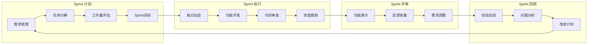

## 📋 文件摘要

本文档是AI Prompts by Stark知识库的工作流程分类导航中心，按软件开发生命周期的6个核心阶段组织资源。每个阶段都包含具体的模板链接、任务描述、使用场景和推荐路径，帮助开发者根据项目进度快速找到所需资源。

## 📑 目录索引

- [📋 文件摘要](#-文件摘要)
- [🚀 项目启动阶段](#-项目启动阶段)
  - [项目可行性分析](#项目可行性分析)
  - [技术栈选型](#技术栈选型)
  - [开发环境搭建](#开发环境搭建)
  - [团队组建分工](#团队组建分工)
  - [项目规划制定](#项目规划制定)
- [📋 需求分析阶段](#-需求分析阶段)
  - [需求收集整理](#需求收集整理)
  - [用户故事编写](#用户故事编写)
  - [业务流程分析](#业务流程分析)
  - [原型设计](#原型设计)
  - [需求评审确认](#需求评审确认)
- [🏗️ 架构设计阶段](#️-架构设计阶段)
  - [系统架构设计](#系统架构设计)
  - [技术选型决策](#技术选型决策)
  - [数据库设计](#数据库设计)
  - [接口设计](#接口设计)
  - [安全架构设计](#安全架构设计)
- [💻 开发实现阶段](#-开发实现阶段)
  - [开发环境配置](#开发环境配置)
  - [代码规范制定](#代码规范制定)
  - [功能模块开发](#功能模块开发)
  - [代码审查流程](#代码审查流程)
  - [版本控制管理](#版本控制管理)
- [🧪 测试验证阶段](#-测试验证阶段)
  - [测试策略制定](#测试策略制定)
  - [测试用例设计](#测试用例设计)
  - [测试执行报告](#测试执行报告)
  - [缺陷管理](#缺陷管理)
  - [质量评估](#质量评估)
- [🚀 部署上线阶段](#-部署上线阶段)
  - [部署环境配置](#部署环境配置)
  - [部署脚本编写](#部署脚本编写)
  - [发布流程管理](#发布流程管理)
  - [监控告警配置](#监控告警配置)
  - [运维文档编写](#运维文档编写)
- [💡 使用建议](#-使用建议)

---

---

## 🚀 项目启动阶段

### 项目可行性分析
- **任务**：评估项目技术可行性和商业价值
- **推荐模板**：
  - [项目初始化检查清单](../../06-best-practices/task-planning/task-planning-methodology-guide-development-20250829.md)
  - [技术选型决策框架](01-project-initiation/README.md#技术选型决策)
- **使用场景**：项目启动前的可行性评估
- **快速入口**：[进入项目启动](01-project-initiation/)

### 技术栈选型
- **任务**：选择合适的技术栈和架构方案
- **推荐模板**：
  - [通用架构分析](../../03-analysis-prompts/code-architecture/general-architecture-analysis-prompt-developer-ai-20250829.md)
  - [后端架构分析](../../03-analysis-prompts/code-architecture/backend-architecture-analysis-prompt-developer-ai-20250829.md)
  - [前端架构分析](../../03-analysis-prompts/code-architecture/frontend-architecture-analysis-prompt-developer-ai-20250829.md)
- **使用场景**：技术决策和架构设计
- **快速入口**：[查看技术选型](01-project-initiation/README.md#技术选型决策)

### 开发环境搭建
- **任务**：配置开发环境和工具链
- **推荐模板**：
  - [开发环境配置](01-project-initiation/README.md#开发环境搭建)
  - [开发工具配置](01-project-initiation/README.md#开发工具配置)
- **使用场景**：团队开发环境标准化
- **快速入口**：[查看环境配置](01-project-initiation/README.md#开发环境搭建)

### 团队组建分工
- **任务**：组建开发团队和明确分工
- **推荐模板**：
  - [团队协作规范](01-project-initiation/README.md#团队协作规范)
  - [项目角色分工](01-project-initiation/README.md#项目角色分工)
- **使用场景**：团队建设和协作管理
- **快速入口**：[查看团队管理](01-project-initiation/README.md#团队协作规范)

### 项目规划制定
- **任务**：制定项目计划和时间表
- **推荐模板**：
  - [任务规划方法论](../../06-best-practices/task-planning/task-planning-methodology-guide-development-20250829.md)
  - [OODA决策框架](../../01-core-framework/decision-frameworks/ooda-source-reference-decision-framework-ai-20250829.md)
- **使用场景**：项目管理和进度规划
- **快速入口**：[查看项目规划](01-project-initiation/README.md#项目规划制定)

---

## 📋 需求分析阶段

### 需求收集整理
- **任务**：收集和整理用户需求
- **推荐模板**：
  - [需求分解模板](../../02-development-patterns/task-breakdown/requirement-breakdown-prompt-ai-analysis-20250829.md)
  - [需求收集指南](02-requirements-analysis/README.md#需求收集整理)
- **使用场景**：用户需求收集和分析
- **快速入口**：[进入需求分析](02-requirements-analysis/)

### 用户故事编写
- **任务**：编写高质量的用户故事
- **推荐模板**：
  - [用户故事模板](02-requirements-analysis/README.md#用户故事编写)
  - [需求优先级排序](02-requirements-analysis/README.md#需求优先级排序)
- **使用场景**：敏捷开发和需求管理
- **快速入口**：[查看用户故事](02-requirements-analysis/README.md#用户故事编写)

### 业务流程分析
- **任务**：分析业务流程和数据流
- **推荐模板**：
  - [业务流分析](../../03-analysis-prompts/business-analysis/business-flow-analysis-prompt-business-analyst-ai-20250829.md)
  - [数据流分析](../../02-development-patterns/task-breakdown/dataflow-analysis-prompt-ai-architecture-20250829.md)
- **使用场景**：业务逻辑分析和流程设计
- **快速入口**：[查看业务分析](02-requirements-analysis/README.md#业务流程分析)

### 原型设计
- **任务**：设计系统原型和界面
- **推荐模板**：
  - [原型设计指南](02-requirements-analysis/README.md#原型设计)
  - [界面设计规范](02-requirements-analysis/README.md#界面设计规范)
- **使用场景**：用户界面设计和交互设计
- **快速入口**：[查看原型设计](02-requirements-analysis/README.md#原型设计)

### 需求评审确认
- **任务**：评审和确认需求文档
- **推荐模板**：
  - [需求评审清单](02-requirements-analysis/README.md#需求评审确认)
  - [需求确认流程](02-requirements-analysis/README.md#需求确认流程)
- **使用场景**：需求质量保证和确认
- **快速入口**：[查看需求评审](02-requirements-analysis/README.md#需求评审确认)

---

## 🏗️ 架构设计阶段

### 系统架构设计
- **任务**：设计整体系统架构
- **推荐模板**：
  - [通用架构分析](../../03-analysis-prompts/code-architecture/general-architecture-analysis-prompt-developer-ai-20250829.md)
  - [软件设计原则](../../06-best-practices/design-principles/software-design-principles-guide-design-pattern-20250829.md)
- **使用场景**：系统架构设计和技术选型
- **快速入口**：[进入架构设计](03-architecture-design/)

### 技术选型决策
- **任务**：制定技术选型决策
- **推荐模板**：
  - [技术选型框架](03-architecture-design/README.md#技术选型决策)
  - [技术评估矩阵](03-architecture-design/README.md#技术评估矩阵)
- **使用场景**：技术方案评估和选择
- **快速入口**：[查看技术选型](03-architecture-design/README.md#技术选型决策)

### 数据库设计
- **任务**：设计数据库结构和数据模型
- **推荐模板**：
  - [数据库设计模式](03-architecture-design/README.md#数据库设计)
  - [数据建模指南](03-architecture-design/README.md#数据建模指南)
- **使用场景**：数据库架构和数据设计
- **快速入口**：[查看数据库设计](03-architecture-design/README.md#数据库设计)

### 接口设计
- **任务**：设计系统接口和通信协议
- **推荐模板**：
  - [领域依赖分析](../../03-analysis-prompts/field-dependency/field-dependency-analysis-prompt-consultant-ai-20250829.md)
  - [接口设计规范](03-architecture-design/README.md#接口设计)
- **使用场景**：API设计和接口规范
- **快速入口**：[查看接口设计](03-architecture-design/README.md#接口设计)

### 安全架构设计
- **任务**：设计系统安全架构
- **推荐模板**：
  - [安全架构设计](03-architecture-design/README.md#安全架构设计)
  - [安全策略制定](03-architecture-design/README.md#安全策略制定)
- **使用场景**：系统安全设计和防护
- **快速入口**：[查看安全设计](03-architecture-design/README.md#安全架构设计)

---

## 💻 开发实现阶段

### 开发环境配置
- **任务**：配置开发和构建环境
- **推荐模板**：
  - [开发环境配置](04-development/README.md#开发环境配置)
  - [构建工具配置](04-development/README.md#构建工具配置)
- **使用场景**：开发环境标准化
- **快速入口**：[进入开发实现](04-development/)

### 代码规范制定
- **任务**：制定代码规范和标准
- **推荐模板**：
  - [代码规范指南](04-development/README.md#代码规范制定)
  - [代码质量标准](04-development/README.md#代码质量标准)
- **使用场景**：代码质量和规范管理
- **快速入口**：[查看代码规范](04-development/README.md#代码规范制定)

### 功能模块开发
- **任务**：开发系统功能模块
- **推荐模板**：
  - [代码生成代理](../../01-core-framework/multi-agent-system/agents-code-agent-prompt-ai-development-20250829.md)
  - [组件开发模板](../../07-tools-templates/code-templates/button-component-template-react-typescript-20250829.md)
- **使用场景**：功能开发和组件实现
- **快速入口**：[查看功能开发](04-development/README.md#功能模块开发)

### 代码审查流程
- **任务**：建立代码审查流程
- **推荐模板**：
  - [代码审查代理](../../01-core-framework/multi-agent-system/agents-review-agent-prompt-ai-review-20250829.md)
  - [代码审查清单](04-development/README.md#代码审查流程)
- **使用场景**：代码质量保证和审查
- **快速入口**：[查看代码审查](04-development/README.md#代码审查流程)

### 版本控制管理
- **任务**：管理代码版本和分支
- **推荐模板**：
  - [版本控制策略](04-development/README.md#版本控制管理)
  - [分支管理规范](04-development/README.md#分支管理规范)
- **使用场景**：代码版本控制和协作
- **快速入口**：[查看版本控制](04-development/README.md#版本控制管理)

---

## 🧪 测试验证阶段

### 测试策略制定
- **任务**：制定测试策略和计划
- **推荐模板**：
  - [测试场景生成](../../04-testing-prompts/test-generation/test-scenario-generation-prompt-ai-testing-20250829.md)
  - [测试策略框架](05-testing/README.md#测试策略制定)
- **使用场景**：测试策略制定和规划
- **快速入口**：[进入测试验证](05-testing/)

### 测试用例设计
- **任务**：设计和编写测试用例
- **推荐模板**：
  - [测试代码生成](../../04-testing-prompts/test-generation/test-code-generation-prompt-ai-testing-20250829.md)
  - [测试用例模板](05-testing/README.md#测试用例设计)
- **使用场景**：测试用例设计和编写
- **快速入口**：[查看测试用例](05-testing/README.md#测试用例设计)

### 测试执行报告
- **任务**：执行测试并生成报告
- **推荐模板**：
  - [测试执行模板](05-testing/README.md#测试执行报告)
  - [测试报告生成](05-testing/README.md#测试报告生成)
- **使用场景**：测试执行和结果报告
- **快速入口**：[查看测试执行](05-testing/README.md#测试执行报告)

### 缺陷管理
- **任务**：管理和跟踪缺陷
- **推荐模板**：
  - [缺陷管理流程](05-testing/README.md#缺陷管理)
  - [缺陷跟踪模板](05-testing/README.md#缺陷跟踪模板)
- **使用场景**：缺陷跟踪和管理
- **快速入口**：[查看缺陷管理](05-testing/README.md#缺陷管理)

### 质量评估
- **任务**：评估软件质量和发布准备
- **推荐模板**：
  - [质量评估框架](05-testing/README.md#质量评估)
  - [发布质量标准](05-testing/README.md#发布质量标准)
- **使用场景**：质量评估和发布决策
- **快速入口**：[查看质量评估](05-testing/README.md#质量评估)

---

## 🚀 部署上线阶段

### 部署环境配置
- **任务**：配置部署环境和基础设施
- **推荐模板**：
  - [部署环境配置](06-deployment/README.md#部署环境配置)
  - [环境配置管理](06-deployment/README.md#环境配置管理)
- **使用场景**：生产环境配置和管理
- **快速入口**：[进入部署上线](06-deployment/)

### 部署脚本编写
- **任务**：编写自动化部署脚本
- **推荐模板**：
  - [部署脚本模板](06-deployment/README.md#部署脚本编写)
  - [自动化部署](06-deployment/README.md#自动化部署)
- **使用场景**：自动化部署和脚本管理
- **快速入口**：[查看部署脚本](06-deployment/README.md#部署脚本编写)

### 发布流程管理
- **任务**：管理发布流程和版本控制
- **推荐模板**：
  - [发布流程管理](06-deployment/README.md#发布流程管理)
  - [版本发布策略](06-deployment/README.md#版本发布策略)
- **使用场景**：发布流程和版本管理
- **快速入口**：[查看发布流程](06-deployment/README.md#发布流程管理)

### 监控告警配置
- **任务**：配置监控和告警系统
- **推荐模板**：
  - [监控配置模板](06-deployment/README.md#监控告警配置)
  - [告警策略制定](06-deployment/README.md#告警策略制定)
- **使用场景**：系统监控和告警管理
- **快速入口**：[查看监控配置](06-deployment/README.md#监控告警配置)

### 运维文档编写
- **任务**：编写运维和技术文档
- **推荐模板**：
  - [运维文档模板](06-deployment/README.md#运维文档编写)
  - [技术文档生成](../../01-core-framework/multi-agent-system/agents-doc-agent-prompt-ai-documentation-20250829.md)
- **使用场景**：运维文档和技术文档编写
- **快速入口**：[查看运维文档](06-deployment/README.md#运维文档编写)

---

## 🔄 工作流程图

### 🔄 完整开发流程

```mermaid
graph TB
    subgraph "项目启动"
        A1[项目章程]
        A2[技术选型]
        A3[团队组建]
        A4[项目计划]
    end
    
    subgraph "需求分析"
        B1[需求收集]
        B2[用户故事]
        B3[业务流程]
        B4[原型设计]
        B5[需求确认]
    end
    
    subgraph "架构设计"
        C1[系统架构]
        C2[技术方案]
        C3[数据库设计]
        C4[接口设计]
        C5[架构评审]
    end
    
    subgraph "开发实现"
        D1[环境搭建]
        D2[代码开发]
        D3[代码审查]
        D4[单元测试]
        D5[集成测试]
    end
    
    subgraph "测试验证"
        E1[系统测试]
        E2[性能测试]
        E3[安全测试]
        E4[用户验收]
        E5[质量评估]
    end
    
    subgraph "部署上线"
        F1[环境配置]
        F2[部署脚本]
        F3[发布执行]
        F4[监控配置]
        F5[运维交接]
    end
    
    A1 --> A2 --> A3 --> A4 --> B1
    B1 --> B2 --> B3 --> B4 --> B5 --> C1
    C1 --> C2 --> C3 --> C4 --> C5 --> D1
    D1 --> D2 --> D3 --> D4 --> D5 --> E1
    E1 --> E2 --> E3 --> E4 --> E5 --> F1
    F1 --> F2 --> F3 --> F4 --> F5
```

### 📋 敏捷开发流程

---

## 📊 阶段资源统计

### 📈 各阶段资源分布

| 阶段 | 模板数量 | 指南数量 | 工具数量 | 总计 |
|------|----------|----------|----------|------|
| **项目启动** | 8 | 5 | 3 | 16 |
| **需求分析** | 12 | 8 | 4 | 24 |
| **架构设计** | 15 | 10 | 6 | 31 |
| **开发实现** | 20 | 12 | 8 | 40 |
| **测试验证** | 18 | 10 | 7 | 35 |
| **部署上线** | 10 | 8 | 5 | 23 |

### 🔥 热门资源推荐

#### 项目启动阶段
1. **技术选型决策框架** - 帮助团队做出明智的技术选择
2. **项目初始化检查清单** - 确保项目启动不遗漏重要环节
3. **团队协作规范** - 建立高效的团队协作流程

#### 需求分析阶段
1. **需求分解模板** - 系统化地分解复杂需求
2. **用户故事编写指南** - 编写高质量的用户故事
3. **业务流程分析方法** - 深入理解业务流程

#### 架构设计阶段
1. **系统架构分析模板** - 全面分析系统架构需求
2. **技术选型评估框架** - 科学评估技术方案
3. **数据库设计最佳实践** - 设计高效的数据库结构

#### 开发实现阶段
1. **代码生成代理** - AI辅助代码开发
2. **组件开发模板** - 高质量的组件开发模板
3. **代码审查清单** - 确保代码质量

#### 测试验证阶段
1. **测试代码生成** - 自动生成测试代码
2. **测试场景设计** - 设计全面的测试场景
3. **质量评估框架** - 评估软件质量

#### 部署上线阶段
1. **CI/CD配置模板** - 自动化部署流水线
2. **容器化部署指南** - Docker和Kubernetes部署
3. **监控配置方案** - 完整的监控告警配置

---

---

## 💡 使用建议

### 🎯 按项目类型选择路径

#### 新项目开发
**推荐路径**：项目启动 → 需求分析 → 架构设计 → 开发实现 → 测试验证 → 部署上线
**适用场景**：全新的软件项目开发
**时间安排**：根据项目规模，2-12个月
**关键模板组合**：
- [项目初始化检查清单](../../06-best-practices/task-planning/task-planning-methodology-guide-development-20250829.md)
- [需求分解模板](../../02-development-patterns/task-breakdown/requirement-breakdown-prompt-ai-analysis-20250829.md)
- [通用架构分析](../../03-analysis-prompts/code-architecture/general-architecture-analysis-prompt-developer-ai-20250829.md)
- [代码生成代理](../../01-core-framework/multi-agent-system/agents-code-agent-prompt-ai-development-20250829.md)
- [测试代码生成](../../04-testing-prompts/test-generation/test-code-generation-prompt-ai-testing-20250829.md)

#### 功能迭代开发
**推荐路径**：需求分析 → 开发实现 → 测试验证 → 部署上线
**适用场景**：现有项目的新功能开发
**时间安排**：1-4周
**关键模板组合**：
- [需求分解模板](../../02-development-patterns/task-breakdown/requirement-breakdown-prompt-ai-analysis-20250829.md)
- [组件开发模板](../../07-tools-templates/code-templates/button-component-template-react-typescript-20250829.md)
- [测试代码生成](../../04-testing-prompts/test-generation/test-code-generation-prompt-ai-testing-20250829.md)
- [部署脚本模板](06-deployment/README.md#部署脚本编写)

#### 问题排查与优化
**推荐路径**：根据具体问题选择相应阶段
**适用场景**：性能优化、缺陷修复、架构调整
**时间安排**：1-2周
**关键模板组合**：
- [调试代理模板](../../01-core-framework/multi-agent-system/agents-debug-agent-prompt-ai-debugging-20250829.md)
- [代码审查代理](../../01-core-framework/multi-agent-system/agents-review-agent-prompt-ai-review-20250829.md)
- [遗留代码理解](../../04-testing-prompts/legacy-code/legacy-code-understanding-prompt-ai-testing-20250829.md)

### 🔗 敏捷开发流程

#### Sprint计划阶段
**任务**：需求梳理 → 任务分解 → 工作量评估 → Sprint目标
**推荐模板**：
- [需求分解模板](../../02-development-patterns/task-breakdown/requirement-breakdown-prompt-ai-analysis-20250829.md)
- [开发任务分解](../../02-development-patterns/task-breakdown/development-breakdown-prompt-ai-development-20250829.md)
- [任务规划方法论](../../06-best-practices/task-planning/task-planning-methodology-guide-development-20250829.md)

#### Sprint执行阶段
**任务**：功能开发 → 代码审查 → 单元测试 → 集成测试
**推荐模板**：
- [代码生成代理](../../01-core-framework/multi-agent-system/agents-code-agent-prompt-ai-development-20250829.md)
- [代码审查代理](../../01-core-framework/multi-agent-system/agents-review-agent-prompt-ai-review-20250829.md)
- [测试代码生成](../../04-testing-prompts/test-generation/test-code-generation-prompt-ai-testing-20250829.md)

#### Sprint评审阶段
**任务**：功能演示 → 反馈收集 → 需求调整
**推荐模板**：
- [测试场景生成](../../04-testing-prompts/test-generation/test-scenario-generation-prompt-ai-testing-20250829.md)
- [用户故事模板](02-requirements-analysis/README.md#用户故事编写)

### 📋 最佳实践建议

#### 阶段过渡检查清单
- ✅ **项目启动**：项目章程完成、技术栈确定、团队组建完成
- ✅ **需求分析**：需求文档齐全、用户故事完成、原型设计确认
- ✅ **架构设计**：架构文档完成、技术方案确定、接口设计完成
- ✅ **开发实现**：功能模块完成、代码审查通过、单元测试通过
- ✅ **测试验证**：测试用例完成、缺陷修复完成、质量评估达标
- ✅ **部署上线**：部署环境就绪、部署脚本完成、监控配置完成

#### 资源利用策略
1. **模板优先**：优先使用各阶段的标准化模板
2. **工具辅助**：善用AI代理和自动化工具
3. **最佳实践**：参考设计原则和开发规范
4. **持续改进**：根据项目特点优化流程

### 📈 效率提升技巧

#### 日常使用建议
1. **建立工作流**：为常用场景建立标准化的工作流程
2. **模板收藏**：将常用模板添加到浏览器书签
3. **团队共享**：与团队成员共享工作流程和模板
4. **定期回顾**：定期评估流程效果并优化

#### 团队协作建议
1. **统一标准**：团队使用相同的工作流程和模板
2. **角色分工**：明确各角色在不同阶段的职责
3. **进度跟踪**：使用看板或项目管理工具跟踪进度
4. **质量保证**：建立代码审查和测试规范

### 🎯 快速查找方法

#### 按问题类型查找
- **技术选型问题**：查看项目启动阶段的技术栈选型
- **需求分析问题**：查看需求分析阶段的相关模板
- **架构设计问题**：查看架构设计阶段的系统设计
- **开发实现问题**：查看开发实现阶段的编码规范
- **测试验证问题**：查看测试验证阶段的测试策略
- **部署运维问题**：查看部署上线阶段的运维配置

#### 按角色查找
- **项目经理**：重点关注项目启动和需求分析阶段
- **架构师**：重点关注架构设计和技术选型阶段
- **开发者**：重点关注开发实现和测试验证阶段
- **测试工程师**：重点关注测试验证和质量评估阶段
- **运维工程师**：重点关注部署上线和监控运维阶段

---

*这个工作流程分类系统为软件开发的每个阶段都提供了详细的模板和指导。根据您的项目类型和当前阶段选择合适的资源，开始高效的开发之旅！* 🚀